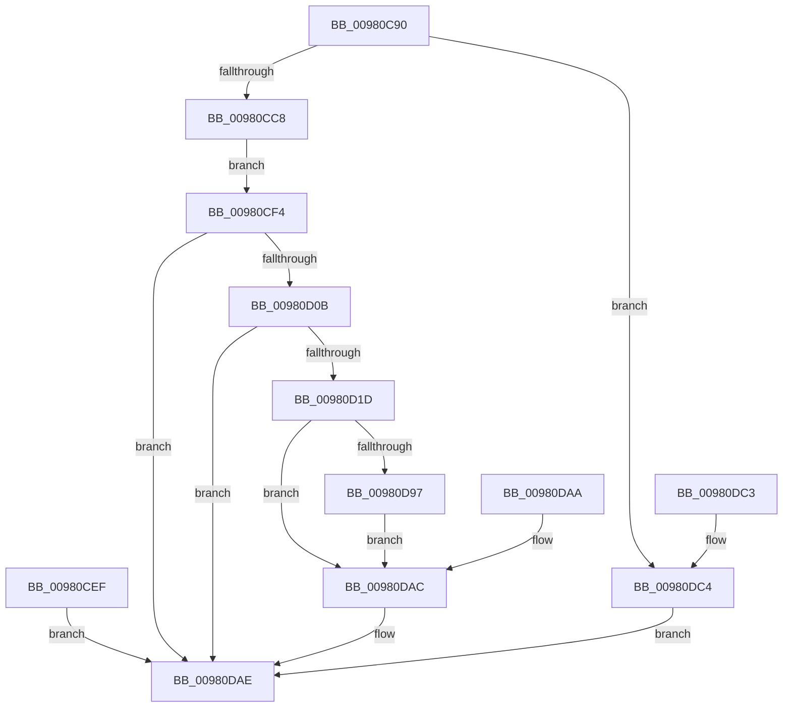

# NtInitializeNlsFiles

- RVA: `0x00980C90`–`0x00980DCB` (길이 `315` bytes)
- VA: `0x0000000140980C90`
- 실행 섹션: `PAGE`
- PDB 이름 있음: `예`; PDB Function 태그: `아니요`
- unwind 정보 RVA: `0x00097748`
- 디코드: `72`개 명령, `315/315` bytes 표시
- 미해석 바이트: `0` (있으면 어셈블리에 `.byte`로 보존)

> 이 문서는 커널 이미지의 기계어와 PDB 기호를 분석해 생성했습니다. 4번과 5번은 함수 원형과 자료형을 바이너리 사용 방식에서 추정한 C 해석이며 원본 소스 복구 결과는 아닙니다.

## 1. Dependencies

- 직접 호출 지점: **4**; 고유 호출 대상: **4**
- 직접 호출자로 확인된 함수: **0**
- RIP 상대 이미지 참조: **0**

### Outgoing calls
- `0x00980CFE` → [ZwQueryDefaultLocale](../../text/6A/ZwQueryDefaultLocale_function_006AD370.md) (function, `0x006AD370`)
- `0x00980D10` → [ExpGetGlobalLocaleSection](ExpGetGlobalLocaleSection_function_00980DD4.md) (function, `0x00980DD4`)
- `0x00980D82` → [MmMapViewOfSection](MmMapViewOfSection_function_00981680.md) (function, `0x00981680`)
- `0x00980D8E` → [ObfDereferenceObject](../../text/2F/ObfDereferenceObject_function_002F9350.md) (function, `0x002F9350`)

### Direct callers
- 이 함수 시작 RVA로 연결되는 직접 call은 확인되지 않았습니다. 간접 호출은 완전히 역산할 수 없습니다.

### Static image references
- 디코드된 RIP-relative 메모리 참조가 없습니다.

## 2. Other-region calls and transfers

- 다른 실행 섹션으로 향하는 call: **2**
  - `0x00980CFE` → [ZwQueryDefaultLocale](../../text/6A/ZwQueryDefaultLocale_function_006AD370.md) (`PAGE` → `.text`)
  - `0x00980D8E` → [ObfDereferenceObject](../../text/2F/ObfDereferenceObject_function_002F9350.md) (`PAGE` → `.text`)
- 별도 외부 분기/꼬리 이동을 확인하지 못했습니다.

## 3. Assembly (complete function range)

```asm
00980C90  48 8B C4                        mov rax, rsp
00980C93  48 89 58 08                     mov qword ptr [rax + 8], rbx
00980C97  48 89 70 10                     mov qword ptr [rax + 0x10], rsi
00980C9B  57                              push rdi
00980C9C  48 81 EC 80 00 00 00            sub rsp, 0x80
00980CA3  48 8B FA                        mov rdi, rdx
00980CA6  48 8B F1                        mov rsi, rcx
00980CA9  83 60 20 00                     and dword ptr [rax + 0x20], 0
00980CAD  48 83 60 D0 00                  and qword ptr [rax - 0x30], 0
00980CB2  65 48 8B 04 25 88 01 00 00      mov rax, qword ptr gs:[0x188]
00980CBB  80 B8 32 02 00 00 00            cmp byte ptr [rax + 0x232], 0
00980CC2  0F 84 FC 00 00 00               je 0x140980dc4
00980CC8  48 BA 00 00 FF FF FF 7F 00 00   movabs rdx, 0x7fffffff0000
00980CD2  48 8B CA                        mov rcx, rdx
00980CD5  48 3B F2                        cmp rsi, rdx
00980CD8  48 0F 42 CE                     cmovb rcx, rsi
00980CDC  48 8B 01                        mov rax, qword ptr [rcx]
00980CDF  48 89 01                        mov qword ptr [rcx], rax
00980CE2  48 3B FA                        cmp rdi, rdx
00980CE5  48 0F 42 D7                     cmovb rdx, rdi
00980CE9  8B 02                           mov eax, dword ptr [rdx]
00980CEB  89 02                           mov dword ptr [rdx], eax
00980CED  EB 05                           jmp 0x140980cf4
00980CEF  E9 BA 00 00 00                  jmp 0x140980dae
00980CF4  48 8D 94 24 A8 00 00 00         lea rdx, [rsp + 0xa8]
00980CFC  33 C9                           xor ecx, ecx
00980CFE  E8 6D C6 D2 FF                  call 0x1406ad370
00980D03  85 C0                           test eax, eax
00980D05  0F 88 A3 00 00 00               js 0x140980dae
00980D0B  48 8D 4C 24 58                  lea rcx, [rsp + 0x58]
00980D10  E8 BF 00 00 00                  call 0x140980dd4
00980D15  85 C0                           test eax, eax
00980D17  0F 88 91 00 00 00               js 0x140980dae
00980D1D  48 83 64 24 68 00               and qword ptr [rsp + 0x68], 0
00980D23  83 64 24 60 00                  and dword ptr [rsp + 0x60], 0
00980D28  83 64 24 64 00                  and dword ptr [rsp + 0x64], 0
00980D2D  48 83 64 24 70 00               and qword ptr [rsp + 0x70], 0
00980D33  65 48 8B 04 25 88 01 00 00      mov rax, qword ptr gs:[0x188]
00980D3C  48 8B 90 B8 00 00 00            mov rdx, qword ptr [rax + 0xb8]
00980D43  C7 44 24 48 02 00 00 00         mov dword ptr [rsp + 0x48], 2
00980D4B  C7 44 24 40 00 00 40 00         mov dword ptr [rsp + 0x40], 0x400000
00980D53  C7 44 24 38 01 00 00 00         mov dword ptr [rsp + 0x38], 1
00980D5B  48 8D 44 24 70                  lea rax, [rsp + 0x70]
00980D60  48 89 44 24 30                  mov qword ptr [rsp + 0x30], rax
00980D65  48 8D 44 24 60                  lea rax, [rsp + 0x60]
00980D6A  48 89 44 24 28                  mov qword ptr [rsp + 0x28], rax
00980D6F  48 83 64 24 20 00               and qword ptr [rsp + 0x20], 0
00980D75  45 33 C9                        xor r9d, r9d
00980D78  4C 8D 44 24 68                  lea r8, [rsp + 0x68]
00980D7D  48 8B 4C 24 58                  mov rcx, qword ptr [rsp + 0x58]
00980D82  E8 F9 08 00 00                  call 0x140981680
00980D87  8B D8                           mov ebx, eax
00980D89  48 8B 4C 24 58                  mov rcx, qword ptr [rsp + 0x58]
00980D8E  E8 BD 85 97 FF                  call 0x1402f9350
00980D93  85 DB                           test ebx, ebx
00980D95  78 15                           js 0x140980dac
00980D97  48 8B 4C 24 68                  mov rcx, qword ptr [rsp + 0x68]
00980D9C  48 89 0E                        mov qword ptr [rsi], rcx
00980D9F  8B 8C 24 A8 00 00 00            mov ecx, dword ptr [rsp + 0xa8]
00980DA6  89 0F                           mov dword ptr [rdi], ecx
00980DA8  EB 02                           jmp 0x140980dac
00980DAA  8B D8                           mov ebx, eax
00980DAC  8B C3                           mov eax, ebx
00980DAE  4C 8D 9C 24 80 00 00 00         lea r11, [rsp + 0x80]
00980DB6  49 8B 5B 10                     mov rbx, qword ptr [r11 + 0x10]
00980DBA  49 8B 73 18                     mov rsi, qword ptr [r11 + 0x18]
00980DBE  49 8B E3                        mov rsp, r11
00980DC1  5F                              pop rdi
00980DC2  C3                              ret
00980DC3  CC                              int3
00980DC4  B8 BB 00 00 C0                  mov eax, 0xc00000bb
00980DC9  EB E3                           jmp 0x140980dae
```

## 4. C-style interpretation (structured pseudocode)

```c
__int64 __fastcall NtInitializeNlsFiles(__int64 a1, __int64 a2, __int64 a3, int a4)
{
    __int64 result;
    __int64 v_rsp;
    unsigned __int64 v_stack_m18;
    unsigned __int64 v_stack_m20;
    unsigned int v_stack_m24;
    unsigned int v_stack_m28;
    unsigned __int64 v_stack_m30;
    unsigned int v_stack_m40;
    unsigned int v_stack_m48;
    unsigned int v_stack_m50;
    unsigned __int64 v_stack_m58;
    unsigned __int64 v_stack_m60;
    unsigned __int64 v_stack_m68;
    unsigned __int64 v_stack_m8;
    unsigned __int64 v_stack_p20;

    *(unsigned __int64 *)(v_rsp + 8) = v_rbx;
    *(unsigned __int64 *)(v_rsp + 16) = v_rsi;
    v_rsp = (v_rsp) - (128);
    if ((*(unsigned __int8 *)(*(unsigned __int64 *)(gs_base + (0 + 392)) + 562)) == 0) goto loc_00980DC4;
    if (a1 < a2) { a2 = a1; }
    *(unsigned __int64 *)(a2) = *(unsigned __int64 *)(a2);
    if (a2 < a2) { a2 = a2; }
    *(unsigned int *)(a2) = (unsigned int)((unsigned int)(*(unsigned int *)(a2)));
    goto loc_00980CF4;
loc_00980CF4:
    a1 = 0;
    result = ZwQueryDefaultLocale(a1, v_stack_p20, a3, a4);
    if (sign_flag) goto loc_00980DAE;
    result = ExpGetGlobalLocaleSection(v_stack_m30, v_stack_p20, a3, a4);
    if (sign_flag) goto loc_00980DAE;
    v_stack_m40 = 2;
    v_stack_m48 = 0x400000ULL;
    v_stack_m50 = 1;
    v_stack_m58 = v_stack_m18;
    v_stack_m60 = v_stack_m28;
    a4 = 0;
    result = MmMapViewOfSection(v_stack_m30, *(unsigned __int64 *)(*(unsigned __int64 *)(gs_base + (0 + 392)) + 184), v_stack_m20, a4);
    result = ObfDereferenceObject(v_stack_m30, *(unsigned __int64 *)(*(unsigned __int64 *)(gs_base + (0 + 392)) + 184), v_stack_m20, a4);
    if (sign_flag) goto loc_00980DAC;
    *(unsigned __int64 *)(a1) = v_stack_m20;
    *(unsigned int *)(a2) = (unsigned int)((unsigned int)(v_stack_p20));
    goto loc_00980DAC;
loc_00980DAC:
loc_00980DAE:
    return (unsigned int)((unsigned int)((unsigned int)((unsigned int)(result))));
loc_00980DC4:
    goto loc_00980DAE;
}
```

## 5. (Beta) C Style

```c
int64_t NtInitializeNlsFiles(int64_t Arg1, int64_t Arg2, int64_t Arg3, int32_t Arg4)
{
    int64_t result;
    int64_t local_rsp;
    uint64_t v_stack_m18;
    uint64_t v_stack_m20;
    uint32_t v_stack_m24;
    uint32_t v_stack_m28;
    uint64_t v_stack_m30;
    uint32_t v_stack_m40;
    uint32_t v_stack_m48;
    uint32_t v_stack_m50;
    uint64_t v_stack_m58;
    uint64_t v_stack_m60;
    uint64_t v_stack_m68;
    uint64_t v_stack_m8;
    uint64_t v_stack_p20;

    *(uint64_t *)(local_rsp + 0x8) = local_rbx;
    *(uint64_t *)(local_rsp + 0x10) = local_rsi;
    local_rsp = (local_rsp) - (128);
    if ((*(uint8_t *)(*(uint64_t *)(gs_base + (0 + 0x188)) + 0x232)) == 0) goto loc_00980DC4;
    if (Arg1 < Arg2) { Arg2 = Arg1; }
    *(uint64_t *)(Arg2) = *(uint64_t *)(Arg2);
    if (Arg2 < Arg2) { Arg2 = Arg2; }
    *(uint32_t *)(Arg2) = (uint32_t)((uint32_t)(*(uint32_t *)(Arg2)));
    goto loc_00980CF4;
loc_00980CF4:
    Arg1 = 0;
    result = ZwQueryDefaultLocale(Arg1, v_stack_p20, Arg3, Arg4);
    if (sign_flag) goto loc_00980DAE;
    result = ExpGetGlobalLocaleSection(v_stack_m30, v_stack_p20, Arg3, Arg4);
    if (sign_flag) goto loc_00980DAE;
    v_stack_m40 = 2;
    v_stack_m48 = 0x400000ULL;
    v_stack_m50 = 1;
    v_stack_m58 = v_stack_m18;
    v_stack_m60 = v_stack_m28;
    Arg4 = 0;
    result = MmMapViewOfSection(v_stack_m30, *(uint64_t *)(*(uint64_t *)(gs_base + (0 + 0x188)) + 0xB8), v_stack_m20, Arg4);
    result = ObfDereferenceObject(v_stack_m30, *(uint64_t *)(*(uint64_t *)(gs_base + (0 + 0x188)) + 0xB8), v_stack_m20, Arg4);
    if (sign_flag) goto loc_00980DAC;
    *(uint64_t *)(Arg1) = v_stack_m20;
    *(uint32_t *)(Arg2) = (uint32_t)((uint32_t)(v_stack_p20));
    goto loc_00980DAC;
loc_00980DAC:
loc_00980DAE:
    return (uint32_t)((uint32_t)((uint32_t)((uint32_t)(result))));
loc_00980DC4:
    goto loc_00980DAE;
}
```

## 6. Execution-region graph

[열기: 2D/3D 그래프와 함수 탐색 컨트롤 패널](../../../control-panel.html?section=page&rva=0x00980C90&view=graph)

- 2D 그래프는 위에서 아래로 흐르고, 3D 그래프는 빈 공간을 드래그해 회전합니다. Shift+드래그는 이동, 휠은 확대·축소, 함수 노드 선택은 대상 보고서 이동입니다.

### Static fallback


