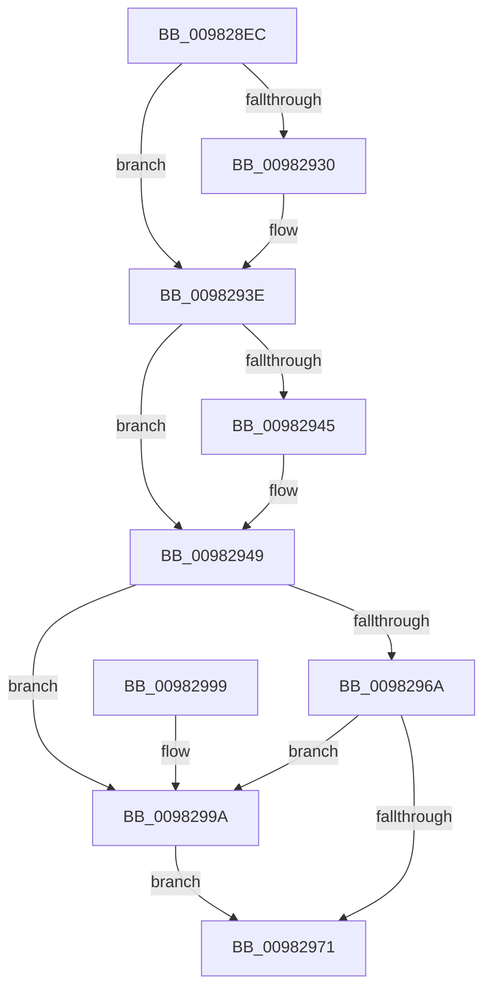

# ObCheckActiveHandles

- RVA: `0x009828EC`–`0x009829A4` (길이 `184` bytes)
- VA: `0x00000001409828EC`
- 실행 섹션: `PAGE`
- PDB 이름 있음: `예`; PDB Function 태그: `아니요`
- unwind 정보 RVA: `0x00073808`
- 디코드: `52`개 명령, `184/184` bytes 표시
- 미해석 바이트: `0` (있으면 어셈블리에 `.byte`로 보존)

> 이 문서는 커널 이미지의 기계어와 PDB 기호를 분석해 생성했습니다. 4번과 5번은 함수 원형과 자료형을 바이너리 사용 방식에서 추정한 C 해석이며 원본 소스 복구 결과는 아닙니다.

## 1. Dependencies

- 직접 호출 지점: **5**; 고유 호출 대상: **5**
- 직접 호출자로 확인된 함수: **1**
- RIP 상대 이미지 참조: **0**

### Outgoing calls
- `0x00982920` → [KeAbPreAcquire](../../text/21/KeAbPreAcquire_function_00210230.md) (function, `0x00210230`)
- `0x00982939` → [ExfAcquirePushLockExclusiveEx](../../text/20/ExfAcquirePushLockExclusiveEx_function_0020FC90.md) (function, `0x0020FC90`)
- `0x00982974` → [KeAbPostRelease](../../text/2E/KeAbPostRelease_function_002E1600.md) (function, `0x002E1600`)
- `0x00982979` → [KeLeaveCriticalRegion](../../text/25/KeLeaveCriticalRegion_function_0025D8B0.md) (function, `0x0025D8B0`)
- `0x0098299D` → [ExfReleasePushLock](../../text/26/ExfReleasePushLock_function_002638D0.md) (function, `0x002638D0`)

### Direct callers
- [MiFinishCreateSection](MiFinishCreateSection_function_009844FC.md) at `0x0098459B`

### Static image references
- 디코드된 RIP-relative 메모리 참조가 없습니다.

## 2. Other-region calls and transfers

- 다른 실행 섹션으로 향하는 call: **5**
  - `0x00982920` → [KeAbPreAcquire](../../text/21/KeAbPreAcquire_function_00210230.md) (`PAGE` → `.text`)
  - `0x00982939` → [ExfAcquirePushLockExclusiveEx](../../text/20/ExfAcquirePushLockExclusiveEx_function_0020FC90.md) (`PAGE` → `.text`)
  - `0x00982974` → [KeAbPostRelease](../../text/2E/KeAbPostRelease_function_002E1600.md) (`PAGE` → `.text`)
  - `0x00982979` → [KeLeaveCriticalRegion](../../text/25/KeLeaveCriticalRegion_function_0025D8B0.md) (`PAGE` → `.text`)
  - `0x0098299D` → [ExfReleasePushLock](../../text/26/ExfReleasePushLock_function_002638D0.md) (`PAGE` → `.text`)
- 별도 외부 분기/꼬리 이동을 확인하지 못했습니다.

## 3. Assembly (complete function range)

```asm
009828EC  48 89 5C 24 08                  mov qword ptr [rsp + 8], rbx
009828F1  48 89 6C 24 10                  mov qword ptr [rsp + 0x10], rbp
009828F6  48 89 74 24 18                  mov qword ptr [rsp + 0x18], rsi
009828FB  57                              push rdi
009828FC  48 83 EC 20                     sub rsp, 0x20
00982900  65 48 8B 04 25 88 01 00 00      mov rax, qword ptr gs:[0x188]
00982909  48 8D 59 E0                     lea rbx, [rcx - 0x20]
0098290D  48 8B F1                        mov rsi, rcx
00982910  45 33 C0                        xor r8d, r8d
00982913  33 D2                           xor edx, edx
00982915  48 8B CB                        mov rcx, rbx
00982918  66 FF 88 E4 01 00 00            dec word ptr [rax + 0x1e4]
0098291F  90                              nop
00982920  E8 0B D9 88 FF                  call 0x140210230
00982925  F0 48 0F BA 2B 00               lock bts qword ptr [rbx], 0
0098292B  48 8B F8                        mov rdi, rax
0098292E  73 0E                           jae 0x14098293e
00982930  4C 8B C3                        mov r8, rbx
00982933  48 8B D0                        mov rdx, rax
00982936  48 8B CB                        mov rcx, rbx
00982939  E8 52 D3 88 FF                  call 0x14020fc90
0098293E  33 ED                           xor ebp, ebp
00982940  48 85 FF                        test rdi, rdi
00982943  74 04                           je 0x140982949
00982945  C6 47 0A 01                     mov byte ptr [rdi + 0xa], 1
00982949  48 8B 7E D8                     mov rdi, qword ptr [rsi - 0x28]
0098294D  0F 0D 0B                        prefetchw byte ptr [rbx]
00982950  48 8B 03                        mov rax, qword ptr [rbx]
00982953  48 8B C8                        mov rcx, rax
00982956  48 83 E1 F0                     and rcx, 0xfffffffffffffff0
0098295A  48 83 F9 10                     cmp rcx, 0x10
0098295E  48 8D 50 F0                     lea rdx, [rax - 0x10]
00982962  48 0F 46 D5                     cmovbe rdx, rbp
00982966  A8 02                           test al, 2
00982968  75 30                           jne 0x14098299a
0098296A  F0 48 0F B1 13                  lock cmpxchg qword ptr [rbx], rdx
0098296F  75 29                           jne 0x14098299a
00982971  48 8B CB                        mov rcx, rbx
00982974  E8 87 EC 95 FF                  call 0x1402e1600
00982979  E8 32 AF 8D FF                  call 0x14025d8b0
0098297E  48 8B 5C 24 30                  mov rbx, qword ptr [rsp + 0x30]
00982983  48 85 FF                        test rdi, rdi
00982986  48 8B 6C 24 38                  mov rbp, qword ptr [rsp + 0x38]
0098298B  48 8B 74 24 40                  mov rsi, qword ptr [rsp + 0x40]
00982990  0F 95 C0                        setne al
00982993  48 83 C4 20                     add rsp, 0x20
00982997  5F                              pop rdi
00982998  C3                              ret
00982999  CC                              int3
0098299A  48 8B CB                        mov rcx, rbx
0098299D  E8 2E 0F 8E FF                  call 0x1402638d0
009829A2  EB CD                           jmp 0x140982971
```

## 4. C-style interpretation (structured pseudocode)

```c
__int64 __fastcall ObCheckActiveHandles(__int64 a1, int a2, int a3)
{
    __int64 result;
    __int64 v_rbp;
    __int64 v_rsp;
    unsigned __int64 v_stack_p10;
    unsigned __int64 v_stack_p18;
    unsigned __int64 v_stack_p8;

    v_stack_p8 = v_rbx;
    v_stack_p10 = v_rbp;
    v_stack_p18 = v_rsi;
    v_rsp = (v_rsp) - (32);
    a3 = 0;
    a2 = 0;
    result = KeAbPreAcquire(a1 - 32, a2, a3, a4);
    if (!(condition_is_above_or_equal)) {
        a3 = a1 - 32;
        a2 = result;
        a1 = a1 - 32;
        result = ExfAcquirePushLockExclusiveEx(a1, a2, a3, a4);
    }
    v_rbp = 0;
    if (result != 0) {
        *(unsigned __int8 *)(result + 10) = 1;
    }
    a1 = (*(unsigned __int64 *)(a1 - 32)) & (-16);
    a2 = *(unsigned __int64 *)(a1 - 32) - 16;
    if (a1 <= 16) { a2 = 0; }
    if ((((unsigned __int8)(*(unsigned __int64 *)(a1 - 32))) & (2)) != 0) goto loc_0098299A;
    if ((((unsigned __int8)(*(unsigned __int64 *)(a1 - 32))) & (2)) != 0) goto loc_0098299A;
loc_00982971:
    result = KeAbPostRelease(a1 - 32, a2, a3, a4);
    result = KeLeaveCriticalRegion(a1 - 32, a2, a3, a4);
    result = (*(unsigned __int64 *)(a1 - 40) != 0) ? 1 : 0;
    v_rsp = (v_rsp) + (32);
    return result;
loc_0098299A:
    result = ExfReleasePushLock(v_stack_p8, a2, a3, a4);
    goto loc_00982971;
}
```

## 5. (Beta) C Style

```c
int64_t ObCheckActiveHandles(void *Arg1, int32_t Arg2, int32_t Arg3)
{
    uint8_t *arg1 = (uint8_t *)Arg1;

    int64_t result;
    int64_t local_rbp;
    int64_t local_rsp;
    uint64_t v_stack_p10;
    uint64_t v_stack_p18;
    uint64_t v_stack_p8;

    v_stack_p8 = local_rbx;
    v_stack_p10 = local_rbp;
    v_stack_p18 = local_rsi;
    local_rsp = (local_rsp) - (32);
    Arg3 = 0;
    Arg2 = 0;
    result = KeAbPreAcquire(Arg1 - 32, Arg2, Arg3, a4);
    if (!(condition_is_above_or_equal)) {
        Arg3 = Arg1 - 32;
        Arg2 = result;
        Arg1 = Arg1 - 32;
        result = ExfAcquirePushLockExclusiveEx(Arg1, Arg2, Arg3, a4);
    }
    local_rbp = 0;
    if (result != 0) {
        *(uint8_t *)(result + 0xA) = 1;
    }
    Arg1 = (*(uint64_t *)(arg1 - 0x20)) & (-16);
    Arg2 = *(uint64_t *)(arg1 - 0x20) - 16;
    if (Arg1 <= 16) { Arg2 = 0; }
    if ((((uint8_t)(*(uint64_t *)(arg1 - 0x20))) & (2)) != 0) goto loc_0098299A;
    if ((((uint8_t)(*(uint64_t *)(arg1 - 0x20))) & (2)) != 0) goto loc_0098299A;
loc_00982971:
    result = KeAbPostRelease(Arg1 - 32, Arg2, Arg3, a4);
    result = KeLeaveCriticalRegion(Arg1 - 32, Arg2, Arg3, a4);
    result = (*(uint64_t *)(arg1 - 0x28) != 0) ? 1 : 0;
    local_rsp = (local_rsp) + (32);
    return result;
loc_0098299A:
    result = ExfReleasePushLock(v_stack_p8, Arg2, Arg3, a4);
    goto loc_00982971;
}
```

### 관측된 메모리 오프셋

구조체 형식이 확인되지 않은 접근은 인자 기준의 오프셋으로만 기록했습니다.

| 기준 인자 | 오프셋 표현 | 폭 (bit) | 접근 |
|---|---:|---:|---|
| `Arg1` | `- 0x28` | `64` | `R` |
| `Arg1` | `- 0x20` | `64` | `R` |
| `Arg1` | `+ 0x0` | `8` | `R` |
| `Arg1` | `+ 0x0` | `64` | `R` |
| `Arg1` | `+ 0x0` | `64` | `R/W` |

## 6. Execution-region graph

[열기: 2D/3D 그래프와 함수 탐색 컨트롤 패널](../../../control-panel.html?section=page&rva=0x009828EC&view=graph)

- 2D 그래프는 위에서 아래로 흐르고, 3D 그래프는 빈 공간을 드래그해 회전합니다. Shift+드래그는 이동, 휠은 확대·축소, 함수 노드 선택은 대상 보고서 이동입니다.

### Static fallback


