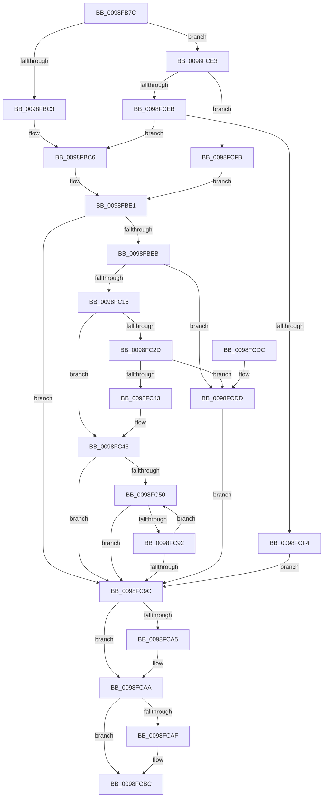

# PiDqActionDataGetAllPropertiesInBestLanguage

- RVA: `0x0098FB7C`–`0x0098FD23` (길이 `423` bytes)
- VA: `0x000000014098FB7C`
- 실행 섹션: `PAGE`
- PDB 이름 있음: `예`; PDB Function 태그: `아니요`
- unwind 정보 RVA: `0x00098B2C`
- 디코드: `123`개 명령, `423/423` bytes 표시
- 미해석 바이트: `0` (있으면 어셈블리에 `.byte`로 보존)

> 이 문서는 커널 이미지의 기계어와 PDB 기호를 분석해 생성했습니다. 4번과 5번은 함수 원형과 자료형을 바이너리 사용 방식에서 추정한 C 해석이며 원본 소스 복구 결과는 아닙니다.

## 1. Dependencies

- 직접 호출 지점: **7**; 고유 호출 대상: **7**
- 직접 호출자로 확인된 함수: **1**
- RIP 상대 이미지 참조: **1**

### Outgoing calls
- `0x0098FBDC` → [PiDqOpenUserObjectRegKey](../99/PiDqOpenUserObjectRegKey_function_00990444.md) (function, `0x00990444`)
- `0x0098FC07` → [PiDqPnPGetObjectPropertyKeys](../99/PiDqPnPGetObjectPropertyKeys_function_009917B8.md) (function, `0x009917B8`)
- `0x0098FC34` → [PiDqGrowPropertyArray](../99/PiDqGrowPropertyArray_function_00991920.md) (function, `0x00991920`)
- `0x0098FC87` → [PiDqPnPGetObjectPropertyInBestLocale](../8D/PiDqPnPGetObjectPropertyInBestLocale_function_008DEE10.md) (function, `0x008DEE10`)
- `0x0098FCA5` → [ZwClose](../../text/6A/ZwClose_function_006AD2B0.md) (function, `0x006AD2B0`)
- `0x0098FCB7` → [ExFreePoolWithTag](../../poolcode/B8/ExFreePoolWithTag_function_00B82870.md) (function, `0x00B82870`)
- `0x0098FD19` → [PnpOpenObjectRegKey](../8E/PnpOpenObjectRegKey_function_008E15E8.md) (function, `0x008E15E8`)

### Direct callers
- [PiDqActionDataCreate](../8D/PiDqActionDataCreate_function_008DE1F0.md) at `0x008DE38E`
- [PiDqActionDataCreate](../8D/PiDqActionDataCreate_function_008DE1F0.md) at `0x008DE3C2`

### Static image references
- `0x0098FCFB` → RVA `0x00E66398` (`.data`; read)

## 2. Other-region calls and transfers

- 다른 실행 섹션으로 향하는 call: **2**
  - `0x0098FCA5` → [ZwClose](../../text/6A/ZwClose_function_006AD2B0.md) (`PAGE` → `.text`)
  - `0x0098FCB7` → [ExFreePoolWithTag](../../poolcode/B8/ExFreePoolWithTag_function_00B82870.md) (`PAGE` → `POOLCODE`)
- 별도 외부 분기/꼬리 이동을 확인하지 못했습니다.

## 3. Assembly (complete function range)

```asm
0098FB7C  48 89 5C 24 08                  mov qword ptr [rsp + 8], rbx
0098FB81  48 89 74 24 18                  mov qword ptr [rsp + 0x18], rsi
0098FB86  48 89 7C 24 20                  mov qword ptr [rsp + 0x20], rdi
0098FB8B  55                              push rbp
0098FB8C  41 54                           push r12
0098FB8E  41 55                           push r13
0098FB90  41 56                           push r14
0098FB92  41 57                           push r15
0098FB94  48 8B EC                        mov rbp, rsp
0098FB97  48 83 EC 50                     sub rsp, 0x50
0098FB9B  45 33 F6                        xor r14d, r14d
0098FB9E  41 8B F0                        mov esi, r8d
0098FBA1  4D 8B E9                        mov r13, r9
0098FBA4  4C 89 75 F8                     mov qword ptr [rbp - 8], r14
0098FBA8  44 8B E2                        mov r12d, edx
0098FBAB  44 89 75 38                     mov dword ptr [rbp + 0x38], r14d
0098FBAF  41 8B FE                        mov edi, r14d
0098FBB2  4C 89 75 F0                     mov qword ptr [rbp - 0x10], r14
0098FBB6  45 8D 46 01                     lea r8d, [r14 + 1]
0098FBBA  41 3B D0                        cmp edx, r8d
0098FBBD  0F 85 20 01 00 00               jne 0x14098fce3
0098FBC3  45 8B FE                        mov r15d, r14d
0098FBC6  48 8D 45 F0                     lea rax, [rbp - 0x10]
0098FBCA  45 33 C9                        xor r9d, r9d
0098FBCD  48 89 44 24 28                  mov qword ptr [rsp + 0x28], rax
0098FBD2  8B D6                           mov edx, esi
0098FBD4  48 89 4C 24 20                  mov qword ptr [rsp + 0x20], rcx
0098FBD9  49 8B CD                        mov rcx, r13
0098FBDC  E8 63 08 00 00                  call 0x140990444
0098FBE1  8B D8                           mov ebx, eax
0098FBE3  85 C0                           test eax, eax
0098FBE5  0F 88 B1 00 00 00               js 0x14098fc9c
0098FBEB  4C 8B 45 F0                     mov r8, qword ptr [rbp - 0x10]
0098FBEF  48 8D 45 38                     lea rax, [rbp + 0x38]
0098FBF3  48 89 44 24 28                  mov qword ptr [rsp + 0x28], rax
0098FBF8  41 8B D7                        mov edx, r15d
0098FBFB  48 8D 45 F8                     lea rax, [rbp - 8]
0098FBFF  49 8B CD                        mov rcx, r13
0098FC02  48 89 44 24 20                  mov qword ptr [rsp + 0x20], rax
0098FC07  E8 AC 1B 00 00                  call 0x1409917b8
0098FC0C  8B D8                           mov ebx, eax
0098FC0E  85 C0                           test eax, eax
0098FC10  0F 88 C7 00 00 00               js 0x14098fcdd
0098FC16  4C 8B 75 60                     mov r14, qword ptr [rbp + 0x60]
0098FC1A  8B 45 38                        mov eax, dword ptr [rbp + 0x38]
0098FC1D  48 8B 4D 68                     mov rcx, qword ptr [rbp + 0x68]
0098FC21  41 8B 16                        mov edx, dword ptr [r14]
0098FC24  44 8D 04 02                     lea r8d, [rdx + rax]
0098FC28  44 39 01                        cmp dword ptr [rcx], r8d
0098FC2B  73 19                           jae 0x14098fc46
0098FC2D  44 89 01                        mov dword ptr [rcx], r8d
0098FC30  48 8B 4D 58                     mov rcx, qword ptr [rbp + 0x58]
0098FC34  E8 E7 1C 00 00                  call 0x140991920
0098FC39  8B D8                           mov ebx, eax
0098FC3B  85 C0                           test eax, eax
0098FC3D  0F 88 9A 00 00 00               js 0x14098fcdd
0098FC43  8B 45 38                        mov eax, dword ptr [rbp + 0x38]
0098FC46  48 8B 7D F8                     mov rdi, qword ptr [rbp - 8]
0098FC4A  33 F6                           xor esi, esi
0098FC4C  85 C0                           test eax, eax
0098FC4E  74 4C                           je 0x14098fc9c
0098FC50  41 8B 06                        mov eax, dword ptr [r14]
0098FC53  48 8D 0C B6                     lea rcx, [rsi + rsi*4]
0098FC57  4C 8B 45 F0                     mov r8, qword ptr [rbp - 0x10]
0098FC5B  4C 8D 0C 8F                     lea r9, [rdi + rcx*4]
0098FC5F  49 8B CD                        mov rcx, r13
0098FC62  48 8D 14 40                     lea rdx, [rax + rax*2]
0098FC66  48 8B 45 58                     mov rax, qword ptr [rbp + 0x58]
0098FC6A  48 C1 E2 04                     shl rdx, 4
0098FC6E  48 03 10                        add rdx, qword ptr [rax]
0098FC71  48 8B 45 50                     mov rax, qword ptr [rbp + 0x50]
0098FC75  48 89 54 24 30                  mov qword ptr [rsp + 0x30], rdx
0098FC7A  41 8B D7                        mov edx, r15d
0098FC7D  48 89 44 24 28                  mov qword ptr [rsp + 0x28], rax
0098FC82  44 89 64 24 20                  mov dword ptr [rsp + 0x20], r12d
0098FC87  E8 84 F1 F4 FF                  call 0x1408dee10
0098FC8C  8B D8                           mov ebx, eax
0098FC8E  85 C0                           test eax, eax
0098FC90  78 0A                           js 0x14098fc9c
0098FC92  41 FF 06                        inc dword ptr [r14]
0098FC95  FF C6                           inc esi
0098FC97  3B 75 38                        cmp esi, dword ptr [rbp + 0x38]
0098FC9A  72 B4                           jb 0x14098fc50
0098FC9C  48 8B 4D F0                     mov rcx, qword ptr [rbp - 0x10]
0098FCA0  48 85 C9                        test rcx, rcx
0098FCA3  74 05                           je 0x14098fcaa
0098FCA5  E8 06 D6 D1 FF                  call 0x1406ad2b0
0098FCAA  48 85 FF                        test rdi, rdi
0098FCAD  74 0D                           je 0x14098fcbc
0098FCAF  BA 50 6E 70 58                  mov edx, 0x58706e50
0098FCB4  48 8B CF                        mov rcx, rdi
0098FCB7  E8 B4 2B 1F 00                  call 0x140b82870
0098FCBC  4C 8D 5C 24 50                  lea r11, [rsp + 0x50]
0098FCC1  8B C3                           mov eax, ebx
0098FCC3  49 8B 5B 30                     mov rbx, qword ptr [r11 + 0x30]
0098FCC7  49 8B 73 40                     mov rsi, qword ptr [r11 + 0x40]
0098FCCB  49 8B 7B 48                     mov rdi, qword ptr [r11 + 0x48]
0098FCCF  49 8B E3                        mov rsp, r11
0098FCD2  41 5F                           pop r15
0098FCD4  41 5E                           pop r14
0098FCD6  41 5D                           pop r13
0098FCD8  41 5C                           pop r12
0098FCDA  5D                              pop rbp
0098FCDB  C3                              ret
0098FCDC  CC                              int3
0098FCDD  48 8B 7D F8                     mov rdi, qword ptr [rbp - 8]
0098FCE1  EB B9                           jmp 0x14098fc9c
0098FCE3  44 8B FE                        mov r15d, esi
0098FCE6  45 85 E4                        test r12d, r12d
0098FCE9  74 10                           je 0x14098fcfb
0098FCEB  45 3B E0                        cmp r12d, r8d
0098FCEE  0F 84 D2 FE FF FF               je 0x14098fbc6
0098FCF4  BB 0D 00 00 C0                  mov ebx, 0xc000000d
0098FCF9  EB A1                           jmp 0x14098fc9c
0098FCFB  48 8B 0D 96 66 4D 00            mov rcx, qword ptr [rip + 0x4d6696]
0098FD02  48 8D 45 F0                     lea rax, [rbp - 0x10]
0098FD06  45 8B C8                        mov r9d, r8d
0098FD09  48 89 44 24 28                  mov qword ptr [rsp + 0x28], rax
0098FD0E  44 8B C6                        mov r8d, esi
0098FD11  44 88 74 24 20                  mov byte ptr [rsp + 0x20], r14b
0098FD16  49 8B D5                        mov rdx, r13
0098FD19  E8 CA 18 F5 FF                  call 0x1408e15e8
0098FD1E  E9 BE FE FF FF                  jmp 0x14098fbe1
```

## 4. C-style interpretation (structured pseudocode)

```c
__int64 __fastcall PiDqActionDataGetAllPropertiesInBestLanguage(__int64 a1, int a2, int a3, __int64 a4, __int64 a5, __int64 a6, __int64 a7, __int64 a8)
{
    __int64 result;
    __int64 v_r14;
    __int64 v_rsi;
    __int64 v_rsp;
    unsigned __int64 v_stack_m28;
    unsigned __int64 v_stack_m30;
    unsigned __int64 v_stack_m38;
    unsigned __int64 v_stack_m48;
    unsigned __int64 v_stack_m50;
    unsigned __int64 v_stack_m58;
    unsigned int v_stack_p10;
    unsigned __int64 v_stack_p18;
    unsigned __int64 v_stack_p20;
    unsigned __int64 v_stack_p8;

    v_stack_p8 = v_rbx;
    v_stack_p18 = v_rsi;
    v_stack_p20 = v_rdi;
    v_rsp = (v_rsp) - (80);
    v_r14 = 0;
    v_stack_m30 = 0;
    v_stack_p10 = 0;
    v_stack_m38 = 0;
    if (a2 != ((unsigned int)(v_r14 + 1))) goto loc_0098FCE3;
loc_0098FBC6:
    a4 = 0;
    v_stack_m50 = v_stack_m38;
    v_stack_m58 = a1;
    result = PiDqOpenUserObjectRegKey(0, (unsigned int)((unsigned int)((unsigned int)(a3))), v_r14 + 1, a4);
loc_0098FBE1:
    if (sign_flag) goto loc_0098FC9C;
    v_stack_m50 = v_stack_p10;
    v_stack_m58 = v_stack_m30;
    result = PiDqPnPGetObjectPropertyKeys(0, 0, v_stack_m38, a4);
    if (sign_flag) goto loc_0098FCDD;
    if ((*(unsigned int *)(a8)) >= ((unsigned int)((unsigned int)(*(unsigned int *)(a7)) + (unsigned int)(v_stack_p10) * 1))) goto loc_0098FC46;
    *(unsigned int *)(a8) = (unsigned int)((unsigned int)(*(unsigned int *)(a7)) + (unsigned int)(v_stack_p10) * 1);
    result = PiDqGrowPropertyArray(a6, (unsigned int)(*(unsigned int *)(a7)), (unsigned int)(*(unsigned int *)(a7)) + (unsigned int)(v_stack_p10) * 1, a4);
    if (sign_flag) goto loc_0098FCDD;
loc_0098FC46:
    v_rsi = 0;
    if ((unsigned int)((unsigned int)(v_stack_p10)) == 0) goto loc_0098FC9C;
loc_0098FC50:
    a2 = ((unsigned int)(*(unsigned int *)(a7)) + (unsigned int)(*(unsigned int *)(a7)) * 2) << (4);
    a2 = (a2) + (*(unsigned __int64 *)(a6));
    v_stack_m48 = a2;
    v_stack_m50 = a5;
    v_stack_m58 = (unsigned int)((unsigned int)(a2));
    result = PiDqPnPGetObjectPropertyInBestLocale(0, 0, v_stack_m38, v_stack_m30 + v_rsi + v_rsi * 4 * 4);
    if (sign_flag) goto loc_0098FC9C;
    v_rsi = (unsigned int)((v_rsi) + 1);
    if (((unsigned int)(v_rsi)) < v_stack_p10) goto loc_0098FC50;
loc_0098FC9C:
    if (v_stack_m38 != 0) {
        result = ZwClose(v_stack_m38, 0, v_stack_m38, v_stack_m30 + v_rsi + v_rsi * 4 * 4);
    }
    if (v_stack_m30 != 0) {
        a2 = 0x58706E50ULL;
        a1 = v_stack_m30;
        result = ExFreePoolWithTag(a1, a2, v_stack_m38, v_stack_m30 + v_rsi + v_rsi * 4 * 4);
    }
    return (unsigned int)((unsigned int)((unsigned int)((unsigned int)(result))));
loc_0098FCDD:
    goto loc_0098FC9C;
loc_0098FCE3:
    if ((unsigned int)((unsigned int)(a2)) == 0) goto loc_0098FCFB;
    if (((unsigned int)((unsigned int)(a2))) == ((unsigned int)(v_stack_m38))) goto loc_0098FBC6;
    goto loc_0098FC9C;
loc_0098FCFB:
    v_stack_m28 = v_stack_m38;
    v_stack_m30 = (unsigned __int8)(a7);
    result = PnpOpenObjectRegKey(*(unsigned __int64 *)(v_rip + 5072534), 0, (unsigned int)((unsigned int)(*(unsigned __int64 *)(v_stack_m28 + 64))), (unsigned int)((unsigned int)(v_stack_m38)));
    goto loc_0098FBE1;
}
```

## 5. (Beta) C Style

```c
int64_t PiDqActionDataGetAllPropertiesInBestLanguage(int64_t Arg1, int32_t Arg2, int32_t Arg3, int64_t Arg4, int64_t Arg5, void *Arg6, void *Arg7, void *Arg8)
{
    uint8_t *arg6 = (uint8_t *)Arg6;
    uint8_t *arg7 = (uint8_t *)Arg7;
    uint8_t *arg8 = (uint8_t *)Arg8;

    int64_t result;
    int64_t local_r14;
    int64_t local_rsi;
    int64_t local_rsp;
    uint64_t v_stack_m28;
    uint64_t v_stack_m30;
    uint64_t v_stack_m38;
    uint64_t v_stack_m48;
    uint64_t v_stack_m50;
    uint64_t v_stack_m58;
    uint32_t v_stack_p10;
    uint64_t v_stack_p18;
    uint64_t v_stack_p20;
    uint64_t v_stack_p8;

    v_stack_p8 = local_rbx;
    v_stack_p18 = local_rsi;
    v_stack_p20 = local_rdi;
    local_rsp = (local_rsp) - (80);
    local_r14 = 0;
    v_stack_m30 = 0;
    v_stack_p10 = 0;
    v_stack_m38 = 0;
    if (Arg2 != ((uint32_t)(local_r14 + 1))) goto loc_0098FCE3;
loc_0098FBC6:
    Arg4 = 0;
    v_stack_m50 = v_stack_m38;
    v_stack_m58 = Arg1;
    result = PiDqOpenUserObjectRegKey(0, (uint32_t)((uint32_t)((uint32_t)(Arg3))), local_r14 + 1, Arg4);
loc_0098FBE1:
    if (sign_flag) goto loc_0098FC9C;
    v_stack_m50 = v_stack_p10;
    v_stack_m58 = v_stack_m30;
    result = PiDqPnPGetObjectPropertyKeys(0, 0, v_stack_m38, Arg4);
    if (sign_flag) goto loc_0098FCDD;
    if ((*(uint32_t *)(arg8)) >= ((uint32_t)((uint32_t)(*(uint32_t *)(arg7)) + (uint32_t)(v_stack_p10) * 1))) goto loc_0098FC46;
    *(uint32_t *)(arg8) = (uint32_t)((uint32_t)(*(uint32_t *)(arg7)) + (uint32_t)(v_stack_p10) * 1);
    result = PiDqGrowPropertyArray(Arg6, (uint32_t)(*(uint32_t *)(arg7)), (uint32_t)(*(uint32_t *)(arg7)) + (uint32_t)(v_stack_p10) * 1, Arg4);
    if (sign_flag) goto loc_0098FCDD;
loc_0098FC46:
    local_rsi = 0;
    if ((uint32_t)((uint32_t)(v_stack_p10)) == 0) goto loc_0098FC9C;
loc_0098FC50:
    Arg2 = ((uint32_t)(*(uint32_t *)(arg7)) + (uint32_t)(*(uint32_t *)(arg7)) * 2) << (4);
    Arg2 = (Arg2) + (*(uint64_t *)(arg6));
    v_stack_m48 = Arg2;
    v_stack_m50 = Arg5;
    v_stack_m58 = (uint32_t)((uint32_t)(Arg2));
    result = PiDqPnPGetObjectPropertyInBestLocale(0, 0, v_stack_m38, v_stack_m30 + local_rsi + local_rsi * 4 * 4);
    if (sign_flag) goto loc_0098FC9C;
    local_rsi = (uint32_t)((local_rsi) + 1);
    if (((uint32_t)(local_rsi)) < v_stack_p10) goto loc_0098FC50;
loc_0098FC9C:
    if (v_stack_m38 != 0) {
        result = ZwClose(v_stack_m38, 0, v_stack_m38, v_stack_m30 + local_rsi + local_rsi * 4 * 4);
    }
    if (v_stack_m30 != 0) {
        Arg2 = 0x58706E50ULL;
        Arg1 = v_stack_m30;
        result = ExFreePoolWithTag(Arg1, Arg2, v_stack_m38, v_stack_m30 + local_rsi + local_rsi * 4 * 4);
    }
    return (uint32_t)((uint32_t)((uint32_t)((uint32_t)(result))));
loc_0098FCDD:
    goto loc_0098FC9C;
loc_0098FCE3:
    if ((uint32_t)((uint32_t)(Arg2)) == 0) goto loc_0098FCFB;
    if (((uint32_t)((uint32_t)(Arg2))) == ((uint32_t)(v_stack_m38))) goto loc_0098FBC6;
    goto loc_0098FC9C;
loc_0098FCFB:
    v_stack_m28 = v_stack_m38;
    v_stack_m30 = (uint8_t)(Arg7);
    result = PnpOpenObjectRegKey(*(uint64_t *)(v_rip + 0x4D6696), 0, (uint32_t)((uint32_t)(*(uint64_t *)(v_stack_m28 + 0x40))), (uint32_t)((uint32_t)(v_stack_m38)));
    goto loc_0098FBE1;
}
```

### 관측된 메모리 오프셋

구조체 형식이 확인되지 않은 접근은 인자 기준의 오프셋으로만 기록했습니다.

| 기준 인자 | 오프셋 표현 | 폭 (bit) | 접근 |
|---|---:|---:|---|
| `Arg6` | `+ 0x0` | `64` | `R` |
| `Arg7` | `+ 0x0` | `32` | `R` |
| `Arg7` | `+ 0x0` | `32` | `R/W` |
| `Arg8` | `+ 0x0` | `32` | `R` |
| `Arg8` | `+ 0x0` | `32` | `W` |

## 6. Execution-region graph

[열기: 2D/3D 그래프와 함수 탐색 컨트롤 패널](../../../control-panel.html?section=page&rva=0x0098FB7C&view=graph)

- 2D 그래프는 위에서 아래로 흐르고, 3D 그래프는 빈 공간을 드래그해 회전합니다. Shift+드래그는 이동, 휠은 확대·축소, 함수 노드 선택은 대상 보고서 이동입니다.

### Static fallback


