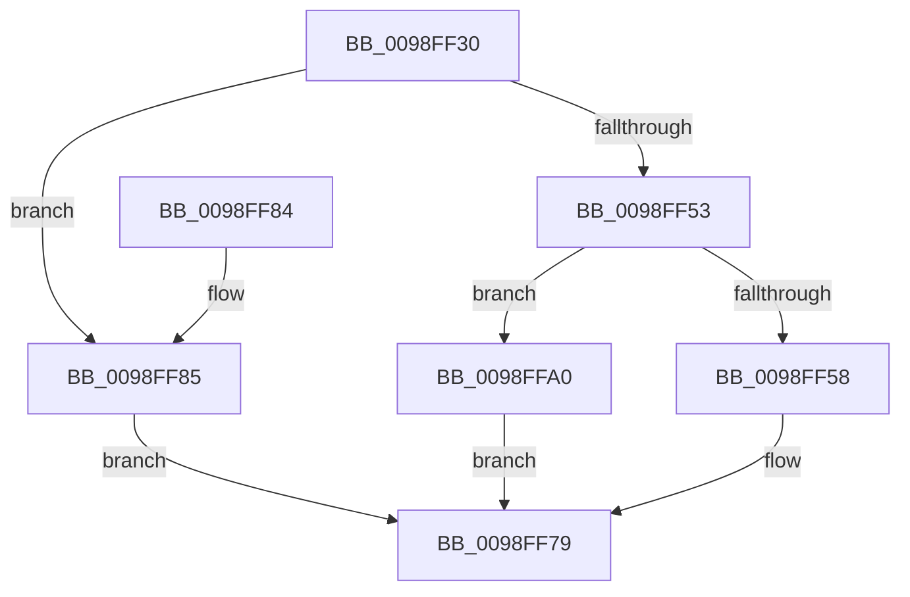

# PiDqOpenObjectRegKey

- RVA: `0x0098FF30`–`0x0098FFA7` (길이 `119` bytes)
- VA: `0x000000014098FF30`
- 실행 섹션: `PAGE`
- PDB 이름 있음: `예`; PDB Function 태그: `아니요`
- unwind 정보 RVA: `0x00098B74`
- 디코드: `33`개 명령, `119/119` bytes 표시
- 미해석 바이트: `0` (있으면 어셈블리에 `.byte`로 보존)

> 이 문서는 커널 이미지의 기계어와 PDB 기호를 분석해 생성했습니다. 4번과 5번은 함수 원형과 자료형을 바이너리 사용 방식에서 추정한 C 해석이며 원본 소스 복구 결과는 아닙니다.

## 1. Dependencies

- 직접 호출 지점: **2**; 고유 호출 대상: **2**
- 직접 호출자로 확인된 함수: **4**
- RIP 상대 이미지 참조: **1**

### Outgoing calls
- `0x0098FF74` → [PiDqOpenUserObjectRegKey](../99/PiDqOpenUserObjectRegKey_function_00990444.md) (function, `0x00990444`)
- `0x0098FF99` → [PnpOpenObjectRegKey](../8E/PnpOpenObjectRegKey_function_008E15E8.md) (function, `0x008E15E8`)

### Direct callers
- [PiDqIrpPropertySet](../96/PiDqIrpPropertySet_function_00963770.md) at `0x00963A88`
- [PiDqActionDataGetAllPropertiesInAllLanguages](../99/PiDqActionDataGetAllPropertiesInAllLanguages_function_0099569C.md) at `0x00995703`
- [PiDqActionDataGetChangedProperties](../A6/PiDqActionDataGetChangedProperties_function_00A61F10.md) at `0x00A622B8`
- [sub_00B1CF0E](../B1/Unknown_function_00B1CF0E.md) at `0x00B1CF46`

### Static image references
- `0x0098FF89` → RVA `0x00E66398` (`.data`; read)

## 2. Other-region calls and transfers

- 다른 실행 섹션으로 향하는 call: **0**
- 별도 외부 분기/꼬리 이동을 확인하지 못했습니다.

## 3. Assembly (complete function range)

```asm
0098FF30  48 89 5C 24 08                  mov qword ptr [rsp + 8], rbx
0098FF35  57                              push rdi
0098FF36  48 83 EC 40                     sub rsp, 0x40
0098FF3A  4C 8B 94 24 80 00 00 00         mov r10, qword ptr [rsp + 0x80]
0098FF42  45 8B D9                        mov r11d, r9d
0098FF45  41 8B D8                        mov ebx, r8d
0098FF48  48 8B FA                        mov rdi, rdx
0098FF4B  49 83 22 00                     and qword ptr [r10], 0
0098FF4F  85 C9                           test ecx, ecx
0098FF51  74 32                           je 0x14098ff85
0098FF53  83 F9 01                        cmp ecx, 1
0098FF56  75 48                           jne 0x14098ffa0
0098FF58  48 8B 44 24 78                  mov rax, qword ptr [rsp + 0x78]
0098FF5D  45 8B C3                        mov r8d, r11d
0098FF60  44 8A 4C 24 70                  mov r9b, byte ptr [rsp + 0x70]
0098FF65  8B D3                           mov edx, ebx
0098FF67  4C 89 54 24 28                  mov qword ptr [rsp + 0x28], r10
0098FF6C  48 8B CF                        mov rcx, rdi
0098FF6F  48 89 44 24 20                  mov qword ptr [rsp + 0x20], rax
0098FF74  E8 CB 04 00 00                  call 0x140990444
0098FF79  48 8B 5C 24 50                  mov rbx, qword ptr [rsp + 0x50]
0098FF7E  48 83 C4 40                     add rsp, 0x40
0098FF82  5F                              pop rdi
0098FF83  C3                              ret
0098FF84  CC                              int3
0098FF85  8A 44 24 70                     mov al, byte ptr [rsp + 0x70]
0098FF89  48 8B 0D 08 64 4D 00            mov rcx, qword ptr [rip + 0x4d6408]
0098FF90  4C 89 54 24 28                  mov qword ptr [rsp + 0x28], r10
0098FF95  88 44 24 20                     mov byte ptr [rsp + 0x20], al
0098FF99  E8 4A 16 F5 FF                  call 0x1408e15e8
0098FF9E  EB D9                           jmp 0x14098ff79
0098FFA0  B8 0D 00 00 C0                  mov eax, 0xc000000d
0098FFA5  EB D2                           jmp 0x14098ff79
```

## 4. C-style interpretation (structured pseudocode)

```c
__int64 __fastcall PiDqOpenObjectRegKey(int a1, __int64 a2, int a3, int a4, unsigned __int8 a5, __int64 a6, __int64 a7)
{
    __int64 result;
    __int64 v_rsp;
    unsigned __int64 v_stack_m20;
    unsigned __int64 v_stack_m28;
    unsigned __int8 v_stack_p20;
    unsigned __int64 v_stack_p28;
    unsigned __int64 v_stack_p8;

    v_stack_p8 = v_rbx;
    v_rsp = (v_rsp) - (64);
    if (a1 == 0) goto loc_0098FF85;
    if (a1 != 1) goto loc_0098FFA0;
    v_stack_m20 = a7;
    v_stack_m28 = a6;
    result = PiDqOpenUserObjectRegKey(a2, (unsigned int)((unsigned int)((unsigned int)(a3))), (unsigned int)((unsigned int)((unsigned int)(a4))), a5);
loc_0098FF79:
    v_rsp = (v_rsp) + (64);
    return result;
loc_0098FF85:
    v_stack_p28 = a7;
    v_stack_p20 = a5;
    result = PnpOpenObjectRegKey(*(unsigned __int64 *)(v_rip + 5071880), (unsigned int)((unsigned int)((unsigned int)(a3))), (unsigned int)((unsigned int)((unsigned int)(a4))), a5);
    goto loc_0098FF79;
loc_0098FFA0:
    goto loc_0098FF79;
}
```

## 5. (Beta) C Style

```c
int64_t PiDqOpenObjectRegKey(int32_t Arg1, int64_t Arg2, int32_t Arg3, int32_t Arg4, uint8_t Arg5, int64_t Arg6, void *Arg7)
{
    uint8_t *arg7 = (uint8_t *)Arg7;

    int64_t result;
    int64_t local_rsp;
    uint64_t v_stack_m20;
    uint64_t v_stack_m28;
    uint8_t v_stack_p20;
    uint64_t v_stack_p28;
    uint64_t v_stack_p8;

    v_stack_p8 = local_rbx;
    local_rsp = (local_rsp) - (64);
    if (Arg1 == 0) goto loc_0098FF85;
    if (Arg1 != 1) goto loc_0098FFA0;
    v_stack_m20 = Arg7;
    v_stack_m28 = Arg6;
    result = PiDqOpenUserObjectRegKey(Arg2, (uint32_t)((uint32_t)((uint32_t)(Arg3))), (uint32_t)((uint32_t)((uint32_t)(Arg4))), Arg5);
loc_0098FF79:
    local_rsp = (local_rsp) + (64);
    return result;
loc_0098FF85:
    v_stack_p28 = Arg7;
    v_stack_p20 = Arg5;
    result = PnpOpenObjectRegKey(*(uint64_t *)(v_rip + 0x4D6408), (uint32_t)((uint32_t)((uint32_t)(Arg3))), (uint32_t)((uint32_t)((uint32_t)(Arg4))), Arg5);
    goto loc_0098FF79;
loc_0098FFA0:
    goto loc_0098FF79;
}
```

### 관측된 메모리 오프셋

구조체 형식이 확인되지 않은 접근은 인자 기준의 오프셋으로만 기록했습니다.

| 기준 인자 | 오프셋 표현 | 폭 (bit) | 접근 |
|---|---:|---:|---|
| `Arg7` | `+ 0x0` | `64` | `R/W` |

## 6. Execution-region graph

[열기: 2D/3D 그래프와 함수 탐색 컨트롤 패널](../../../control-panel.html?section=page&rva=0x0098FF30&view=graph)

- 2D 그래프는 위에서 아래로 흐르고, 3D 그래프는 빈 공간을 드래그해 회전합니다. Shift+드래그는 이동, 휠은 확대·축소, 함수 노드 선택은 대상 보고서 이동입니다.

### Static fallback


