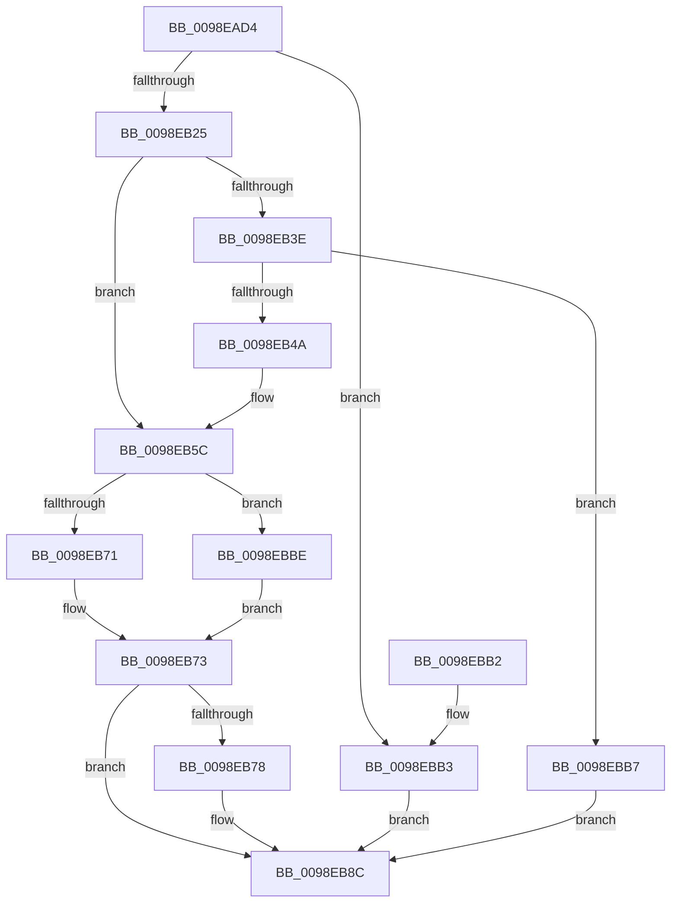

# PoEnergyContextStart

- RVA: `0x0098EAD4`–`0x0098EBD5` (길이 `257` bytes)
- VA: `0x000000014098EAD4`
- 실행 섹션: `PAGE`
- PDB 이름 있음: `예`; PDB Function 태그: `아니요`
- unwind 정보 RVA: `0x00098974`
- 디코드: `64`개 명령, `257/257` bytes 표시
- 미해석 바이트: `0` (있으면 어셈블리에 `.byte`로 보존)

> 이 문서는 커널 이미지의 기계어와 PDB 기호를 분석해 생성했습니다. 4번과 5번은 함수 원형과 자료형을 바이너리 사용 방식에서 추정한 C 해석이며 원본 소스 복구 결과는 아닙니다.

## 1. Dependencies

- 직접 호출 지점: **6**; 고유 호출 대상: **6**
- 직접 호출자로 확인된 함수: **2**
- RIP 상대 이미지 참조: **2**

### Outgoing calls
- `0x0098EB41` → [ExAcquireRundownProtection](../../text/21/ExAcquireRundownProtection_function_00216620.md) (function, `0x00216620`)
- `0x0098EB54` → [KiStackAttachProcess](../../text/21/KiStackAttachProcess_function_00216820.md) (function, `0x00216820`)
- `0x0098EB66` → [PopEtGetProcessAppId](PopEtGetProcessAppId_function_0098EBDC.md) (function, `0x0098EBDC`)
- `0x0098EB7F` → [KiUnstackDetachProcess](../../text/21/KiUnstackDetachProcess_function_00217D30.md) (function, `0x00217D30`)
- `0x0098EB87` → [ExReleaseRundownProtection](../../text/34/ExReleaseRundownProtection_function_00349E80.md) (function, `0x00349E80`)
- `0x0098EB96` → [_security_check_cookie](../../text/6A/_security_check_cookie_function_006AC640.md) (function, `0x006AC640`)

### Direct callers
- [PspInsertThread](../9F/PspInsertThread_function_009F0314.md) at `0x009F0B1D`
- [PopEtInit](../../init/C4/PopEtInit_function_00C43018.md) at `0x00C4323E`

### Static image references
- `0x0098EAE9` → RVA `0x00E0A740` (`.data`; read)
- `0x0098EB08` → RVA `0x00E67A30` (`.data`; read)

## 2. Other-region calls and transfers

- 다른 실행 섹션으로 향하는 call: **5**
  - `0x0098EB41` → [ExAcquireRundownProtection](../../text/21/ExAcquireRundownProtection_function_00216620.md) (`PAGE` → `.text`)
  - `0x0098EB54` → [KiStackAttachProcess](../../text/21/KiStackAttachProcess_function_00216820.md) (`PAGE` → `.text`)
  - `0x0098EB7F` → [KiUnstackDetachProcess](../../text/21/KiUnstackDetachProcess_function_00217D30.md) (`PAGE` → `.text`)
  - `0x0098EB87` → [ExReleaseRundownProtection](../../text/34/ExReleaseRundownProtection_function_00349E80.md) (`PAGE` → `.text`)
  - `0x0098EB96` → [_security_check_cookie](../../text/6A/_security_check_cookie_function_006AC640.md) (`PAGE` → `.text`)
- 별도 외부 분기/꼬리 이동을 확인하지 못했습니다.

## 3. Assembly (complete function range)

```asm
0098EAD4  48 89 5C 24 10                  mov qword ptr [rsp + 0x10], rbx
0098EAD9  48 89 74 24 18                  mov qword ptr [rsp + 0x18], rsi
0098EADE  48 89 7C 24 20                  mov qword ptr [rsp + 0x20], rdi
0098EAE3  41 56                           push r14
0098EAE5  48 83 EC 60                     sub rsp, 0x60
0098EAE9  48 8B 05 50 BC 47 00            mov rax, qword ptr [rip + 0x47bc50]
0098EAF0  48 33 C4                        xor rax, rsp
0098EAF3  48 89 44 24 50                  mov qword ptr [rsp + 0x50], rax
0098EAF8  4C 8B B1 68 06 00 00            mov r14, qword ptr [rcx + 0x668]
0098EAFF  0F 57 C0                        xorps xmm0, xmm0
0098EB02  40 32 F6                        xor sil, sil
0098EB05  48 8B D9                        mov rbx, rcx
0098EB08  48 83 3D 20 8F 4D 00 00         cmp qword ptr [rip + 0x4d8f20], 0
0098EB10  0F 11 44 24 20                  movups xmmword ptr [rsp + 0x20], xmm0
0098EB15  0F 11 44 24 30                  movups xmmword ptr [rsp + 0x30], xmm0
0098EB1A  0F 11 44 24 40                  movups xmmword ptr [rsp + 0x40], xmm0
0098EB1F  0F 84 8E 00 00 00               je 0x14098ebb3
0098EB25  65 48 8B 04 25 88 01 00 00      mov rax, qword ptr gs:[0x188]
0098EB2E  48 8D B9 E8 01 00 00            lea rdi, [rcx + 0x1e8]
0098EB35  48 39 88 B8 00 00 00            cmp qword ptr [rax + 0xb8], rcx
0098EB3C  74 1E                           je 0x14098eb5c
0098EB3E  48 8B CF                        mov rcx, rdi
0098EB41  E8 DA 7A 88 FF                  call 0x140216620
0098EB46  84 C0                           test al, al
0098EB48  74 6D                           je 0x14098ebb7
0098EB4A  4C 8D 44 24 20                  lea r8, [rsp + 0x20]
0098EB4F  33 D2                           xor edx, edx
0098EB51  48 8B CB                        mov rcx, rbx
0098EB54  E8 C7 7C 88 FF                  call 0x140216820
0098EB59  40 B6 01                        mov sil, 1
0098EB5C  49 8D 96 C8 01 00 00            lea rdx, [r14 + 0x1c8]
0098EB63  48 8B CB                        mov rcx, rbx
0098EB66  E8 71 00 00 00                  call 0x14098ebdc
0098EB6B  8B D8                           mov ebx, eax
0098EB6D  85 C0                           test eax, eax
0098EB6F  78 4D                           js 0x14098ebbe
0098EB71  33 DB                           xor ebx, ebx
0098EB73  40 84 F6                        test sil, sil
0098EB76  74 14                           je 0x14098eb8c
0098EB78  33 D2                           xor edx, edx
0098EB7A  48 8D 4C 24 20                  lea rcx, [rsp + 0x20]
0098EB7F  E8 AC 91 88 FF                  call 0x140217d30
0098EB84  48 8B CF                        mov rcx, rdi
0098EB87  E8 F4 B2 9B FF                  call 0x140349e80
0098EB8C  8B C3                           mov eax, ebx
0098EB8E  48 8B 4C 24 50                  mov rcx, qword ptr [rsp + 0x50]
0098EB93  48 33 CC                        xor rcx, rsp
0098EB96  E8 A5 DA D1 FF                  call 0x1406ac640
0098EB9B  4C 8D 5C 24 60                  lea r11, [rsp + 0x60]
0098EBA0  49 8B 5B 18                     mov rbx, qword ptr [r11 + 0x18]
0098EBA4  49 8B 73 20                     mov rsi, qword ptr [r11 + 0x20]
0098EBA8  49 8B 7B 28                     mov rdi, qword ptr [r11 + 0x28]
0098EBAC  49 8B E3                        mov rsp, r11
0098EBAF  41 5E                           pop r14
0098EBB1  C3                              ret
0098EBB2  CC                              int3
0098EBB3  33 DB                           xor ebx, ebx
0098EBB5  EB D5                           jmp 0x14098eb8c
0098EBB7  BB 0A 01 00 C0                  mov ebx, 0xc000010a
0098EBBC  EB CE                           jmp 0x14098eb8c
0098EBBE  48 8B 0D 6B 8E 4D 00            mov rcx, qword ptr [rip + 0x4d8e6b]
0098EBC5  48 81 C1 70 03 00 00            add rcx, 0x370
0098EBCC  49 89 8E C8 01 00 00            mov qword ptr [r14 + 0x1c8], rcx
0098EBD3  EB 9E                           jmp 0x14098eb73
```

## 4. C-style interpretation (structured pseudocode)

```c
__int64 __fastcall PoEnergyContextStart(__int64 a1, int a2)
{
    __int64 result;
    __int64 v_rbx;
    __int64 v_rsi;
    __int64 v_rsp;
    unsigned __int64 v_stack_m18;
    unsigned __int64 v_stack_m28;
    unsigned __int64 v_stack_m38;
    unsigned __int64 v_stack_m48;
    unsigned __int64 v_stack_m8;
    unsigned __int64 v_stack_p10;
    unsigned __int64 v_stack_p18;
    unsigned __int64 v_stack_p20;

    v_stack_p10 = v_rbx;
    v_stack_p18 = v_rsi;
    v_stack_p20 = v_rdi;
    v_rsp = (v_rsp) - (96);
    result = (*(unsigned __int64 *)(v_rip + 4701264)) ^ (v_rsp);
    v_stack_m18 = result;
    v_rsi = 0;
    v_stack_m48 = v_xmm0;
    v_stack_m38 = v_xmm0;
    v_stack_m28 = v_xmm0;
    if ((*(unsigned __int64 *)(v_rip + 5082912)) == 0) goto loc_0098EBB3;
    if ((*(unsigned __int64 *)(*(unsigned __int64 *)(gs_base + (0 + 392)) + 184)) == a1) goto loc_0098EB5C;
    result = ExAcquireRundownProtection(a1 + 488, a2, a3, a4);
    if ((unsigned __int8)(result) == 0) goto loc_0098EBB7;
    a2 = 0;
    result = KiStackAttachProcess(a1, a2, v_stack_m48, a4);
loc_0098EB5C:
    result = PopEtGetProcessAppId(a1, *(unsigned __int64 *)(a1 + 1640) + 456, v_stack_m48, a4);
    if (sign_flag) goto loc_0098EBBE;
    v_rbx = 0;
loc_0098EB73:
    if (1 != 0) {
        a2 = 0;
        a1 = v_stack_m48;
        result = KiUnstackDetachProcess(a1, a2, v_stack_m48, a4);
        a1 = a1 + 488;
        result = ExReleaseRundownProtection(a1, a2, v_stack_m48, a4);
    }
    a1 = (v_stack_m18) ^ (v_rsp);
    result = _security_check_cookie(a1, a2, v_stack_m48, a4);
    return result;
loc_0098EBB3:
    v_rbx = 0;
    goto loc_0098EB8C;
loc_0098EBB7:
    goto loc_0098EB8C;
loc_0098EBBE:
    a1 = (*(unsigned __int64 *)(v_rip + 5082731)) + (880);
    *(unsigned __int64 *)(*(unsigned __int64 *)(a1 + 1640) + 456) = a1;
    goto loc_0098EB73;
}
```

## 5. (Beta) C Style

```c
int64_t PoEnergyContextStart(void *Arg1, int32_t Arg2)
{
    uint8_t *arg1 = (uint8_t *)Arg1;

    int64_t result;
    int64_t local_rbx;
    int64_t local_rsi;
    int64_t local_rsp;
    uint64_t v_stack_m18;
    uint64_t v_stack_m28;
    uint64_t v_stack_m38;
    uint64_t v_stack_m48;
    uint64_t v_stack_m8;
    uint64_t v_stack_p10;
    uint64_t v_stack_p18;
    uint64_t v_stack_p20;

    v_stack_p10 = local_rbx;
    v_stack_p18 = local_rsi;
    v_stack_p20 = local_rdi;
    local_rsp = (local_rsp) - (96);
    result = (*(uint64_t *)(v_rip + 0x47BC50)) ^ (local_rsp);
    v_stack_m18 = result;
    local_rsi = 0;
    v_stack_m48 = v_xmm0;
    v_stack_m38 = v_xmm0;
    v_stack_m28 = v_xmm0;
    if ((*(uint64_t *)(v_rip + 0x4D8F20)) == 0) goto loc_0098EBB3;
    if ((*(uint64_t *)(*(uint64_t *)(gs_base + (0 + 0x188)) + 0xB8)) == Arg1) goto loc_0098EB5C;
    result = ExAcquireRundownProtection(Arg1 + 488, Arg2, a3, a4);
    if ((uint8_t)(result) == 0) goto loc_0098EBB7;
    Arg2 = 0;
    result = KiStackAttachProcess(Arg1, Arg2, v_stack_m48, a4);
loc_0098EB5C:
    result = PopEtGetProcessAppId(Arg1, *(uint64_t *)(arg1 + 0x668) + 456, v_stack_m48, a4);
    if (sign_flag) goto loc_0098EBBE;
    local_rbx = 0;
loc_0098EB73:
    if (1 != 0) {
        Arg2 = 0;
        Arg1 = v_stack_m48;
        result = KiUnstackDetachProcess(Arg1, Arg2, v_stack_m48, a4);
        Arg1 = Arg1 + 488;
        result = ExReleaseRundownProtection(Arg1, Arg2, v_stack_m48, a4);
    }
    Arg1 = (v_stack_m18) ^ (local_rsp);
    result = _security_check_cookie(Arg1, Arg2, v_stack_m48, a4);
    return result;
loc_0098EBB3:
    local_rbx = 0;
    goto loc_0098EB8C;
loc_0098EBB7:
    goto loc_0098EB8C;
loc_0098EBBE:
    Arg1 = (*(uint64_t *)(v_rip + 0x4D8E6B)) + (880);
    *(void **)(*(uint64_t *)(arg1 + 0x668) + 0x1C8) = Arg1;
    goto loc_0098EB73;
}
```

### 관측된 메모리 오프셋

구조체 형식이 확인되지 않은 접근은 인자 기준의 오프셋으로만 기록했습니다.

| 기준 인자 | 오프셋 표현 | 폭 (bit) | 접근 |
|---|---:|---:|---|
| `Arg1` | `+ 0x1E8` | `64` | `R` |
| `Arg1` | `+ 0x668` | `64` | `R` |

## 6. Execution-region graph

[열기: 2D/3D 그래프와 함수 탐색 컨트롤 패널](../../../control-panel.html?section=page&rva=0x0098EAD4&view=graph)

- 2D 그래프는 위에서 아래로 흐르고, 3D 그래프는 빈 공간을 드래그해 회전합니다. Shift+드래그는 이동, 휠은 확대·축소, 함수 노드 선택은 대상 보고서 이동입니다.

### Static fallback


