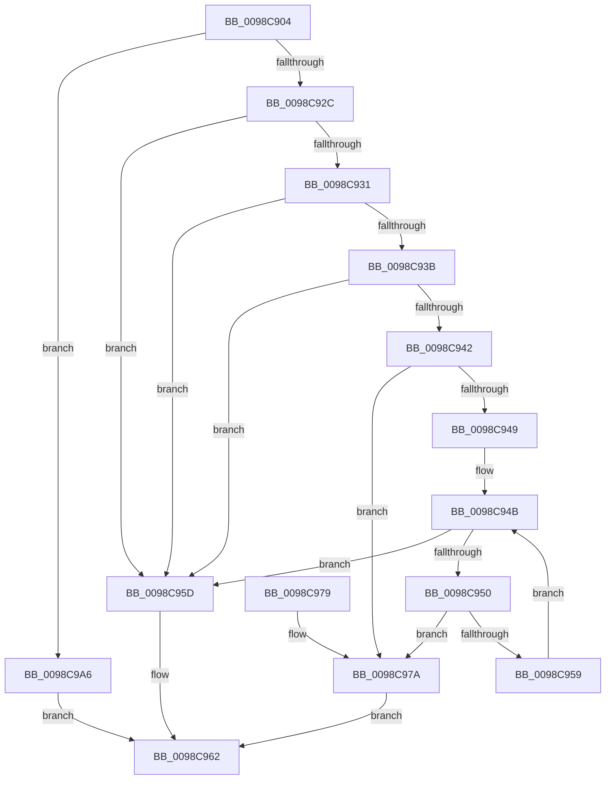

# PoSetProcessEnergyTrackingState

- RVA: `0x0098C904`–`0x0098C9AD` (길이 `169` bytes)
- VA: `0x000000014098C904`
- 실행 섹션: `PAGE`
- PDB 이름 있음: `예`; PDB Function 태그: `아니요`
- unwind 정보 RVA: `0x00073C48`
- 디코드: `52`개 명령, `169/169` bytes 표시
- 미해석 바이트: `0` (있으면 어셈블리에 `.byte`로 보존)

> 이 문서는 커널 이미지의 기계어와 PDB 기호를 분석해 생성했습니다. 4번과 5번은 함수 원형과 자료형을 바이너리 사용 방식에서 추정한 C 해석이며 원본 소스 복구 결과는 아닙니다.

## 1. Dependencies

- 직접 호출 지점: **3**; 고유 호출 대상: **3**
- 직접 호출자로 확인된 함수: **1**
- RIP 상대 이미지 참조: **0**

### Outgoing calls
- `0x0098C981` → [PopAcquireRwLockExclusive](../../text/43/PopAcquireRwLockExclusive_function_00430B44.md) (function, `0x00430B44`)
- `0x0098C98C` → [PopEtEnergyContextSetState](PopEtEnergyContextSetState_function_0098CF94.md) (function, `0x0098CF94`)
- `0x0098C99F` → [PopReleaseRwLock](../../text/2D/PopReleaseRwLock_function_002DFBBC.md) (function, `0x002DFBBC`)

### Direct callers
- [NtSetInformationProcess](../AE/NtSetInformationProcess_function_00AE5370.md) at `0x00AE93FF`

### Static image references
- 디코드된 RIP-relative 메모리 참조가 없습니다.

## 2. Other-region calls and transfers

- 다른 실행 섹션으로 향하는 call: **2**
  - `0x0098C981` → [PopAcquireRwLockExclusive](../../text/43/PopAcquireRwLockExclusive_function_00430B44.md) (`PAGE` → `.text`)
  - `0x0098C99F` → [PopReleaseRwLock](../../text/2D/PopReleaseRwLock_function_002DFBBC.md) (`PAGE` → `.text`)
- 별도 외부 분기/꼬리 이동을 확인하지 못했습니다.

## 3. Assembly (complete function range)

```asm
0098C904  48 89 5C 24 08                  mov qword ptr [rsp + 8], rbx
0098C909  48 89 6C 24 10                  mov qword ptr [rsp + 0x10], rbp
0098C90E  48 89 74 24 18                  mov qword ptr [rsp + 0x18], rsi
0098C913  57                              push rdi
0098C914  48 83 EC 20                     sub rsp, 0x20
0098C918  48 8B B9 68 06 00 00            mov rdi, qword ptr [rcx + 0x668]
0098C91F  33 ED                           xor ebp, ebp
0098C921  48 8B DA                        mov rbx, rdx
0098C924  48 8B F1                        mov rsi, rcx
0098C927  48 85 FF                        test rdi, rdi
0098C92A  74 7A                           je 0x14098c9a6
0098C92C  39 6A 08                        cmp dword ptr [rdx + 8], ebp
0098C92F  75 2C                           jne 0x14098c95d
0098C931  8B 0A                           mov ecx, dword ptr [rdx]
0098C933  F7 C1 EF FF FF FF               test ecx, 0xffffffef
0098C939  75 22                           jne 0x14098c95d
0098C93B  F7 D1                           not ecx
0098C93D  85 4A 04                        test dword ptr [rdx + 4], ecx
0098C940  75 1B                           jne 0x14098c95d
0098C942  8B 42 0C                        mov eax, dword ptr [rdx + 0xc]
0098C945  A8 01                           test al, 1
0098C947  74 31                           je 0x14098c97a
0098C949  8B CD                           mov ecx, ebp
0098C94B  83 F9 40                        cmp ecx, 0x40
0098C94E  73 0D                           jae 0x14098c95d
0098C950  8B C1                           mov eax, ecx
0098C952  66 39 6C 42 10                  cmp word ptr [rdx + rax*2 + 0x10], bp
0098C957  74 21                           je 0x14098c97a
0098C959  FF C1                           inc ecx
0098C95B  EB EE                           jmp 0x14098c94b
0098C95D  BB 0D 00 00 C0                  mov ebx, 0xc000000d
0098C962  48 8B 6C 24 38                  mov rbp, qword ptr [rsp + 0x38]
0098C967  8B C3                           mov eax, ebx
0098C969  48 8B 5C 24 30                  mov rbx, qword ptr [rsp + 0x30]
0098C96E  48 8B 74 24 40                  mov rsi, qword ptr [rsp + 0x40]
0098C973  48 83 C4 20                     add rsp, 0x20
0098C977  5F                              pop rdi
0098C978  C3                              ret
0098C979  CC                              int3
0098C97A  48 8D 8F B8 01 00 00            lea rcx, [rdi + 0x1b8]
0098C981  E8 BE 41 AA FF                  call 0x140430b44
0098C986  48 8B D3                        mov rdx, rbx
0098C989  48 8B CE                        mov rcx, rsi
0098C98C  E8 03 06 00 00                  call 0x14098cf94
0098C991  85 C0                           test eax, eax
0098C993  48 8D 8F B8 01 00 00            lea rcx, [rdi + 0x1b8]
0098C99A  8B D8                           mov ebx, eax
0098C99C  0F 49 DD                        cmovns ebx, ebp
0098C99F  E8 18 32 95 FF                  call 0x1402dfbbc
0098C9A4  EB BC                           jmp 0x14098c962
0098C9A6  BB BB 00 00 C0                  mov ebx, 0xc00000bb
0098C9AB  EB B5                           jmp 0x14098c962
```

## 4. C-style interpretation (structured pseudocode)

```c
__int64 __fastcall PoSetProcessEnergyTrackingState(__int64 a1, __int64 a2)
{
    __int64 result;
    __int64 v_rbp;
    __int64 v_rbx;
    __int64 v_rsp;
    unsigned __int64 v_stack_p10;
    unsigned __int64 v_stack_p18;
    unsigned __int64 v_stack_p8;

    v_stack_p8 = v_rbx;
    v_stack_p10 = v_rbp;
    v_stack_p18 = v_rsi;
    v_rsp = (v_rsp) - (32);
    v_rbp = 0;
    if (*(unsigned __int64 *)(a1 + 1640) == 0) goto loc_0098C9A6;
    if ((*(unsigned int *)(a2 + 8)) != 0) goto loc_0098C95D;
    if ((((unsigned int)((unsigned int)(*(unsigned int *)(a2)))) & (0xFFFFFFEFULL)) != 0) goto loc_0098C95D;
    a1 = (unsigned int)(~((unsigned int)(*(unsigned int *)(a2))));
    if (((*(unsigned int *)(a2 + 4)) & ((unsigned int)(a1))) != 0) goto loc_0098C95D;
    if ((((unsigned __int8)((unsigned int)(*(unsigned int *)(a2 + 12)))) & (1)) == 0) goto loc_0098C97A;
loc_0098C94B:
    if (0 >= 64) goto loc_0098C95D;
    if ((*(unsigned __int16 *)(a2 + 0 * 2 + 16)) == 0) goto loc_0098C97A;
    a1 = (unsigned int)((0) + 1);
    goto loc_0098C94B;
loc_0098C95D:
loc_0098C962:
    v_rsp = (v_rsp) + (32);
    return (unsigned int)((unsigned int)((unsigned int)(0xC000000DULL)));
loc_0098C97A:
    result = PopAcquireRwLockExclusive(*(unsigned __int64 *)(a1 + 1640) + 440, a2, a3, a4);
    result = PopEtEnergyContextSetState(v_stack_p18, v_stack_p8, a3, a4);
    v_rbx = (unsigned int)((unsigned int)(result));
    if (!sign_flag) { v_rbx = (unsigned int)(v_stack_p10); }
    result = PopReleaseRwLock(*(unsigned __int64 *)(a1 + 1640) + 440, v_stack_p8, a3, a4);
    goto loc_0098C962;
loc_0098C9A6:
    goto loc_0098C962;
}
```

## 5. (Beta) C Style

```c
int64_t PoSetProcessEnergyTrackingState(void *Arg1, void *Arg2)
{
    uint8_t *arg1 = (uint8_t *)Arg1;
    uint8_t *arg2 = (uint8_t *)Arg2;

    int64_t result;
    int64_t local_rbp;
    int64_t local_rbx;
    int64_t local_rsp;
    uint64_t v_stack_p10;
    uint64_t v_stack_p18;
    uint64_t v_stack_p8;

    v_stack_p8 = local_rbx;
    v_stack_p10 = local_rbp;
    v_stack_p18 = local_rsi;
    local_rsp = (local_rsp) - (32);
    local_rbp = 0;
    if (*(uint64_t *)(arg1 + 0x668) == 0) goto loc_0098C9A6;
    if ((*(uint32_t *)(arg2 + 0x8)) != 0) goto loc_0098C95D;
    if ((((uint32_t)((uint32_t)(*(uint32_t *)(arg2)))) & (0xFFFFFFEFULL)) != 0) goto loc_0098C95D;
    Arg1 = (uint32_t)(~((uint32_t)(*(uint32_t *)(arg2))));
    if (((*(uint32_t *)(arg2 + 0x4)) & ((uint32_t)(Arg1))) != 0) goto loc_0098C95D;
    if ((((uint8_t)((uint32_t)(*(uint32_t *)(arg2 + 0xC)))) & (1)) == 0) goto loc_0098C97A;
loc_0098C94B:
    if (0 >= 64) goto loc_0098C95D;
    if ((*(uint16_t *)(arg2 + 0x0 * 2 + 0x10)) == 0) goto loc_0098C97A;
    Arg1 = (uint32_t)((0) + 1);
    goto loc_0098C94B;
loc_0098C95D:
loc_0098C962:
    local_rsp = (local_rsp) + (32);
    return (uint32_t)((uint32_t)((uint32_t)(0xC000000DULL)));
loc_0098C97A:
    result = PopAcquireRwLockExclusive(*(uint64_t *)(arg1 + 0x668) + 440, Arg2, a3, a4);
    result = PopEtEnergyContextSetState(v_stack_p18, v_stack_p8, a3, a4);
    local_rbx = (uint32_t)((uint32_t)(result));
    if (!sign_flag) { local_rbx = (uint32_t)(v_stack_p10); }
    result = PopReleaseRwLock(*(uint64_t *)(arg1 + 0x668) + 440, v_stack_p8, a3, a4);
    goto loc_0098C962;
loc_0098C9A6:
    goto loc_0098C962;
}
```

### 관측된 메모리 오프셋

구조체 형식이 확인되지 않은 접근은 인자 기준의 오프셋으로만 기록했습니다.

| 기준 인자 | 오프셋 표현 | 폭 (bit) | 접근 |
|---|---:|---:|---|
| `Arg1` | `+ 0x668` | `64` | `R` |
| `Arg2` | `+ 0x0` | `32` | `R` |
| `Arg2` | `+ 0x4` | `32` | `R` |
| `Arg2` | `+ 0x8` | `32` | `R` |
| `Arg2` | `+ 0xC` | `32` | `R` |
| `Arg2` | `+ 0x10 + rax*2` | `16` | `R` |

## 6. Execution-region graph

[열기: 2D/3D 그래프와 함수 탐색 컨트롤 패널](../../../control-panel.html?section=page&rva=0x0098C904&view=graph)

- 2D 그래프는 위에서 아래로 흐르고, 3D 그래프는 빈 공간을 드래그해 회전합니다. Shift+드래그는 이동, 휠은 확대·축소, 함수 노드 선택은 대상 보고서 이동입니다.

### Static fallback


