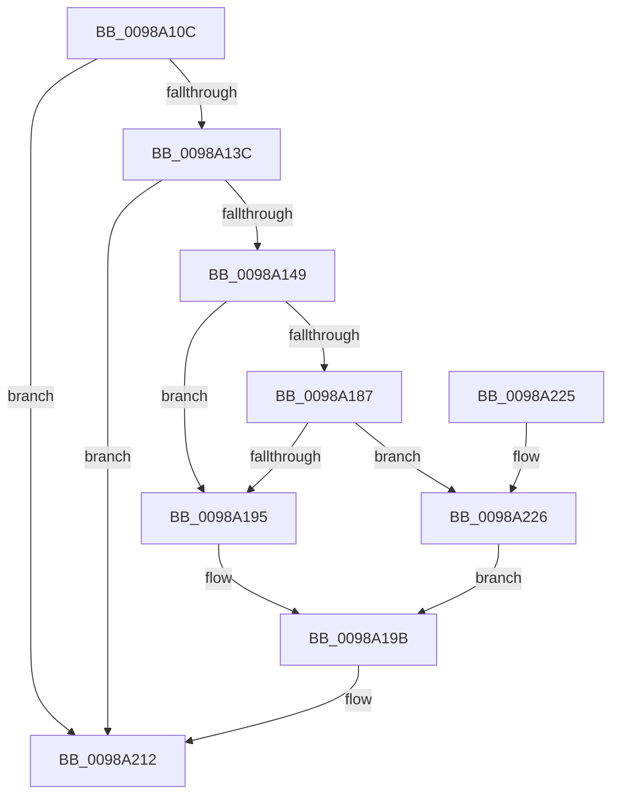

# PopArmIdlePhaseWatchdog

- RVA: `0x0098A10C`–`0x0098A231` (길이 `293` bytes)
- VA: `0x000000014098A10C`
- 실행 섹션: `PAGE`
- PDB 이름 있음: `예`; PDB Function 태그: `아니요`
- unwind 정보 RVA: `0x00098670`
- 디코드: `66`개 명령, `293/293` bytes 표시
- 미해석 바이트: `0` (있으면 어셈블리에 `.byte`로 보존)

> 이 문서는 커널 이미지의 기계어와 PDB 기호를 분석해 생성했습니다. 4번과 5번은 함수 원형과 자료형을 바이너리 사용 방식에서 추정한 C 해석이며 원본 소스 복구 결과는 아닙니다.

## 1. Dependencies

- 직접 호출 지점: **6**; 고유 호출 대상: **6**
- 직접 호출자로 확인된 함수: **1**
- RIP 상대 이미지 참조: **8**

### Outgoing calls
- `0x0098A13C` → [PopPdcAreAllPhasesDisengaged](PopPdcAreAllPhasesDisengaged_function_0098A238.md) (function, `0x0098A238`)
- `0x0098A151` → [PopSnapSystemIdleContext](PopSnapSystemIdleContext_function_0098A260.md) (function, `0x0098A260`)
- `0x0098A15D` → [PopAcquireRwLockExclusive](../../text/43/PopAcquireRwLockExclusive_function_00430B44.md) (function, `0x00430B44`)
- `0x0098A17D` → [PopReleaseRwLock](../../text/2D/PopReleaseRwLock_function_002DFBBC.md) (function, `0x002DFBBC`)
- `0x0098A1A5` → [memset](../../text/6C/memset_function_006C6C40.md) (function, `0x006C6C40`)
- `0x0098A20D` → [ZwPowerInformation](../../text/6A/ZwPowerInformation_function_006ADCB0.md) (function, `0x006ADCB0`)

### Direct callers
- [PopProcessSessionDisplayStateChange](../91/PopProcessSessionDisplayStateChange_function_00914380.md) at `0x009143C9`

### Static image references
- `0x0098A129` → RVA `0x00F08480` (`.data`; read)
- `0x0098A156` → RVA `0x00F08488` (`.data`; read)
- `0x0098A170` → RVA `0x00F08498` (`.data`; write)
- `0x0098A177` → RVA `0x00F084A0` (`.data`; write)
- `0x0098A195` → RVA `0x00E0B568` (`.data`; read)
- `0x0098A1E1` → RVA `0x00FC6FA8` (`ALMOSTRO`; read)
- `0x0098A1FE` → RVA `0x004CB090` (`PopIdlePhaseWatchdogCallback`; read)
- `0x0098A226` → RVA `0x00E0B558` (`.data`; read)

## 2. Other-region calls and transfers

- 다른 실행 섹션으로 향하는 call: **4**
  - `0x0098A15D` → [PopAcquireRwLockExclusive](../../text/43/PopAcquireRwLockExclusive_function_00430B44.md) (`PAGE` → `.text`)
  - `0x0098A17D` → [PopReleaseRwLock](../../text/2D/PopReleaseRwLock_function_002DFBBC.md) (`PAGE` → `.text`)
  - `0x0098A1A5` → [memset](../../text/6C/memset_function_006C6C40.md) (`PAGE` → `.text`)
  - `0x0098A20D` → [ZwPowerInformation](../../text/6A/ZwPowerInformation_function_006ADCB0.md) (`PAGE` → `.text`)
- 별도 외부 분기/꼬리 이동을 확인하지 못했습니다.

## 3. Assembly (complete function range)

```asm
0098A10C  48 89 5C 24 08                  mov qword ptr [rsp + 8], rbx
0098A111  55                              push rbp
0098A112  56                              push rsi
0098A113  57                              push rdi
0098A114  48 8D 6C 24 B9                  lea rbp, [rsp - 0x47]
0098A119  48 81 EC 90 00 00 00            sub rsp, 0x90
0098A120  48 83 65 77 00                  and qword ptr [rbp + 0x77], 0
0098A125  83 65 6F 00                     and dword ptr [rbp + 0x6f], 0
0098A129  48 8B 35 50 E3 57 00            mov rsi, qword ptr [rip + 0x57e350]
0098A130  48 63 D9                        movsxd rbx, ecx
0098A133  48 85 F6                        test rsi, rsi
0098A136  0F 84 D6 00 00 00               je 0x14098a212
0098A13C  E8 F7 00 00 00                  call 0x14098a238
0098A141  84 C0                           test al, al
0098A143  0F 84 C9 00 00 00               je 0x14098a212
0098A149  48 8D 55 6F                     lea rdx, [rbp + 0x6f]
0098A14D  48 8D 4D 77                     lea rcx, [rbp + 0x77]
0098A151  E8 0A 01 00 00                  call 0x14098a260
0098A156  48 8D 0D 2B E3 57 00            lea rcx, [rip + 0x57e32b]
0098A15D  E8 E2 69 AA FF                  call 0x140430b44
0098A162  48 8B 45 77                     mov rax, qword ptr [rbp + 0x77]
0098A166  48 8D 0D 1B E3 57 00            lea rcx, [rip + 0x57e31b]
0098A16D  8B 7D 6F                        mov edi, dword ptr [rbp + 0x6f]
0098A170  48 89 05 21 E3 57 00            mov qword ptr [rip + 0x57e321], rax
0098A177  89 3D 23 E3 57 00               mov dword ptr [rip + 0x57e323], edi
0098A17D  E8 3A 5A 95 FF                  call 0x1402dfbbc
0098A182  83 FB 10                        cmp ebx, 0x10
0098A185  77 0E                           ja 0x14098a195
0098A187  B8 60 10 01 00                  mov eax, 0x11060
0098A18C  0F A3 D8                        bt eax, ebx
0098A18F  0F 82 91 00 00 00               jb 0x14098a226
0098A195  8B 3D CD 13 48 00               mov edi, dword ptr [rip + 0x4813cd]
0098A19B  33 D2                           xor edx, edx
0098A19D  48 8D 4D E7                     lea rcx, [rbp - 0x19]
0098A1A1  44 8D 42 60                     lea r8d, [rdx + 0x60]
0098A1A5  E8 96 CA D3 FF                  call 0x1406c6c40
0098A1AA  83 64 24 20 00                  and dword ptr [rsp + 0x20], 0
0098A1AF  48 8D 55 E7                     lea rdx, [rbp - 0x19]
0098A1B3  69 C7 E8 03 00 00               imul eax, edi, 0x3e8
0098A1B9  45 33 C9                        xor r9d, r9d
0098A1BC  C7 45 E7 15 00 00 00            mov dword ptr [rbp - 0x19], 0x15
0098A1C3  48 89 75 EF                     mov qword ptr [rbp - 0x11], rsi
0098A1C7  C7 45 FF A0 00 00 00            mov dword ptr [rbp - 1], 0xa0
0098A1CE  45 8D 41 60                     lea r8d, [r9 + 0x60]
0098A1D2  48 C7 45 07 02 08 00 00         mov qword ptr [rbp + 7], 0x802
0098A1DA  89 45 F7                        mov dword ptr [rbp - 9], eax
0098A1DD  41 8D 49 57                     lea ecx, [r9 + 0x57]
0098A1E1  8B 05 C1 CD 63 00               mov eax, dword ptr [rip + 0x63cdc1]
0098A1E7  48 89 45 17                     mov qword ptr [rbp + 0x17], rax
0098A1EB  48 8D 05 8E E2 57 00            lea rax, [rip + 0x57e28e]
0098A1F2  48 89 45 1F                     mov qword ptr [rbp + 0x1f], rax
0098A1F6  48 8D 45 E7                     lea rax, [rbp - 0x19]
0098A1FA  48 89 45 37                     mov qword ptr [rbp + 0x37], rax
0098A1FE  48 8D 05 8B 0E B4 FF            lea rax, [rip - 0x4bf175]
0098A205  48 89 45 2F                     mov qword ptr [rbp + 0x2f], rax
0098A209  48 89 5D 0F                     mov qword ptr [rbp + 0xf], rbx
0098A20D  E8 9E 3A D2 FF                  call 0x1406adcb0
0098A212  48 8B 9C 24 B0 00 00 00         mov rbx, qword ptr [rsp + 0xb0]
0098A21A  48 81 C4 90 00 00 00            add rsp, 0x90
0098A221  5F                              pop rdi
0098A222  5E                              pop rsi
0098A223  5D                              pop rbp
0098A224  C3                              ret
0098A225  CC                              int3
0098A226  03 3D 2C 13 48 00               add edi, dword ptr [rip + 0x48132c]
0098A22C  E9 6A FF FF FF                  jmp 0x14098a19b
```

## 4. C-style interpretation (structured pseudocode)

```c
__int64 __fastcall PopArmIdlePhaseWatchdog(int a1, __int64 a2, __int64 a3, int a4)
{
    __int64 result;
    __int64 v_rdi;
    __int64 v_rsp;
    unsigned __int64 v_stack_m28;
    unsigned __int64 v_stack_m30;
    unsigned __int64 v_stack_m40;
    unsigned __int64 v_stack_m48;
    unsigned __int64 v_stack_m50;
    unsigned __int64 v_stack_m58;
    unsigned __int64 v_stack_m5F;
    unsigned int v_stack_m60;
    unsigned int v_stack_m68;
    unsigned __int64 v_stack_m70;
    unsigned __int64 v_stack_m78;
    unsigned int v_stack_m88;
    unsigned int v_stack_p10;
    unsigned __int64 v_stack_p18;
    unsigned __int64 v_stack_p8;

    v_stack_p8 = v_rbx;
    v_rsp = (v_rsp) - (144);
    if (*(unsigned __int64 *)(v_rip + 5759824) == 0) goto loc_0098A212;
    result = PopPdcAreAllPhasesDisengaged(a1, a2, a3, a4);
    if ((unsigned __int8)(result) == 0) goto loc_0098A212;
    result = PopSnapSystemIdleContext(v_stack_p18, v_stack_p10, a3, a4);
    result = PopAcquireRwLockExclusive(v_rip + 5759787, v_stack_p10, a3, a4);
    *(unsigned __int64 *)(v_rip + 5759777) = v_stack_p18;
    *(unsigned int *)(v_rip + 5759779) = (unsigned int)((unsigned int)(v_stack_p10));
    result = PopReleaseRwLock(v_rip + 5759771, v_stack_p10, a3, a4);
    if (((unsigned int)((int)(a1))) > 16) goto loc_0098A195;
    if (((unsigned int)((int)(a1))) < 16) goto loc_0098A226;
loc_0098A195:
loc_0098A19B:
    a2 = 0;
    result = memset(v_stack_m78, a2, a2 + 96, a4);
    result = (unsigned int)((result) * ((unsigned int)((unsigned int)(*(unsigned int *)(v_rip + 4723661)))));
    a4 = 0;
    v_stack_m78 = 21;
    v_stack_m70 = *(unsigned __int64 *)(v_rip + 5759824);
    v_stack_m60 = 160;
    v_stack_m58 = 0x802ULL;
    v_stack_m68 = (unsigned int)(result);
    v_stack_m48 = (unsigned int)(*(unsigned int *)(v_rip + 6540737));
    v_stack_m40 = v_rip + 5759630;
    v_stack_m28 = v_stack_m78;
    v_stack_m30 = v_rip - 4977013;
    v_stack_m50 = (int)(a1);
    result = ZwPowerInformation(a4 + 87, v_stack_m78, a4 + 96, a4);
loc_0098A212:
    v_rsp = (v_rsp) + (144);
    return result;
loc_0098A226:
    v_rdi = (unsigned int)(((unsigned int)(*(unsigned int *)(v_rip + 4723661))) + (*(unsigned int *)(v_rip + 4723500)));
    goto loc_0098A19B;
}
```

## 5. (Beta) C Style

```c
int64_t PopArmIdlePhaseWatchdog(int32_t Arg1, int64_t Arg2, int64_t Arg3, int32_t Arg4)
{
    int64_t result;
    int64_t local_rdi;
    int64_t local_rsp;
    uint64_t v_stack_m28;
    uint64_t v_stack_m30;
    uint64_t v_stack_m40;
    uint64_t v_stack_m48;
    uint64_t v_stack_m50;
    uint64_t v_stack_m58;
    uint64_t v_stack_m5F;
    uint32_t v_stack_m60;
    uint32_t v_stack_m68;
    uint64_t v_stack_m70;
    uint64_t v_stack_m78;
    uint32_t v_stack_m88;
    uint32_t v_stack_p10;
    uint64_t v_stack_p18;
    uint64_t v_stack_p8;

    v_stack_p8 = local_rbx;
    local_rsp = (local_rsp) - (144);
    if (*(uint64_t *)(v_rip + 0x57E350) == 0) goto loc_0098A212;
    result = PopPdcAreAllPhasesDisengaged(Arg1, Arg2, Arg3, Arg4);
    if ((uint8_t)(result) == 0) goto loc_0098A212;
    result = PopSnapSystemIdleContext(v_stack_p18, v_stack_p10, Arg3, Arg4);
    result = PopAcquireRwLockExclusive(v_rip + 5759787, v_stack_p10, Arg3, Arg4);
    *(uint64_t *)(v_rip + 0x57E321) = v_stack_p18;
    *(uint32_t *)(v_rip + 0x57E323) = (uint32_t)((uint32_t)(v_stack_p10));
    result = PopReleaseRwLock(v_rip + 5759771, v_stack_p10, Arg3, Arg4);
    if (((uint32_t)((int32_t)(Arg1))) > 16) goto loc_0098A195;
    if (((uint32_t)((int32_t)(Arg1))) < 16) goto loc_0098A226;
loc_0098A195:
loc_0098A19B:
    Arg2 = 0;
    result = memset(v_stack_m78, Arg2, Arg2 + 96, Arg4);
    result = (uint32_t)((result) * ((uint32_t)((uint32_t)(*(uint32_t *)(v_rip + 0x4813CD)))));
    Arg4 = 0;
    v_stack_m78 = 21;
    v_stack_m70 = *(uint64_t *)(v_rip + 0x57E350);
    v_stack_m60 = 160;
    v_stack_m58 = 0x802ULL;
    v_stack_m68 = (uint32_t)(result);
    v_stack_m48 = (uint32_t)(*(uint32_t *)(v_rip + 0x63CDC1));
    v_stack_m40 = v_rip + 5759630;
    v_stack_m28 = v_stack_m78;
    v_stack_m30 = v_rip - 4977013;
    v_stack_m50 = (int32_t)(Arg1);
    result = ZwPowerInformation(Arg4 + 87, v_stack_m78, Arg4 + 96, Arg4);
loc_0098A212:
    local_rsp = (local_rsp) + (144);
    return result;
loc_0098A226:
    local_rdi = (uint32_t)(((uint32_t)(*(uint32_t *)(v_rip + 0x4813CD))) + (*(uint32_t *)(v_rip + 0x48132C)));
    goto loc_0098A19B;
}
```

## 6. Execution-region graph

[열기: 2D/3D 그래프와 함수 탐색 컨트롤 패널](../../../control-panel.html?section=page&rva=0x0098A10C&view=graph)

- 2D 그래프는 위에서 아래로 흐르고, 3D 그래프는 빈 공간을 드래그해 회전합니다. Shift+드래그는 이동, 휠은 확대·축소, 함수 노드 선택은 대상 보고서 이동입니다.

### Static fallback


