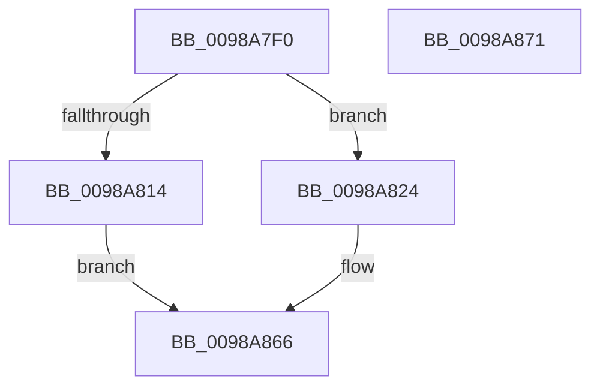

# PopControlMonitor

- RVA: `0x0098A7F0`–`0x0098A872` (길이 `130` bytes)
- VA: `0x000000014098A7F0`
- 실행 섹션: `PAGE`
- PDB 이름 있음: `예`; PDB Function 태그: `아니요`
- unwind 정보 RVA: `0x000986D4`
- 디코드: `37`개 명령, `130/130` bytes 표시
- 미해석 바이트: `0` (있으면 어셈블리에 `.byte`로 보존)

> 이 문서는 커널 이미지의 기계어와 PDB 기호를 분석해 생성했습니다. 4번과 5번은 함수 원형과 자료형을 바이너리 사용 방식에서 추정한 C 해석이며 원본 소스 복구 결과는 아닙니다.

## 1. Dependencies

- 직접 호출 지점: **3**; 고유 호출 대상: **3**
- 직접 호출자로 확인된 함수: **2**
- RIP 상대 이미지 참조: **0**

### Outgoing calls
- `0x0098A809` → [TtmIsEnabled](../91/TtmIsEnabled_function_009143D8.md) (function, `0x009143D8`)
- `0x0098A81D` → [TtmSessionMonitorControl](TtmSessionMonitorControl_function_0098B174.md) (function, `0x0098B174`)
- `0x0098A861` → [PopInvokeWin32Callout](../91/PopInvokeWin32Callout_function_009125F4.md) (function, `0x009125F4`)

### Direct callers
- [PopScreenOn](../76/PopScreenOn_function_007697E0.md) at `0x00769812`
- [PopScreenOff](PopScreenOff_function_0098A758.md) at `0x0098A7A2`

### Static image references
- 디코드된 RIP-relative 메모리 참조가 없습니다.

## 2. Other-region calls and transfers

- 다른 실행 섹션으로 향하는 call: **0**
- 별도 외부 분기/꼬리 이동을 확인하지 못했습니다.

## 3. Assembly (complete function range)

```asm
0098A7F0  48 89 5C 24 08                  mov qword ptr [rsp + 8], rbx
0098A7F5  89 54 24 10                     mov dword ptr [rsp + 0x10], edx
0098A7F9  55                              push rbp
0098A7FA  48 8B EC                        mov rbp, rsp
0098A7FD  48 83 EC 60                     sub rsp, 0x60
0098A801  33 C0                           xor eax, eax
0098A803  48 8B D9                        mov rbx, rcx
0098A806  89 45 C4                        mov dword ptr [rbp - 0x3c], eax
0098A809  E8 CA 9B F8 FF                  call 0x1409143d8
0098A80E  33 C9                           xor ecx, ecx
0098A810  84 C0                           test al, al
0098A812  74 10                           je 0x14098a824
0098A814  44 8B 03                        mov r8d, dword ptr [rbx]
0098A817  8B 53 04                        mov edx, dword ptr [rbx + 4]
0098A81A  8B 4D 18                        mov ecx, dword ptr [rbp + 0x18]
0098A81D  E8 52 09 00 00                  call 0x14098b174
0098A822  EB 42                           jmp 0x14098a866
0098A824  0F 57 C0                        xorps xmm0, xmm0
0098A827  48 89 4D F0                     mov qword ptr [rbp - 0x10], rcx
0098A82B  0F 11 45 D0                     movups xmmword ptr [rbp - 0x30], xmm0
0098A82F  41 B8 01 00 00 00               mov r8d, 1
0098A835  88 4D D4                        mov byte ptr [rbp - 0x2c], cl
0098A838  0F 11 45 E0                     movups xmmword ptr [rbp - 0x20], xmm0
0098A83C  89 4D E8                        mov dword ptr [rbp - 0x18], ecx
0098A83F  4C 8D 4D 18                     lea r9, [rbp + 0x18]
0098A843  48 8D 55 C0                     lea rdx, [rbp - 0x40]
0098A847  C7 45 D0 03 00 00 00            mov dword ptr [rbp - 0x30], 3
0098A84E  41 8D 48 04                     lea ecx, [r8 + 4]
0098A852  C7 45 D8 08 00 00 00            mov dword ptr [rbp - 0x28], 8
0098A859  0F 11 45 C0                     movups xmmword ptr [rbp - 0x40], xmm0
0098A85D  48 89 5D E0                     mov qword ptr [rbp - 0x20], rbx
0098A861  E8 8E 7D F8 FF                  call 0x1409125f4
0098A866  48 8B 5C 24 70                  mov rbx, qword ptr [rsp + 0x70]
0098A86B  48 83 C4 60                     add rsp, 0x60
0098A86F  5D                              pop rbp
0098A870  C3                              ret
0098A871  CC                              int3
```

## 4. C-style interpretation (structured pseudocode)

```c
__int64 __fastcall PopControlMonitor(__int64 a1, int a2)
{
    __int64 result;
    __int64 v_rsp;
    unsigned __int64 v_stack_m18;
    unsigned int v_stack_m20;
    unsigned __int64 v_stack_m28;
    unsigned int v_stack_m30;
    unsigned __int8 v_stack_m34;
    unsigned __int64 v_stack_m38;
    unsigned int v_stack_m44;
    unsigned __int64 v_stack_m48;
    unsigned int v_stack_p10;
    unsigned __int64 v_stack_p8;

    v_stack_p8 = v_rbx;
    v_stack_p10 = a2;
    v_rsp = (v_rsp) - (96);
    result = 0;
    v_stack_m44 = 0;
    result = TtmIsEnabled(a1, a2, a3, a4);
    a1 = 0;
    if ((unsigned __int8)(result) == 0) goto loc_0098A824;
    result = TtmSessionMonitorControl((unsigned int)(v_stack_p10), (unsigned int)(*(unsigned int *)(a1 + 4)), (unsigned int)(*(unsigned int *)(a1)), a4);
    goto loc_0098A866;
loc_0098A824:
    v_stack_m18 = (unsigned int)(v_stack_p10);
    v_stack_m38 = v_xmm0;
    v_stack_m34 = (unsigned __int8)((unsigned int)(v_stack_p10));
    v_stack_m28 = v_xmm0;
    v_stack_m20 = (unsigned int)((unsigned int)(v_stack_p10));
    v_stack_m38 = 3;
    v_stack_m30 = 8;
    v_stack_m48 = v_xmm0;
    v_stack_m28 = 0;
    result = PopInvokeWin32Callout(1 + 4, v_stack_m48, 1, v_stack_p10);
loc_0098A866:
    v_rsp = (v_rsp) + (96);
    return result;
}
```

## 5. (Beta) C Style

```c
int64_t PopControlMonitor(void *Arg1, int32_t Arg2)
{
    uint8_t *arg1 = (uint8_t *)Arg1;

    int64_t result;
    int64_t local_rsp;
    uint64_t v_stack_m18;
    uint32_t v_stack_m20;
    uint64_t v_stack_m28;
    uint32_t v_stack_m30;
    uint8_t v_stack_m34;
    uint64_t v_stack_m38;
    uint32_t v_stack_m44;
    uint64_t v_stack_m48;
    uint32_t v_stack_p10;
    uint64_t v_stack_p8;

    v_stack_p8 = local_rbx;
    v_stack_p10 = Arg2;
    local_rsp = (local_rsp) - (96);
    result = 0;
    v_stack_m44 = 0;
    result = TtmIsEnabled(Arg1, Arg2, a3, a4);
    Arg1 = 0;
    if ((uint8_t)(result) == 0) goto loc_0098A824;
    result = TtmSessionMonitorControl((uint32_t)(v_stack_p10), (uint32_t)(*(uint32_t *)(arg1 + 0x4)), (uint32_t)(*(uint32_t *)(arg1)), a4);
    goto loc_0098A866;
loc_0098A824:
    v_stack_m18 = (uint32_t)(v_stack_p10);
    v_stack_m38 = v_xmm0;
    v_stack_m34 = (uint8_t)((uint32_t)(v_stack_p10));
    v_stack_m28 = v_xmm0;
    v_stack_m20 = (uint32_t)((uint32_t)(v_stack_p10));
    v_stack_m38 = 3;
    v_stack_m30 = 8;
    v_stack_m48 = v_xmm0;
    v_stack_m28 = 0;
    result = PopInvokeWin32Callout(1 + 4, v_stack_m48, 1, v_stack_p10);
loc_0098A866:
    local_rsp = (local_rsp) + (96);
    return result;
}
```

### 관측된 메모리 오프셋

구조체 형식이 확인되지 않은 접근은 인자 기준의 오프셋으로만 기록했습니다.

| 기준 인자 | 오프셋 표현 | 폭 (bit) | 접근 |
|---|---:|---:|---|
| `Arg1` | `+ 0x0` | `32` | `R` |
| `Arg1` | `+ 0x4` | `32` | `R` |

## 6. Execution-region graph

[열기: 2D/3D 그래프와 함수 탐색 컨트롤 패널](../../../control-panel.html?section=page&rva=0x0098A7F0&view=graph)

- 2D 그래프는 위에서 아래로 흐르고, 3D 그래프는 빈 공간을 드래그해 회전합니다. Shift+드래그는 이동, 휠은 확대·축소, 함수 노드 선택은 대상 보고서 이동입니다.

### Static fallback


