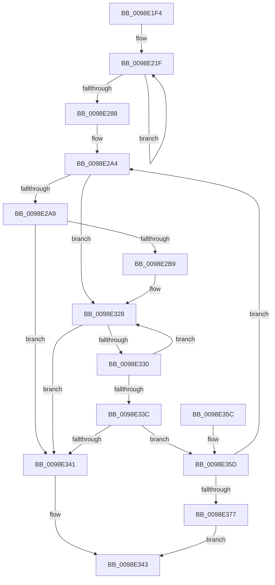

# PopEtAggregateFind

- RVA: `0x0098E1F4`–`0x0098E37C` (길이 `392` bytes)
- VA: `0x000000014098E1F4`
- 실행 섹션: `PAGE`
- PDB 이름 있음: `예`; PDB Function 태그: `아니요`
- unwind 정보 RVA: `0x000988E4`
- 디코드: `108`개 명령, `392/392` bytes 표시
- 미해석 바이트: `0` (있으면 어셈블리에 `.byte`로 보존)

> 이 문서는 커널 이미지의 기계어와 PDB 기호를 분석해 생성했습니다. 4번과 5번은 함수 원형과 자료형을 바이너리 사용 방식에서 추정한 C 해석이며 원본 소스 복구 결과는 아닙니다.

## 1. Dependencies

- 직접 호출 지점: **1**; 고유 호출 대상: **1**
- 직접 호출자로 확인된 함수: **1**
- RIP 상대 이미지 참조: **0**

### Outgoing calls
- `0x0098E36A` → [memcmp](../../text/6C/memcmp_function_006C6B10.md) (function, `0x006C6B10`)

### Direct callers
- [PopEtAggregateGet](PopEtAggregateGet_function_0098DEEC.md) at `0x0098DF1C`

### Static image references
- 디코드된 RIP-relative 메모리 참조가 없습니다.

## 2. Other-region calls and transfers

- 다른 실행 섹션으로 향하는 call: **1**
  - `0x0098E36A` → [memcmp](../../text/6C/memcmp_function_006C6B10.md) (`PAGE` → `.text`)
- 별도 외부 분기/꼬리 이동을 확인하지 못했습니다.

## 3. Assembly (complete function range)

```asm
0098E1F4  48 89 5C 24 10                  mov qword ptr [rsp + 0x10], rbx
0098E1F9  48 89 6C 24 18                  mov qword ptr [rsp + 0x18], rbp
0098E1FE  48 89 74 24 20                  mov qword ptr [rsp + 0x20], rsi
0098E203  57                              push rdi
0098E204  41 56                           push r14
0098E206  41 57                           push r15
0098E208  48 83 EC 20                     sub rsp, 0x20
0098E20C  48 8B EA                        mov rbp, rdx
0098E20F  4C 8B F9                        mov r15, rcx
0098E212  4C 8B DA                        mov r11, rdx
0098E215  BF 2F CB 04 00                  mov edi, 0x4cb2f
0098E21A  BB 04 00 00 00                  mov ebx, 4
0098E21F  41 0F B6 03                     movzx eax, byte ptr [r11]
0098E223  4D 8D 5B 08                     lea r11, [r11 + 8]
0098E227  4C 6B CF 25                     imul r9, rdi, 0x25
0098E22B  4C 03 C8                        add r9, rax
0098E22E  41 0F B6 43 F9                  movzx eax, byte ptr [r11 - 7]
0098E233  4D 6B D1 25                     imul r10, r9, 0x25
0098E237  4C 03 D0                        add r10, rax
0098E23A  41 0F B6 43 FA                  movzx eax, byte ptr [r11 - 6]
0098E23F  49 6B CA 25                     imul rcx, r10, 0x25
0098E243  48 03 C8                        add rcx, rax
0098E246  41 0F B6 43 FB                  movzx eax, byte ptr [r11 - 5]
0098E24B  48 6B D1 25                     imul rdx, rcx, 0x25
0098E24F  48 03 D0                        add rdx, rax
0098E252  41 0F B6 43 FC                  movzx eax, byte ptr [r11 - 4]
0098E257  48 6B CA 25                     imul rcx, rdx, 0x25
0098E25B  48 03 C8                        add rcx, rax
0098E25E  41 0F B6 43 FD                  movzx eax, byte ptr [r11 - 3]
0098E263  48 6B D1 25                     imul rdx, rcx, 0x25
0098E267  48 03 D0                        add rdx, rax
0098E26A  41 0F B6 43 FE                  movzx eax, byte ptr [r11 - 2]
0098E26F  48 6B CA 25                     imul rcx, rdx, 0x25
0098E273  48 03 C8                        add rcx, rax
0098E276  41 0F B6 43 FF                  movzx eax, byte ptr [r11 - 1]
0098E27B  48 6B F9 25                     imul rdi, rcx, 0x25
0098E27F  48 03 F8                        add rdi, rax
0098E282  48 83 EB 01                     sub rbx, 1
0098E286  75 97                           jne 0x14098e21f
0098E288  45 8B 77 34                     mov r14d, dword ptr [r15 + 0x34]
0098E28C  48 83 CE FF                     or rsi, 0xffffffffffffffff
0098E290  41 8B CE                        mov ecx, r14d
0098E293  49 89 38                        mov qword ptr [r8], rdi
0098E296  83 E1 1F                        and ecx, 0x1f
0098E299  48 D3 E6                        shl rsi, cl
0098E29C  48 23 FE                        and rdi, rsi
0098E29F  48 89 7C 24 40                  mov qword ptr [rsp + 0x40], rdi
0098E2A4  48 85 DB                        test rbx, rbx
0098E2A7  75 7F                           jne 0x14098e328
0098E2A9  45 8B CE                        mov r9d, r14d
0098E2AC  41 C1 E9 05                     shr r9d, 5
0098E2B0  45 85 C9                        test r9d, r9d
0098E2B3  0F 84 88 00 00 00               je 0x14098e341
0098E2B9  40 0F B6 C7                     movzx eax, dil
0098E2BD  48 05 CB 5D B1 00               add rax, 0xb15dcb
0098E2C3  48 6B C8 25                     imul rcx, rax, 0x25
0098E2C7  0F B6 44 24 41                  movzx eax, byte ptr [rsp + 0x41]
0098E2CC  48 03 C8                        add rcx, rax
0098E2CF  0F B6 44 24 42                  movzx eax, byte ptr [rsp + 0x42]
0098E2D4  48 6B D1 25                     imul rdx, rcx, 0x25
0098E2D8  48 03 D0                        add rdx, rax
0098E2DB  0F B6 44 24 43                  movzx eax, byte ptr [rsp + 0x43]
0098E2E0  48 6B CA 25                     imul rcx, rdx, 0x25
0098E2E4  48 03 C8                        add rcx, rax
0098E2E7  0F B6 44 24 44                  movzx eax, byte ptr [rsp + 0x44]
0098E2EC  48 6B D1 25                     imul rdx, rcx, 0x25
0098E2F0  48 03 D0                        add rdx, rax
0098E2F3  0F B6 44 24 45                  movzx eax, byte ptr [rsp + 0x45]
0098E2F8  48 6B CA 25                     imul rcx, rdx, 0x25
0098E2FC  48 03 C8                        add rcx, rax
0098E2FF  0F B6 44 24 46                  movzx eax, byte ptr [rsp + 0x46]
0098E304  48 6B D1 25                     imul rdx, rcx, 0x25
0098E308  41 8D 49 FF                     lea ecx, [r9 - 1]
0098E30C  48 03 D0                        add rdx, rax
0098E30F  0F B6 44 24 47                  movzx eax, byte ptr [rsp + 0x47]
0098E314  4C 6B C2 25                     imul r8, rdx, 0x25
0098E318  49 03 C0                        add rax, r8
0098E31B  8B C0                           mov eax, eax
0098E31D  48 23 C8                        and rcx, rax
0098E320  49 8B 47 38                     mov rax, qword ptr [r15 + 0x38]
0098E324  48 8D 1C C8                     lea rbx, [rax + rcx*8]
0098E328  48 8B 1B                        mov rbx, qword ptr [rbx]
0098E32B  F6 C3 01                        test bl, 1
0098E32E  75 11                           jne 0x14098e341
0098E330  48 8B 43 08                     mov rax, qword ptr [rbx + 8]
0098E334  48 23 C6                        and rax, rsi
0098E337  48 3B F8                        cmp rdi, rax
0098E33A  75 EC                           jne 0x14098e328
0098E33C  48 85 DB                        test rbx, rbx
0098E33F  75 1C                           jne 0x14098e35d
0098E341  33 C0                           xor eax, eax
0098E343  48 8B 5C 24 48                  mov rbx, qword ptr [rsp + 0x48]
0098E348  48 8B 6C 24 50                  mov rbp, qword ptr [rsp + 0x50]
0098E34D  48 8B 74 24 58                  mov rsi, qword ptr [rsp + 0x58]
0098E352  48 83 C4 20                     add rsp, 0x20
0098E356  41 5F                           pop r15
0098E358  41 5E                           pop r14
0098E35A  5F                              pop rdi
0098E35B  C3                              ret
0098E35C  CC                              int3
0098E35D  48 8D 4B 10                     lea rcx, [rbx + 0x10]
0098E361  41 B8 20 00 00 00               mov r8d, 0x20
0098E367  48 8B D5                        mov rdx, rbp
0098E36A  E8 A1 87 D3 FF                  call 0x1406c6b10
0098E36F  85 C0                           test eax, eax
0098E371  0F 85 2D FF FF FF               jne 0x14098e2a4
0098E377  48 8B C3                        mov rax, rbx
0098E37A  EB C7                           jmp 0x14098e343
```

## 4. C-style interpretation (structured pseudocode)

```c
__int64 __fastcall PopEtAggregateFind(__int64 a1, __int64 a2, __int64 a3)
{
    __int64 result;
    __int64 v_r10;
    __int64 v_rbx;
    __int64 v_rdi;
    __int64 v_rsi;
    __int64 v_rsp;
    unsigned __int64 v_stack_p10;
    unsigned __int64 v_stack_p18;
    unsigned __int64 v_stack_p20;
    unsigned __int64 v_stack_p8;
    unsigned __int8 v_stack_p9;
    unsigned __int8 v_stack_pA;
    unsigned __int8 v_stack_pB;
    unsigned __int8 v_stack_pC;
    unsigned __int8 v_stack_pD;
    unsigned __int8 v_stack_pE;
    unsigned __int8 v_stack_pF;

    v_stack_p10 = v_rbx;
    v_stack_p18 = v_rbp;
    v_stack_p20 = v_rsi;
    v_rsp = (v_rsp) - (32);
loc_0098E21F:
    a4 = (a4) * ((unsigned int)(0x4CB2FULL));
    a4 = (a4) + (*(unsigned __int8 *)(a2));
    v_r10 = (v_r10) * (a4);
    v_r10 = (v_r10) + (*(unsigned __int8 *)(a2 + 8 - 7));
    a1 = (a1) * (v_r10);
    a1 = (a1) + (*(unsigned __int8 *)(a2 + 8 - 6));
    a2 = (a2) * (a1);
    a2 = (a2) + (*(unsigned __int8 *)(a2 + 8 - 5));
    a1 = (a1) * (a2);
    a1 = (a1) + (*(unsigned __int8 *)(a2 + 8 - 4));
    a2 = (a2) * (a1);
    a2 = (a2) + (*(unsigned __int8 *)(a2 + 8 - 3));
    a1 = (a1) * (a2);
    a1 = (a1) + (*(unsigned __int8 *)(a2 + 8 - 2));
    v_rdi = ((unsigned int)(0x4CB2FULL)) * (a1);
    v_rdi = (v_rdi) + (*(unsigned __int8 *)(a2 + 8 - 1));
    v_rbx = (4) - (1);
    if (condition_is_not_equal) goto loc_0098E21F;
    v_rsi = (v_rsi) | (-1);
    *(unsigned __int64 *)(a3) = v_rdi;
    a1 = (unsigned int)(((unsigned int)((unsigned int)((unsigned int)(*(unsigned int *)(a1 + 52))))) & (31));
    v_rsi = (v_rsi) << ((unsigned __int8)(a1));
    v_rdi = (v_rdi) & (v_rsi);
    v_stack_p8 = v_rdi;
loc_0098E2A4:
    if (v_rbx != 0) goto loc_0098E328;
    a4 = (unsigned int)(((unsigned int)((unsigned int)((unsigned int)(*(unsigned int *)(a1 + 52))))) >> (5));
    if ((unsigned int)(a4) == 0) goto loc_0098E341;
    result = ((unsigned __int8)(v_rdi)) + (0xB15DCBULL);
    a1 = (a1) * (result);
    a1 = (a1) + (v_stack_p9);
    a2 = (a2) * (a1);
    a2 = (a2) + (v_stack_pA);
    a1 = (a1) * (a2);
    a1 = (a1) + (v_stack_pB);
    a2 = (a2) * (a1);
    a2 = (a2) + (v_stack_pC);
    a1 = (a1) * (a2);
    a1 = (a1) + (v_stack_pD);
    a2 = (a2) * (a1);
    a2 = (a2) + (v_stack_pE);
    a3 = (a3) * (a2);
    result = (v_stack_pF) + (a3);
    a1 = (a4 - 1) & ((unsigned int)((unsigned int)(result)));
loc_0098E328:
    if ((((unsigned __int8)(*(unsigned __int64 *)(*(unsigned __int64 *)(a1 + 56) + a1 * 8))) & (1)) != 0) goto loc_0098E341;
    result = (*(unsigned __int64 *)(*(unsigned __int64 *)(*(unsigned __int64 *)(a1 + 56) + a1 * 8) + 8)) & (v_rsi);
    if (v_rdi != result) goto loc_0098E328;
    if (*(unsigned __int64 *)(*(unsigned __int64 *)(a1 + 56) + a1 * 8) != 0) goto loc_0098E35D;
loc_0098E341:
    result = 0;
loc_0098E343:
    v_rsp = (v_rsp) + (32);
    return result;
loc_0098E35D:
    result = memcmp(v_stack_p10 + 16, v_stack_p18, 32, a4);
    if ((unsigned int)(result) != 0) goto loc_0098E2A4;
    goto loc_0098E343;
}
```

## 5. (Beta) C Style

```c
int64_t PopEtAggregateFind(void *Arg1, void *Arg2, void *Arg3)
{
    uint8_t *arg1 = (uint8_t *)Arg1;
    uint8_t *arg2 = (uint8_t *)Arg2;
    uint8_t *arg3 = (uint8_t *)Arg3;

    int64_t result;
    int64_t local_r10;
    int64_t local_rbx;
    int64_t local_rdi;
    int64_t local_rsi;
    int64_t local_rsp;
    uint64_t v_stack_p10;
    uint64_t v_stack_p18;
    uint64_t v_stack_p20;
    uint64_t v_stack_p8;
    uint8_t v_stack_p9;
    uint8_t v_stack_pA;
    uint8_t v_stack_pB;
    uint8_t v_stack_pC;
    uint8_t v_stack_pD;
    uint8_t v_stack_pE;
    uint8_t v_stack_pF;

    v_stack_p10 = local_rbx;
    v_stack_p18 = local_rbp;
    v_stack_p20 = local_rsi;
    local_rsp = (local_rsp) - (32);
loc_0098E21F:
    a4 = (a4) * ((uint32_t)(0x4CB2FULL));
    a4 = (a4) + (*(uint8_t *)(arg2));
    local_r10 = (local_r10) * (a4);
    local_r10 = (local_r10) + (*(uint8_t *)(arg2 + 0x8 - 0x7));
    Arg1 = (Arg1) * (local_r10);
    Arg1 = (Arg1) + (*(uint8_t *)(arg2 + 0x8 - 0x6));
    Arg2 = (Arg2) * (Arg1);
    Arg2 = (Arg2) + (*(uint8_t *)(arg2 + 0x8 - 0x5));
    Arg1 = (Arg1) * (Arg2);
    Arg1 = (Arg1) + (*(uint8_t *)(arg2 + 0x8 - 0x4));
    Arg2 = (Arg2) * (Arg1);
    Arg2 = (Arg2) + (*(uint8_t *)(arg2 + 0x8 - 0x3));
    Arg1 = (Arg1) * (Arg2);
    Arg1 = (Arg1) + (*(uint8_t *)(arg2 + 0x8 - 0x2));
    local_rdi = ((uint32_t)(0x4CB2FULL)) * (Arg1);
    local_rdi = (local_rdi) + (*(uint8_t *)(arg2 + 0x8 - 0x1));
    local_rbx = (4) - (1);
    if (condition_is_not_equal) goto loc_0098E21F;
    local_rsi = (local_rsi) | (-1);
    *(uint64_t *)(arg3) = local_rdi;
    Arg1 = (uint32_t)(((uint32_t)((uint32_t)((uint32_t)(*(uint32_t *)(arg1 + 0x34))))) & (31));
    local_rsi = (local_rsi) << ((uint8_t)(Arg1));
    local_rdi = (local_rdi) & (local_rsi);
    v_stack_p8 = local_rdi;
loc_0098E2A4:
    if (local_rbx != 0) goto loc_0098E328;
    a4 = (uint32_t)(((uint32_t)((uint32_t)((uint32_t)(*(uint32_t *)(arg1 + 0x34))))) >> (5));
    if ((uint32_t)(a4) == 0) goto loc_0098E341;
    result = ((uint8_t)(local_rdi)) + (0xB15DCBULL);
    Arg1 = (Arg1) * (result);
    Arg1 = (Arg1) + (v_stack_p9);
    Arg2 = (Arg2) * (Arg1);
    Arg2 = (Arg2) + (v_stack_pA);
    Arg1 = (Arg1) * (Arg2);
    Arg1 = (Arg1) + (v_stack_pB);
    Arg2 = (Arg2) * (Arg1);
    Arg2 = (Arg2) + (v_stack_pC);
    Arg1 = (Arg1) * (Arg2);
    Arg1 = (Arg1) + (v_stack_pD);
    Arg2 = (Arg2) * (Arg1);
    Arg2 = (Arg2) + (v_stack_pE);
    Arg3 = (Arg3) * (Arg2);
    result = (v_stack_pF) + (Arg3);
    Arg1 = (a4 - 1) & ((uint32_t)((uint32_t)(result)));
loc_0098E328:
    if ((((uint8_t)(*(uint64_t *)(*(uint64_t *)(arg1 + 0x38) + arg1 * 8))) & (1)) != 0) goto loc_0098E341;
    result = (*(uint64_t *)(*(uint64_t *)(*(uint64_t *)(arg1 + 0x38) + arg1 * 8) + 0x8)) & (local_rsi);
    if (local_rdi != result) goto loc_0098E328;
    if (*(uint64_t *)(*(uint64_t *)(arg1 + 0x38) + arg1 * 8) != 0) goto loc_0098E35D;
loc_0098E341:
    result = 0;
loc_0098E343:
    local_rsp = (local_rsp) + (32);
    return result;
loc_0098E35D:
    result = memcmp(v_stack_p10 + 16, v_stack_p18, 32, a4);
    if ((uint32_t)(result) != 0) goto loc_0098E2A4;
    goto loc_0098E343;
}
```

### 관측된 메모리 오프셋

구조체 형식이 확인되지 않은 접근은 인자 기준의 오프셋으로만 기록했습니다.

| 기준 인자 | 오프셋 표현 | 폭 (bit) | 접근 |
|---|---:|---:|---|
| `Arg1` | `+ 0x34` | `32` | `R` |
| `Arg1` | `+ 0x38` | `64` | `R` |
| `Arg2` | `- 0x7` | `8` | `R` |
| `Arg2` | `- 0x6` | `8` | `R` |
| `Arg2` | `- 0x5` | `8` | `R` |
| `Arg2` | `- 0x4` | `8` | `R` |
| `Arg2` | `- 0x3` | `8` | `R` |
| `Arg2` | `- 0x2` | `8` | `R` |
| `Arg2` | `- 0x1` | `8` | `R` |
| `Arg2` | `+ 0x0` | `8` | `R` |
| `Arg2` | `+ 0x8` | `64` | `R` |
| `Arg3` | `+ 0x0` | `64` | `W` |

## 6. Execution-region graph

[열기: 2D/3D 그래프와 함수 탐색 컨트롤 패널](../../../control-panel.html?section=page&rva=0x0098E1F4&view=graph)

- 2D 그래프는 위에서 아래로 흐르고, 3D 그래프는 빈 공간을 드래그해 회전합니다. Shift+드래그는 이동, 휠은 확대·축소, 함수 노드 선택은 대상 보고서 이동입니다.

### Static fallback


