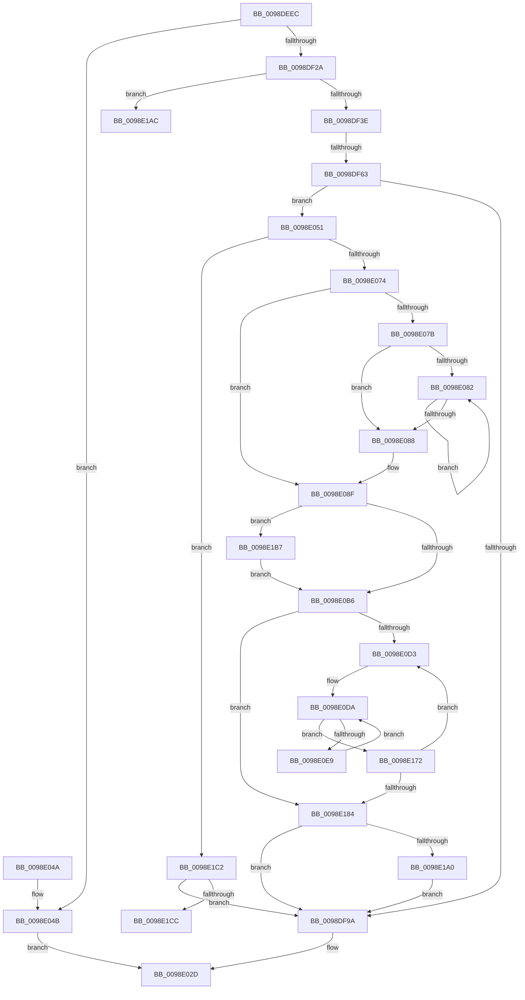

# PopEtAggregateGet

- RVA: `0x0098DEEC`–`0x0098E1EC` (길이 `768` bytes)
- VA: `0x000000014098DEEC`
- 실행 섹션: `PAGE`
- PDB 이름 있음: `예`; PDB Function 태그: `예`
- unwind 정보 RVA: `0x000988B4`
- 디코드: `210`개 명령, `768/768` bytes 표시
- 미해석 바이트: `0` (있으면 어셈블리에 `.byte`로 보존)

> 이 문서는 커널 이미지의 기계어와 PDB 기호를 분석해 생성했습니다. 4번과 5번은 함수 원형과 자료형을 바이너리 사용 방식에서 추정한 C 해석이며 원본 소스 복구 결과는 아닙니다.

## 1. Dependencies

- 직접 호출 지점: **8**; 고유 호출 대상: **8**
- 직접 호출자로 확인된 함수: **1**
- RIP 상대 이미지 참조: **0**

### Outgoing calls
- `0x0098DF1C` → [PopEtAggregateFind](PopEtAggregateFind_function_0098E1F4.md) (function, `0x0098E1F4`)
- `0x0098DF52` → [ExAllocatePool2](../../poolcode/B8/ExAllocatePool2_function_00B820F0.md) (function, `0x00B820F0`)
- `0x0098DF6B` → [memset](../../text/6C/memset_function_006C6C40.md) (function, `0x006C6C40`)
- `0x0098DF77` → [PopEtAggregateKeyCopy](PopEtAggregateKeyCopy_function_0098D37C.md) (function, `0x0098D37C`)
- `0x0098E063` → [PopEtAllocate](PopEtAllocate_function_0098C8E0.md) (function, `0x0098C8E0`)
- `0x0098E1A2` → [PopEtBucketsFree](../76/PopEtBucketsFree_function_00769B24.md) (function, `0x00769B24`)
- `0x0098E1D0` → [PopEtAggregateKeyCleanup](PopEtAggregateKeyCleanup_function_0098D304.md) (function, `0x0098D304`)
- `0x0098E1DD` → [ExFreePoolWithTag](../../poolcode/B8/ExFreePoolWithTag_function_00B82870.md) (function, `0x00B82870`)

### Direct callers
- [PopEtEnergyTrackerUpdateAggregate](PopEtEnergyTrackerUpdateAggregate_function_0098D724.md) at `0x0098D79A`

### Static image references
- 디코드된 RIP-relative 메모리 참조가 없습니다.

## 2. Other-region calls and transfers

- 다른 실행 섹션으로 향하는 call: **3**
  - `0x0098DF52` → [ExAllocatePool2](../../poolcode/B8/ExAllocatePool2_function_00B820F0.md) (`PAGE` → `POOLCODE`)
  - `0x0098DF6B` → [memset](../../text/6C/memset_function_006C6C40.md) (`PAGE` → `.text`)
  - `0x0098E1DD` → [ExFreePoolWithTag](../../poolcode/B8/ExFreePoolWithTag_function_00B82870.md) (`PAGE` → `POOLCODE`)
- call이 아닌 외부 분기/꼬리 이동: **3**
  - `0x0098DF5D` → [sub_00B2B8B2](../B2/Unknown_function_00B2B8B2.md) (`tail-transfer`)
  - `0x0098E1B2` → [sub_00B2B8B2](../B2/Unknown_function_00B2B8B2.md) (`tail-transfer`)
  - `0x0098E1E7` → [sub_00B2B8B2](../B2/Unknown_function_00B2B8B2.md) (`tail-transfer`)

## 3. Assembly (complete function range)

```asm
0098DEEC  48 8B C4                        mov rax, rsp
0098DEEF  48 89 58 08                     mov qword ptr [rax + 8], rbx
0098DEF3  48 89 68 10                     mov qword ptr [rax + 0x10], rbp
0098DEF7  48 89 70 18                     mov qword ptr [rax + 0x18], rsi
0098DEFB  57                              push rdi
0098DEFC  41 54                           push r12
0098DEFE  41 55                           push r13
0098DF00  41 56                           push r14
0098DF02  41 57                           push r15
0098DF04  48 83 EC 20                     sub rsp, 0x20
0098DF08  4D 8B E0                        mov r12, r8
0098DF0B  45 33 ED                        xor r13d, r13d
0098DF0E  4C 8D 40 20                     lea r8, [rax + 0x20]
0098DF12  4C 89 68 20                     mov qword ptr [rax + 0x20], r13
0098DF16  48 8B FA                        mov rdi, rdx
0098DF19  48 8B F1                        mov rsi, rcx
0098DF1C  E8 D3 02 00 00                  call 0x14098e1f4
0098DF21  48 85 C0                        test rax, rax
0098DF24  0F 85 21 01 00 00               jne 0x14098e04b
0098DF2A  8B 46 20                        mov eax, dword ptr [rsi + 0x20]
0098DF2D  48 8D 6E 30                     lea rbp, [rsi + 0x30]
0098DF31  41 8D 5D 04                     lea ebx, [r13 + 4]
0098DF35  39 45 00                        cmp dword ptr [rbp], eax
0098DF38  0F 83 6E 02 00 00               jae 0x14098e1ac
0098DF3E  41 BF 08 02 00 00               mov r15d, 0x208
0098DF44  41 B8 50 6F 45 54               mov r8d, 0x54456f50
0098DF4A  41 8B D7                        mov edx, r15d
0098DF4D  B9 00 01 00 00                  mov ecx, 0x100
0098DF52  E8 99 41 1F 00                  call 0x140b820f0
0098DF57  4C 8B F0                        mov r14, rax
0098DF5A  48 85 C0                        test rax, rax
0098DF5D  0F 84 4F D9 19 00               je 0x140b2b8b2
0098DF63  45 8B C7                        mov r8d, r15d
0098DF66  33 D2                           xor edx, edx
0098DF68  48 8B C8                        mov rcx, rax
0098DF6B  E8 D0 8C D3 FF                  call 0x1406c6c40
0098DF70  49 8D 4E 10                     lea rcx, [r14 + 0x10]
0098DF74  48 8B D7                        mov rdx, rdi
0098DF77  E8 00 F4 FF FF                  call 0x14098d37c
0098DF7C  48 8B 4C 24 68                  mov rcx, qword ptr [rsp + 0x68]
0098DF81  49 83 CF FF                     or r15, 0xffffffffffffffff
0098DF85  49 89 4E 08                     mov qword ptr [r14 + 8], rcx
0098DF89  8B 5D 04                        mov ebx, dword ptr [rbp + 4]
0098DF8C  C1 EB 05                        shr ebx, 5
0098DF8F  03 DB                           add ebx, ebx
0098DF91  39 5D 00                        cmp dword ptr [rbp], ebx
0098DF94  0F 83 B7 00 00 00               jae 0x14098e051
0098DF9A  8B 4E 34                        mov ecx, dword ptr [rsi + 0x34]
0098DF9D  8B F9                           mov edi, ecx
0098DF9F  83 E1 1F                        and ecx, 0x1f
0098DFA2  C1 EF 05                        shr edi, 5
0098DFA5  49 D3 E7                        shl r15, cl
0098DFA8  4D 23 7E 08                     and r15, qword ptr [r14 + 8]
0098DFAC  4C 89 7C 24 68                  mov qword ptr [rsp + 0x68], r15
0098DFB1  41 0F B6 C7                     movzx eax, r15b
0098DFB5  48 05 CB 5D B1 00               add rax, 0xb15dcb
0098DFBB  4D 89 34 24                     mov qword ptr [r12], r14
0098DFBF  48 6B C8 25                     imul rcx, rax, 0x25
0098DFC3  0F B6 44 24 69                  movzx eax, byte ptr [rsp + 0x69]
0098DFC8  48 03 C8                        add rcx, rax
0098DFCB  0F B6 44 24 6A                  movzx eax, byte ptr [rsp + 0x6a]
0098DFD0  48 6B D1 25                     imul rdx, rcx, 0x25
0098DFD4  48 03 D0                        add rdx, rax
0098DFD7  0F B6 44 24 6B                  movzx eax, byte ptr [rsp + 0x6b]
0098DFDC  48 6B CA 25                     imul rcx, rdx, 0x25
0098DFE0  48 03 C8                        add rcx, rax
0098DFE3  0F B6 44 24 6C                  movzx eax, byte ptr [rsp + 0x6c]
0098DFE8  48 6B D1 25                     imul rdx, rcx, 0x25
0098DFEC  48 03 D0                        add rdx, rax
0098DFEF  0F B6 44 24 6D                  movzx eax, byte ptr [rsp + 0x6d]
0098DFF4  48 6B CA 25                     imul rcx, rdx, 0x25
0098DFF8  48 03 C8                        add rcx, rax
0098DFFB  0F B6 44 24 6E                  movzx eax, byte ptr [rsp + 0x6e]
0098E000  48 6B D1 25                     imul rdx, rcx, 0x25
0098E004  48 03 D0                        add rdx, rax
0098E007  0F B6 44 24 6F                  movzx eax, byte ptr [rsp + 0x6f]
0098E00C  48 6B CA 25                     imul rcx, rdx, 0x25
0098E010  8D 57 FF                        lea edx, [rdi - 1]
0098E013  48 03 C1                        add rax, rcx
0098E016  48 8B 4E 38                     mov rcx, qword ptr [rsi + 0x38]
0098E01A  8B C0                           mov eax, eax
0098E01C  48 23 D0                        and rdx, rax
0098E01F  48 8B 04 D1                     mov rax, qword ptr [rcx + rdx*8]
0098E023  49 89 06                        mov qword ptr [r14], rax
0098E026  4C 89 34 D1                     mov qword ptr [rcx + rdx*8], r14
0098E02A  FF 46 30                        inc dword ptr [rsi + 0x30]
0098E02D  48 8B 5C 24 50                  mov rbx, qword ptr [rsp + 0x50]
0098E032  48 8B 6C 24 58                  mov rbp, qword ptr [rsp + 0x58]
0098E037  48 8B 74 24 60                  mov rsi, qword ptr [rsp + 0x60]
0098E03C  48 83 C4 20                     add rsp, 0x20
0098E040  41 5F                           pop r15
0098E042  41 5E                           pop r14
0098E044  41 5D                           pop r13
0098E046  41 5C                           pop r12
0098E048  5F                              pop rdi
0098E049  C3                              ret
0098E04A  CC                              int3
0098E04B  49 89 04 24                     mov qword ptr [r12], rax
0098E04F  EB DC                           jmp 0x14098e02d
0098E051  B8 04 00 00 00                  mov eax, 4
0098E056  3B D8                           cmp ebx, eax
0098E058  0F 42 D8                        cmovb ebx, eax
0098E05B  33 D2                           xor edx, edx
0098E05D  8B CB                           mov ecx, ebx
0098E05F  48 C1 E1 03                     shl rcx, 3
0098E063  E8 78 E8 FF FF                  call 0x14098c8e0
0098E068  4C 8B C0                        mov r8, rax
0098E06B  48 85 C0                        test rax, rax
0098E06E  0F 84 4E 01 00 00               je 0x14098e1c2
0098E074  8D 4B FF                        lea ecx, [rbx - 1]
0098E077  85 CB                           test ebx, ecx
0098E079  74 14                           je 0x14098e08f
0098E07B  83 C9 FF                        or ecx, 0xffffffff
0098E07E  85 DB                           test ebx, ebx
0098E080  74 06                           je 0x14098e088
0098E082  FF C1                           inc ecx
0098E084  D1 EB                           shr ebx, 1
0098E086  75 FA                           jne 0x14098e082
0098E088  BB 01 00 00 00                  mov ebx, 1
0098E08D  D3 E3                           shl ebx, cl
0098E08F  B8 00 00 00 04                  mov eax, 0x4000000
0098E094  3B D8                           cmp ebx, eax
0098E096  0F 47 D8                        cmova ebx, eax
0098E099  48 8B C5                        mov rax, rbp
0098E09C  48 83 C8 01                     or rax, 1
0098E0A0  8B CB                           mov ecx, ebx
0098E0A2  49 8D 14 D8                     lea rdx, [r8 + rbx*8]
0098E0A6  4C 3B C2                        cmp r8, rdx
0098E0A9  49 0F 47 CD                     cmova rcx, r13
0098E0AD  48 85 C9                        test rcx, rcx
0098E0B0  0F 85 01 01 00 00               jne 0x14098e1b7
0098E0B6  8B 55 04                        mov edx, dword ptr [rbp + 4]
0098E0B9  4D 8B D7                        mov r10, r15
0098E0BC  8B CA                           mov ecx, edx
0098E0BE  41 8B FD                        mov edi, r13d
0098E0C1  83 E1 1F                        and ecx, 0x1f
0098E0C4  49 D3 E2                        shl r10, cl
0098E0C7  F7 C2 E0 FF FF FF               test edx, 0xffffffe0
0098E0CD  0F 86 B1 00 00 00               jbe 0x14098e184
0098E0D3  4C 8B 6D 08                     mov r13, qword ptr [rbp + 8]
0098E0D7  44 8B DF                        mov r11d, edi
0098E0DA  4F 8B 4C DD 00                  mov r9, qword ptr [r13 + r11*8]
0098E0DF  41 F6 C1 01                     test r9b, 1
0098E0E3  0F 85 89 00 00 00               jne 0x14098e172
0098E0E9  49 8B 01                        mov rax, qword ptr [r9]
0098E0EC  4B 89 44 DD 00                  mov qword ptr [r13 + r11*8], rax
0098E0F1  49 8B 41 08                     mov rax, qword ptr [r9 + 8]
0098E0F5  49 23 C2                        and rax, r10
0098E0F8  48 89 44 24 68                  mov qword ptr [rsp + 0x68], rax
0098E0FD  0F B6 C0                        movzx eax, al
0098E100  48 05 CB 5D B1 00               add rax, 0xb15dcb
0098E106  48 6B C8 25                     imul rcx, rax, 0x25
0098E10A  0F B6 44 24 69                  movzx eax, byte ptr [rsp + 0x69]
0098E10F  48 03 C8                        add rcx, rax
0098E112  0F B6 44 24 6A                  movzx eax, byte ptr [rsp + 0x6a]
0098E117  48 6B D1 25                     imul rdx, rcx, 0x25
0098E11B  48 03 D0                        add rdx, rax
0098E11E  0F B6 44 24 6B                  movzx eax, byte ptr [rsp + 0x6b]
0098E123  48 6B CA 25                     imul rcx, rdx, 0x25
0098E127  48 03 C8                        add rcx, rax
0098E12A  0F B6 44 24 6C                  movzx eax, byte ptr [rsp + 0x6c]
0098E12F  48 6B D1 25                     imul rdx, rcx, 0x25
0098E133  48 03 D0                        add rdx, rax
0098E136  0F B6 44 24 6D                  movzx eax, byte ptr [rsp + 0x6d]
0098E13B  48 6B CA 25                     imul rcx, rdx, 0x25
0098E13F  48 03 C8                        add rcx, rax
0098E142  0F B6 44 24 6E                  movzx eax, byte ptr [rsp + 0x6e]
0098E147  48 6B D1 25                     imul rdx, rcx, 0x25
0098E14B  48 03 D0                        add rdx, rax
0098E14E  0F B6 44 24 6F                  movzx eax, byte ptr [rsp + 0x6f]
0098E153  48 6B CA 25                     imul rcx, rdx, 0x25
0098E157  8D 53 FF                        lea edx, [rbx - 1]
0098E15A  48 03 C1                        add rax, rcx
0098E15D  8B C0                           mov eax, eax
0098E15F  48 23 D0                        and rdx, rax
0098E162  49 8B 04 D0                     mov rax, qword ptr [r8 + rdx*8]
0098E166  49 89 01                        mov qword ptr [r9], rax
0098E169  4D 89 0C D0                     mov qword ptr [r8 + rdx*8], r9
0098E16D  E9 68 FF FF FF                  jmp 0x14098e0da
0098E172  8B 55 04                        mov edx, dword ptr [rbp + 4]
0098E175  FF C7                           inc edi
0098E177  8B C2                           mov eax, edx
0098E179  C1 E8 05                        shr eax, 5
0098E17C  3B F8                           cmp edi, eax
0098E17E  0F 82 4F FF FF FF               jb 0x14098e0d3
0098E184  48 8B 4D 08                     mov rcx, qword ptr [rbp + 8]
0098E188  83 E2 1F                        and edx, 0x1f
0098E18B  C1 E3 05                        shl ebx, 5
0098E18E  0B D3                           or edx, ebx
0098E190  4C 89 45 08                     mov qword ptr [rbp + 8], r8
0098E194  89 55 04                        mov dword ptr [rbp + 4], edx
0098E197  48 85 C9                        test rcx, rcx
0098E19A  0F 84 FA FD FF FF               je 0x14098df9a
0098E1A0  33 D2                           xor edx, edx
0098E1A2  E8 7D B9 DD FF                  call 0x140769b24
0098E1A7  E9 EE FD FF FF                  jmp 0x14098df9a
0098E1AC  FF 86 70 02 00 00               inc dword ptr [rsi + 0x270]
0098E1B2  E9 FB D6 19 00                  jmp 0x140b2b8b2
0098E1B7  49 8B F8                        mov rdi, r8
0098E1BA  F3 48 AB                        rep stosq qword ptr [rdi], rax
0098E1BD  E9 F4 FE FF FF                  jmp 0x14098e0b6
0098E1C2  83 7D 04 20                     cmp dword ptr [rbp + 4], 0x20
0098E1C6  0F 83 CE FD FF FF               jae 0x14098df9a
0098E1CC  49 8D 4E 10                     lea rcx, [r14 + 0x10]
0098E1D0  E8 2F F1 FF FF                  call 0x14098d304
0098E1D5  BA 50 6F 45 54                  mov edx, 0x54456f50
0098E1DA  49 8B CE                        mov rcx, r14
0098E1DD  E8 8E 46 1F 00                  call 0x140b82870
0098E1E2  BB 04 00 00 00                  mov ebx, 4
0098E1E7  E9 C6 D6 19 00                  jmp 0x140b2b8b2
```

## 4. C-style interpretation (structured pseudocode)

```c
__int64 __fastcall PopEtAggregateGet(__int64 a1, __int64 a2, __int64 a3)
{
    __int64 result;
    __int64 v_r10;
    __int64 v_r13;
    __int64 v_r15;
    __int64 v_rbx;
    __int64 v_rdi;
    __int64 v_rsp;
    unsigned __int64 v_stack_p10;
    unsigned __int64 v_stack_p18;
    unsigned __int64 v_stack_p20;
    unsigned __int8 v_stack_p21;
    unsigned __int8 v_stack_p22;
    unsigned __int8 v_stack_p23;
    unsigned __int8 v_stack_p24;
    unsigned __int8 v_stack_p25;
    unsigned __int8 v_stack_p26;
    unsigned __int8 v_stack_p27;
    unsigned __int64 v_stack_p68;
    unsigned __int8 v_stack_p69;
    unsigned __int8 v_stack_p6A;
    unsigned __int8 v_stack_p6B;
    unsigned __int8 v_stack_p6C;
    unsigned __int8 v_stack_p6D;
    unsigned __int8 v_stack_p6E;
    unsigned __int8 v_stack_p6F;
    unsigned __int64 v_stack_p8;

    *(unsigned __int64 *)(v_rsp + 8) = v_rbx;
    *(unsigned __int64 *)(v_rsp + 16) = v_rbp;
    *(unsigned __int64 *)(v_rsp + 24) = v_rsi;
    v_rsp = (v_rsp) - (32);
    v_r13 = 0;
    *(unsigned __int64 *)(v_rsp + 32) = 0;
    result = PopEtAggregateFind(a1, a2, v_rsp + 32, a4);
    if (result != 0) goto loc_0098E04B;
    if ((*(unsigned int *)(a1 + 48)) >= ((unsigned int)((unsigned int)(*(unsigned int *)(a1 + 32))))) goto loc_0098E1AC;
    result = ExAllocatePool2(256, 520, (unsigned int)(0x54456F50ULL), a4);
    a2 = 0;
    result = memset(result, a2, 520, a4);
    result = PopEtAggregateKeyCopy(result + 16, 0, 520, a4);
    v_r15 = (520) | (-1);
    *(unsigned __int64 *)(result + 8) = v_stack_p20;
    v_rbx = (unsigned int)(((unsigned int)(*(unsigned int *)(a1 + 48 + 4))) >> (5));
    v_rbx = (unsigned int)((v_rbx) + ((unsigned int)(v_rbx)));
    if ((*(unsigned int *)(a1 + 48)) >= ((unsigned int)(v_rbx))) goto loc_0098E051;
loc_0098DF9A:
    a1 = (unsigned int)(((unsigned int)(*(unsigned int *)(a1 + 52))) & (31));
    v_rdi = (unsigned int)(((unsigned int)((unsigned int)((unsigned int)(*(unsigned int *)(a1 + 52))))) >> (5));
    v_r15 = (v_r15) << ((unsigned __int8)(a1));
    v_r15 = (v_r15) & (*(unsigned __int64 *)(result + 8));
    v_stack_p20 = v_r15;
    result = ((unsigned __int8)(v_r15)) + (0xB15DCBULL);
    *(unsigned __int64 *)(a3) = result;
    a1 = (a1) * (result);
    a1 = (a1) + (v_stack_p21);
    a2 = (0) * (a1);
    a2 = (a2) + (v_stack_p22);
    a1 = (a1) * (a2);
    a1 = (a1) + (v_stack_p23);
    a2 = (a2) * (a1);
    a2 = (a2) + (v_stack_p24);
    a1 = (a1) * (a2);
    a1 = (a1) + (v_stack_p25);
    a2 = (a2) * (a1);
    a2 = (a2) + (v_stack_p26);
    a1 = (a1) * (a2);
    result = (v_stack_p27) + (a1);
    a2 = (v_rdi - 1) & ((unsigned int)((unsigned int)(result)));
    *(unsigned __int64 *)(result) = *(unsigned __int64 *)(*(unsigned __int64 *)(a1 + 56) + a2 * 8);
    *(unsigned __int64 *)(*(unsigned __int64 *)(a1 + 56) + a2 * 8) = result;
loc_0098E02D:
    v_rsp = (v_rsp) + (32);
    return *(unsigned __int64 *)(*(unsigned __int64 *)(a1 + 56) + a2 * 8);
loc_0098E04B:
    *(unsigned __int64 *)(a3) = *(unsigned __int64 *)(*(unsigned __int64 *)(a1 + 56) + a2 * 8);
    goto loc_0098E02D;
loc_0098E051:
    v_rbx = v_stack_p8;
    if (((unsigned int)(v_stack_p8)) < 4) { v_rbx = 4; }
    a2 = 0;
    a1 = ((unsigned int)((unsigned int)(v_rbx))) << (3);
    result = PopEtAllocate(a1, a2, 520, a4);
    if (result == 0) goto loc_0098E1C2;
    if ((((unsigned int)(v_rbx)) & ((unsigned int)(v_rbx - 1))) == 0) goto loc_0098E08F;
    a1 = (unsigned int)((v_rbx - 1) | (0xFFFFFFFFULL));
    if ((unsigned int)(v_rbx) == 0) goto loc_0098E088;
loc_0098E082:
    a1 = (unsigned int)((a1) + 1);
    v_rbx = (unsigned int)((v_rbx) >> (1));
    if (condition_is_not_equal) goto loc_0098E082;
loc_0098E088:
    v_rbx = (unsigned int)((1) << ((unsigned __int8)(a1)));
loc_0098E08F:
    if (((unsigned int)(v_rbx)) > ((unsigned int)((unsigned int)(0x4000000ULL)))) { v_rbx = (unsigned int)((unsigned int)(0x4000000ULL)); }
    result = (v_stack_p10) | (1);
    a1 = (unsigned int)((unsigned int)(v_rbx));
    if (result > (result + v_rbx * 8)) { a1 = 0; }
    if (a1 != 0) goto loc_0098E1B7;
loc_0098E0B6:
    a1 = (unsigned int)(((unsigned int)((unsigned int)((unsigned int)(*(unsigned int *)(v_stack_p10 + 4))))) & (31));
    v_r10 = (v_r15) << ((unsigned __int8)(a1));
    if (condition_is_below_or_equal) goto loc_0098E184;
loc_0098E0D3:
loc_0098E0DA:
    if ((((unsigned __int8)(*(unsigned __int64 *)(*(unsigned __int64 *)(v_stack_p10 + 8) + 0 * 8))) & (1)) != 0) goto loc_0098E172;
    *(unsigned __int64 *)(*(unsigned __int64 *)(v_stack_p10 + 8) + 0 * 8) = *(unsigned __int64 *)(*(unsigned __int64 *)(*(unsigned __int64 *)(v_stack_p10 + 8) + 0 * 8));
    result = (*(unsigned __int64 *)(*(unsigned __int64 *)(*(unsigned __int64 *)(v_stack_p10 + 8) + 0 * 8) + 8)) & (v_r10);
    v_stack_p68 = result;
    result = ((unsigned __int8)(result)) + (0xB15DCBULL);
    a1 = (a1) * (result);
    a1 = (a1) + (v_stack_p69);
    a2 = ((unsigned int)(*(unsigned int *)(v_stack_p10 + 4))) * (a1);
    a2 = (a2) + (v_stack_p6A);
    a1 = (a1) * (a2);
    a1 = (a1) + (v_stack_p6B);
    a2 = (a2) * (a1);
    a2 = (a2) + (v_stack_p6C);
    a1 = (a1) * (a2);
    a1 = (a1) + (v_stack_p6D);
    a2 = (a2) * (a1);
    a2 = (a2) + (v_stack_p6E);
    a1 = (a1) * (a2);
    result = (v_stack_p6F) + (a1);
    a2 = (v_rbx - 1) & ((unsigned int)((unsigned int)(result)));
    *(unsigned __int64 *)(*(unsigned __int64 *)(*(unsigned __int64 *)(v_stack_p10 + 8) + 0 * 8)) = *(unsigned __int64 *)(result + a2 * 8);
    *(unsigned __int64 *)(result + a2 * 8) = *(unsigned __int64 *)(*(unsigned __int64 *)(v_stack_p10 + 8) + 0 * 8);
    goto loc_0098E0DA;
loc_0098E172:
    v_rdi = (unsigned int)((0) + 1);
    result = (unsigned int)(((unsigned int)((unsigned int)((unsigned int)(*(unsigned int *)(v_stack_p10 + 4))))) >> (5));
    if (((unsigned int)(v_rdi)) < ((unsigned int)(result))) goto loc_0098E0D3;
loc_0098E184:
    a2 = (unsigned int)(((unsigned int)(*(unsigned int *)(v_stack_p10 + 4))) & (31));
    v_rbx = (unsigned int)((v_rbx) << (5));
    a2 = (unsigned int)((a2) | ((unsigned int)(v_rbx)));
    *(unsigned __int64 *)(v_stack_p10 + 8) = result;
    *(unsigned int *)(v_stack_p10 + 4) = (unsigned int)(a2);
    if (*(unsigned __int64 *)(v_stack_p10 + 8) == 0) goto loc_0098DF9A;
    a2 = 0;
    result = PopEtBucketsFree(*(unsigned __int64 *)(v_stack_p10 + 8), a2, result, *(unsigned __int64 *)(*(unsigned __int64 *)(v_stack_p10 + 8) + 0 * 8));
    goto loc_0098DF9A;
loc_0098E1AC:
loc_0098E1B7:
    goto loc_0098E0B6;
loc_0098E1C2:
    if ((*(unsigned int *)(v_stack_p10 + 4)) >= 32) goto loc_0098DF9A;
    result = PopEtAggregateKeyCleanup(result + 16, a2, result, *(unsigned __int64 *)(*(unsigned __int64 *)(v_stack_p10 + 8) + 0 * 8));
    result = ExFreePoolWithTag(result, (unsigned int)(0x54456F50ULL), result, *(unsigned __int64 *)(*(unsigned __int64 *)(v_stack_p10 + 8) + 0 * 8));
}
```

## 5. (Beta) C Style

```c
int64_t PopEtAggregateGet(void *Arg1, int64_t Arg2, void *Arg3)
{
    uint8_t *arg1 = (uint8_t *)Arg1;
    uint8_t *arg3 = (uint8_t *)Arg3;

    int64_t result;
    int64_t local_r10;
    int64_t local_r13;
    int64_t local_r15;
    int64_t local_rbx;
    int64_t local_rdi;
    int64_t local_rsp;
    uint64_t v_stack_p10;
    uint64_t v_stack_p18;
    uint64_t v_stack_p20;
    uint8_t v_stack_p21;
    uint8_t v_stack_p22;
    uint8_t v_stack_p23;
    uint8_t v_stack_p24;
    uint8_t v_stack_p25;
    uint8_t v_stack_p26;
    uint8_t v_stack_p27;
    uint64_t v_stack_p68;
    uint8_t v_stack_p69;
    uint8_t v_stack_p6A;
    uint8_t v_stack_p6B;
    uint8_t v_stack_p6C;
    uint8_t v_stack_p6D;
    uint8_t v_stack_p6E;
    uint8_t v_stack_p6F;
    uint64_t v_stack_p8;

    *(uint64_t *)(local_rsp + 0x8) = local_rbx;
    *(uint64_t *)(local_rsp + 0x10) = local_rbp;
    *(uint64_t *)(local_rsp + 0x18) = local_rsi;
    local_rsp = (local_rsp) - (32);
    local_r13 = 0;
    *(uint64_t *)(local_rsp + 0x20) = 0;
    result = PopEtAggregateFind(Arg1, Arg2, local_rsp + 32, a4);
    if (result != 0) goto loc_0098E04B;
    if ((*(uint32_t *)(arg1 + 0x30)) >= ((uint32_t)((uint32_t)(*(uint32_t *)(arg1 + 0x20))))) goto loc_0098E1AC;
    result = ExAllocatePool2(256, 520, (uint32_t)(0x54456F50ULL), a4);
    Arg2 = 0;
    result = memset(result, Arg2, 520, a4);
    result = PopEtAggregateKeyCopy(result + 16, 0, 520, a4);
    local_r15 = (520) | (-1);
    *(uint64_t *)(result + 0x8) = v_stack_p20;
    local_rbx = (uint32_t)(((uint32_t)(*(uint32_t *)(arg1 + 0x30 + 0x4))) >> (5));
    local_rbx = (uint32_t)((local_rbx) + ((uint32_t)(local_rbx)));
    if ((*(uint32_t *)(arg1 + 0x30)) >= ((uint32_t)(local_rbx))) goto loc_0098E051;
loc_0098DF9A:
    Arg1 = (uint32_t)(((uint32_t)(*(uint32_t *)(arg1 + 0x34))) & (31));
    local_rdi = (uint32_t)(((uint32_t)((uint32_t)((uint32_t)(*(uint32_t *)(arg1 + 0x34))))) >> (5));
    local_r15 = (local_r15) << ((uint8_t)(Arg1));
    local_r15 = (local_r15) & (*(uint64_t *)(result + 0x8));
    v_stack_p20 = local_r15;
    result = ((uint8_t)(local_r15)) + (0xB15DCBULL);
    *(uint64_t *)(arg3) = result;
    Arg1 = (Arg1) * (result);
    Arg1 = (Arg1) + (v_stack_p21);
    Arg2 = (0) * (Arg1);
    Arg2 = (Arg2) + (v_stack_p22);
    Arg1 = (Arg1) * (Arg2);
    Arg1 = (Arg1) + (v_stack_p23);
    Arg2 = (Arg2) * (Arg1);
    Arg2 = (Arg2) + (v_stack_p24);
    Arg1 = (Arg1) * (Arg2);
    Arg1 = (Arg1) + (v_stack_p25);
    Arg2 = (Arg2) * (Arg1);
    Arg2 = (Arg2) + (v_stack_p26);
    Arg1 = (Arg1) * (Arg2);
    result = (v_stack_p27) + (Arg1);
    Arg2 = (local_rdi - 1) & ((uint32_t)((uint32_t)(result)));
    *(uint64_t *)(result) = *(uint64_t *)(*(uint64_t *)(arg1 + 0x38) + Arg2 * 8);
    *(uint64_t *)(*(uint64_t *)(arg1 + 0x38) + Arg2 * 8) = result;
loc_0098E02D:
    local_rsp = (local_rsp) + (32);
    return *(uint64_t *)(*(uint64_t *)(arg1 + 0x38) + Arg2 * 8);
loc_0098E04B:
    *(uint64_t *)(arg3) = *(uint64_t *)(*(uint64_t *)(arg1 + 0x38) + Arg2 * 8);
    goto loc_0098E02D;
loc_0098E051:
    local_rbx = v_stack_p8;
    if (((uint32_t)(v_stack_p8)) < 4) { local_rbx = 4; }
    Arg2 = 0;
    Arg1 = ((uint32_t)((uint32_t)(local_rbx))) << (3);
    result = PopEtAllocate(Arg1, Arg2, 520, a4);
    if (result == 0) goto loc_0098E1C2;
    if ((((uint32_t)(local_rbx)) & ((uint32_t)(local_rbx - 1))) == 0) goto loc_0098E08F;
    Arg1 = (uint32_t)((local_rbx - 1) | (0xFFFFFFFFULL));
    if ((uint32_t)(local_rbx) == 0) goto loc_0098E088;
loc_0098E082:
    Arg1 = (uint32_t)((Arg1) + 1);
    local_rbx = (uint32_t)((local_rbx) >> (1));
    if (condition_is_not_equal) goto loc_0098E082;
loc_0098E088:
    local_rbx = (uint32_t)((1) << ((uint8_t)(Arg1)));
loc_0098E08F:
    if (((uint32_t)(local_rbx)) > ((uint32_t)((uint32_t)(0x4000000ULL)))) { local_rbx = (uint32_t)((uint32_t)(0x4000000ULL)); }
    result = (v_stack_p10) | (1);
    Arg1 = (uint32_t)((uint32_t)(local_rbx));
    if (result > (result + local_rbx * 8)) { Arg1 = 0; }
    if (Arg1 != NULL) goto loc_0098E1B7;
loc_0098E0B6:
    Arg1 = (uint32_t)(((uint32_t)((uint32_t)((uint32_t)(*(uint32_t *)(v_stack_p10 + 0x4))))) & (31));
    local_r10 = (local_r15) << ((uint8_t)(Arg1));
    if (condition_is_below_or_equal) goto loc_0098E184;
loc_0098E0D3:
loc_0098E0DA:
    if ((((uint8_t)(*(uint64_t *)(*(uint64_t *)(v_stack_p10 + 0x8) + 0x0 * 8))) & (1)) != 0) goto loc_0098E172;
    *(uint64_t *)(*(uint64_t *)(v_stack_p10 + 0x8) + 0x0 * 8) = *(uint64_t *)(*(uint64_t *)(*(uint64_t *)(v_stack_p10 + 0x8) + 0x0 * 8));
    result = (*(uint64_t *)(*(uint64_t *)(*(uint64_t *)(v_stack_p10 + 0x8) + 0x0 * 8) + 0x8)) & (local_r10);
    v_stack_p68 = result;
    result = ((uint8_t)(result)) + (0xB15DCBULL);
    Arg1 = (Arg1) * (result);
    Arg1 = (Arg1) + (v_stack_p69);
    Arg2 = ((uint32_t)(*(uint32_t *)(v_stack_p10 + 0x4))) * (Arg1);
    Arg2 = (Arg2) + (v_stack_p6A);
    Arg1 = (Arg1) * (Arg2);
    Arg1 = (Arg1) + (v_stack_p6B);
    Arg2 = (Arg2) * (Arg1);
    Arg2 = (Arg2) + (v_stack_p6C);
    Arg1 = (Arg1) * (Arg2);
    Arg1 = (Arg1) + (v_stack_p6D);
    Arg2 = (Arg2) * (Arg1);
    Arg2 = (Arg2) + (v_stack_p6E);
    Arg1 = (Arg1) * (Arg2);
    result = (v_stack_p6F) + (Arg1);
    Arg2 = (local_rbx - 1) & ((uint32_t)((uint32_t)(result)));
    *(uint64_t *)(*(uint64_t *)(*(uint64_t *)(v_stack_p10 + 0x8) + 0x0 * 8)) = *(uint64_t *)(result + Arg2 * 8);
    *(uint64_t *)(result + Arg2 * 8) = *(uint64_t *)(*(uint64_t *)(v_stack_p10 + 0x8) + 0x0 * 8);
    goto loc_0098E0DA;
loc_0098E172:
    local_rdi = (uint32_t)((0) + 1);
    result = (uint32_t)(((uint32_t)((uint32_t)((uint32_t)(*(uint32_t *)(v_stack_p10 + 0x4))))) >> (5));
    if (((uint32_t)(local_rdi)) < ((uint32_t)(result))) goto loc_0098E0D3;
loc_0098E184:
    Arg2 = (uint32_t)(((uint32_t)(*(uint32_t *)(v_stack_p10 + 0x4))) & (31));
    local_rbx = (uint32_t)((local_rbx) << (5));
    Arg2 = (uint32_t)((Arg2) | ((uint32_t)(local_rbx)));
    *(uint64_t *)(v_stack_p10 + 0x8) = result;
    *(uint32_t *)(v_stack_p10 + 0x4) = (uint32_t)(Arg2);
    if (*(uint64_t *)(v_stack_p10 + 0x8) == 0) goto loc_0098DF9A;
    Arg2 = 0;
    result = PopEtBucketsFree(*(uint64_t *)(v_stack_p10 + 0x8), Arg2, result, *(uint64_t *)(*(uint64_t *)(v_stack_p10 + 0x8) + 0x0 * 8));
    goto loc_0098DF9A;
loc_0098E1AC:
loc_0098E1B7:
    goto loc_0098E0B6;
loc_0098E1C2:
    if ((*(uint32_t *)(v_stack_p10 + 0x4)) >= 32) goto loc_0098DF9A;
    result = PopEtAggregateKeyCleanup(result + 16, Arg2, result, *(uint64_t *)(*(uint64_t *)(v_stack_p10 + 0x8) + 0x0 * 8));
    result = ExFreePoolWithTag(result, (uint32_t)(0x54456F50ULL), result, *(uint64_t *)(*(uint64_t *)(v_stack_p10 + 0x8) + 0x0 * 8));
}
```

### 관측된 메모리 오프셋

구조체 형식이 확인되지 않은 접근은 인자 기준의 오프셋으로만 기록했습니다.

| 기준 인자 | 오프셋 표현 | 폭 (bit) | 접근 |
|---|---:|---:|---|
| `Arg1` | `+ 0x0` | `32` | `R` |
| `Arg1` | `+ 0x4` | `32` | `R` |
| `Arg1` | `+ 0x4` | `32` | `W` |
| `Arg1` | `+ 0x8` | `64` | `R` |
| `Arg1` | `+ 0x8` | `64` | `W` |
| `Arg1` | `+ 0x20` | `32` | `R` |
| `Arg1` | `+ 0x30` | `32` | `R/W` |
| `Arg1` | `+ 0x30` | `64` | `R` |
| `Arg1` | `+ 0x34` | `32` | `R` |
| `Arg1` | `+ 0x38` | `64` | `R` |
| `Arg1` | `+ 0x270` | `32` | `R/W` |
| `Arg3` | `+ 0x0` | `64` | `W` |

## 6. Execution-region graph

[열기: 2D/3D 그래프와 함수 탐색 컨트롤 패널](../../../control-panel.html?section=page&rva=0x0098DEEC&view=graph)

- 2D 그래프는 위에서 아래로 흐르고, 3D 그래프는 빈 공간을 드래그해 회전합니다. Shift+드래그는 이동, 휠은 확대·축소, 함수 노드 선택은 대상 보고서 이동입니다.

### Static fallback


