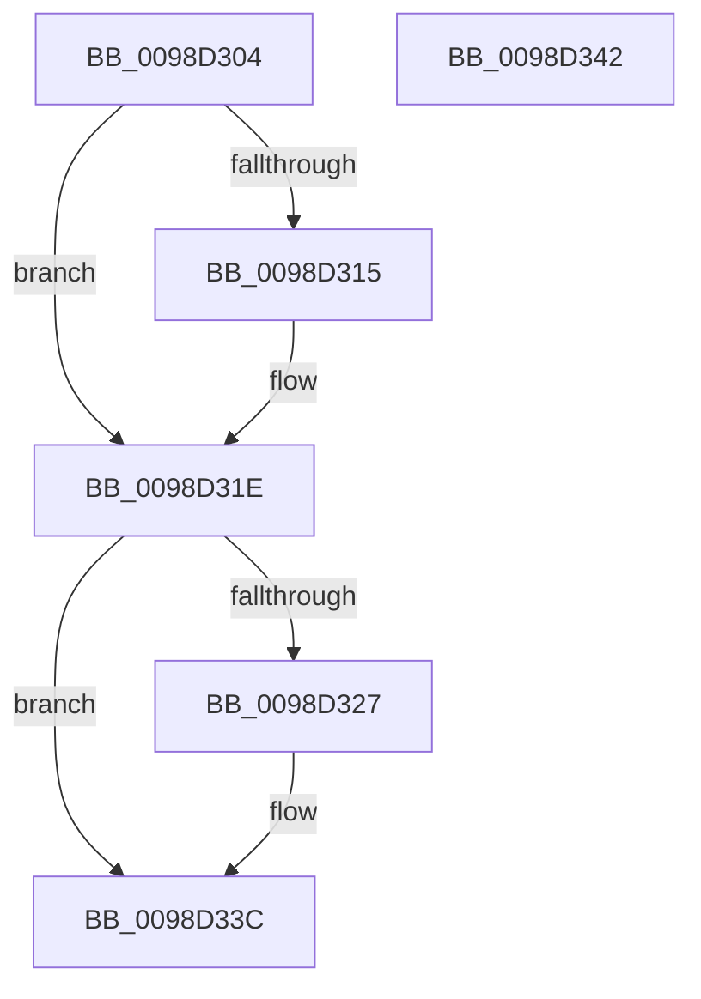

# PopEtAggregateKeyCleanup

- RVA: `0x0098D304`–`0x0098D343` (길이 `63` bytes)
- VA: `0x000000014098D304`
- 실행 섹션: `PAGE`
- PDB 이름 있음: `예`; PDB Function 태그: `아니요`
- unwind 정보 RVA: `0x0005CF00`
- 디코드: `19`개 명령, `63/63` bytes 표시
- 미해석 바이트: `0` (있으면 어셈블리에 `.byte`로 보존)

> 이 문서는 커널 이미지의 기계어와 PDB 기호를 분석해 생성했습니다. 4번과 5번은 함수 원형과 자료형을 바이너리 사용 방식에서 추정한 C 해석이며 원본 소스 복구 결과는 아닙니다.

## 1. Dependencies

- 직접 호출 지점: **2**; 고유 호출 대상: **2**
- 직접 호출자로 확인된 함수: **5**
- RIP 상대 이미지 참조: **1**

### Outgoing calls
- `0x0098D315` → [PopEtAppIdDereference](PopEtAppIdDereference_function_0098D34C.md) (function, `0x0098D34C`)
- `0x0098D332` → [RtlInternEntryDereference](RtlInternEntryDereference_function_0098DCB4.md) (function, `0x0098DCB4`)

### Direct callers
- [PopEtEnergyTrackerCleanup](../76/PopEtEnergyTrackerCleanup_function_00769CB4.md) at `0x00769E41`
- [PopEtEnergyTrackerCleanup](../76/PopEtEnergyTrackerCleanup_function_00769CB4.md) at `0x00769E6F`
- [PopEtEnergyTrackerCleanupAggregates](PopEtEnergyTrackerCleanupAggregates_function_0098D1D8.md) at `0x0098D286`
- [PopEtProcessSnapshotUpdate](PopEtProcessSnapshotUpdate_function_0098D430.md) at `0x0098D5D8`
- [PopEtAggregateGet](PopEtAggregateGet_function_0098DEEC.md) at `0x0098E1D0`
- [PopEtProcessSnapshotCreate](PopEtProcessSnapshotCreate_function_0098E4C8.md) at `0x0098E7B1`

### Static image references
- `0x0098D327` → RVA `0x00E67A30` (`.data`; read)

## 2. Other-region calls and transfers

- 다른 실행 섹션으로 향하는 call: **0**
- 별도 외부 분기/꼬리 이동을 확인하지 못했습니다.

## 3. Assembly (complete function range)

```asm
0098D304  40 53                           push rbx
0098D306  48 83 EC 20                     sub rsp, 0x20
0098D30A  48 8B D9                        mov rbx, rcx
0098D30D  48 8B 09                        mov rcx, qword ptr [rcx]
0098D310  48 85 C9                        test rcx, rcx
0098D313  74 09                           je 0x14098d31e
0098D315  E8 32 00 00 00                  call 0x14098d34c
0098D31A  48 83 23 00                     and qword ptr [rbx], 0
0098D31E  48 8B 53 08                     mov rdx, qword ptr [rbx + 8]
0098D322  48 85 D2                        test rdx, rdx
0098D325  74 15                           je 0x14098d33c
0098D327  48 8B 0D 02 A7 4D 00            mov rcx, qword ptr [rip + 0x4da702]
0098D32E  48 83 C1 38                     add rcx, 0x38
0098D332  E8 7D 09 00 00                  call 0x14098dcb4
0098D337  48 83 63 08 00                  and qword ptr [rbx + 8], 0
0098D33C  48 83 C4 20                     add rsp, 0x20
0098D340  5B                              pop rbx
0098D341  C3                              ret
0098D342  CC                              int3
```

## 4. C-style interpretation (structured pseudocode)

```c
__int64 __fastcall PopEtAggregateKeyCleanup(__int64 a1)
{
    __int64 result;
    __int64 v_rsp;

    v_rsp = (v_rsp) - (32);
    if (*(unsigned __int64 *)(a1) != 0) {
        result = PopEtAppIdDereference(*(unsigned __int64 *)(a1), a2, a3, a4);
    }
    if (*(unsigned __int64 *)(a1 + 8) != 0) {
        a1 = *(unsigned __int64 *)(v_rip + 5089026);
        a1 = (a1) + (56);
        result = RtlInternEntryDereference(a1, *(unsigned __int64 *)(a1 + 8), a3, a4);
    }
    v_rsp = (v_rsp) + (32);
    return result;
}
```

## 5. (Beta) C Style

```c
int64_t PopEtAggregateKeyCleanup(void *Arg1)
{
    uint8_t *arg1 = (uint8_t *)Arg1;

    int64_t result;
    int64_t local_rsp;

    local_rsp = (local_rsp) - (32);
    if (*(uint64_t *)(arg1) != 0) {
        result = PopEtAppIdDereference(*(uint64_t *)(arg1), a2, a3, a4);
    }
    if (*(uint64_t *)(arg1 + 0x8) != 0) {
        Arg1 = *(uint64_t *)(v_rip + 0x4DA702);
        Arg1 = (Arg1) + (56);
        result = RtlInternEntryDereference(Arg1, *(uint64_t *)(arg1 + 0x8), a3, a4);
    }
    local_rsp = (local_rsp) + (32);
    return result;
}
```

### 관측된 메모리 오프셋

구조체 형식이 확인되지 않은 접근은 인자 기준의 오프셋으로만 기록했습니다.

| 기준 인자 | 오프셋 표현 | 폭 (bit) | 접근 |
|---|---:|---:|---|
| `Arg1` | `+ 0x0` | `64` | `R` |
| `Arg1` | `+ 0x0` | `64` | `R/W` |
| `Arg1` | `+ 0x8` | `64` | `R` |
| `Arg1` | `+ 0x8` | `64` | `R/W` |

## 6. Execution-region graph

[열기: 2D/3D 그래프와 함수 탐색 컨트롤 패널](../../../control-panel.html?section=page&rva=0x0098D304&view=graph)

- 2D 그래프는 위에서 아래로 흐르고, 3D 그래프는 빈 공간을 드래그해 회전합니다. Shift+드래그는 이동, 휠은 확대·축소, 함수 노드 선택은 대상 보고서 이동입니다.

### Static fallback


