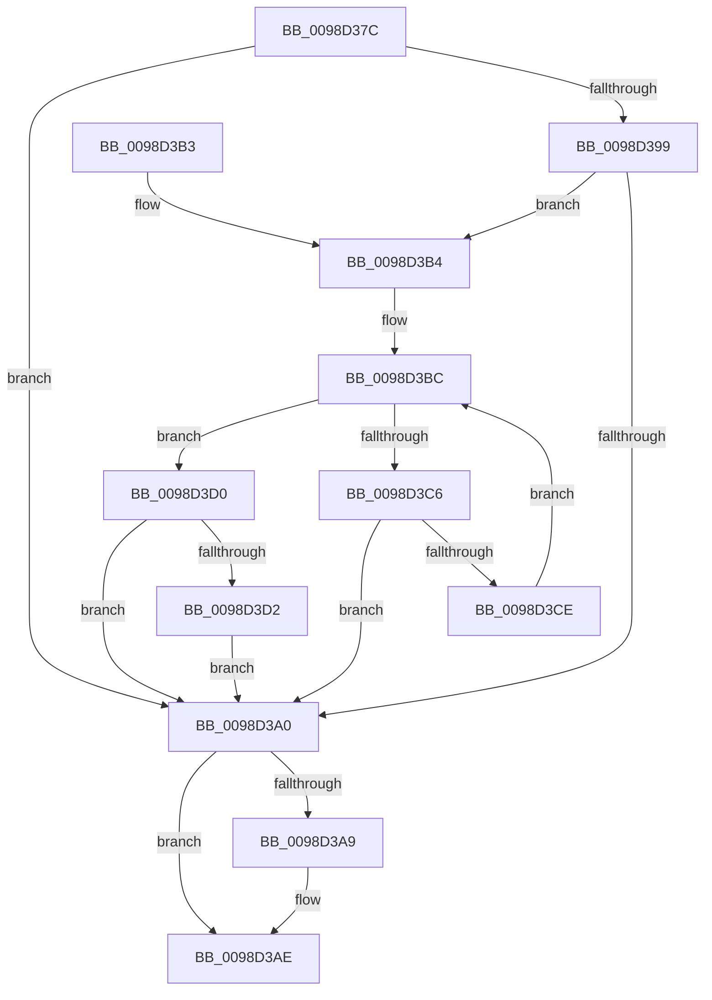

# PopEtAggregateKeyCopy

- RVA: `0x0098D37C`–`0x0098D3DB` (길이 `95` bytes)
- VA: `0x000000014098D37C`
- 실행 섹션: `PAGE`
- PDB 이름 있음: `예`; PDB Function 태그: `아니요`
- unwind 정보 RVA: `0x00098820`
- 디코드: `30`개 명령, `95/95` bytes 표시
- 미해석 바이트: `0` (있으면 어셈블리에 `.byte`로 보존)

> 이 문서는 커널 이미지의 기계어와 PDB 기호를 분석해 생성했습니다. 4번과 5번은 함수 원형과 자료형을 바이너리 사용 방식에서 추정한 C 해석이며 원본 소스 복구 결과는 아닙니다.

## 1. Dependencies

- 직접 호출 지점: **1**; 고유 호출 대상: **1**
- 직접 호출자로 확인된 함수: **2**
- RIP 상대 이미지 참조: **0**

### Outgoing calls
- `0x0098D3A9` → [PopEtStringReference](PopEtStringReference_function_0098DE50.md) (function, `0x0098DE50`)

### Direct callers
- [PopEtAggregateKeyCopyFromProcess](PopEtAggregateKeyCopyFromProcess_function_0098D0D4.md) at `0x0098D11D`
- [PopEtAggregateGet](PopEtAggregateGet_function_0098DEEC.md) at `0x0098DF77`

### Static image references
- 디코드된 RIP-relative 메모리 참조가 없습니다.

## 2. Other-region calls and transfers

- 다른 실행 섹션으로 향하는 call: **0**
- 별도 외부 분기/꼬리 이동을 확인하지 못했습니다.

## 3. Assembly (complete function range)

```asm
0098D37C  48 83 EC 28                     sub rsp, 0x28
0098D380  0F 10 02                        movups xmm0, xmmword ptr [rdx]
0098D383  4C 8B C1                        mov r8, rcx
0098D386  0F 11 01                        movups xmmword ptr [rcx], xmm0
0098D389  0F 10 4A 10                     movups xmm1, xmmword ptr [rdx + 0x10]
0098D38D  0F 11 49 10                     movups xmmword ptr [rcx + 0x10], xmm1
0098D391  48 8B 11                        mov rdx, qword ptr [rcx]
0098D394  48 85 D2                        test rdx, rdx
0098D397  74 07                           je 0x14098d3a0
0098D399  66 83 7A 18 00                  cmp word ptr [rdx + 0x18], 0
0098D39E  75 14                           jne 0x14098d3b4
0098D3A0  49 8B 48 08                     mov rcx, qword ptr [r8 + 8]
0098D3A4  48 85 C9                        test rcx, rcx
0098D3A7  74 05                           je 0x14098d3ae
0098D3A9  E8 A2 0A 00 00                  call 0x14098de50
0098D3AE  48 83 C4 28                     add rsp, 0x28
0098D3B2  C3                              ret
0098D3B3  CC                              int3
0098D3B4  0F 0D 4A 10                     prefetchw byte ptr [rdx + 0x10]
0098D3B8  48 8B 42 10                     mov rax, qword ptr [rdx + 0x10]
0098D3BC  48 8D 48 01                     lea rcx, [rax + 1]
0098D3C0  48 83 F9 01                     cmp rcx, 1
0098D3C4  76 0A                           jbe 0x14098d3d0
0098D3C6  F0 48 0F B1 4A 10               lock cmpxchg qword ptr [rdx + 0x10], rcx
0098D3CC  74 D2                           je 0x14098d3a0
0098D3CE  EB EC                           jmp 0x14098d3bc
0098D3D0  74 CE                           je 0x14098d3a0
0098D3D2  B9 0E 00 00 00                  mov ecx, 0xe
0098D3D7  CD 29                           int 0x29
0098D3D9  EB C5                           jmp 0x14098d3a0
```

## 4. C-style interpretation (structured pseudocode)

```c
__int64 __fastcall PopEtAggregateKeyCopy(__int64 a1, __int64 a2)
{
    __int64 result;
    __int64 v_rsp;

    v_rsp = (v_rsp) - (40);
    *(unsigned __int64 *)(a1) = v_xmm0;
    *(unsigned __int64 *)(a1 + 16) = v_xmm1;
    if (*(unsigned __int64 *)(a1) == 0) goto loc_0098D3A0;
    if ((*(unsigned __int16 *)(*(unsigned __int64 *)(a1) + 24)) != 0) goto loc_0098D3B4;
loc_0098D3A0:
    if (*(unsigned __int64 *)(a1 + 8) != 0) {
        result = PopEtStringReference(*(unsigned __int64 *)(a1 + 8), *(unsigned __int64 *)(a1), a1, a4);
    }
    v_rsp = (v_rsp) + (40);
    return result;
loc_0098D3B4:
loc_0098D3BC:
    if ((*(unsigned __int64 *)(*(unsigned __int64 *)(a1) + 16) + 1) <= 1) goto loc_0098D3D0;
    if ((*(unsigned __int64 *)(*(unsigned __int64 *)(a1) + 16) + 1) == 1) goto loc_0098D3A0;
    goto loc_0098D3BC;
loc_0098D3D0:
    if ((*(unsigned __int64 *)(*(unsigned __int64 *)(a1) + 16) + 1) == 1) goto loc_0098D3A0;
    goto loc_0098D3A0;
}
```

## 5. (Beta) C Style

```c
int64_t PopEtAggregateKeyCopy(void *Arg1, void *Arg2)
{
    uint8_t *arg1 = (uint8_t *)Arg1;
    uint8_t *arg2 = (uint8_t *)Arg2;

    int64_t result;
    int64_t local_rsp;

    local_rsp = (local_rsp) - (40);
    *(uint64_t *)(arg1) = v_xmm0;
    *(uint64_t *)(arg1 + 0x10) = v_xmm1;
    if (*(uint64_t *)(arg1) == 0) goto loc_0098D3A0;
    if ((*(uint16_t *)(*(uint64_t *)(arg1) + 0x18)) != 0) goto loc_0098D3B4;
loc_0098D3A0:
    if (*(uint64_t *)(arg1 + 0x8) != 0) {
        result = PopEtStringReference(*(uint64_t *)(arg1 + 0x8), *(uint64_t *)(arg1), Arg1, a4);
    }
    local_rsp = (local_rsp) + (40);
    return result;
loc_0098D3B4:
loc_0098D3BC:
    if ((*(uint64_t *)(*(uint64_t *)(arg1) + 0x10) + 1) <= 1) goto loc_0098D3D0;
    if ((*(uint64_t *)(*(uint64_t *)(arg1) + 0x10) + 1) == 1) goto loc_0098D3A0;
    goto loc_0098D3BC;
loc_0098D3D0:
    if ((*(uint64_t *)(*(uint64_t *)(arg1) + 0x10) + 1) == 1) goto loc_0098D3A0;
    goto loc_0098D3A0;
}
```

### 관측된 메모리 오프셋

구조체 형식이 확인되지 않은 접근은 인자 기준의 오프셋으로만 기록했습니다.

| 기준 인자 | 오프셋 표현 | 폭 (bit) | 접근 |
|---|---:|---:|---|
| `Arg1` | `+ 0x0` | `64` | `R` |
| `Arg1` | `+ 0x0` | `128` | `R` |
| `Arg1` | `+ 0x8` | `64` | `R` |
| `Arg1` | `+ 0x10` | `128` | `R` |
| `Arg2` | `+ 0x0` | `128` | `R` |
| `Arg2` | `+ 0x10` | `128` | `R` |

## 6. Execution-region graph

[열기: 2D/3D 그래프와 함수 탐색 컨트롤 패널](../../../control-panel.html?section=page&rva=0x0098D37C&view=graph)

- 2D 그래프는 위에서 아래로 흐르고, 3D 그래프는 빈 공간을 드래그해 회전합니다. Shift+드래그는 이동, 휠은 확대·축소, 함수 노드 선택은 대상 보고서 이동입니다.

### Static fallback


