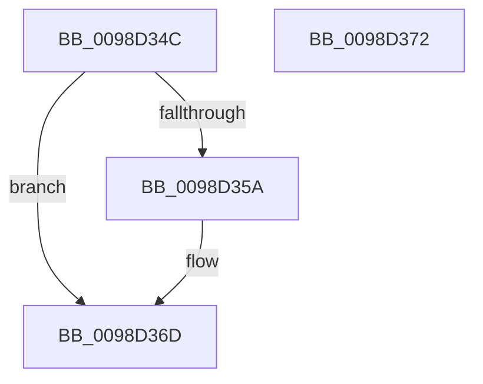

# PopEtAppIdDereference

- RVA: `0x0098D34C`–`0x0098D373` (길이 `39` bytes)
- VA: `0x000000014098D34C`
- 실행 섹션: `PAGE`
- PDB 이름 있음: `예`; PDB Function 태그: `아니요`
- unwind 정보 RVA: `0x0005C788`
- 디코드: `11`개 명령, `39/39` bytes 표시
- 미해석 바이트: `0` (있으면 어셈블리에 `.byte`로 보존)

> 이 문서는 커널 이미지의 기계어와 PDB 기호를 분석해 생성했습니다. 4번과 5번은 함수 원형과 자료형을 바이너리 사용 방식에서 추정한 C 해석이며 원본 소스 복구 결과는 아닙니다.

## 1. Dependencies

- 직접 호출 지점: **1**; 고유 호출 대상: **1**
- 직접 호출자로 확인된 함수: **3**
- RIP 상대 이미지 참조: **1**

### Outgoing calls
- `0x0098D368` → [RtlInternEntryDereference](RtlInternEntryDereference_function_0098DCB4.md) (function, `0x0098DCB4`)

### Direct callers
- [PopEtEnergyContextCleanup](PopEtEnergyContextCleanup_function_0098C9B4.md) at `0x0098C9C9`
- [PopEtAggregateKeyCleanup](PopEtAggregateKeyCleanup_function_0098D304.md) at `0x0098D315`
- [PopEtGetProcessAppId](PopEtGetProcessAppId_function_0098EBDC.md) at `0x0098ED66`

### Static image references
- `0x0098D35A` → RVA `0x00E67A30` (`.data`; read)

## 2. Other-region calls and transfers

- 다른 실행 섹션으로 향하는 call: **0**
- 별도 외부 분기/꼬리 이동을 확인하지 못했습니다.

## 3. Assembly (complete function range)

```asm
0098D34C  48 83 EC 28                     sub rsp, 0x28
0098D350  66 83 79 18 00                  cmp word ptr [rcx + 0x18], 0
0098D355  4C 8B C1                        mov r8, rcx
0098D358  74 13                           je 0x14098d36d
0098D35A  48 8B 0D CF A6 4D 00            mov rcx, qword ptr [rip + 0x4da6cf]
0098D361  49 8B D0                        mov rdx, r8
0098D364  48 83 C1 38                     add rcx, 0x38
0098D368  E8 47 09 00 00                  call 0x14098dcb4
0098D36D  48 83 C4 28                     add rsp, 0x28
0098D371  C3                              ret
0098D372  CC                              int3
```

## 4. C-style interpretation (structured pseudocode)

```c
__int64 __fastcall PopEtAppIdDereference(__int64 a1)
{
    __int64 result;
    __int64 v_rsp;

    v_rsp = (v_rsp) - (40);
    if ((*(unsigned __int16 *)(a1 + 24)) != 0) {
        a1 = *(unsigned __int64 *)(v_rip + 5088975);
        a2 = a1;
        a1 = (a1) + (56);
        result = RtlInternEntryDereference(a1, a2, a1, a4);
    }
    v_rsp = (v_rsp) + (40);
    return result;
}
```

## 5. (Beta) C Style

```c
int64_t PopEtAppIdDereference(void *Arg1)
{
    uint8_t *arg1 = (uint8_t *)Arg1;

    int64_t result;
    int64_t local_rsp;

    local_rsp = (local_rsp) - (40);
    if ((*(uint16_t *)(arg1 + 0x18)) != 0) {
        Arg1 = *(uint64_t *)(v_rip + 0x4DA6CF);
        a2 = Arg1;
        Arg1 = (Arg1) + (56);
        result = RtlInternEntryDereference(Arg1, a2, Arg1, a4);
    }
    local_rsp = (local_rsp) + (40);
    return result;
}
```

### 관측된 메모리 오프셋

구조체 형식이 확인되지 않은 접근은 인자 기준의 오프셋으로만 기록했습니다.

| 기준 인자 | 오프셋 표현 | 폭 (bit) | 접근 |
|---|---:|---:|---|
| `Arg1` | `+ 0x18` | `16` | `R` |

## 6. Execution-region graph

[열기: 2D/3D 그래프와 함수 탐색 컨트롤 패널](../../../control-panel.html?section=page&rva=0x0098D34C&view=graph)

- 2D 그래프는 위에서 아래로 흐르고, 3D 그래프는 빈 공간을 드래그해 회전합니다. Shift+드래그는 이동, 휠은 확대·축소, 함수 노드 선택은 대상 보고서 이동입니다.

### Static fallback


