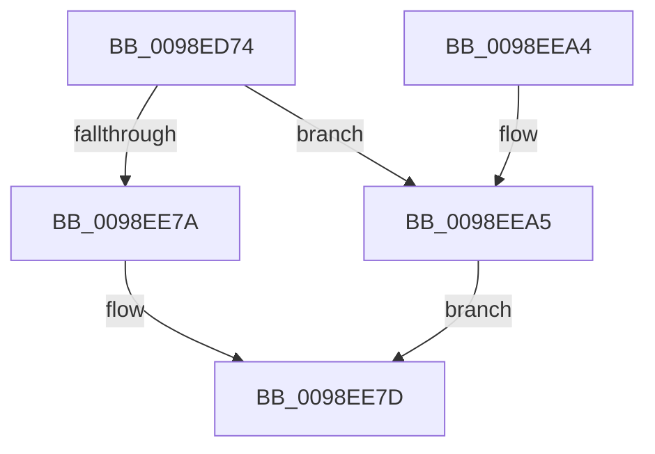

# PopEtAppIdIntern

- RVA: `0x0098ED74`–`0x0098EEAC` (길이 `312` bytes)
- VA: `0x000000014098ED74`
- 실행 섹션: `PAGE`
- PDB 이름 있음: `예`; PDB Function 태그: `아니요`
- unwind 정보 RVA: `0x000989C8`
- 디코드: `77`개 명령, `312/312` bytes 표시
- 미해석 바이트: `0` (있으면 어셈블리에 `.byte`로 보존)

> 이 문서는 커널 이미지의 기계어와 PDB 기호를 분석해 생성했습니다. 4번과 5번은 함수 원형과 자료형을 바이너리 사용 방식에서 추정한 C 해석이며 원본 소스 복구 결과는 아닙니다.

## 1. Dependencies

- 직접 호출 지점: **3**; 고유 호출 대상: **3**
- 직접 호출자로 확인된 함수: **1**
- RIP 상대 이미지 참조: **2**

### Outgoing calls
- `0x0098EDCA` → [memset](../../text/6C/memset_function_006C6C40.md) (function, `0x006C6C40`)
- `0x0098EE70` → [RtlInternTableIntern](RtlInternTableIntern_function_0098EEB4.md) (function, `0x0098EEB4`)
- `0x0098EE86` → [_security_check_cookie](../../text/6A/_security_check_cookie_function_006AC640.md) (function, `0x006AC640`)

### Direct callers
- [PopEtGetProcessAppId](PopEtGetProcessAppId_function_0098EBDC.md) at `0x0098ED0F`

### Static image references
- `0x0098ED8F` → RVA `0x00E0A740` (`.data`; read)
- `0x0098EE4A` → RVA `0x00E67A30` (`.data`; read)

## 2. Other-region calls and transfers

- 다른 실행 섹션으로 향하는 call: **2**
  - `0x0098EDCA` → [memset](../../text/6C/memset_function_006C6C40.md) (`PAGE` → `.text`)
  - `0x0098EE86` → [_security_check_cookie](../../text/6A/_security_check_cookie_function_006AC640.md) (`PAGE` → `.text`)
- 별도 외부 분기/꼬리 이동을 확인하지 못했습니다.

## 3. Assembly (complete function range)

```asm
0098ED74  48 8B C4                        mov rax, rsp
0098ED77  48 89 58 08                     mov qword ptr [rax + 8], rbx
0098ED7B  48 89 70 18                     mov qword ptr [rax + 0x18], rsi
0098ED7F  48 89 78 20                     mov qword ptr [rax + 0x20], rdi
0098ED83  55                              push rbp
0098ED84  48 8D 68 E8                     lea rbp, [rax - 0x18]
0098ED88  48 81 EC 10 01 00 00            sub rsp, 0x110
0098ED8F  48 8B 05 AA B9 47 00            mov rax, qword ptr [rip + 0x47b9aa]
0098ED96  48 33 C4                        xor rax, rsp
0098ED99  48 89 45 00                     mov qword ptr [rbp], rax
0098ED9D  48 8B F2                        mov rsi, rdx
0098EDA0  48 C7 44 24 20 58 00 00 00      mov qword ptr [rsp + 0x20], 0x58
0098EDA9  48 8B D9                        mov rbx, rcx
0098EDAC  48 8D 44 24 40                  lea rax, [rsp + 0x40]
0098EDB1  33 FF                           xor edi, edi
0098EDB3  48 89 44 24 28                  mov qword ptr [rsp + 0x28], rax
0098EDB8  33 D2                           xor edx, edx
0098EDBA  48 89 7C 24 38                  mov qword ptr [rsp + 0x38], rdi
0098EDBF  48 8D 4C 24 40                  lea rcx, [rsp + 0x40]
0098EDC4  41 B8 C0 00 00 00               mov r8d, 0xc0
0098EDCA  E8 71 7E D3 FF                  call 0x1406c6c40
0098EDCF  48 8B 43 20                     mov rax, qword ptr [rbx + 0x20]
0098EDD3  8D 4F 08                        lea ecx, [rdi + 8]
0098EDD6  48 89 44 24 40                  mov qword ptr [rsp + 0x40], rax
0098EDDB  8D 57 04                        lea edx, [rdi + 4]
0098EDDE  48 8B 43 28                     mov rax, qword ptr [rbx + 0x28]
0098EDE2  48 89 44 24 60                  mov qword ptr [rsp + 0x60], rax
0098EDE7  0F B7 43 56                     movzx eax, word ptr [rbx + 0x56]
0098EDEB  48 89 45 90                     mov qword ptr [rbp - 0x70], rax
0098EDEF  48 8B 43 48                     mov rax, qword ptr [rbx + 0x48]
0098EDF3  48 89 45 80                     mov qword ptr [rbp - 0x80], rax
0098EDF7  0F B7 43 50                     movzx eax, word ptr [rbx + 0x50]
0098EDFB  48 03 C0                        add rax, rax
0098EDFE  48 89 4C 24 50                  mov qword ptr [rsp + 0x50], rcx
0098EE03  48 89 45 B0                     mov qword ptr [rbp - 0x50], rax
0098EE07  48 8B 43 30                     mov rax, qword ptr [rbx + 0x30]
0098EE0B  48 89 45 A0                     mov qword ptr [rbp - 0x60], rax
0098EE0F  0F B7 43 52                     movzx eax, word ptr [rbx + 0x52]
0098EE13  48 03 C0                        add rax, rax
0098EE16  48 89 4C 24 78                  mov qword ptr [rsp + 0x78], rcx
0098EE1B  48 89 45 D0                     mov qword ptr [rbp - 0x30], rax
0098EE1F  48 8B 43 38                     mov rax, qword ptr [rbx + 0x38]
0098EE23  48 89 45 C0                     mov qword ptr [rbp - 0x40], rax
0098EE27  0F B7 43 54                     movzx eax, word ptr [rbx + 0x54]
0098EE2B  48 89 4C 24 70                  mov qword ptr [rsp + 0x70], rcx
0098EE30  48 03 C0                        add rax, rax
0098EE33  8D 4F 02                        lea ecx, [rdi + 2]
0098EE36  48 89 45 F0                     mov qword ptr [rbp - 0x10], rax
0098EE3A  48 8B 43 40                     mov rax, qword ptr [rbx + 0x40]
0098EE3E  48 89 4D B8                     mov qword ptr [rbp - 0x48], rcx
0098EE42  48 89 4D D8                     mov qword ptr [rbp - 0x28], rcx
0098EE46  48 89 4D F8                     mov qword ptr [rbp - 8], rcx
0098EE4A  48 8B 0D DF 8B 4D 00            mov rcx, qword ptr [rip + 0x4d8bdf]
0098EE51  48 89 54 24 58                  mov qword ptr [rsp + 0x58], rdx
0098EE56  48 83 C1 38                     add rcx, 0x38
0098EE5A  48 89 55 98                     mov qword ptr [rbp - 0x68], rdx
0098EE5E  48 8D 54 24 20                  lea rdx, [rsp + 0x20]
0098EE63  48 89 45 E0                     mov qword ptr [rbp - 0x20], rax
0098EE67  48 C7 44 24 30 06 00 00 00      mov qword ptr [rsp + 0x30], 6
0098EE70  E8 3F 00 00 00                  call 0x14098eeb4
0098EE75  48 85 C0                        test rax, rax
0098EE78  74 2B                           je 0x14098eea5
0098EE7A  48 89 06                        mov qword ptr [rsi], rax
0098EE7D  8B C7                           mov eax, edi
0098EE7F  48 8B 4D 00                     mov rcx, qword ptr [rbp]
0098EE83  48 33 CC                        xor rcx, rsp
0098EE86  E8 B5 D7 D1 FF                  call 0x1406ac640
0098EE8B  4C 8D 9C 24 10 01 00 00         lea r11, [rsp + 0x110]
0098EE93  49 8B 5B 10                     mov rbx, qword ptr [r11 + 0x10]
0098EE97  49 8B 73 20                     mov rsi, qword ptr [r11 + 0x20]
0098EE9B  49 8B 7B 28                     mov rdi, qword ptr [r11 + 0x28]
0098EE9F  49 8B E3                        mov rsp, r11
0098EEA2  5D                              pop rbp
0098EEA3  C3                              ret
0098EEA4  CC                              int3
0098EEA5  BF 9A 00 00 C0                  mov edi, 0xc000009a
0098EEAA  EB D1                           jmp 0x14098ee7d
```

## 4. C-style interpretation (structured pseudocode)

```c
__int64 __fastcall PopEtAppIdIntern(__int64 a1, __int64 a2)
{
    __int64 result;
    __int64 v_rdi;
    __int64 v_rsp;
    unsigned __int64 v_stack_m8;
    unsigned __int64 v_stack_mA0;
    unsigned __int64 v_stack_mA8;
    unsigned __int64 v_stack_mB8;
    unsigned __int64 v_stack_mC0;
    unsigned __int64 v_stack_mC8;
    unsigned __int64 v_stack_mD8;
    unsigned __int64 v_stack_mE0;
    unsigned __int64 v_stack_mE8;
    unsigned __int64 v_stack_mF0;
    unsigned __int64 v_stack_mF8;

    *(unsigned __int64 *)(v_rsp + 8) = v_rbx;
    *(unsigned __int64 *)(v_rsp + 24) = v_rsi;
    *(unsigned __int64 *)(v_rsp + 32) = v_rdi;
    v_rsp = (v_rsp) - (272);
    result = (*(unsigned __int64 *)(v_rip + 4700586)) ^ (v_rsp);
    *(unsigned __int64 *)(v_rsp - 24) = result;
    v_stack_mF8 = 88;
    v_rdi = 0;
    v_stack_mF0 = v_stack_mD8;
    a2 = 0;
    v_stack_mE0 = 0;
    result = memset(v_stack_mD8, a2, 192, a4);
    v_stack_mD8 = *(unsigned __int64 *)(a1 + 32);
    v_stack_mB8 = *(unsigned __int64 *)(a1 + 40);
    *(unsigned __int64 *)(v_rsp - 24 - 112) = *(unsigned __int16 *)(a1 + 86);
    *(unsigned __int64 *)(v_rsp - 24 - 128) = *(unsigned __int64 *)(a1 + 72);
    result = (*(unsigned __int16 *)(a1 + 80)) + (*(unsigned __int16 *)(a1 + 80));
    v_stack_mC8 = v_rdi + 8;
    *(unsigned __int64 *)(v_rsp - 24 - 80) = result;
    *(unsigned __int64 *)(v_rsp - 24 - 96) = *(unsigned __int64 *)(a1 + 48);
    result = (*(unsigned __int16 *)(a1 + 82)) + (*(unsigned __int16 *)(a1 + 82));
    v_stack_mA0 = v_rdi + 8;
    *(unsigned __int64 *)(v_rsp - 24 - 48) = result;
    *(unsigned __int64 *)(v_rsp - 24 - 64) = *(unsigned __int64 *)(a1 + 56);
    v_stack_mA8 = v_rdi + 8;
    result = (*(unsigned __int16 *)(a1 + 84)) + (*(unsigned __int16 *)(a1 + 84));
    *(unsigned __int64 *)(v_rsp - 24 - 16) = result;
    *(unsigned __int64 *)(v_rsp - 24 - 72) = v_rdi + 2;
    *(unsigned __int64 *)(v_rsp - 24 - 40) = v_rdi + 2;
    *(unsigned __int64 *)(v_rsp - 24 - 8) = v_rdi + 2;
    v_stack_mC0 = v_rdi + 4;
    a1 = (*(unsigned __int64 *)(v_rip + 5082079)) + (56);
    *(unsigned __int64 *)(v_rsp - 24 - 104) = v_rdi + 4;
    *(unsigned __int64 *)(v_rsp - 24 - 32) = *(unsigned __int64 *)(a1 + 64);
    v_stack_mE8 = 6;
    result = RtlInternTableIntern(a1, v_stack_mF8, 192, a4);
    if (result == 0) goto loc_0098EEA5;
    *(unsigned __int64 *)(a2) = result;
loc_0098EE7D:
    a1 = (*(unsigned __int64 *)(v_rsp - 24)) ^ (v_rsp);
    result = _security_check_cookie(a1, v_stack_mF8, 192, a4);
    return result;
loc_0098EEA5:
    goto loc_0098EE7D;
}
```

## 5. (Beta) C Style

```c
int64_t PopEtAppIdIntern(void *Arg1, void *Arg2)
{
    uint8_t *arg1 = (uint8_t *)Arg1;
    uint8_t *arg2 = (uint8_t *)Arg2;

    int64_t result;
    int64_t local_rdi;
    int64_t local_rsp;
    uint64_t v_stack_m8;
    uint64_t v_stack_mA0;
    uint64_t v_stack_mA8;
    uint64_t v_stack_mB8;
    uint64_t v_stack_mC0;
    uint64_t v_stack_mC8;
    uint64_t v_stack_mD8;
    uint64_t v_stack_mE0;
    uint64_t v_stack_mE8;
    uint64_t v_stack_mF0;
    uint64_t v_stack_mF8;

    *(uint64_t *)(local_rsp + 0x8) = local_rbx;
    *(uint64_t *)(local_rsp + 0x18) = local_rsi;
    *(uint64_t *)(local_rsp + 0x20) = local_rdi;
    local_rsp = (local_rsp) - (272);
    result = (*(uint64_t *)(v_rip + 0x47B9AA)) ^ (local_rsp);
    *(uint64_t *)(local_rsp - 0x18) = result;
    v_stack_mF8 = 88;
    local_rdi = 0;
    v_stack_mF0 = v_stack_mD8;
    Arg2 = 0;
    v_stack_mE0 = 0;
    result = memset(v_stack_mD8, Arg2, 192, a4);
    v_stack_mD8 = *(uint64_t *)(arg1 + 0x20);
    v_stack_mB8 = *(uint64_t *)(arg1 + 0x28);
    *(uint64_t *)(local_rsp - 0x18 - 0x70) = *(uint16_t *)(arg1 + 0x56);
    *(uint64_t *)(local_rsp - 0x18 - 0x80) = *(uint64_t *)(arg1 + 0x48);
    result = (*(uint16_t *)(arg1 + 0x50)) + (*(uint16_t *)(arg1 + 0x50));
    v_stack_mC8 = local_rdi + 8;
    *(uint64_t *)(local_rsp - 0x18 - 0x50) = result;
    *(uint64_t *)(local_rsp - 0x18 - 0x60) = *(uint64_t *)(arg1 + 0x30);
    result = (*(uint16_t *)(arg1 + 0x52)) + (*(uint16_t *)(arg1 + 0x52));
    v_stack_mA0 = local_rdi + 8;
    *(uint64_t *)(local_rsp - 0x18 - 0x30) = result;
    *(uint64_t *)(local_rsp - 0x18 - 0x40) = *(uint64_t *)(arg1 + 0x38);
    v_stack_mA8 = local_rdi + 8;
    result = (*(uint16_t *)(arg1 + 0x54)) + (*(uint16_t *)(arg1 + 0x54));
    *(uint64_t *)(local_rsp - 0x18 - 0x10) = result;
    *(uint64_t *)(local_rsp - 0x18 - 0x48) = local_rdi + 2;
    *(uint64_t *)(local_rsp - 0x18 - 0x28) = local_rdi + 2;
    *(uint64_t *)(local_rsp - 0x18 - 0x8) = local_rdi + 2;
    v_stack_mC0 = local_rdi + 4;
    Arg1 = (*(uint64_t *)(v_rip + 0x4D8BDF)) + (56);
    *(uint64_t *)(local_rsp - 0x18 - 0x68) = local_rdi + 4;
    *(uint64_t *)(local_rsp - 0x18 - 0x20) = *(uint64_t *)(arg1 + 0x40);
    v_stack_mE8 = 6;
    result = RtlInternTableIntern(Arg1, v_stack_mF8, 192, a4);
    if (result == 0) goto loc_0098EEA5;
    *(uint64_t *)(arg2) = result;
loc_0098EE7D:
    Arg1 = (*(uint64_t *)(local_rsp - 0x18)) ^ (local_rsp);
    result = _security_check_cookie(Arg1, v_stack_mF8, 192, a4);
    return result;
loc_0098EEA5:
    goto loc_0098EE7D;
}
```

### 관측된 메모리 오프셋

구조체 형식이 확인되지 않은 접근은 인자 기준의 오프셋으로만 기록했습니다.

| 기준 인자 | 오프셋 표현 | 폭 (bit) | 접근 |
|---|---:|---:|---|
| `Arg1` | `+ 0x20` | `64` | `R` |
| `Arg1` | `+ 0x28` | `64` | `R` |
| `Arg1` | `+ 0x30` | `64` | `R` |
| `Arg1` | `+ 0x38` | `64` | `R` |
| `Arg1` | `+ 0x40` | `64` | `R` |
| `Arg1` | `+ 0x48` | `64` | `R` |
| `Arg1` | `+ 0x50` | `16` | `R` |
| `Arg1` | `+ 0x52` | `16` | `R` |
| `Arg1` | `+ 0x54` | `16` | `R` |
| `Arg1` | `+ 0x56` | `16` | `R` |
| `Arg2` | `+ 0x0` | `64` | `W` |

## 6. Execution-region graph

[열기: 2D/3D 그래프와 함수 탐색 컨트롤 패널](../../../control-panel.html?section=page&rva=0x0098ED74&view=graph)

- 2D 그래프는 위에서 아래로 흐르고, 3D 그래프는 빈 공간을 드래그해 회전합니다. Shift+드래그는 이동, 휠은 확대·축소, 함수 노드 선택은 대상 보고서 이동입니다.

### Static fallback


