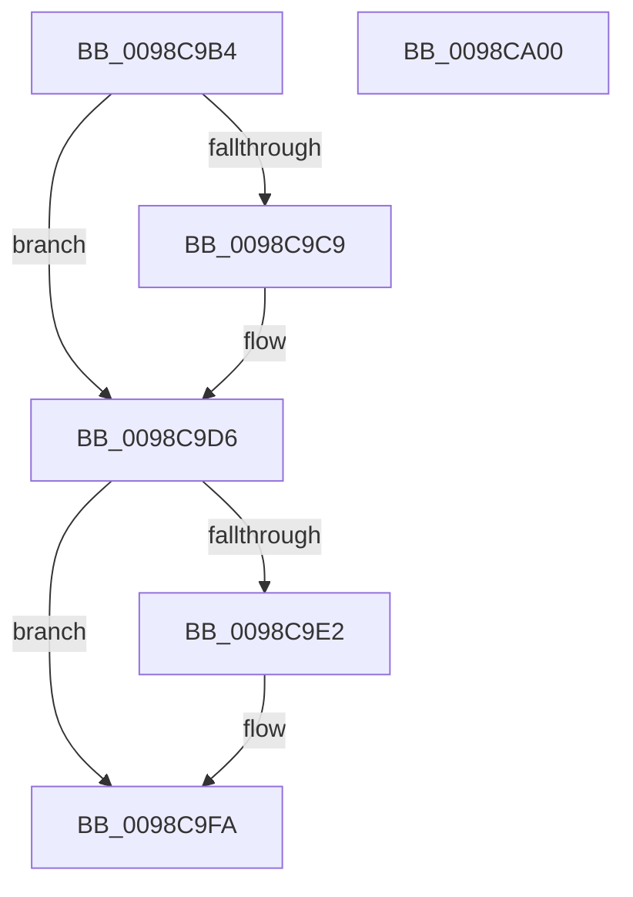

# PopEtEnergyContextCleanup

- RVA: `0x0098C9B4`–`0x0098CA01` (길이 `77` bytes)
- VA: `0x000000014098C9B4`
- 실행 섹션: `PAGE`
- PDB 이름 있음: `예`; PDB Function 태그: `아니요`
- unwind 정보 RVA: `0x0005CF00`
- 디코드: `19`개 명령, `77/77` bytes 표시
- 미해석 바이트: `0` (있으면 어셈블리에 `.byte`로 보존)

> 이 문서는 커널 이미지의 기계어와 PDB 기호를 분석해 생성했습니다. 4번과 5번은 함수 원형과 자료형을 바이너리 사용 방식에서 추정한 C 해석이며 원본 소스 복구 결과는 아닙니다.

## 1. Dependencies

- 직접 호출 지점: **2**; 고유 호출 대상: **2**
- 직접 호출자로 확인된 함수: **1**
- RIP 상대 이미지 참조: **1**

### Outgoing calls
- `0x0098C9C9` → [PopEtAppIdDereference](PopEtAppIdDereference_function_0098D34C.md) (function, `0x0098D34C`)
- `0x0098C9ED` → [RtlInternEntryDereference](RtlInternEntryDereference_function_0098DCB4.md) (function, `0x0098DCB4`)

### Direct callers
- [PoEnergyContextCleanup](../90/PoEnergyContextCleanup_function_00907A38.md) at `0x00907B41`

### Static image references
- `0x0098C9E2` → RVA `0x00E67A30` (`.data`; read)

## 2. Other-region calls and transfers

- 다른 실행 섹션으로 향하는 call: **0**
- 별도 외부 분기/꼬리 이동을 확인하지 못했습니다.

## 3. Assembly (complete function range)

```asm
0098C9B4  40 53                           push rbx
0098C9B6  48 83 EC 20                     sub rsp, 0x20
0098C9BA  48 8B D9                        mov rbx, rcx
0098C9BD  48 8B 89 C8 01 00 00            mov rcx, qword ptr [rcx + 0x1c8]
0098C9C4  48 85 C9                        test rcx, rcx
0098C9C7  74 0D                           je 0x14098c9d6
0098C9C9  E8 7E 09 00 00                  call 0x14098d34c
0098C9CE  48 83 A3 C8 01 00 00 00         and qword ptr [rbx + 0x1c8], 0
0098C9D6  48 8B 93 D0 01 00 00            mov rdx, qword ptr [rbx + 0x1d0]
0098C9DD  48 85 D2                        test rdx, rdx
0098C9E0  74 18                           je 0x14098c9fa
0098C9E2  48 8B 0D 47 B0 4D 00            mov rcx, qword ptr [rip + 0x4db047]
0098C9E9  48 83 C1 38                     add rcx, 0x38
0098C9ED  E8 C2 12 00 00                  call 0x14098dcb4
0098C9F2  48 83 A3 D0 01 00 00 00         and qword ptr [rbx + 0x1d0], 0
0098C9FA  48 83 C4 20                     add rsp, 0x20
0098C9FE  5B                              pop rbx
0098C9FF  C3                              ret
0098CA00  CC                              int3
```

## 4. C-style interpretation (structured pseudocode)

```c
__int64 __fastcall PopEtEnergyContextCleanup(__int64 a1)
{
    __int64 result;
    __int64 v_rsp;

    v_rsp = (v_rsp) - (32);
    if (*(unsigned __int64 *)(a1 + 456) != 0) {
        result = PopEtAppIdDereference(*(unsigned __int64 *)(a1 + 456), a2, a3, a4);
    }
    if (*(unsigned __int64 *)(a1 + 464) != 0) {
        a1 = *(unsigned __int64 *)(v_rip + 5091399);
        a1 = (a1) + (56);
        result = RtlInternEntryDereference(a1, *(unsigned __int64 *)(a1 + 464), a3, a4);
    }
    v_rsp = (v_rsp) + (32);
    return result;
}
```

## 5. (Beta) C Style

```c
int64_t PopEtEnergyContextCleanup(void *Arg1)
{
    uint8_t *arg1 = (uint8_t *)Arg1;

    int64_t result;
    int64_t local_rsp;

    local_rsp = (local_rsp) - (32);
    if (*(uint64_t *)(arg1 + 0x1C8) != 0) {
        result = PopEtAppIdDereference(*(uint64_t *)(arg1 + 0x1C8), a2, a3, a4);
    }
    if (*(uint64_t *)(arg1 + 0x1D0) != 0) {
        Arg1 = *(uint64_t *)(v_rip + 0x4DB047);
        Arg1 = (Arg1) + (56);
        result = RtlInternEntryDereference(Arg1, *(uint64_t *)(arg1 + 0x1D0), a3, a4);
    }
    local_rsp = (local_rsp) + (32);
    return result;
}
```

### 관측된 메모리 오프셋

구조체 형식이 확인되지 않은 접근은 인자 기준의 오프셋으로만 기록했습니다.

| 기준 인자 | 오프셋 표현 | 폭 (bit) | 접근 |
|---|---:|---:|---|
| `Arg1` | `+ 0x1C8` | `64` | `R` |
| `Arg1` | `+ 0x1C8` | `64` | `R/W` |
| `Arg1` | `+ 0x1D0` | `64` | `R` |
| `Arg1` | `+ 0x1D0` | `64` | `R/W` |

## 6. Execution-region graph

[열기: 2D/3D 그래프와 함수 탐색 컨트롤 패널](../../../control-panel.html?section=page&rva=0x0098C9B4&view=graph)

- 2D 그래프는 위에서 아래로 흐르고, 3D 그래프는 빈 공간을 드래그해 회전합니다. Shift+드래그는 이동, 휠은 확대·축소, 함수 노드 선택은 대상 보고서 이동입니다.

### Static fallback


