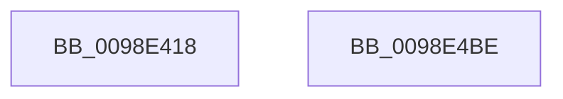

# PopEtEnergyContextProcessStateUpdate

- RVA: `0x0098E418`–`0x0098E4BF` (길이 `167` bytes)
- VA: `0x000000014098E418`
- 실행 섹션: `PAGE`
- PDB 이름 있음: `예`; PDB Function 태그: `아니요`
- unwind 정보 RVA: `0x00098900`
- 디코드: `34`개 명령, `167/167` bytes 표시
- 미해석 바이트: `0` (있으면 어셈블리에 `.byte`로 보존)

> 이 문서는 커널 이미지의 기계어와 PDB 기호를 분석해 생성했습니다. 4번과 5번은 함수 원형과 자료형을 바이너리 사용 방식에서 추정한 C 해석이며 원본 소스 복구 결과는 아닙니다.

## 1. Dependencies

- 직접 호출 지점: **4**; 고유 호출 대상: **4**
- 직접 호출자로 확인된 함수: **2**
- RIP 상대 이미지 참조: **1**

### Outgoing calls
- `0x0098E459` → [memset](../../text/6C/memset_function_006C6C40.md) (function, `0x006C6C40`)
- `0x0098E46C` → [PsQueryProcessEnergyValues](../91/PsQueryProcessEnergyValues_function_0091A4E0.md) (function, `0x0091A4E0`)
- `0x0098E498` → [PopEtEnumEnergyTrackers](PopEtEnumEnergyTrackers_function_0098D150.md) (function, `0x0098D150`)
- `0x0098E4A8` → [_security_check_cookie](../../text/6A/_security_check_cookie_function_006AC640.md) (function, `0x006AC640`)

### Direct callers
- [PoEnergyContextUpdateComponentPower](PoEnergyContextUpdateComponentPower_function_0098CA08.md) at `0x0098CD8E`
- [PopEtEnergyContextSetState](PopEtEnergyContextSetState_function_0098CF94.md) at `0x0098D01B`

### Static image references
- `0x0098E425` → RVA `0x00E0A740` (`.data`; read)

## 2. Other-region calls and transfers

- 다른 실행 섹션으로 향하는 call: **2**
  - `0x0098E459` → [memset](../../text/6C/memset_function_006C6C40.md) (`PAGE` → `.text`)
  - `0x0098E4A8` → [_security_check_cookie](../../text/6A/_security_check_cookie_function_006AC640.md) (`PAGE` → `.text`)
- 별도 외부 분기/꼬리 이동을 확인하지 못했습니다.

## 3. Assembly (complete function range)

```asm
0098E418  48 89 5C 24 10                  mov qword ptr [rsp + 0x10], rbx
0098E41D  57                              push rdi
0098E41E  48 81 EC 10 02 00 00            sub rsp, 0x210
0098E425  48 8B 05 14 C3 47 00            mov rax, qword ptr [rip + 0x47c314]
0098E42C  48 33 C4                        xor rax, rsp
0098E42F  48 89 84 24 00 02 00 00         mov qword ptr [rsp + 0x200], rax
0098E437  48 8B 99 68 06 00 00            mov rbx, qword ptr [rcx + 0x668]
0098E43E  48 8B F9                        mov rdi, rcx
0098E441  83 64 24 24 00                  and dword ptr [rsp + 0x24], 0
0098E446  48 8D 4C 24 40                  lea rcx, [rsp + 0x40]
0098E44B  48 83 64 24 30 00               and qword ptr [rsp + 0x30], 0
0098E451  33 D2                           xor edx, edx
0098E453  41 B8 B8 01 00 00               mov r8d, 0x1b8
0098E459  E8 E2 87 D3 FF                  call 0x1406c6c40
0098E45E  FF 83 DC 01 00 00               inc dword ptr [rbx + 0x1dc]
0098E464  48 8D 54 24 40                  lea rdx, [rsp + 0x40]
0098E469  48 8B CF                        mov rcx, rdi
0098E46C  E8 6F C0 F8 FF                  call 0x14091a4e0
0098E471  83 64 24 24 00                  and dword ptr [rsp + 0x24], 0
0098E476  48 8D 44 24 40                  lea rax, [rsp + 0x40]
0098E47B  48 83 64 24 30 00               and qword ptr [rsp + 0x30], 0
0098E481  48 8D 54 24 20                  lea rdx, [rsp + 0x20]
0098E486  48 89 44 24 38                  mov qword ptr [rsp + 0x38], rax
0098E48B  C7 44 24 20 03 00 00 00         mov dword ptr [rsp + 0x20], 3
0098E493  48 89 7C 24 28                  mov qword ptr [rsp + 0x28], rdi
0098E498  E8 B3 EC FF FF                  call 0x14098d150
0098E49D  48 8B 8C 24 00 02 00 00         mov rcx, qword ptr [rsp + 0x200]
0098E4A5  48 33 CC                        xor rcx, rsp
0098E4A8  E8 93 E1 D1 FF                  call 0x1406ac640
0098E4AD  48 8B 9C 24 28 02 00 00         mov rbx, qword ptr [rsp + 0x228]
0098E4B5  48 81 C4 10 02 00 00            add rsp, 0x210
0098E4BC  5F                              pop rdi
0098E4BD  C3                              ret
0098E4BE  CC                              int3
```

## 4. C-style interpretation (structured pseudocode)

```c
__int64 __fastcall PopEtEnergyContextProcessStateUpdate(__int64 a1, int a2)
{
    __int64 result;
    __int64 v_rsp;
    unsigned __int64 v_stack_m18;
    unsigned __int64 v_stack_m1D8;
    unsigned __int64 v_stack_m1E0;
    unsigned __int64 v_stack_m1E8;
    unsigned __int64 v_stack_m1F0;
    unsigned int v_stack_m1F4;
    unsigned __int64 v_stack_m1F8;
    unsigned __int64 v_stack_p10;

    v_stack_p10 = v_rbx;
    v_rsp = (v_rsp) - (528);
    result = (*(unsigned __int64 *)(v_rip + 4702996)) ^ (v_rsp);
    v_stack_m18 = result;
    a2 = 0;
    result = memset(v_stack_m1D8, a2, 440, a4);
    result = PsQueryProcessEnergyValues(a1, v_stack_m1D8, 440, a4);
    v_stack_m1E0 = v_stack_m1D8;
    v_stack_m1F8 = 3;
    v_stack_m1F0 = a1;
    result = PopEtEnumEnergyTrackers(a1, v_stack_m1F8, 440, a4);
    a1 = (v_stack_m18) ^ (v_rsp);
    result = _security_check_cookie(a1, v_stack_m1F8, 440, a4);
    v_rsp = (v_rsp) + (528);
    return result;
}
```

## 5. (Beta) C Style

```c
int64_t PopEtEnergyContextProcessStateUpdate(void *Arg1, int32_t Arg2)
{
    uint8_t *arg1 = (uint8_t *)Arg1;

    int64_t result;
    int64_t local_rsp;
    uint64_t v_stack_m18;
    uint64_t v_stack_m1D8;
    uint64_t v_stack_m1E0;
    uint64_t v_stack_m1E8;
    uint64_t v_stack_m1F0;
    uint32_t v_stack_m1F4;
    uint64_t v_stack_m1F8;
    uint64_t v_stack_p10;

    v_stack_p10 = local_rbx;
    local_rsp = (local_rsp) - (528);
    result = (*(uint64_t *)(v_rip + 0x47C314)) ^ (local_rsp);
    v_stack_m18 = result;
    Arg2 = 0;
    result = memset(v_stack_m1D8, Arg2, 440, a4);
    result = PsQueryProcessEnergyValues(Arg1, v_stack_m1D8, 440, a4);
    v_stack_m1E0 = v_stack_m1D8;
    v_stack_m1F8 = 3;
    v_stack_m1F0 = Arg1;
    result = PopEtEnumEnergyTrackers(Arg1, v_stack_m1F8, 440, a4);
    Arg1 = (v_stack_m18) ^ (local_rsp);
    result = _security_check_cookie(Arg1, v_stack_m1F8, 440, a4);
    local_rsp = (local_rsp) + (528);
    return result;
}
```

### 관측된 메모리 오프셋

구조체 형식이 확인되지 않은 접근은 인자 기준의 오프셋으로만 기록했습니다.

| 기준 인자 | 오프셋 표현 | 폭 (bit) | 접근 |
|---|---:|---:|---|
| `Arg1` | `+ 0x668` | `64` | `R` |

## 6. Execution-region graph

[열기: 2D/3D 그래프와 함수 탐색 컨트롤 패널](../../../control-panel.html?section=page&rva=0x0098E418&view=graph)

- 2D 그래프는 위에서 아래로 흐르고, 3D 그래프는 빈 공간을 드래그해 회전합니다. Shift+드래그는 이동, 휠은 확대·축소, 함수 노드 선택은 대상 보고서 이동입니다.

### Static fallback


