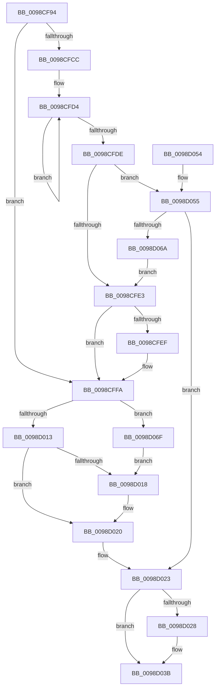

# PopEtEnergyContextSetState

- RVA: `0x0098CF94`–`0x0098D0CC` (길이 `312` bytes)
- VA: `0x000000014098CF94`
- 실행 섹션: `PAGE`
- PDB 이름 있음: `예`; PDB Function 태그: `아니요`
- unwind 정보 RVA: `0x000987F4`
- 디코드: `90`개 명령, `312/312` bytes 표시
- 미해석 바이트: `0` (있으면 어셈블리에 `.byte`로 보존)

> 이 문서는 커널 이미지의 기계어와 PDB 기호를 분석해 생성했습니다. 4번과 5번은 함수 원형과 자료형을 바이너리 사용 방식에서 추정한 C 해석이며 원본 소스 복구 결과는 아닙니다.

## 1. Dependencies

- 직접 호출 지점: **6**; 고유 호출 대상: **5**
- 직접 호출자로 확인된 함수: **2**
- RIP 상대 이미지 참조: **1**

### Outgoing calls
- `0x0098CFF2` → [PopEtStringSet](PopEtStringSet_function_0098D3E4.md) (function, `0x0098D3E4`)
- `0x0098D01B` → [PopEtEnergyContextProcessStateUpdate](PopEtEnergyContextProcessStateUpdate_function_0098E418.md) (function, `0x0098E418`)
- `0x0098D036` → [RtlInternEntryDereference](RtlInternEntryDereference_function_0098DCB4.md) (function, `0x0098DCB4`)
- `0x0098D05A` → [PopEtStringIntern](PopEtStringIntern_function_0098E7D0.md) (function, `0x0098E7D0`)
- `0x0098D09F` → [RtlStateDurationUpdate](../../text/49/RtlStateDurationUpdate_function_00499538.md) (function, `0x00499538`)
- `0x0098D0B6` → [RtlStateDurationUpdate](../../text/49/RtlStateDurationUpdate_function_00499538.md) (function, `0x00499538`)

### Direct callers
- [PoSetProcessEnergyTrackingState](PoSetProcessEnergyTrackingState_function_0098C904.md) at `0x0098C98C`
- [PoEnergyContextUpdateComponentPower](PoEnergyContextUpdateComponentPower_function_0098CA08.md) at `0x0098CCF5`

### Static image references
- `0x0098D028` → RVA `0x00E67A30` (`.data`; read)

## 2. Other-region calls and transfers

- 다른 실행 섹션으로 향하는 call: **2**
  - `0x0098D09F` → [RtlStateDurationUpdate](../../text/49/RtlStateDurationUpdate_function_00499538.md) (`PAGE` → `.text`)
  - `0x0098D0B6` → [RtlStateDurationUpdate](../../text/49/RtlStateDurationUpdate_function_00499538.md) (`PAGE` → `.text`)
- 별도 외부 분기/꼬리 이동을 확인하지 못했습니다.

## 3. Assembly (complete function range)

```asm
0098CF94  48 89 5C 24 10                  mov qword ptr [rsp + 0x10], rbx
0098CF99  48 89 6C 24 18                  mov qword ptr [rsp + 0x18], rbp
0098CF9E  56                              push rsi
0098CF9F  57                              push rdi
0098CFA0  41 54                           push r12
0098CFA2  41 56                           push r14
0098CFA4  41 57                           push r15
0098CFA6  48 83 EC 20                     sub rsp, 0x20
0098CFAA  8B 42 0C                        mov eax, dword ptr [rdx + 0xc]
0098CFAD  45 33 E4                        xor r12d, r12d
0098CFB0  48 8B A9 68 06 00 00            mov rbp, qword ptr [rcx + 0x668]
0098CFB7  41 8B DC                        mov ebx, r12d
0098CFBA  48 89 5C 24 50                  mov qword ptr [rsp + 0x50], rbx
0098CFBF  48 8B F2                        mov rsi, rdx
0098CFC2  4C 8B F9                        mov r15, rcx
0098CFC5  45 8A F4                        mov r14b, r12b
0098CFC8  A8 01                           test al, 1
0098CFCA  74 2E                           je 0x14098cffa
0098CFCC  48 8D 4A 10                     lea rcx, [rdx + 0x10]
0098CFD0  48 83 CA FF                     or rdx, 0xffffffffffffffff
0098CFD4  48 FF C2                        inc rdx
0098CFD7  66 44 39 24 51                  cmp word ptr [rcx + rdx*2], r12w
0098CFDC  75 F6                           jne 0x14098cfd4
0098CFDE  48 85 D2                        test rdx, rdx
0098CFE1  75 72                           jne 0x14098d055
0098CFE3  48 8D 8D D0 01 00 00            lea rcx, [rbp + 0x1d0]
0098CFEA  48 39 19                        cmp qword ptr [rcx], rbx
0098CFED  74 0B                           je 0x14098cffa
0098CFEF  48 8B D3                        mov rdx, rbx
0098CFF2  E8 ED 03 00 00                  call 0x14098d3e4
0098CFF7  41 B6 01                        mov r14b, 1
0098CFFA  8B 8D D8 01 00 00               mov ecx, dword ptr [rbp + 0x1d8]
0098D000  8B 06                           mov eax, dword ptr [rsi]
0098D002  F7 D0                           not eax
0098D004  23 C1                           and eax, ecx
0098D006  0F B7 F8                        movzx edi, ax
0098D009  0B 7E 04                        or edi, dword ptr [rsi + 4]
0098D00C  0F B7 C1                        movzx eax, cx
0098D00F  3B C7                           cmp eax, edi
0098D011  75 5C                           jne 0x14098d06f
0098D013  45 84 F6                        test r14b, r14b
0098D016  74 08                           je 0x14098d020
0098D018  49 8B CF                        mov rcx, r15
0098D01B  E8 F8 13 00 00                  call 0x14098e418
0098D020  41 8B FC                        mov edi, r12d
0098D023  48 85 DB                        test rbx, rbx
0098D026  74 13                           je 0x14098d03b
0098D028  48 8B 0D 01 AA 4D 00            mov rcx, qword ptr [rip + 0x4daa01]
0098D02F  48 8B D3                        mov rdx, rbx
0098D032  48 83 C1 38                     add rcx, 0x38
0098D036  E8 79 0C 00 00                  call 0x14098dcb4
0098D03B  48 8B 5C 24 58                  mov rbx, qword ptr [rsp + 0x58]
0098D040  8B C7                           mov eax, edi
0098D042  48 8B 6C 24 60                  mov rbp, qword ptr [rsp + 0x60]
0098D047  48 83 C4 20                     add rsp, 0x20
0098D04B  41 5F                           pop r15
0098D04D  41 5E                           pop r14
0098D04F  41 5C                           pop r12
0098D051  5F                              pop rdi
0098D052  5E                              pop rsi
0098D053  C3                              ret
0098D054  CC                              int3
0098D055  4C 8D 44 24 50                  lea r8, [rsp + 0x50]
0098D05A  E8 71 17 00 00                  call 0x14098e7d0
0098D05F  48 8B 5C 24 50                  mov rbx, qword ptr [rsp + 0x50]
0098D064  8B F8                           mov edi, eax
0098D066  85 C0                           test eax, eax
0098D068  78 B9                           js 0x14098d023
0098D06A  E9 74 FF FF FF                  jmp 0x14098cfe3
0098D06F  48 B9 04 00 00 00 80 F7 FF FF   movabs rcx, 0xfffff78000000004
0098D079  8B D7                           mov edx, edi
0098D07B  C1 EA 02                        shr edx, 2
0098D07E  48 B8 20 03 00 00 80 F7 FF FF   movabs rax, 0xfffff78000000320
0098D088  80 E2 01                        and dl, 1
0098D08B  48 8B 00                        mov rax, qword ptr [rax]
0098D08E  8B 19                           mov ebx, dword ptr [rcx]
0098D090  48 8D 4D 78                     lea rcx, [rbp + 0x78]
0098D094  48 0F AF D8                     imul rbx, rax
0098D098  48 C1 EB 18                     shr rbx, 0x18
0098D09C  44 8B C3                        mov r8d, ebx
0098D09F  E8 94 C4 B0 FF                  call 0x140499538
0098D0A4  8B D7                           mov edx, edi
0098D0A6  48 8D 8D A0 01 00 00            lea rcx, [rbp + 0x1a0]
0098D0AD  C1 EA 03                        shr edx, 3
0098D0B0  44 8B C3                        mov r8d, ebx
0098D0B3  80 E2 01                        and dl, 1
0098D0B6  E8 7D C4 B0 FF                  call 0x140499538
0098D0BB  48 8B 5C 24 50                  mov rbx, qword ptr [rsp + 0x50]
0098D0C0  66 89 BD D8 01 00 00            mov word ptr [rbp + 0x1d8], di
0098D0C7  E9 4C FF FF FF                  jmp 0x14098d018
```

## 4. C-style interpretation (structured pseudocode)

```c
__int64 __fastcall PopEtEnergyContextSetState(__int64 a1, __int64 a2)
{
    __int64 result;
    __int64 v_r12;
    __int64 v_r14;
    __int64 v_rbx;
    __int64 v_rdi;
    __int64 v_rsp;
    unsigned __int64 v_stack_p10;
    unsigned __int64 v_stack_p18;
    unsigned __int64 v_stack_p50;
    unsigned __int64 v_stack_p8;

    v_stack_p10 = v_rbx;
    v_stack_p18 = v_rbp;
    v_rsp = (v_rsp) - (32);
    v_r12 = 0;
    v_stack_p8 = 0;
    if ((((unsigned __int8)((unsigned int)(*(unsigned int *)(a2 + 12)))) & (1)) == 0) goto loc_0098CFFA;
    a2 = (a2) | (-1);
loc_0098CFD4:
    a2 = (a2) + 1;
    if ((*(unsigned __int16 *)(a2 + 16 + a2 * 2)) != 0) goto loc_0098CFD4;
    if (a2 != 0) goto loc_0098D055;
loc_0098CFE3:
    result = (unsigned int)(*(unsigned int *)(a2 + 12));
    v_r14 = 0;
    if ((*(unsigned __int64 *)(*(unsigned __int64 *)(a1 + 1640) + 464)) != 0) {
        a2 = 0;
        result = PopEtStringSet(*(unsigned __int64 *)(a1 + 1640) + 464, a2, a3, a4);
        v_r14 = 1;
    }
    result = (unsigned int)(~((unsigned int)(*(unsigned int *)(a2))));
    result = (unsigned int)((result) & ((unsigned int)((unsigned int)(*(unsigned int *)(*(unsigned __int64 *)(a1 + 1640) + 472)))));
    v_rdi = (unsigned int)(((unsigned __int16)(result)) | (*(unsigned int *)(a2 + 4)));
    if (((unsigned int)((unsigned __int16)((unsigned int)(*(unsigned int *)(*(unsigned __int64 *)(a1 + 1640) + 472))))) != ((unsigned int)(v_rdi))) goto loc_0098D06F;
    result = (unsigned __int16)((unsigned int)(*(unsigned int *)(*(unsigned __int64 *)(a1 + 1640) + 472)));
    if ((unsigned __int8)(v_r14) != 0) {
        a1 = a1;
        result = PopEtEnergyContextProcessStateUpdate(a1, a2, a3, a4);
    }
loc_0098D023:
    if (0 != 0) {
        a1 = *(unsigned __int64 *)(v_rip + 5089793);
        a2 = 0;
        a1 = (a1) + (56);
        result = RtlInternEntryDereference(a1, a2, a3, a4);
    }
    v_rsp = (v_rsp) + (32);
    return 0;
loc_0098D055:
    result = PopEtStringIntern(a1, a2, v_stack_p50, a4);
    if (sign_flag) goto loc_0098D023;
    goto loc_0098CFE3;
loc_0098D06F:
    a2 = (unsigned int)(((unsigned int)((unsigned int)((unsigned int)((unsigned int)(result))))) >> (2));
    a2 = (unsigned __int8)((a2) & (1));
    v_rbx = ((unsigned int)(*(unsigned int *)(a1))) * (*(unsigned __int64 *)(result));
    v_rbx = (v_rbx) >> (24);
    result = RtlStateDurationUpdate(v_stack_p18 + 120, a2, (unsigned int)((unsigned int)(v_rbx)), a4);
    a2 = (unsigned int)(((unsigned int)((unsigned int)((unsigned int)((unsigned int)(result))))) >> (3));
    a2 = (unsigned __int8)((a2) & (1));
    result = RtlStateDurationUpdate(v_stack_p18 + 416, a2, (unsigned int)((unsigned int)(v_rbx)), a4);
    *(unsigned __int16 *)(v_stack_p18 + 472) = (unsigned __int16)((unsigned int)((unsigned int)(result)));
    goto loc_0098D018;
}
```

## 5. (Beta) C Style

```c
int64_t PopEtEnergyContextSetState(void *Arg1, void *Arg2)
{
    uint8_t *arg1 = (uint8_t *)Arg1;
    uint8_t *arg2 = (uint8_t *)Arg2;

    int64_t result;
    int64_t local_r12;
    int64_t local_r14;
    int64_t local_rbx;
    int64_t local_rdi;
    int64_t local_rsp;
    uint64_t v_stack_p10;
    uint64_t v_stack_p18;
    uint64_t v_stack_p50;
    uint64_t v_stack_p8;

    v_stack_p10 = local_rbx;
    v_stack_p18 = local_rbp;
    local_rsp = (local_rsp) - (32);
    local_r12 = 0;
    v_stack_p8 = 0;
    if ((((uint8_t)((uint32_t)(*(uint32_t *)(arg2 + 0xC)))) & (1)) == 0) goto loc_0098CFFA;
    Arg2 = (Arg2) | (-1);
loc_0098CFD4:
    Arg2 = (Arg2) + 1;
    if ((*(uint16_t *)(arg2 + 0x10 + arg2 * 2)) != 0) goto loc_0098CFD4;
    if (Arg2 != NULL) goto loc_0098D055;
loc_0098CFE3:
    result = (uint32_t)(*(uint32_t *)(arg2 + 0xC));
    local_r14 = 0;
    if ((*(uint64_t *)(*(uint64_t *)(arg1 + 0x668) + 0x1D0)) != 0) {
        Arg2 = 0;
        result = PopEtStringSet(*(uint64_t *)(arg1 + 0x668) + 464, Arg2, a3, a4);
        local_r14 = 1;
    }
    result = (uint32_t)(~((uint32_t)(*(uint32_t *)(arg2))));
    result = (uint32_t)((result) & ((uint32_t)((uint32_t)(*(uint32_t *)(*(uint64_t *)(arg1 + 0x668) + 0x1D8)))));
    local_rdi = (uint32_t)(((uint16_t)(result)) | (*(uint32_t *)(arg2 + 0x4)));
    if (((uint32_t)((uint16_t)((uint32_t)(*(uint32_t *)(*(uint64_t *)(arg1 + 0x668) + 0x1D8))))) != ((uint32_t)(local_rdi))) goto loc_0098D06F;
    result = (uint16_t)((uint32_t)(*(uint32_t *)(*(uint64_t *)(arg1 + 0x668) + 0x1D8)));
    if ((uint8_t)(local_r14) != 0) {
        Arg1 = Arg1;
        result = PopEtEnergyContextProcessStateUpdate(Arg1, Arg2, a3, a4);
    }
loc_0098D023:
    if (0 != 0) {
        Arg1 = *(uint64_t *)(v_rip + 0x4DAA01);
        Arg2 = 0;
        Arg1 = (Arg1) + (56);
        result = RtlInternEntryDereference(Arg1, Arg2, a3, a4);
    }
    local_rsp = (local_rsp) + (32);
    return 0;
loc_0098D055:
    result = PopEtStringIntern(Arg1, Arg2, v_stack_p50, a4);
    if (sign_flag) goto loc_0098D023;
    goto loc_0098CFE3;
loc_0098D06F:
    Arg2 = (uint32_t)(((uint32_t)((uint32_t)((uint32_t)((uint32_t)(result))))) >> (2));
    Arg2 = (uint8_t)((Arg2) & (1));
    local_rbx = ((uint32_t)(*(uint32_t *)(arg1))) * (*(uint64_t *)(result));
    local_rbx = (local_rbx) >> (24);
    result = RtlStateDurationUpdate(v_stack_p18 + 120, Arg2, (uint32_t)((uint32_t)(local_rbx)), a4);
    Arg2 = (uint32_t)(((uint32_t)((uint32_t)((uint32_t)((uint32_t)(result))))) >> (3));
    Arg2 = (uint8_t)((Arg2) & (1));
    result = RtlStateDurationUpdate(v_stack_p18 + 416, Arg2, (uint32_t)((uint32_t)(local_rbx)), a4);
    *(uint16_t *)(v_stack_p18 + 0x1D8) = (uint16_t)((uint32_t)((uint32_t)(result)));
    goto loc_0098D018;
}
```

### 관측된 메모리 오프셋

구조체 형식이 확인되지 않은 접근은 인자 기준의 오프셋으로만 기록했습니다.

| 기준 인자 | 오프셋 표현 | 폭 (bit) | 접근 |
|---|---:|---:|---|
| `Arg1` | `+ 0x668` | `64` | `R` |
| `Arg2` | `+ 0x0` | `32` | `R` |
| `Arg2` | `+ 0x0 + rdx*2` | `16` | `R` |
| `Arg2` | `+ 0x4` | `32` | `R` |
| `Arg2` | `+ 0xC` | `32` | `R` |
| `Arg2` | `+ 0x10` | `64` | `R` |

## 6. Execution-region graph

[열기: 2D/3D 그래프와 함수 탐색 컨트롤 패널](../../../control-panel.html?section=page&rva=0x0098CF94&view=graph)

- 2D 그래프는 위에서 아래로 흐르고, 3D 그래프는 빈 공간을 드래그해 회전합니다. Shift+드래그는 이동, 휠은 확대·축소, 함수 노드 선택은 대상 보고서 이동입니다.

### Static fallback


