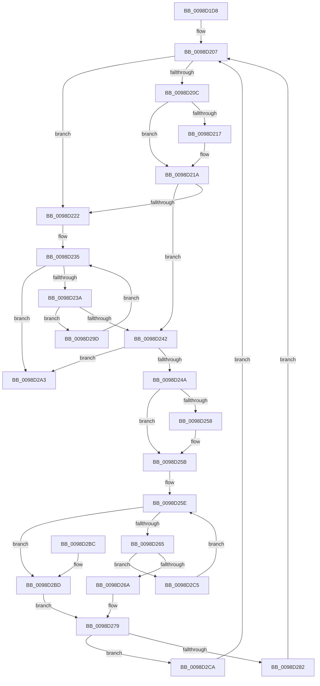

# PopEtEnergyTrackerCleanupAggregates

- RVA: `0x0098D1D8`–`0x0098D2FD` (길이 `293` bytes)
- VA: `0x000000014098D1D8`
- 실행 섹션: `PAGE`
- PDB 이름 있음: `예`; PDB Function 태그: `아니요`
- unwind 정보 RVA: `0x00093F4C`
- 디코드: `87`개 명령, `293/293` bytes 표시
- 미해석 바이트: `0` (있으면 어셈블리에 `.byte`로 보존)

> 이 문서는 커널 이미지의 기계어와 PDB 기호를 분석해 생성했습니다. 4번과 5번은 함수 원형과 자료형을 바이너리 사용 방식에서 추정한 C 해석이며 원본 소스 복구 결과는 아닙니다.

## 1. Dependencies

- 직접 호출 지점: **3**; 고유 호출 대상: **3**
- 직접 호출자로 확인된 함수: **2**
- RIP 상대 이미지 참조: **0**

### Outgoing calls
- `0x0098D286` → [PopEtAggregateKeyCleanup](PopEtAggregateKeyCleanup_function_0098D304.md) (function, `0x0098D304`)
- `0x0098D293` → [ExFreePoolWithTag](../../poolcode/B8/ExFreePoolWithTag_function_00B82870.md) (function, `0x00B82870`)
- `0x0098D2E0` → [memset](../../text/6C/memset_function_006C6C40.md) (function, `0x006C6C40`)

### Direct callers
- [PopEtEnergyTrackerCleanup](../76/PopEtEnergyTrackerCleanup_function_00769CB4.md) at `0x00769D8D`
- [PopEtEnergyTrackerQuery](PopEtEnergyTrackerQuery_function_0098B668.md) at `0x0098C59D`

### Static image references
- 디코드된 RIP-relative 메모리 참조가 없습니다.

## 2. Other-region calls and transfers

- 다른 실행 섹션으로 향하는 call: **2**
  - `0x0098D293` → [ExFreePoolWithTag](../../poolcode/B8/ExFreePoolWithTag_function_00B82870.md) (`PAGE` → `POOLCODE`)
  - `0x0098D2E0` → [memset](../../text/6C/memset_function_006C6C40.md) (`PAGE` → `.text`)
- 별도 외부 분기/꼬리 이동을 확인하지 못했습니다.

## 3. Assembly (complete function range)

```asm
0098D1D8  48 89 5C 24 08                  mov qword ptr [rsp + 8], rbx
0098D1DD  48 89 6C 24 10                  mov qword ptr [rsp + 0x10], rbp
0098D1E2  48 89 74 24 18                  mov qword ptr [rsp + 0x18], rsi
0098D1E7  57                              push rdi
0098D1E8  41 56                           push r14
0098D1EA  41 57                           push r15
0098D1EC  48 83 EC 20                     sub rsp, 0x20
0098D1F0  48 8B 79 38                     mov rdi, qword ptr [rcx + 0x38]
0098D1F4  48 8B F1                        mov rsi, rcx
0098D1F7  48 8B DF                        mov rbx, rdi
0098D1FA  45 33 F6                        xor r14d, r14d
0098D1FD  49 BF 02 00 00 00 00 00 00 80   movabs r15, 0x8000000000000002
0098D207  48 85 DB                        test rbx, rbx
0098D20A  74 16                           je 0x14098d222
0098D20C  48 8B 03                        mov rax, qword ptr [rbx]
0098D20F  49 23 C7                        and rax, r15
0098D212  49 3B C7                        cmp rax, r15
0098D215  75 03                           jne 0x14098d21a
0098D217  49 8B 06                        mov rax, qword ptr [r14]
0098D21A  48 8B 1B                        mov rbx, qword ptr [rbx]
0098D21D  F6 C3 01                        test bl, 1
0098D220  74 20                           je 0x14098d242
0098D222  8B 4E 34                        mov ecx, dword ptr [rsi + 0x34]
0098D225  48 83 C7 08                     add rdi, 8
0098D229  48 8B 46 38                     mov rax, qword ptr [rsi + 0x38]
0098D22D  48 C1 E9 05                     shr rcx, 5
0098D231  48 8D 14 C8                     lea rdx, [rax + rcx*8]
0098D235  48 3B FA                        cmp rdi, rdx
0098D238  73 69                           jae 0x14098d2a3
0098D23A  48 8B 1F                        mov rbx, qword ptr [rdi]
0098D23D  F6 C3 01                        test bl, 1
0098D240  75 5B                           jne 0x14098d29d
0098D242  48 8B C3                        mov rax, rbx
0098D245  48 85 C0                        test rax, rax
0098D248  74 59                           je 0x14098d2a3
0098D24A  48 8B 03                        mov rax, qword ptr [rbx]
0098D24D  48 8B EB                        mov rbp, rbx
0098D250  49 23 C7                        and rax, r15
0098D253  49 3B C7                        cmp rax, r15
0098D256  75 03                           jne 0x14098d25b
0098D258  49 8B 06                        mov rax, qword ptr [r14]
0098D25B  48 8B CF                        mov rcx, rdi
0098D25E  48 8B 01                        mov rax, qword ptr [rcx]
0098D261  A8 01                           test al, 1
0098D263  75 58                           jne 0x14098d2bd
0098D265  48 3B C3                        cmp rax, rbx
0098D268  75 5B                           jne 0x14098d2c5
0098D26A  48 8B 03                        mov rax, qword ptr [rbx]
0098D26D  48 89 01                        mov qword ptr [rcx], rax
0098D270  FF 4E 30                        dec dword ptr [rsi + 0x30]
0098D273  4C 09 3B                        or qword ptr [rbx], r15
0098D276  48 8B D9                        mov rbx, rcx
0098D279  48 8D 46 50                     lea rax, [rsi + 0x50]
0098D27D  48 3B E8                        cmp rbp, rax
0098D280  74 48                           je 0x14098d2ca
0098D282  48 8D 4D 10                     lea rcx, [rbp + 0x10]
0098D286  E8 79 00 00 00                  call 0x14098d304
0098D28B  BA 50 6F 45 54                  mov edx, 0x54456f50
0098D290  48 8B CD                        mov rcx, rbp
0098D293  E8 D8 55 1F 00                  call 0x140b82870
0098D298  E9 6A FF FF FF                  jmp 0x14098d207
0098D29D  48 83 C7 08                     add rdi, 8
0098D2A1  EB 92                           jmp 0x14098d235
0098D2A3  48 8B 5C 24 40                  mov rbx, qword ptr [rsp + 0x40]
0098D2A8  48 8B 6C 24 48                  mov rbp, qword ptr [rsp + 0x48]
0098D2AD  48 8B 74 24 50                  mov rsi, qword ptr [rsp + 0x50]
0098D2B2  48 83 C4 20                     add rsp, 0x20
0098D2B6  41 5F                           pop r15
0098D2B8  41 5E                           pop r14
0098D2BA  5F                              pop rdi
0098D2BB  C3                              ret
0098D2BC  CC                              int3
0098D2BD  49 8B 06                        mov rax, qword ptr [r14]
0098D2C0  49 8B EE                        mov rbp, r14
0098D2C3  EB B4                           jmp 0x14098d279
0098D2C5  48 8B C8                        mov rcx, rax
0098D2C8  EB 94                           jmp 0x14098d25e
0098D2CA  83 A6 84 02 00 00 FB            and dword ptr [rsi + 0x284], 0xfffffffb
0098D2D1  48 8D 8E 80 00 00 00            lea rcx, [rsi + 0x80]
0098D2D8  33 D2                           xor edx, edx
0098D2DA  41 B8 B8 01 00 00               mov r8d, 0x1b8
0098D2E0  E8 5B 99 D3 FF                  call 0x1406c6c40
0098D2E5  0F 57 C0                        xorps xmm0, xmm0
0098D2E8  33 C0                           xor eax, eax
0098D2EA  0F 11 86 38 02 00 00            movups xmmword ptr [rsi + 0x238], xmm0
0098D2F1  48 89 86 48 02 00 00            mov qword ptr [rsi + 0x248], rax
0098D2F8  E9 0A FF FF FF                  jmp 0x14098d207
```

## 4. C-style interpretation (structured pseudocode)

```c
__int64 __fastcall PopEtEnergyTrackerCleanupAggregates(__int64 a1)
{
    __int64 result;
    __int64 v_r14;
    __int64 v_rdi;
    __int64 v_rsp;
    unsigned __int64 v_stack_p10;
    unsigned __int64 v_stack_p18;
    unsigned __int64 v_stack_p8;

    v_stack_p8 = v_rbx;
    v_stack_p10 = v_rbp;
    v_stack_p18 = v_rsi;
    v_rsp = (v_rsp) - (32);
    v_r14 = 0;
loc_0098D207:
    if (*(unsigned __int64 *)(a1 + 56) == 0) goto loc_0098D222;
    result = (*(unsigned __int64 *)(*(unsigned __int64 *)(a1 + 56))) & (v_r15);
    if (result == v_r15) {
        result = *(unsigned __int64 *)(v_r14);
    }
    if ((((unsigned __int8)(*(unsigned __int64 *)(*(unsigned __int64 *)(a1 + 56)))) & (1)) == 0) goto loc_0098D242;
loc_0098D222:
    v_rdi = (*(unsigned __int64 *)(a1 + 56)) + (8);
    a1 = ((unsigned int)(*(unsigned int *)(a1 + 52))) >> (5);
loc_0098D235:
    if (v_rdi >= (*(unsigned __int64 *)(a1 + 56) + a1 * 8)) goto loc_0098D2A3;
    if ((((unsigned __int8)(*(unsigned __int64 *)(v_rdi))) & (1)) != 0) goto loc_0098D29D;
loc_0098D242:
    if (*(unsigned __int64 *)(v_rdi) == 0) goto loc_0098D2A3;
    result = (*(unsigned __int64 *)(*(unsigned __int64 *)(v_rdi))) & (v_r15);
    if (result == v_r15) {
        result = *(unsigned __int64 *)(v_r14);
    }
loc_0098D25E:
    if ((((unsigned __int8)(*(unsigned __int64 *)(v_rdi))) & (1)) != 0) goto loc_0098D2BD;
    if ((*(unsigned __int64 *)(v_rdi)) != (*(unsigned __int64 *)(v_rdi))) goto loc_0098D2C5;
    *(unsigned __int64 *)(v_rdi) = *(unsigned __int64 *)(*(unsigned __int64 *)(v_rdi));
loc_0098D279:
    if ((*(unsigned __int64 *)(v_rdi)) == (a1 + 80)) goto loc_0098D2CA;
    result = PopEtAggregateKeyCleanup(*(unsigned __int64 *)(v_rdi) + 16, *(unsigned __int64 *)(a1 + 56) + a1 * 8, a3, a4);
    result = ExFreePoolWithTag(*(unsigned __int64 *)(v_rdi), (unsigned int)(0x54456F50ULL), a3, a4);
    goto loc_0098D207;
loc_0098D29D:
    v_rdi = (v_rdi) + (8);
    goto loc_0098D235;
loc_0098D2A3:
    v_rsp = (v_rsp) + (32);
    return result;
loc_0098D2BD:
    goto loc_0098D279;
loc_0098D2C5:
    goto loc_0098D25E;
loc_0098D2CA:
    a2 = 0;
    result = memset(v_stack_p18 + 128, a2, 440, a4);
    result = 0;
    *(unsigned __int64 *)(v_stack_p18 + 568) = v_xmm0;
    *(unsigned __int64 *)(v_stack_p18 + 584) = 0;
    goto loc_0098D207;
}
```

## 5. (Beta) C Style

```c
int64_t PopEtEnergyTrackerCleanupAggregates(void *Arg1)
{
    uint8_t *arg1 = (uint8_t *)Arg1;

    int64_t result;
    int64_t local_r14;
    int64_t local_rdi;
    int64_t local_rsp;
    uint64_t v_stack_p10;
    uint64_t v_stack_p18;
    uint64_t v_stack_p8;

    v_stack_p8 = local_rbx;
    v_stack_p10 = local_rbp;
    v_stack_p18 = local_rsi;
    local_rsp = (local_rsp) - (32);
    local_r14 = 0;
loc_0098D207:
    if (*(uint64_t *)(arg1 + 0x38) == 0) goto loc_0098D222;
    result = (*(uint64_t *)(*(uint64_t *)(arg1 + 0x38))) & (local_r15);
    if (result == local_r15) {
        result = *(uint64_t *)(local_r14);
    }
    if ((((uint8_t)(*(uint64_t *)(*(uint64_t *)(arg1 + 0x38)))) & (1)) == 0) goto loc_0098D242;
loc_0098D222:
    local_rdi = (*(uint64_t *)(arg1 + 0x38)) + (8);
    Arg1 = ((uint32_t)(*(uint32_t *)(arg1 + 0x34))) >> (5);
loc_0098D235:
    if (local_rdi >= (*(uint64_t *)(arg1 + 0x38) + Arg1 * 8)) goto loc_0098D2A3;
    if ((((uint8_t)(*(uint64_t *)(local_rdi))) & (1)) != 0) goto loc_0098D29D;
loc_0098D242:
    if (*(uint64_t *)(local_rdi) == 0) goto loc_0098D2A3;
    result = (*(uint64_t *)(*(uint64_t *)(local_rdi))) & (local_r15);
    if (result == local_r15) {
        result = *(uint64_t *)(local_r14);
    }
loc_0098D25E:
    if ((((uint8_t)(*(uint64_t *)(local_rdi))) & (1)) != 0) goto loc_0098D2BD;
    if ((*(uint64_t *)(local_rdi)) != (*(uint64_t *)(local_rdi))) goto loc_0098D2C5;
    *(uint64_t *)(local_rdi) = *(uint64_t *)(*(uint64_t *)(local_rdi));
loc_0098D279:
    if ((*(uint64_t *)(local_rdi)) == (Arg1 + 80)) goto loc_0098D2CA;
    result = PopEtAggregateKeyCleanup(*(uint64_t *)(local_rdi) + 16, *(uint64_t *)(arg1 + 0x38) + Arg1 * 8, a3, a4);
    result = ExFreePoolWithTag(*(uint64_t *)(local_rdi), (uint32_t)(0x54456F50ULL), a3, a4);
    goto loc_0098D207;
loc_0098D29D:
    local_rdi = (local_rdi) + (8);
    goto loc_0098D235;
loc_0098D2A3:
    local_rsp = (local_rsp) + (32);
    return result;
loc_0098D2BD:
    goto loc_0098D279;
loc_0098D2C5:
    goto loc_0098D25E;
loc_0098D2CA:
    a2 = 0;
    result = memset(v_stack_p18 + 128, a2, 440, a4);
    result = 0;
    *(uint64_t *)(v_stack_p18 + 0x238) = v_xmm0;
    *(uint64_t *)(v_stack_p18 + 0x248) = 0;
    goto loc_0098D207;
}
```

### 관측된 메모리 오프셋

구조체 형식이 확인되지 않은 접근은 인자 기준의 오프셋으로만 기록했습니다.

| 기준 인자 | 오프셋 표현 | 폭 (bit) | 접근 |
|---|---:|---:|---|
| `Arg1` | `+ 0x30` | `32` | `R/W` |
| `Arg1` | `+ 0x34` | `32` | `R` |
| `Arg1` | `+ 0x38` | `64` | `R` |
| `Arg1` | `+ 0x50` | `64` | `R` |
| `Arg1` | `+ 0x80` | `64` | `R` |
| `Arg1` | `+ 0x238` | `128` | `R` |
| `Arg1` | `+ 0x248` | `64` | `W` |
| `Arg1` | `+ 0x284` | `32` | `R/W` |

## 6. Execution-region graph

[열기: 2D/3D 그래프와 함수 탐색 컨트롤 패널](../../../control-panel.html?section=page&rva=0x0098D1D8&view=graph)

- 2D 그래프는 위에서 아래로 흐르고, 3D 그래프는 빈 공간을 드래그해 회전합니다. Shift+드래그는 이동, 휠은 확대·축소, 함수 노드 선택은 대상 보고서 이동입니다.

### Static fallback


