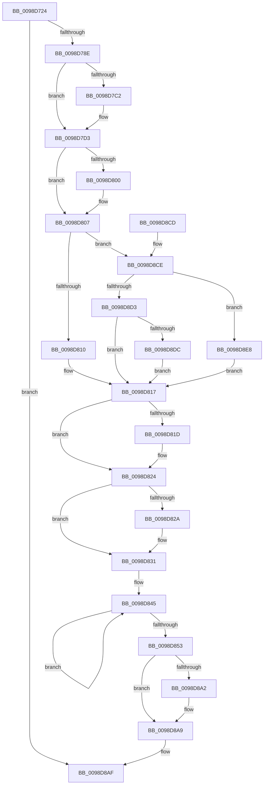

# PopEtEnergyTrackerUpdateAggregate

- RVA: `0x0098D724`–`0x0098D8F4` (길이 `464` bytes)
- VA: `0x000000014098D724`
- 실행 섹션: `PAGE`
- PDB 이름 있음: `예`; PDB Function 태그: `아니요`
- unwind 정보 RVA: `0x0009885C`
- 디코드: `110`개 명령, `464/464` bytes 표시
- 미해석 바이트: `0` (있으면 어셈블리에 `.byte`로 보존)

> 이 문서는 커널 이미지의 기계어와 PDB 기호를 분석해 생성했습니다. 4번과 5번은 함수 원형과 자료형을 바이너리 사용 방식에서 추정한 C 해석이며 원본 소스 복구 결과는 아닙니다.

## 1. Dependencies

- 직접 호출 지점: **5**; 고유 호출 대상: **5**
- 직접 호출자로 확인된 함수: **1**
- RIP 상대 이미지 참조: **1**

### Outgoing calls
- `0x0098D763` → [memset](../../text/6C/memset_function_006C6C40.md) (function, `0x006C6C40`)
- `0x0098D77E` → [PopEtEnergyValuesDeltaCalculate](PopEtEnergyValuesDeltaCalculate_function_0098D8FC.md) (function, `0x0098D8FC`)
- `0x0098D79A` → [PopEtAggregateGet](PopEtAggregateGet_function_0098DEEC.md) (function, `0x0098DEEC`)
- `0x0098D7AD` → [PsAddProcessEnergyValues](../../text/41/PsAddProcessEnergyValues_function_00416F58.md) (function, `0x00416F58`)
- `0x0098D8BA` → [_security_check_cookie](../../text/6A/_security_check_cookie_function_006AC640.md) (function, `0x006AC640`)

### Direct callers
- [PopEtProcessSnapshotUpdate](PopEtProcessSnapshotUpdate_function_0098D430.md) at `0x0098D4A1`

### Static image references
- `0x0098D732` → RVA `0x00E0A740` (`.data`; read)

## 2. Other-region calls and transfers

- 다른 실행 섹션으로 향하는 call: **3**
  - `0x0098D763` → [memset](../../text/6C/memset_function_006C6C40.md) (`PAGE` → `.text`)
  - `0x0098D7AD` → [PsAddProcessEnergyValues](../../text/41/PsAddProcessEnergyValues_function_00416F58.md) (`PAGE` → `.text`)
  - `0x0098D8BA` → [_security_check_cookie](../../text/6A/_security_check_cookie_function_006AC640.md) (`PAGE` → `.text`)
- 별도 외부 분기/꼬리 이동을 확인하지 못했습니다.

## 3. Assembly (complete function range)

```asm
0098D724  40 53                           push rbx
0098D726  55                              push rbp
0098D727  56                              push rsi
0098D728  57                              push rdi
0098D729  41 56                           push r14
0098D72B  48 81 EC 00 02 00 00            sub rsp, 0x200
0098D732  48 8B 05 07 D0 47 00            mov rax, qword ptr [rip + 0x47d007]
0098D739  48 33 C4                        xor rax, rsp
0098D73C  48 89 84 24 F0 01 00 00         mov qword ptr [rsp + 0x1f0], rax
0098D744  48 83 64 24 28 00               and qword ptr [rsp + 0x28], 0
0098D74A  49 8B E8                        mov rbp, r8
0098D74D  48 8B FA                        mov rdi, rdx
0098D750  4C 8B F1                        mov r14, rcx
0098D753  33 D2                           xor edx, edx
0098D755  48 8D 4C 24 30                  lea rcx, [rsp + 0x30]
0098D75A  41 B8 B8 01 00 00               mov r8d, 0x1b8
0098D760  41 8B F1                        mov esi, r9d
0098D763  E8 D8 94 D3 FF                  call 0x1406c6c40
0098D768  83 64 24 20 00                  and dword ptr [rsp + 0x20], 0
0098D76D  48 8D 4F 30                     lea rcx, [rdi + 0x30]
0098D771  4C 8D 4C 24 20                  lea r9, [rsp + 0x20]
0098D776  48 8B D5                        mov rdx, rbp
0098D779  4C 8D 44 24 30                  lea r8, [rsp + 0x30]
0098D77E  E8 79 01 00 00                  call 0x14098d8fc
0098D783  83 7C 24 20 00                  cmp dword ptr [rsp + 0x20], 0
0098D788  0F 85 21 01 00 00               jne 0x14098d8af
0098D78E  48 8D 57 10                     lea rdx, [rdi + 0x10]
0098D792  49 8B CE                        mov rcx, r14
0098D795  4C 8D 44 24 28                  lea r8, [rsp + 0x28]
0098D79A  E8 4D 07 00 00                  call 0x14098deec
0098D79F  48 8B 5C 24 28                  mov rbx, qword ptr [rsp + 0x28]
0098D7A4  48 8D 54 24 30                  lea rdx, [rsp + 0x30]
0098D7A9  48 8D 4B 30                     lea rcx, [rbx + 0x30]
0098D7AD  E8 A6 97 A8 FF                  call 0x140416f58
0098D7B2  8B 87 EC 01 00 00               mov eax, dword ptr [rdi + 0x1ec]
0098D7B8  41 B8 01 00 00 00               mov r8d, 1
0098D7BE  85 C0                           test eax, eax
0098D7C0  78 11                           js 0x14098d7d3
0098D7C2  0F BA E8 1F                     bts eax, 0x1f
0098D7C6  89 87 EC 01 00 00               mov dword ptr [rdi + 0x1ec], eax
0098D7CC  44 01 83 F4 01 00 00            add dword ptr [rbx + 0x1f4], r8d
0098D7D3  44 01 83 E8 01 00 00            add dword ptr [rbx + 0x1e8], r8d
0098D7DA  41 B9 FF FF FF 7F               mov r9d, 0x7fffffff
0098D7E0  8B 8F EC 01 00 00               mov ecx, dword ptr [rdi + 0x1ec]
0098D7E6  8D 51 01                        lea edx, [rcx + 1]
0098D7E9  8B C2                           mov eax, edx
0098D7EB  41 23 D1                        and edx, r9d
0098D7EE  33 C1                           xor eax, ecx
0098D7F0  41 23 C1                        and eax, r9d
0098D7F3  33 C1                           xor eax, ecx
0098D7F5  89 87 EC 01 00 00               mov dword ptr [rdi + 0x1ec], eax
0098D7FB  41 3B D0                        cmp edx, r8d
0098D7FE  75 07                           jne 0x14098d807
0098D800  44 01 83 F8 01 00 00            add dword ptr [rbx + 0x1f8], r8d
0098D807  83 FE 02                        cmp esi, 2
0098D80A  0F 85 BE 00 00 00               jne 0x14098d8ce
0098D810  44 01 83 EC 01 00 00            add dword ptr [rbx + 0x1ec], r8d
0098D817  44 85 4D 6C                     test dword ptr [rbp + 0x6c], r9d
0098D81B  74 07                           je 0x14098d824
0098D81D  44 09 83 04 02 00 00            or dword ptr [rbx + 0x204], r8d
0098D824  44 85 4D 74                     test dword ptr [rbp + 0x74], r9d
0098D828  74 07                           je 0x14098d831
0098D82A  83 8B 04 02 00 00 02            or dword ptr [rbx + 0x204], 2
0098D831  49 B8 B0 03 00 00 80 F7 FF FF   movabs r8, 0xfffff780000003b0
0098D83B  49 B9 08 00 00 00 80 F7 FF FF   movabs r9, 0xfffff78000000008
0098D845  49 8B 08                        mov rcx, qword ptr [r8]
0098D848  49 8B 11                        mov rdx, qword ptr [r9]
0098D84B  49 8B 00                        mov rax, qword ptr [r8]
0098D84E  48 3B C8                        cmp rcx, rax
0098D851  75 F2                           jne 0x14098d845
0098D853  45 8B 86 5C 02 00 00            mov r8d, dword ptr [r14 + 0x25c]
0098D85A  48 2B D1                        sub rdx, rcx
0098D85D  8B 8F F0 01 00 00               mov ecx, dword ptr [rdi + 0x1f0]
0098D863  48 B8 4B 59 86 38 D6 C5 6D 34   movabs rax, 0x346dc5d63886594b
0098D86D  4C 8B 54 24 28                  mov r10, qword ptr [rsp + 0x28]
0098D872  48 F7 E2                        mul rdx
0098D875  48 C1 EA 0B                     shr rdx, 0xb
0098D879  44 8B CA                        mov r9d, edx
0098D87C  8B C2                           mov eax, edx
0098D87E  2B C1                           sub eax, ecx
0098D880  45 2B C8                        sub r9d, r8d
0098D883  41 3B C1                        cmp eax, r9d
0098D886  44 0F 46 C1                     cmovbe r8d, ecx
0098D88A  41 8B 8A 00 02 00 00            mov ecx, dword ptr [r10 + 0x200]
0098D891  41 2B C8                        sub ecx, r8d
0098D894  03 CA                           add ecx, edx
0098D896  41 89 8A 00 02 00 00            mov dword ptr [r10 + 0x200], ecx
0098D89D  41 3B C9                        cmp ecx, r9d
0098D8A0  76 07                           jbe 0x14098d8a9
0098D8A2  45 89 8A 00 02 00 00            mov dword ptr [r10 + 0x200], r9d
0098D8A9  89 97 F0 01 00 00               mov dword ptr [rdi + 0x1f0], edx
0098D8AF  48 8B 8C 24 F0 01 00 00         mov rcx, qword ptr [rsp + 0x1f0]
0098D8B7  48 33 CC                        xor rcx, rsp
0098D8BA  E8 81 ED D1 FF                  call 0x1406ac640
0098D8BF  48 81 C4 00 02 00 00            add rsp, 0x200
0098D8C6  41 5E                           pop r14
0098D8C8  5F                              pop rdi
0098D8C9  5E                              pop rsi
0098D8CA  5D                              pop rbp
0098D8CB  5B                              pop rbx
0098D8CC  C3                              ret
0098D8CD  CC                              int3
0098D8CE  83 FE 03                        cmp esi, 3
0098D8D1  74 15                           je 0x14098d8e8
0098D8D3  83 FE 04                        cmp esi, 4
0098D8D6  0F 85 3B FF FF FF               jne 0x14098d817
0098D8DC  44 01 83 FC 01 00 00            add dword ptr [rbx + 0x1fc], r8d
0098D8E3  E9 2F FF FF FF                  jmp 0x14098d817
0098D8E8  44 01 83 F0 01 00 00            add dword ptr [rbx + 0x1f0], r8d
0098D8EF  E9 23 FF FF FF                  jmp 0x14098d817
```

## 4. C-style interpretation (structured pseudocode)

```c
__int64 __fastcall PopEtEnergyTrackerUpdateAggregate(__int64 a1, __int64 a2, __int64 a3, int a4)
{
    __int64 result;
    __int64 v_rsp;
    unsigned __int64 v_stack_m1F8;
    unsigned __int64 v_stack_m200;
    unsigned int v_stack_m208;
    unsigned __int64 v_stack_m38;

    v_rsp = (v_rsp) - (512);
    result = (*(unsigned __int64 *)(v_rip + 4706311)) ^ (v_rsp);
    v_stack_m38 = result;
    a2 = 0;
    result = memset(v_stack_m1F8, a2, 440, a4);
    result = PopEtEnergyValuesDeltaCalculate(a2 + 48, a3, v_stack_m1F8, v_stack_m208);
    if (v_stack_m208 != 0) goto loc_0098D8AF;
    result = PopEtAggregateGet(a1, a2 + 16, v_stack_m200, v_stack_m208);
    result = PsAddProcessEnergyValues(v_stack_m200 + 48, v_stack_m1F8, v_stack_m200, v_stack_m208);
    if (!(sign_flag)) {
        *(unsigned int *)(a2 + 492) = (unsigned int)((unsigned int)(*(unsigned int *)(a2 + 492)));
    }
    a2 = (unsigned int)(((unsigned int)(*(unsigned int *)(a2 + 492)) + 1) & ((unsigned int)((unsigned int)(0x7FFFFFFFULL))));
    result = (unsigned int)(((unsigned int)((unsigned int)((unsigned int)(*(unsigned int *)(a2 + 492)) + 1))) ^ ((unsigned int)((unsigned int)(*(unsigned int *)(a2 + 492)))));
    result = (unsigned int)((result) & ((unsigned int)((unsigned int)(0x7FFFFFFFULL))));
    result = (unsigned int)((result) ^ ((unsigned int)((unsigned int)(*(unsigned int *)(a2 + 492)))));
    *(unsigned int *)(a2 + 492) = (unsigned int)(result);
    if (((unsigned int)(a2)) == 1) {
    }
    if (((unsigned int)((unsigned int)(a4))) != 2) goto loc_0098D8CE;
loc_0098D817:
    if (((*(unsigned int *)(a3 + 108)) & ((unsigned int)((unsigned int)(0x7FFFFFFFULL)))) != 0) {
    }
    if (((*(unsigned int *)(a3 + 116)) & ((unsigned int)((unsigned int)(0x7FFFFFFFULL)))) != 0) {
    }
loc_0098D845:
    if ((*(unsigned __int64 *)(1)) != (*(unsigned __int64 *)(1))) goto loc_0098D845;
    a2 = (*(unsigned __int64 *)((unsigned int)(0x7FFFFFFFULL))) - (*(unsigned __int64 *)(1));
    a2 = (a2) >> (11);
    result = (unsigned int)(((unsigned int)((unsigned int)(a2))) - ((unsigned int)((unsigned int)(*(unsigned int *)(a2 + 496)))));
    a4 = (unsigned int)(((unsigned int)((unsigned int)(a2))) - ((unsigned int)((unsigned int)(*(unsigned int *)(a1 + 604)))));
    a3 = (unsigned int)(*(unsigned int *)(a1 + 604));
    if (((unsigned int)(result)) <= a4) { a3 = (unsigned int)((unsigned int)(*(unsigned int *)(a2 + 496))); }
    a1 = (unsigned int)(((unsigned int)(*(unsigned int *)(v_stack_m200 + 512))) - ((unsigned int)(a3)));
    a1 = (unsigned int)((a1) + ((unsigned int)(a2)));
    *(unsigned int *)(v_stack_m200 + 512) = (unsigned int)(a1);
    if (((unsigned int)(a1)) >= = a4) {
        *(unsigned int *)(v_stack_m200 + 512) = a4;
    }
    *(unsigned int *)(a2 + 496) = (unsigned int)(a2);
loc_0098D8AF:
    a1 = (v_stack_m38) ^ (v_rsp);
    result = _security_check_cookie(a1, a2, a3, a4);
    v_rsp = (v_rsp) + (512);
    return result;
loc_0098D8CE:
    if (((unsigned int)((unsigned int)(a4))) == 3) goto loc_0098D8E8;
    if (((unsigned int)((unsigned int)(a4))) != 4) goto loc_0098D817;
    goto loc_0098D817;
loc_0098D8E8:
    goto loc_0098D817;
}
```

## 5. (Beta) C Style

```c
int64_t PopEtEnergyTrackerUpdateAggregate(void *Arg1, void *Arg2, void *Arg3, int32_t Arg4)
{
    uint8_t *arg1 = (uint8_t *)Arg1;
    uint8_t *arg2 = (uint8_t *)Arg2;
    uint8_t *arg3 = (uint8_t *)Arg3;

    int64_t result;
    int64_t local_rsp;
    uint64_t v_stack_m1F8;
    uint64_t v_stack_m200;
    uint32_t v_stack_m208;
    uint64_t v_stack_m38;

    local_rsp = (local_rsp) - (512);
    result = (*(uint64_t *)(v_rip + 0x47D007)) ^ (local_rsp);
    v_stack_m38 = result;
    Arg2 = 0;
    result = memset(v_stack_m1F8, Arg2, 440, Arg4);
    result = PopEtEnergyValuesDeltaCalculate(Arg2 + 48, Arg3, v_stack_m1F8, v_stack_m208);
    if (v_stack_m208 != 0) goto loc_0098D8AF;
    result = PopEtAggregateGet(Arg1, Arg2 + 16, v_stack_m200, v_stack_m208);
    result = PsAddProcessEnergyValues(v_stack_m200 + 48, v_stack_m1F8, v_stack_m200, v_stack_m208);
    if (!(sign_flag)) {
        *(uint32_t *)(arg2 + 0x1EC) = (uint32_t)((uint32_t)(*(uint32_t *)(arg2 + 0x1EC)));
    }
    Arg2 = (uint32_t)(((uint32_t)(*(uint32_t *)(arg2 + 0x1EC)) + 1) & ((uint32_t)((uint32_t)(0x7FFFFFFFULL))));
    result = (uint32_t)(((uint32_t)((uint32_t)((uint32_t)(*(uint32_t *)(arg2 + 0x1EC)) + 1))) ^ ((uint32_t)((uint32_t)(*(uint32_t *)(arg2 + 0x1EC)))));
    result = (uint32_t)((result) & ((uint32_t)((uint32_t)(0x7FFFFFFFULL))));
    result = (uint32_t)((result) ^ ((uint32_t)((uint32_t)(*(uint32_t *)(arg2 + 0x1EC)))));
    *(uint32_t *)(arg2 + 0x1EC) = (uint32_t)(result);
    if (((uint32_t)(Arg2)) == 1) {
    }
    if (((uint32_t)((uint32_t)(Arg4))) != 2) goto loc_0098D8CE;
loc_0098D817:
    if (((*(uint32_t *)(arg3 + 0x6C)) & ((uint32_t)((uint32_t)(0x7FFFFFFFULL)))) != 0) {
    }
    if (((*(uint32_t *)(arg3 + 0x74)) & ((uint32_t)((uint32_t)(0x7FFFFFFFULL)))) != 0) {
    }
loc_0098D845:
    if ((*(uint64_t *)(1)) != (*(uint64_t *)(1))) goto loc_0098D845;
    Arg2 = (*(uint64_t *)((uint32_t)(0x7FFFFFFFULL))) - (*(uint64_t *)(1));
    Arg2 = (Arg2) >> (11);
    result = (uint32_t)(((uint32_t)((uint32_t)(Arg2))) - ((uint32_t)((uint32_t)(*(uint32_t *)(arg2 + 0x1F0)))));
    Arg4 = (uint32_t)(((uint32_t)((uint32_t)(Arg2))) - ((uint32_t)((uint32_t)(*(uint32_t *)(arg1 + 0x25C)))));
    Arg3 = (uint32_t)(*(uint32_t *)(arg1 + 0x25C));
    if (((uint32_t)(result)) <= Arg4) { Arg3 = (uint32_t)((uint32_t)(*(uint32_t *)(arg2 + 0x1F0))); }
    Arg1 = (uint32_t)(((uint32_t)(*(uint32_t *)(v_stack_m200 + 0x200))) - ((uint32_t)(Arg3)));
    Arg1 = (uint32_t)((Arg1) + ((uint32_t)(Arg2)));
    *(uint32_t *)(v_stack_m200 + 0x200) = (uint32_t)(Arg1);
    if (((uint32_t)(Arg1)) >= = Arg4) {
        *(uint32_t *)(v_stack_m200 + 0x200) = Arg4;
    }
    *(uint32_t *)(arg2 + 0x1F0) = (uint32_t)(Arg2);
loc_0098D8AF:
    Arg1 = (v_stack_m38) ^ (local_rsp);
    result = _security_check_cookie(Arg1, Arg2, Arg3, Arg4);
    local_rsp = (local_rsp) + (512);
    return result;
loc_0098D8CE:
    if (((uint32_t)((uint32_t)(Arg4))) == 3) goto loc_0098D8E8;
    if (((uint32_t)((uint32_t)(Arg4))) != 4) goto loc_0098D817;
    goto loc_0098D817;
loc_0098D8E8:
    goto loc_0098D817;
}
```

### 관측된 메모리 오프셋

구조체 형식이 확인되지 않은 접근은 인자 기준의 오프셋으로만 기록했습니다.

| 기준 인자 | 오프셋 표현 | 폭 (bit) | 접근 |
|---|---:|---:|---|
| `Arg1` | `+ 0x25C` | `32` | `R` |
| `Arg2` | `+ 0x10` | `64` | `R` |
| `Arg2` | `+ 0x30` | `64` | `R` |
| `Arg2` | `+ 0x1EC` | `32` | `R` |
| `Arg2` | `+ 0x1EC` | `32` | `W` |
| `Arg2` | `+ 0x1F0` | `32` | `R` |
| `Arg2` | `+ 0x1F0` | `32` | `W` |
| `Arg3` | `+ 0x6C` | `32` | `R` |
| `Arg3` | `+ 0x74` | `32` | `R` |

## 6. Execution-region graph

[열기: 2D/3D 그래프와 함수 탐색 컨트롤 패널](../../../control-panel.html?section=page&rva=0x0098D724&view=graph)

- 2D 그래프는 위에서 아래로 흐르고, 3D 그래프는 빈 공간을 드래그해 회전합니다. Shift+드래그는 이동, 휠은 확대·축소, 함수 노드 선택은 대상 보고서 이동입니다.

### Static fallback


