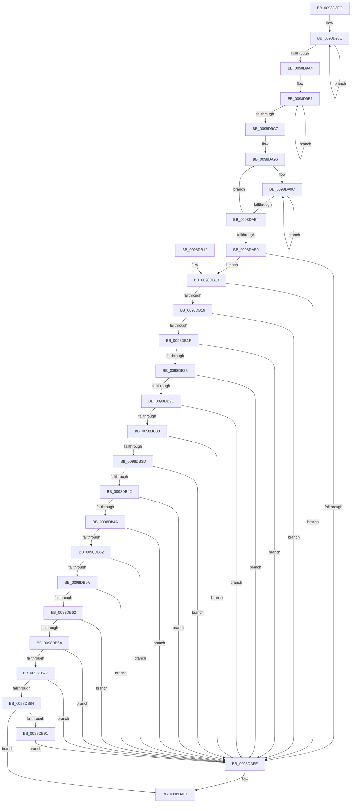

# PopEtEnergyValuesDeltaCalculate

- RVA: `0x0098D8FC`–`0x0098DB96` (길이 `666` bytes)
- VA: `0x000000014098D8FC`
- 실행 섹션: `PAGE`
- PDB 이름 있음: `예`; PDB Function 태그: `아니요`
- unwind 정보 RVA: `0x0009887C`
- 디코드: `151`개 명령, `666/666` bytes 표시
- 미해석 바이트: `0` (있으면 어셈블리에 `.byte`로 보존)

> 이 문서는 커널 이미지의 기계어와 PDB 기호를 분석해 생성했습니다. 4번과 5번은 함수 원형과 자료형을 바이너리 사용 방식에서 추정한 C 해석이며 원본 소스 복구 결과는 아닙니다.

## 1. Dependencies

- 직접 호출 지점: **2**; 고유 호출 대상: **1**
- 직접 호출자로 확인된 함수: **1**
- RIP 상대 이미지 참조: **0**

### Outgoing calls
- `0x0098D996` → [RtlStateDurationDelta](../../text/44/RtlStateDurationDelta_function_0044F76C.md) (function, `0x0044F76C`)
- `0x0098D9B9` → [RtlStateDurationDelta](../../text/44/RtlStateDurationDelta_function_0044F76C.md) (function, `0x0044F76C`)

### Direct callers
- [PopEtEnergyTrackerUpdateAggregate](PopEtEnergyTrackerUpdateAggregate_function_0098D724.md) at `0x0098D77E`

### Static image references
- 디코드된 RIP-relative 메모리 참조가 없습니다.

## 2. Other-region calls and transfers

- 다른 실행 섹션으로 향하는 call: **2**
  - `0x0098D996` → [RtlStateDurationDelta](../../text/44/RtlStateDurationDelta_function_0044F76C.md) (`PAGE` → `.text`)
  - `0x0098D9B9` → [RtlStateDurationDelta](../../text/44/RtlStateDurationDelta_function_0044F76C.md) (`PAGE` → `.text`)
- 별도 외부 분기/꼬리 이동을 확인하지 못했습니다.

## 3. Assembly (complete function range)

```asm
0098D8FC  48 89 5C 24 08                  mov qword ptr [rsp + 8], rbx
0098D901  48 89 6C 24 10                  mov qword ptr [rsp + 0x10], rbp
0098D906  48 89 74 24 18                  mov qword ptr [rsp + 0x18], rsi
0098D90B  57                              push rdi
0098D90C  41 54                           push r12
0098D90E  41 55                           push r13
0098D910  41 56                           push r14
0098D912  41 57                           push r15
0098D914  48 83 EC 20                     sub rsp, 0x20
0098D918  4C 8B 52 40                     mov r10, qword ptr [rdx + 0x40]
0098D91C  48 8B F1                        mov rsi, rcx
0098D91F  4C 2B 51 40                     sub r10, qword ptr [rcx + 0x40]
0098D923  48 8B FA                        mov rdi, rdx
0098D926  4D 89 50 40                     mov qword ptr [r8 + 0x40], r10
0098D92A  BD 01 00 00 00                  mov ebp, 1
0098D92F  4C 8B 52 48                     mov r10, qword ptr [rdx + 0x48]
0098D933  4C 8B FF                        mov r15, rdi
0098D936  4C 2B 51 48                     sub r10, qword ptr [rcx + 0x48]
0098D93A  4C 2B FE                        sub r15, rsi
0098D93D  4D 89 50 48                     mov qword ptr [r8 + 0x48], r10
0098D941  4D 8B E0                        mov r12, r8
0098D944  48 8B 4A 50                     mov rcx, qword ptr [rdx + 0x50]
0098D948  44 8D 75 02                     lea r14d, [rbp + 2]
0098D94C  48 2B 4E 50                     sub rcx, qword ptr [rsi + 0x50]
0098D950  4D 8B E9                        mov r13, r9
0098D953  49 89 48 50                     mov qword ptr [r8 + 0x50], rcx
0098D957  49 8B D8                        mov rbx, r8
0098D95A  48 8B 4A 58                     mov rcx, qword ptr [rdx + 0x58]
0098D95E  48 2B 4E 58                     sub rcx, qword ptr [rsi + 0x58]
0098D962  49 89 48 58                     mov qword ptr [r8 + 0x58], rcx
0098D966  48 8B 4A 60                     mov rcx, qword ptr [rdx + 0x60]
0098D96A  48 2B 4E 60                     sub rcx, qword ptr [rsi + 0x60]
0098D96E  49 89 48 60                     mov qword ptr [r8 + 0x60], rcx
0098D972  48 8B 8A B0 01 00 00            mov rcx, qword ptr [rdx + 0x1b0]
0098D979  48 8D 56 68                     lea rdx, [rsi + 0x68]
0098D97D  48 2B 8E B0 01 00 00            sub rcx, qword ptr [rsi + 0x1b0]
0098D984  49 89 88 B0 01 00 00            mov qword ptr [r8 + 0x1b0], rcx
0098D98B  4C 2B E6                        sub r12, rsi
0098D98E  4D 8D 04 17                     lea r8, [r15 + rdx]
0098D992  49 8D 0C 14                     lea rcx, [r12 + rdx]
0098D996  E8 D1 1D AC FF                  call 0x14044f76c
0098D99B  48 83 C2 08                     add rdx, 8
0098D99F  4C 2B F5                        sub r14, rbp
0098D9A2  75 EA                           jne 0x14098d98e
0098D9A4  48 8D 96 80 01 00 00            lea rdx, [rsi + 0x180]
0098D9AB  41 BE 05 00 00 00               mov r14d, 5
0098D9B1  4E 8D 04 3A                     lea r8, [rdx + r15]
0098D9B5  4A 8D 0C 22                     lea rcx, [rdx + r12]
0098D9B9  E8 AE 1D AC FF                  call 0x14044f76c
0098D9BE  48 83 C2 08                     add rdx, 8
0098D9C2  4C 2B F5                        sub r14, rbp
0098D9C5  75 EA                           jne 0x14098d9b1
0098D9C7  8B 8F 80 00 00 00               mov ecx, dword ptr [rdi + 0x80]
0098D9CD  45 8D 56 04                     lea r10d, [r14 + 4]
0098D9D1  2B 8E 80 00 00 00               sub ecx, dword ptr [rsi + 0x80]
0098D9D7  45 33 DB                        xor r11d, r11d
0098D9DA  89 8B 80 00 00 00               mov dword ptr [rbx + 0x80], ecx
0098D9E0  4C 8B CB                        mov r9, rbx
0098D9E3  8B 8F 84 00 00 00               mov ecx, dword ptr [rdi + 0x84]
0098D9E9  41 8B D3                        mov edx, r11d
0098D9EC  2B 8E 84 00 00 00               sub ecx, dword ptr [rsi + 0x84]
0098D9F2  89 8B 84 00 00 00               mov dword ptr [rbx + 0x84], ecx
0098D9F8  8B 8F 88 00 00 00               mov ecx, dword ptr [rdi + 0x88]
0098D9FE  2B 8E 88 00 00 00               sub ecx, dword ptr [rsi + 0x88]
0098DA04  89 8B 88 00 00 00               mov dword ptr [rbx + 0x88], ecx
0098DA0A  8B 8F A8 01 00 00               mov ecx, dword ptr [rdi + 0x1a8]
0098DA10  2B 8E A8 01 00 00               sub ecx, dword ptr [rsi + 0x1a8]
0098DA16  89 8B A8 01 00 00               mov dword ptr [rbx + 0x1a8], ecx
0098DA1C  8B 8F AC 01 00 00               mov ecx, dword ptr [rdi + 0x1ac]
0098DA22  2B 8E AC 01 00 00               sub ecx, dword ptr [rsi + 0x1ac]
0098DA28  48 2B F7                        sub rsi, rdi
0098DA2B  89 8B AC 01 00 00               mov dword ptr [rbx + 0x1ac], ecx
0098DA31  4C 2B CF                        sub r9, rdi
0098DA34  0F 10 87 10 01 00 00            movups xmm0, xmmword ptr [rdi + 0x110]
0098DA3B  0F 11 83 10 01 00 00            movups xmmword ptr [rbx + 0x110], xmm0
0098DA42  0F 10 8F 20 01 00 00            movups xmm1, xmmword ptr [rdi + 0x120]
0098DA49  0F 11 8B 20 01 00 00            movups xmmword ptr [rbx + 0x120], xmm1
0098DA50  0F 10 87 30 01 00 00            movups xmm0, xmmword ptr [rdi + 0x130]
0098DA57  0F 11 83 30 01 00 00            movups xmmword ptr [rbx + 0x130], xmm0
0098DA5E  0F 10 8F 40 01 00 00            movups xmm1, xmmword ptr [rdi + 0x140]
0098DA65  0F 11 8B 40 01 00 00            movups xmmword ptr [rbx + 0x140], xmm1
0098DA6C  0F 10 87 50 01 00 00            movups xmm0, xmmword ptr [rdi + 0x150]
0098DA73  0F 11 83 50 01 00 00            movups xmmword ptr [rbx + 0x150], xmm0
0098DA7A  0F 10 8F 60 01 00 00            movups xmm1, xmmword ptr [rdi + 0x160]
0098DA81  0F 11 8B 60 01 00 00            movups xmmword ptr [rbx + 0x160], xmm1
0098DA88  0F 10 87 70 01 00 00            movups xmm0, xmmword ptr [rdi + 0x170]
0098DA8F  0F 11 83 70 01 00 00            movups xmmword ptr [rbx + 0x170], xmm0
0098DA96  41 B8 02 00 00 00               mov r8d, 2
0098DA9C  48 8B 0F                        mov rcx, qword ptr [rdi]
0098DA9F  48 2B 0C 3E                     sub rcx, qword ptr [rsi + rdi]
0098DAA3  48 03 D1                        add rdx, rcx
0098DAA6  49 89 0C 39                     mov qword ptr [r9 + rdi], rcx
0098DAAA  48 8B 8F 90 00 00 00            mov rcx, qword ptr [rdi + 0x90]
0098DAB1  48 2B 8C 3E 90 00 00 00         sub rcx, qword ptr [rsi + rdi + 0x90]
0098DAB9  49 89 8C 39 90 00 00 00         mov qword ptr [r9 + rdi + 0x90], rcx
0098DAC1  48 03 D1                        add rdx, rcx
0098DAC4  48 8B 8F D0 00 00 00            mov rcx, qword ptr [rdi + 0xd0]
0098DACB  48 2B 8C 3E D0 00 00 00         sub rcx, qword ptr [rsi + rdi + 0xd0]
0098DAD3  49 89 8C 39 D0 00 00 00         mov qword ptr [r9 + rdi + 0xd0], rcx
0098DADB  48 83 C7 08                     add rdi, 8
0098DADF  4C 2B C5                        sub r8, rbp
0098DAE2  75 B8                           jne 0x14098da9c
0098DAE4  4C 2B D5                        sub r10, rbp
0098DAE7  75 AD                           jne 0x14098da96
0098DAE9  48 85 D2                        test rdx, rdx
0098DAEC  74 25                           je 0x14098db13
0098DAEE  41 8B EB                        mov ebp, r11d
0098DAF1  41 89 6D 00                     mov dword ptr [r13], ebp
0098DAF5  48 8B 5C 24 50                  mov rbx, qword ptr [rsp + 0x50]
0098DAFA  48 8B 6C 24 58                  mov rbp, qword ptr [rsp + 0x58]
0098DAFF  48 8B 74 24 60                  mov rsi, qword ptr [rsp + 0x60]
0098DB04  48 83 C4 20                     add rsp, 0x20
0098DB08  41 5F                           pop r15
0098DB0A  41 5E                           pop r14
0098DB0C  41 5D                           pop r13
0098DB0E  41 5C                           pop r12
0098DB10  5F                              pop rdi
0098DB11  C3                              ret
0098DB12  CC                              int3
0098DB13  4C 39 5B 40                     cmp qword ptr [rbx + 0x40], r11
0098DB17  75 D5                           jne 0x14098daee
0098DB19  4C 39 5B 48                     cmp qword ptr [rbx + 0x48], r11
0098DB1D  75 CF                           jne 0x14098daee
0098DB1F  4C 39 5B 50                     cmp qword ptr [rbx + 0x50], r11
0098DB23  75 C9                           jne 0x14098daee
0098DB25  4C 39 9B B0 01 00 00            cmp qword ptr [rbx + 0x1b0], r11
0098DB2C  75 C0                           jne 0x14098daee
0098DB2E  B9 FF FF FF 7F                  mov ecx, 0x7fffffff
0098DB33  85 4B 6C                        test dword ptr [rbx + 0x6c], ecx
0098DB36  75 B6                           jne 0x14098daee
0098DB38  85 4B 74                        test dword ptr [rbx + 0x74], ecx
0098DB3B  75 B1                           jne 0x14098daee
0098DB3D  85 4B 7C                        test dword ptr [rbx + 0x7c], ecx
0098DB40  75 AC                           jne 0x14098daee
0098DB42  85 8B 84 01 00 00               test dword ptr [rbx + 0x184], ecx
0098DB48  75 A4                           jne 0x14098daee
0098DB4A  85 8B 8C 01 00 00               test dword ptr [rbx + 0x18c], ecx
0098DB50  75 9C                           jne 0x14098daee
0098DB52  85 8B 94 01 00 00               test dword ptr [rbx + 0x194], ecx
0098DB58  75 94                           jne 0x14098daee
0098DB5A  85 8B 9C 01 00 00               test dword ptr [rbx + 0x19c], ecx
0098DB60  75 8C                           jne 0x14098daee
0098DB62  85 8B A4 01 00 00               test dword ptr [rbx + 0x1a4], ecx
0098DB68  75 84                           jne 0x14098daee
0098DB6A  44 39 9B 80 00 00 00            cmp dword ptr [rbx + 0x80], r11d
0098DB71  0F 85 77 FF FF FF               jne 0x14098daee
0098DB77  44 39 9B 84 00 00 00            cmp dword ptr [rbx + 0x84], r11d
0098DB7E  0F 85 6A FF FF FF               jne 0x14098daee
0098DB84  44 39 9B 88 00 00 00            cmp dword ptr [rbx + 0x88], r11d
0098DB8B  0F 84 60 FF FF FF               je 0x14098daf1
0098DB91  E9 58 FF FF FF                  jmp 0x14098daee
```

## 4. C-style interpretation (structured pseudocode)

```c
__int64 __fastcall PopEtEnergyValuesDeltaCalculate(__int64 a1, __int64 a2, __int64 a3, __int64 a4)
{
    __int64 result;
    __int64 v_r10;
    __int64 v_r11;
    __int64 v_r12;
    __int64 v_r14;
    __int64 v_r15;
    __int64 v_rdi;
    __int64 v_rsi;
    __int64 v_rsp;
    unsigned __int64 v_stack_p10;
    unsigned __int64 v_stack_p18;
    unsigned __int64 v_stack_p8;

    v_stack_p8 = v_rbx;
    v_stack_p10 = v_rbp;
    v_stack_p18 = v_rsi;
    v_rsp = (v_rsp) - (32);
    v_r10 = (*(unsigned __int64 *)(a2 + 64)) - (*(unsigned __int64 *)(a1 + 64));
    *(unsigned __int64 *)(a3 + 64) = v_r10;
    v_r10 = (*(unsigned __int64 *)(a2 + 72)) - (*(unsigned __int64 *)(a1 + 72));
    v_r15 = (a2) - (a1);
    *(unsigned __int64 *)(a3 + 72) = v_r10;
    a1 = (*(unsigned __int64 *)(a2 + 80)) - (*(unsigned __int64 *)(a1 + 80));
    *(unsigned __int64 *)(a3 + 80) = a1;
    a1 = (*(unsigned __int64 *)(a2 + 88)) - (*(unsigned __int64 *)(a1 + 88));
    *(unsigned __int64 *)(a3 + 88) = a1;
    a1 = (*(unsigned __int64 *)(a2 + 96)) - (*(unsigned __int64 *)(a1 + 96));
    *(unsigned __int64 *)(a3 + 96) = a1;
    a1 = (*(unsigned __int64 *)(a2 + 432)) - (*(unsigned __int64 *)(a1 + 432));
    *(unsigned __int64 *)(a3 + 432) = a1;
    v_r12 = (a3) - (a1);
loc_0098D98E:
    result = RtlStateDurationDelta(v_r12 + a1 + 104 * 1, a1 + 104, v_r15 + a1 + 104 * 1, a4);
    a2 = (a1 + 104) + (8);
    v_r14 = (1 + 2) - (1);
    if (condition_is_not_equal) goto loc_0098D98E;
loc_0098D9B1:
    result = RtlStateDurationDelta(a1 + 384 + v_r12 * 1, a1 + 384, a1 + 384 + v_r15 * 1, a4);
    a2 = (a1 + 384) + (8);
    v_r14 = (5) - (1);
    if (condition_is_not_equal) goto loc_0098D9B1;
    a1 = (unsigned int)(((unsigned int)(*(unsigned int *)(a2 + 128))) - (*(unsigned int *)(a1 + 128)));
    v_r11 = 0;
    *(unsigned int *)(a3 + 128) = (unsigned int)(a1);
    a1 = (unsigned int)(((unsigned int)(*(unsigned int *)(a2 + 132))) - (*(unsigned int *)(a1 + 132)));
    *(unsigned int *)(a3 + 132) = (unsigned int)(a1);
    a1 = (unsigned int)(((unsigned int)(*(unsigned int *)(a2 + 136))) - (*(unsigned int *)(a1 + 136)));
    *(unsigned int *)(a3 + 136) = (unsigned int)(a1);
    a1 = (unsigned int)(((unsigned int)(*(unsigned int *)(a2 + 424))) - (*(unsigned int *)(a1 + 424)));
    *(unsigned int *)(a3 + 424) = (unsigned int)(a1);
    a1 = (unsigned int)(((unsigned int)(*(unsigned int *)(a2 + 428))) - (*(unsigned int *)(a1 + 428)));
    v_rsi = (a1) - (a2);
    *(unsigned int *)(a3 + 428) = (unsigned int)(a1);
    a4 = (a3) - (a2);
    *(unsigned __int64 *)(a3 + 272) = v_xmm0;
    *(unsigned __int64 *)(a3 + 288) = v_xmm1;
    *(unsigned __int64 *)(a3 + 304) = v_xmm0;
    *(unsigned __int64 *)(a3 + 320) = v_xmm1;
    *(unsigned __int64 *)(a3 + 336) = v_xmm0;
    *(unsigned __int64 *)(a3 + 352) = v_xmm1;
    *(unsigned __int64 *)(a3 + 368) = v_xmm0;
loc_0098DA96:
loc_0098DA9C:
    a1 = (*(unsigned __int64 *)(a2)) - (*(unsigned __int64 *)(v_rsi + a2 * 1));
    a2 = (0) + (a1);
    *(unsigned __int64 *)(a4 + a2 * 1) = a1;
    a1 = (*(unsigned __int64 *)(a2 + 144)) - (*(unsigned __int64 *)(v_rsi + a2 * 1 + 144));
    *(unsigned __int64 *)(a4 + a2 * 1 + 144) = a1;
    a2 = (a2) + (a1);
    a1 = (*(unsigned __int64 *)(a2 + 208)) - (*(unsigned __int64 *)(v_rsi + a2 * 1 + 208));
    *(unsigned __int64 *)(a4 + a2 * 1 + 208) = a1;
    v_rdi = (a2) + (8);
    a3 = (2) - (1);
    if (condition_is_not_equal) goto loc_0098DA9C;
    v_r10 = (v_r14 + 4) - (1);
    if (condition_is_not_equal) goto loc_0098DA96;
    if (a2 == 0) goto loc_0098DB13;
loc_0098DAEE:
loc_0098DAF1:
    *(unsigned int *)(a4) = 0;
    v_rsp = (v_rsp) + (32);
    return result;
loc_0098DB13:
    if ((*(unsigned __int64 *)(v_stack_p8 + 64)) != 0) goto loc_0098DAEE;
    if ((*(unsigned __int64 *)(v_stack_p8 + 72)) != 0) goto loc_0098DAEE;
    if ((*(unsigned __int64 *)(v_stack_p8 + 80)) != 0) goto loc_0098DAEE;
    if ((*(unsigned __int64 *)(v_stack_p8 + 432)) != 0) goto loc_0098DAEE;
    if (((*(unsigned int *)(v_stack_p8 + 108)) & ((unsigned int)((unsigned int)(0x7FFFFFFFULL)))) != 0) goto loc_0098DAEE;
    if (((*(unsigned int *)(v_stack_p8 + 116)) & ((unsigned int)((unsigned int)(0x7FFFFFFFULL)))) != 0) goto loc_0098DAEE;
    if (((*(unsigned int *)(v_stack_p8 + 124)) & ((unsigned int)((unsigned int)(0x7FFFFFFFULL)))) != 0) goto loc_0098DAEE;
    if (((*(unsigned int *)(v_stack_p8 + 388)) & ((unsigned int)((unsigned int)(0x7FFFFFFFULL)))) != 0) goto loc_0098DAEE;
    if (((*(unsigned int *)(v_stack_p8 + 396)) & ((unsigned int)((unsigned int)(0x7FFFFFFFULL)))) != 0) goto loc_0098DAEE;
    if (((*(unsigned int *)(v_stack_p8 + 404)) & ((unsigned int)((unsigned int)(0x7FFFFFFFULL)))) != 0) goto loc_0098DAEE;
    if (((*(unsigned int *)(v_stack_p8 + 412)) & ((unsigned int)((unsigned int)(0x7FFFFFFFULL)))) != 0) goto loc_0098DAEE;
    if (((*(unsigned int *)(v_stack_p8 + 420)) & ((unsigned int)((unsigned int)(0x7FFFFFFFULL)))) != 0) goto loc_0098DAEE;
    if ((*(unsigned int *)(v_stack_p8 + 128)) != 0) goto loc_0098DAEE;
    if ((*(unsigned int *)(v_stack_p8 + 132)) != 0) goto loc_0098DAEE;
    if ((*(unsigned int *)(v_stack_p8 + 136)) == 0) goto loc_0098DAF1;
    goto loc_0098DAEE;
}
```

## 5. (Beta) C Style

```c
int64_t PopEtEnergyValuesDeltaCalculate(void *Arg1, void *Arg2, void *Arg3, void *Arg4)
{
    uint8_t *arg1 = (uint8_t *)Arg1;
    uint8_t *arg2 = (uint8_t *)Arg2;
    uint8_t *arg3 = (uint8_t *)Arg3;
    uint8_t *arg4 = (uint8_t *)Arg4;

    int64_t result;
    int64_t local_r10;
    int64_t local_r11;
    int64_t local_r12;
    int64_t local_r14;
    int64_t local_r15;
    int64_t local_rdi;
    int64_t local_rsi;
    int64_t local_rsp;
    uint64_t v_stack_p10;
    uint64_t v_stack_p18;
    uint64_t v_stack_p8;

    v_stack_p8 = local_rbx;
    v_stack_p10 = local_rbp;
    v_stack_p18 = local_rsi;
    local_rsp = (local_rsp) - (32);
    local_r10 = (*(uint64_t *)(arg2 + 0x40)) - (*(uint64_t *)(arg1 + 0x40));
    *(uint64_t *)(arg3 + 0x40) = local_r10;
    local_r10 = (*(uint64_t *)(arg2 + 0x48)) - (*(uint64_t *)(arg1 + 0x48));
    local_r15 = (Arg2) - (Arg1);
    *(uint64_t *)(arg3 + 0x48) = local_r10;
    Arg1 = (*(uint64_t *)(arg2 + 0x50)) - (*(uint64_t *)(arg1 + 0x50));
    *(void **)(arg3 + 0x50) = Arg1;
    Arg1 = (*(uint64_t *)(arg2 + 0x58)) - (*(uint64_t *)(arg1 + 0x58));
    *(void **)(arg3 + 0x58) = Arg1;
    Arg1 = (*(uint64_t *)(arg2 + 0x60)) - (*(uint64_t *)(arg1 + 0x60));
    *(void **)(arg3 + 0x60) = Arg1;
    Arg1 = (*(uint64_t *)(arg2 + 0x1B0)) - (*(uint64_t *)(arg1 + 0x1B0));
    *(void **)(arg3 + 0x1B0) = Arg1;
    local_r12 = (Arg3) - (Arg1);
loc_0098D98E:
    result = RtlStateDurationDelta(local_r12 + Arg1 + 104 * 1, Arg1 + 104, local_r15 + Arg1 + 104 * 1, Arg4);
    Arg2 = (Arg1 + 104) + (8);
    local_r14 = (1 + 2) - (1);
    if (condition_is_not_equal) goto loc_0098D98E;
loc_0098D9B1:
    result = RtlStateDurationDelta(Arg1 + 384 + local_r12 * 1, Arg1 + 384, Arg1 + 384 + local_r15 * 1, Arg4);
    Arg2 = (Arg1 + 384) + (8);
    local_r14 = (5) - (1);
    if (condition_is_not_equal) goto loc_0098D9B1;
    Arg1 = (uint32_t)(((uint32_t)(*(uint32_t *)(arg2 + 0x80))) - (*(uint32_t *)(arg1 + 0x80)));
    local_r11 = 0;
    *(uint32_t *)(arg3 + 0x80) = (uint32_t)(Arg1);
    Arg1 = (uint32_t)(((uint32_t)(*(uint32_t *)(arg2 + 0x84))) - (*(uint32_t *)(arg1 + 0x84)));
    *(uint32_t *)(arg3 + 0x84) = (uint32_t)(Arg1);
    Arg1 = (uint32_t)(((uint32_t)(*(uint32_t *)(arg2 + 0x88))) - (*(uint32_t *)(arg1 + 0x88)));
    *(uint32_t *)(arg3 + 0x88) = (uint32_t)(Arg1);
    Arg1 = (uint32_t)(((uint32_t)(*(uint32_t *)(arg2 + 0x1A8))) - (*(uint32_t *)(arg1 + 0x1A8)));
    *(uint32_t *)(arg3 + 0x1A8) = (uint32_t)(Arg1);
    Arg1 = (uint32_t)(((uint32_t)(*(uint32_t *)(arg2 + 0x1AC))) - (*(uint32_t *)(arg1 + 0x1AC)));
    local_rsi = (Arg1) - (Arg2);
    *(uint32_t *)(arg3 + 0x1AC) = (uint32_t)(Arg1);
    Arg4 = (Arg3) - (Arg2);
    *(uint64_t *)(arg3 + 0x110) = v_xmm0;
    *(uint64_t *)(arg3 + 0x120) = v_xmm1;
    *(uint64_t *)(arg3 + 0x130) = v_xmm0;
    *(uint64_t *)(arg3 + 0x140) = v_xmm1;
    *(uint64_t *)(arg3 + 0x150) = v_xmm0;
    *(uint64_t *)(arg3 + 0x160) = v_xmm1;
    *(uint64_t *)(arg3 + 0x170) = v_xmm0;
loc_0098DA96:
loc_0098DA9C:
    Arg1 = (*(uint64_t *)(arg2)) - (*(uint64_t *)(local_rsi + arg2 * 1));
    Arg2 = (0) + (Arg1);
    *(void **)(arg4 + arg2 * 1) = Arg1;
    Arg1 = (*(uint64_t *)(arg2 + 0x90)) - (*(uint64_t *)(local_rsi + arg2 * 1 + 0x90));
    *(void **)(arg4 + arg2 * 1 + 0x90) = Arg1;
    Arg2 = (Arg2) + (Arg1);
    Arg1 = (*(uint64_t *)(arg2 + 0xD0)) - (*(uint64_t *)(local_rsi + arg2 * 1 + 0xD0));
    *(void **)(arg4 + arg2 * 1 + 0xD0) = Arg1;
    local_rdi = (Arg2) + (8);
    Arg3 = (2) - (1);
    if (condition_is_not_equal) goto loc_0098DA9C;
    local_r10 = (local_r14 + 4) - (1);
    if (condition_is_not_equal) goto loc_0098DA96;
    if (Arg2 == NULL) goto loc_0098DB13;
loc_0098DAEE:
loc_0098DAF1:
    *(uint32_t *)(arg4) = 0;
    local_rsp = (local_rsp) + (32);
    return result;
loc_0098DB13:
    if ((*(uint64_t *)(v_stack_p8 + 0x40)) != 0) goto loc_0098DAEE;
    if ((*(uint64_t *)(v_stack_p8 + 0x48)) != 0) goto loc_0098DAEE;
    if ((*(uint64_t *)(v_stack_p8 + 0x50)) != 0) goto loc_0098DAEE;
    if ((*(uint64_t *)(v_stack_p8 + 0x1B0)) != 0) goto loc_0098DAEE;
    if (((*(uint32_t *)(v_stack_p8 + 0x6C)) & ((uint32_t)((uint32_t)(0x7FFFFFFFULL)))) != 0) goto loc_0098DAEE;
    if (((*(uint32_t *)(v_stack_p8 + 0x74)) & ((uint32_t)((uint32_t)(0x7FFFFFFFULL)))) != 0) goto loc_0098DAEE;
    if (((*(uint32_t *)(v_stack_p8 + 0x7C)) & ((uint32_t)((uint32_t)(0x7FFFFFFFULL)))) != 0) goto loc_0098DAEE;
    if (((*(uint32_t *)(v_stack_p8 + 0x184)) & ((uint32_t)((uint32_t)(0x7FFFFFFFULL)))) != 0) goto loc_0098DAEE;
    if (((*(uint32_t *)(v_stack_p8 + 0x18C)) & ((uint32_t)((uint32_t)(0x7FFFFFFFULL)))) != 0) goto loc_0098DAEE;
    if (((*(uint32_t *)(v_stack_p8 + 0x194)) & ((uint32_t)((uint32_t)(0x7FFFFFFFULL)))) != 0) goto loc_0098DAEE;
    if (((*(uint32_t *)(v_stack_p8 + 0x19C)) & ((uint32_t)((uint32_t)(0x7FFFFFFFULL)))) != 0) goto loc_0098DAEE;
    if (((*(uint32_t *)(v_stack_p8 + 0x1A4)) & ((uint32_t)((uint32_t)(0x7FFFFFFFULL)))) != 0) goto loc_0098DAEE;
    if ((*(uint32_t *)(v_stack_p8 + 0x80)) != 0) goto loc_0098DAEE;
    if ((*(uint32_t *)(v_stack_p8 + 0x84)) != 0) goto loc_0098DAEE;
    if ((*(uint32_t *)(v_stack_p8 + 0x88)) == 0) goto loc_0098DAF1;
    goto loc_0098DAEE;
}
```

### 관측된 메모리 오프셋

구조체 형식이 확인되지 않은 접근은 인자 기준의 오프셋으로만 기록했습니다.

| 기준 인자 | 오프셋 표현 | 폭 (bit) | 접근 |
|---|---:|---:|---|
| `Arg1` | `+ 0x0 + rdi*1` | `64` | `R` |
| `Arg1` | `+ 0x40` | `64` | `R` |
| `Arg1` | `+ 0x48` | `64` | `R` |
| `Arg1` | `+ 0x50` | `64` | `R` |
| `Arg1` | `+ 0x58` | `64` | `R` |
| `Arg1` | `+ 0x60` | `64` | `R` |
| `Arg1` | `+ 0x68` | `64` | `R` |
| `Arg1` | `+ 0x80` | `32` | `R` |
| `Arg1` | `+ 0x84` | `32` | `R` |
| `Arg1` | `+ 0x88` | `32` | `R` |
| `Arg1` | `+ 0x90 + rdi*1` | `64` | `R` |
| `Arg1` | `+ 0xD0 + rdi*1` | `64` | `R` |
| `Arg1` | `+ 0x180` | `64` | `R` |
| `Arg1` | `+ 0x1A8` | `32` | `R` |
| `Arg1` | `+ 0x1AC` | `32` | `R` |
| `Arg1` | `+ 0x1B0` | `64` | `R` |
| `Arg2` | `+ 0x0` | `64` | `R` |
| `Arg2` | `+ 0x0 + rdx*1` | `64` | `R` |
| `Arg2` | `+ 0x40` | `64` | `R` |
| `Arg2` | `+ 0x48` | `64` | `R` |
| `Arg2` | `+ 0x50` | `64` | `R` |
| `Arg2` | `+ 0x58` | `64` | `R` |
| `Arg2` | `+ 0x60` | `64` | `R` |
| `Arg2` | `+ 0x80` | `32` | `R` |
| `Arg2` | `+ 0x84` | `32` | `R` |
| `Arg2` | `+ 0x88` | `32` | `R` |
| `Arg2` | `+ 0x90` | `64` | `R` |
| `Arg2` | `+ 0xD0` | `64` | `R` |
| `Arg2` | `+ 0x110` | `128` | `R` |
| `Arg2` | `+ 0x120` | `128` | `R` |
| `Arg2` | `+ 0x130` | `128` | `R` |
| `Arg2` | `+ 0x140` | `128` | `R` |

추가 오프셋 44개는 표에서 생략했습니다.

## 6. Execution-region graph

[열기: 2D/3D 그래프와 함수 탐색 컨트롤 패널](../../../control-panel.html?section=page&rva=0x0098D8FC&view=graph)

- 2D 그래프는 위에서 아래로 흐르고, 3D 그래프는 빈 공간을 드래그해 회전합니다. Shift+드래그는 이동, 휠은 확대·축소, 함수 노드 선택은 대상 보고서 이동입니다.

### Static fallback


