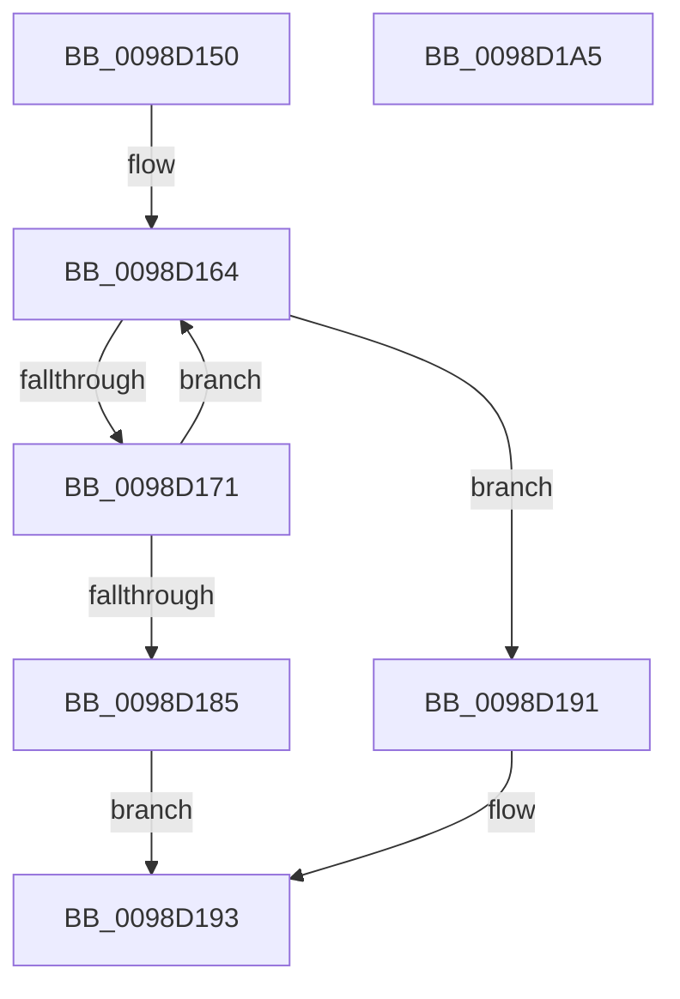

# PopEtEnumEnergyTrackers

- RVA: `0x0098D150`–`0x0098D1A6` (길이 `86` bytes)
- VA: `0x000000014098D150`
- 실행 섹션: `PAGE`
- PDB 이름 있음: `예`; PDB Function 태그: `아니요`
- unwind 정보 RVA: `0x00060BC4`
- 디코드: `28`개 명령, `86/86` bytes 표시
- 미해석 바이트: `0` (있으면 어셈블리에 `.byte`로 보존)

> 이 문서는 커널 이미지의 기계어와 PDB 기호를 분석해 생성했습니다. 4번과 5번은 함수 원형과 자료형을 바이너리 사용 방식에서 추정한 C 해석이며 원본 소스 복구 결과는 아닙니다.

## 1. Dependencies

- 직접 호출 지점: **3**; 고유 호출 대상: **3**
- 직접 호출자로 확인된 함수: **2**
- RIP 상대 이미지 참조: **0**

### Outgoing calls
- `0x0098D164` → [PopEtGetNextEnergyTracker](PopEtGetNextEnergyTracker_function_0098E384.md) (function, `0x0098E384`)
- `0x0098D177` → [PopEtEnergyTrackerEnumSnapshotCallback](PopEtEnergyTrackerEnumSnapshotCallback_function_0098D1AC.md) (function, `0x0098D1AC`)
- `0x0098D18A` → [ObfDereferenceObjectWithTag](../../text/2F/ObfDereferenceObjectWithTag_function_002F78E0.md) (function, `0x002F78E0`)

### Direct callers
- [PoEnergyContextCleanup](../90/PoEnergyContextCleanup_function_00907A38.md) at `0x00907B31`
- [PopEtEnergyContextProcessStateUpdate](PopEtEnergyContextProcessStateUpdate_function_0098E418.md) at `0x0098E498`

### Static image references
- 디코드된 RIP-relative 메모리 참조가 없습니다.

## 2. Other-region calls and transfers

- 다른 실행 섹션으로 향하는 call: **1**
  - `0x0098D18A` → [ObfDereferenceObjectWithTag](../../text/2F/ObfDereferenceObjectWithTag_function_002F78E0.md) (`PAGE` → `.text`)
- 별도 외부 분기/꼬리 이동을 확인하지 못했습니다.

## 3. Assembly (complete function range)

```asm
0098D150  48 89 5C 24 08                  mov qword ptr [rsp + 8], rbx
0098D155  48 89 74 24 10                  mov qword ptr [rsp + 0x10], rsi
0098D15A  57                              push rdi
0098D15B  48 83 EC 20                     sub rsp, 0x20
0098D15F  48 8B F2                        mov rsi, rdx
0098D162  33 C9                           xor ecx, ecx
0098D164  E8 1B 12 00 00                  call 0x14098e384
0098D169  48 8B D8                        mov rbx, rax
0098D16C  48 85 C0                        test rax, rax
0098D16F  74 20                           je 0x14098d191
0098D171  48 8B D6                        mov rdx, rsi
0098D174  48 8B C8                        mov rcx, rax
0098D177  E8 30 00 00 00                  call 0x14098d1ac
0098D17C  8B F8                           mov edi, eax
0098D17E  48 8B CB                        mov rcx, rbx
0098D181  85 C0                           test eax, eax
0098D183  79 DF                           jns 0x14098d164
0098D185  BA 50 6F 45 74                  mov edx, 0x74456f50
0098D18A  E8 51 A7 96 FF                  call 0x1402f78e0
0098D18F  EB 02                           jmp 0x14098d193
0098D191  33 FF                           xor edi, edi
0098D193  48 8B 5C 24 30                  mov rbx, qword ptr [rsp + 0x30]
0098D198  8B C7                           mov eax, edi
0098D19A  48 8B 74 24 38                  mov rsi, qword ptr [rsp + 0x38]
0098D19F  48 83 C4 20                     add rsp, 0x20
0098D1A3  5F                              pop rdi
0098D1A4  C3                              ret
0098D1A5  CC                              int3
```

## 4. C-style interpretation (structured pseudocode)

```c
__int64 __fastcall PopEtEnumEnergyTrackers(int a1, __int64 a2)
{
    __int64 result;
    __int64 v_rdi;
    __int64 v_rsp;
    unsigned __int64 v_stack_p10;
    unsigned __int64 v_stack_p8;

    v_stack_p8 = v_rbx;
    v_stack_p10 = v_rsi;
    v_rsp = (v_rsp) - (32);
    a1 = 0;
loc_0098D164:
    result = PopEtGetNextEnergyTracker(a1, a2, a3, a4);
    if (result == 0) goto loc_0098D191;
    result = PopEtEnergyTrackerEnumSnapshotCallback(result, a2, a3, a4);
    if (!sign_flag) goto loc_0098D164;
    result = ObfDereferenceObjectWithTag(result, (unsigned int)(0x74456F50ULL), a3, a4);
    goto loc_0098D193;
loc_0098D191:
    v_rdi = 0;
loc_0098D193:
    v_rsp = (v_rsp) + (32);
    return 0;
}
```

## 5. (Beta) C Style

```c
int64_t PopEtEnumEnergyTrackers(int32_t Arg1, int64_t Arg2)
{
    int64_t result;
    int64_t local_rdi;
    int64_t local_rsp;
    uint64_t v_stack_p10;
    uint64_t v_stack_p8;

    v_stack_p8 = local_rbx;
    v_stack_p10 = local_rsi;
    local_rsp = (local_rsp) - (32);
    Arg1 = 0;
loc_0098D164:
    result = PopEtGetNextEnergyTracker(Arg1, Arg2, a3, a4);
    if (result == 0) goto loc_0098D191;
    result = PopEtEnergyTrackerEnumSnapshotCallback(result, Arg2, a3, a4);
    if (!sign_flag) goto loc_0098D164;
    result = ObfDereferenceObjectWithTag(result, (uint32_t)(0x74456F50ULL), a3, a4);
    goto loc_0098D193;
loc_0098D191:
    local_rdi = 0;
loc_0098D193:
    local_rsp = (local_rsp) + (32);
    return 0;
}
```

## 6. Execution-region graph

[열기: 2D/3D 그래프와 함수 탐색 컨트롤 패널](../../../control-panel.html?section=page&rva=0x0098D150&view=graph)

- 2D 그래프는 위에서 아래로 흐르고, 3D 그래프는 빈 공간을 드래그해 회전합니다. Shift+드래그는 이동, 휠은 확대·축소, 함수 노드 선택은 대상 보고서 이동입니다.

### Static fallback


