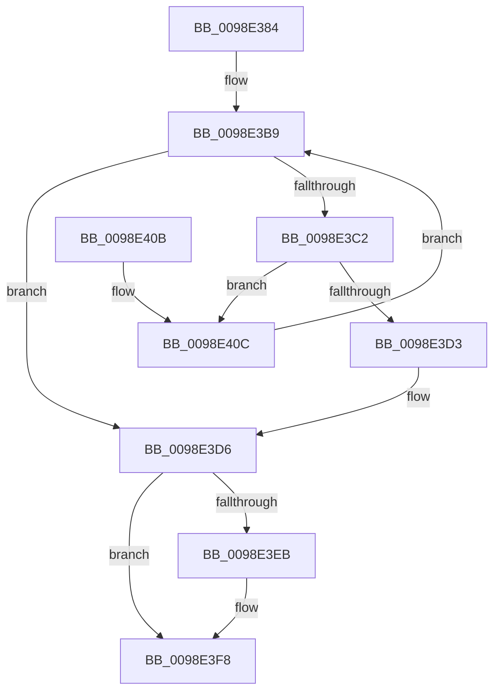

# PopEtGetNextEnergyTracker

- RVA: `0x0098E384`–`0x0098E411` (길이 `141` bytes)
- VA: `0x000000014098E384`
- 실행 섹션: `PAGE`
- PDB 이름 있음: `예`; PDB Function 태그: `아니요`
- unwind 정보 RVA: `0x00095A44`
- 디코드: `38`개 명령, `141/141` bytes 표시
- 미해석 바이트: `0` (있으면 어셈블리에 `.byte`로 보존)

> 이 문서는 커널 이미지의 기계어와 PDB 기호를 분석해 생성했습니다. 4번과 5번은 함수 원형과 자료형을 바이너리 사용 방식에서 추정한 C 해석이며 원본 소스 복구 결과는 아닙니다.

## 1. Dependencies

- 직접 호출 지점: **4**; 고유 호출 대상: **4**
- 직접 호출자로 확인된 함수: **1**
- RIP 상대 이미지 참조: **1**

### Outgoing calls
- `0x0098E3A3` → [PopAcquireRwLockShared](../../text/2D/PopAcquireRwLockShared_function_002D9A40.md) (function, `0x002D9A40`)
- `0x0098E3CA` → [ObReferenceObjectSafeWithTag](../../text/21/ObReferenceObjectSafeWithTag_function_00210EE0.md) (function, `0x00210EE0`)
- `0x0098E3E1` → [PopReleaseRwLock](../../text/2D/PopReleaseRwLock_function_002DFBBC.md) (function, `0x002DFBBC`)
- `0x0098E3F3` → [ObfDereferenceObjectWithTag](../../text/2F/ObfDereferenceObjectWithTag_function_002F78E0.md) (function, `0x002F78E0`)

### Direct callers
- [PopEtEnumEnergyTrackers](PopEtEnumEnergyTrackers_function_0098D150.md) at `0x0098D164`

### Static image references
- `0x0098E398` → RVA `0x00E67A30` (`.data`; read)

## 2. Other-region calls and transfers

- 다른 실행 섹션으로 향하는 call: **4**
  - `0x0098E3A3` → [PopAcquireRwLockShared](../../text/2D/PopAcquireRwLockShared_function_002D9A40.md) (`PAGE` → `.text`)
  - `0x0098E3CA` → [ObReferenceObjectSafeWithTag](../../text/21/ObReferenceObjectSafeWithTag_function_00210EE0.md) (`PAGE` → `.text`)
  - `0x0098E3E1` → [PopReleaseRwLock](../../text/2D/PopReleaseRwLock_function_002DFBBC.md) (`PAGE` → `.text`)
  - `0x0098E3F3` → [ObfDereferenceObjectWithTag](../../text/2F/ObfDereferenceObjectWithTag_function_002F78E0.md) (`PAGE` → `.text`)
- 별도 외부 분기/꼬리 이동을 확인하지 못했습니다.

## 3. Assembly (complete function range)

```asm
0098E384  48 89 5C 24 08                  mov qword ptr [rsp + 8], rbx
0098E389  48 89 74 24 10                  mov qword ptr [rsp + 0x10], rsi
0098E38E  57                              push rdi
0098E38F  48 83 EC 20                     sub rsp, 0x20
0098E393  48 8B F9                        mov rdi, rcx
0098E396  33 F6                           xor esi, esi
0098E398  48 8B 0D 91 96 4D 00            mov rcx, qword ptr [rip + 0x4d9691]
0098E39F  48 83 C1 10                     add rcx, 0x10
0098E3A3  E8 98 B6 94 FF                  call 0x1402d9a40
0098E3A8  48 8B 05 81 96 4D 00            mov rax, qword ptr [rip + 0x4d9681]
0098E3AF  48 85 FF                        test rdi, rdi
0098E3B2  48 0F 45 C7                     cmovne rax, rdi
0098E3B6  48 8B 18                        mov rbx, qword ptr [rax]
0098E3B9  48 3B 1D 70 96 4D 00            cmp rbx, qword ptr [rip + 0x4d9670]
0098E3C0  74 14                           je 0x14098e3d6
0098E3C2  BA 50 6F 45 74                  mov edx, 0x74456f50
0098E3C7  48 8B CB                        mov rcx, rbx
0098E3CA  E8 11 2B 88 FF                  call 0x140210ee0
0098E3CF  84 C0                           test al, al
0098E3D1  74 39                           je 0x14098e40c
0098E3D3  48 8B F3                        mov rsi, rbx
0098E3D6  48 8B 0D 53 96 4D 00            mov rcx, qword ptr [rip + 0x4d9653]
0098E3DD  48 83 C1 10                     add rcx, 0x10
0098E3E1  E8 D6 17 95 FF                  call 0x1402dfbbc
0098E3E6  48 85 FF                        test rdi, rdi
0098E3E9  74 0D                           je 0x14098e3f8
0098E3EB  BA 50 6F 45 74                  mov edx, 0x74456f50
0098E3F0  48 8B CF                        mov rcx, rdi
0098E3F3  E8 E8 94 96 FF                  call 0x1402f78e0
0098E3F8  48 8B 5C 24 30                  mov rbx, qword ptr [rsp + 0x30]
0098E3FD  48 8B C6                        mov rax, rsi
0098E400  48 8B 74 24 38                  mov rsi, qword ptr [rsp + 0x38]
0098E405  48 83 C4 20                     add rsp, 0x20
0098E409  5F                              pop rdi
0098E40A  C3                              ret
0098E40B  CC                              int3
0098E40C  48 8B 1B                        mov rbx, qword ptr [rbx]
0098E40F  EB A8                           jmp 0x14098e3b9
```

## 4. C-style interpretation (structured pseudocode)

```c
__int64 __fastcall PopEtGetNextEnergyTracker(__int64 a1)
{
    __int64 result;
    __int64 v_rsi;
    __int64 v_rsp;
    unsigned __int64 v_stack_p10;
    unsigned __int64 v_stack_p8;

    v_stack_p8 = v_rbx;
    v_stack_p10 = v_rsi;
    v_rsp = (v_rsp) - (32);
    v_rsi = 0;
    a1 = (*(unsigned __int64 *)(v_rip + 5084817)) + (16);
    result = PopAcquireRwLockShared(a1, a2, a3, a4);
    result = *(unsigned __int64 *)(v_rip + 5084801);
    if (a1 != 0) { result = a1; }
loc_0098E3B9:
    if ((*(unsigned __int64 *)(result)) == (*(unsigned __int64 *)(v_rip + 5084784))) goto loc_0098E3D6;
    result = ObReferenceObjectSafeWithTag(*(unsigned __int64 *)(result), (unsigned int)(0x74456F50ULL), a3, a4);
    if ((unsigned __int8)(result) == 0) goto loc_0098E40C;
loc_0098E3D6:
    a1 = (*(unsigned __int64 *)(v_rip + 5084755)) + (16);
    result = PopReleaseRwLock(a1, (unsigned int)(0x74456F50ULL), a3, a4);
    if (a1 != 0) {
        a2 = 0x74456F50ULL;
        a1 = a1;
        result = ObfDereferenceObjectWithTag(a1, a2, a3, a4);
    }
    v_rsp = (v_rsp) + (32);
    return *(unsigned __int64 *)(result);
loc_0098E40C:
    goto loc_0098E3B9;
}
```

## 5. (Beta) C Style

```c
int64_t PopEtGetNextEnergyTracker(int64_t Arg1)
{
    int64_t result;
    int64_t local_rsi;
    int64_t local_rsp;
    uint64_t v_stack_p10;
    uint64_t v_stack_p8;

    v_stack_p8 = local_rbx;
    v_stack_p10 = local_rsi;
    local_rsp = (local_rsp) - (32);
    local_rsi = 0;
    Arg1 = (*(uint64_t *)(v_rip + 0x4D9691)) + (16);
    result = PopAcquireRwLockShared(Arg1, a2, a3, a4);
    result = *(uint64_t *)(v_rip + 0x4D9681);
    if (Arg1 != 0) { result = Arg1; }
loc_0098E3B9:
    if ((*(uint64_t *)(result)) == (*(uint64_t *)(v_rip + 0x4D9670))) goto loc_0098E3D6;
    result = ObReferenceObjectSafeWithTag(*(uint64_t *)(result), (uint32_t)(0x74456F50ULL), a3, a4);
    if ((uint8_t)(result) == 0) goto loc_0098E40C;
loc_0098E3D6:
    Arg1 = (*(uint64_t *)(v_rip + 0x4D9653)) + (16);
    result = PopReleaseRwLock(Arg1, (uint32_t)(0x74456F50ULL), a3, a4);
    if (Arg1 != 0) {
        a2 = 0x74456F50ULL;
        Arg1 = Arg1;
        result = ObfDereferenceObjectWithTag(Arg1, a2, a3, a4);
    }
    local_rsp = (local_rsp) + (32);
    return *(uint64_t *)(result);
loc_0098E40C:
    goto loc_0098E3B9;
}
```

## 6. Execution-region graph

[열기: 2D/3D 그래프와 함수 탐색 컨트롤 패널](../../../control-panel.html?section=page&rva=0x0098E384&view=graph)

- 2D 그래프는 위에서 아래로 흐르고, 3D 그래프는 빈 공간을 드래그해 회전합니다. Shift+드래그는 이동, 휠은 확대·축소, 함수 노드 선택은 대상 보고서 이동입니다.

### Static fallback


