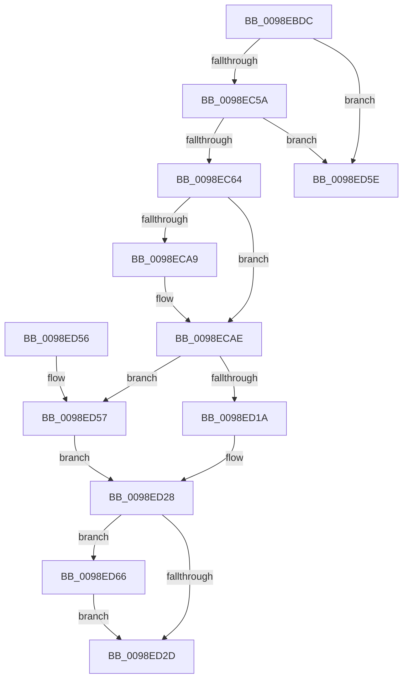

# PopEtGetProcessAppId

- RVA: `0x0098EBDC`–`0x0098ED6D` (길이 `401` bytes)
- VA: `0x000000014098EBDC`
- 실행 섹션: `PAGE`
- PDB 이름 있음: `예`; PDB Function 태그: `예`
- unwind 정보 RVA: `0x00098994`
- 디코드: `101`개 명령, `401/401` bytes 표시
- 미해석 바이트: `0` (있으면 어셈블리에 `.byte`로 보존)

> 이 문서는 커널 이미지의 기계어와 PDB 기호를 분석해 생성했습니다. 4번과 5번은 함수 원형과 자료형을 바이너리 사용 방식에서 추정한 C 해석이며 원본 소스 복구 결과는 아닙니다.

## 1. Dependencies

- 직접 호출 지점: **8**; 고유 호출 대상: **7**
- 직접 호출자로 확인된 함수: **1**
- RIP 상대 이미지 참조: **1**

### Outgoing calls
- `0x0098EC31` → [memset](../../text/6C/memset_function_006C6C40.md) (function, `0x006C6C40`)
- `0x0098EC40` → [memset](../../text/6C/memset_function_006C6C40.md) (function, `0x006C6C40`)
- `0x0098EC6C` → [PopEtGetProcessImageInfo](PopEtGetProcessImageInfo_function_0098FB20.md) (function, `0x0098FB20`)
- `0x0098EC7C` → [PopEtGetProcessSidAndPackageIdentity](PopEtGetProcessSidAndPackageIdentity_function_0098FD2C.md) (function, `0x0098FD2C`)
- `0x0098ECA0` → [PopEtGetProcessVersionInfo](PopEtGetProcessVersionInfo_function_0098F68C.md) (function, `0x0098F68C`)
- `0x0098ED0F` → [PopEtAppIdIntern](PopEtAppIdIntern_function_0098ED74.md) (function, `0x0098ED74`)
- `0x0098ED39` → [_security_check_cookie](../../text/6A/_security_check_cookie_function_006AC640.md) (function, `0x006AC640`)
- `0x0098ED66` → [PopEtAppIdDereference](PopEtAppIdDereference_function_0098D34C.md) (function, `0x0098D34C`)

### Direct callers
- [PoEnergyContextStart](PoEnergyContextStart_function_0098EAD4.md) at `0x0098EB66`

### Static image references
- `0x0098EBF9` → RVA `0x00E0A740` (`.data`; read)

## 2. Other-region calls and transfers

- 다른 실행 섹션으로 향하는 call: **3**
  - `0x0098EC31` → [memset](../../text/6C/memset_function_006C6C40.md) (`PAGE` → `.text`)
  - `0x0098EC40` → [memset](../../text/6C/memset_function_006C6C40.md) (`PAGE` → `.text`)
  - `0x0098ED39` → [_security_check_cookie](../../text/6A/_security_check_cookie_function_006AC640.md) (`PAGE` → `.text`)
- call이 아닌 외부 분기/꼬리 이동: **1**
  - `0x0098ED61` → [sub_00B2B96C](../B2/Unknown_function_00B2B96C.md) (`tail-transfer`)

## 3. Assembly (complete function range)

```asm
0098EBDC  48 89 5C 24 18                  mov qword ptr [rsp + 0x18], rbx
0098EBE1  48 89 74 24 20                  mov qword ptr [rsp + 0x20], rsi
0098EBE6  55                              push rbp
0098EBE7  57                              push rdi
0098EBE8  41 56                           push r14
0098EBEA  48 8D AC 24 40 FE FF FF         lea rbp, [rsp - 0x1c0]
0098EBF2  48 81 EC C0 02 00 00            sub rsp, 0x2c0
0098EBF9  48 8B 05 40 BB 47 00            mov rax, qword ptr [rip + 0x47bb40]
0098EC00  48 33 C4                        xor rax, rsp
0098EC03  48 89 85 B0 01 00 00            mov qword ptr [rbp + 0x1b0], rax
0098EC0A  48 8B F2                        mov rsi, rdx
0098EC0D  48 8B F9                        mov rdi, rcx
0098EC10  45 33 F6                        xor r14d, r14d
0098EC13  48 8D 4D 00                     lea rcx, [rbp]
0098EC17  0F 57 C0                        xorps xmm0, xmm0
0098EC1A  4C 89 74 24 30                  mov qword ptr [rsp + 0x30], r14
0098EC1F  33 D2                           xor edx, edx
0098EC21  4C 89 74 24 28                  mov qword ptr [rsp + 0x28], r14
0098EC26  41 B8 88 01 00 00               mov r8d, 0x188
0098EC2C  0F 11 44 24 38                  movups xmmword ptr [rsp + 0x38], xmm0
0098EC31  E8 0A 80 D3 FF                  call 0x1406c6c40
0098EC36  33 D2                           xor edx, edx
0098EC38  45 8D 46 44                     lea r8d, [r14 + 0x44]
0098EC3C  48 8D 4D B0                     lea rcx, [rbp - 0x50]
0098EC40  E8 FB 7F D3 FF                  call 0x1406c6c40
0098EC45  48 8B 9F 50 03 00 00            mov rbx, qword ptr [rdi + 0x350]
0098EC4C  4C 89 74 24 20                  mov qword ptr [rsp + 0x20], r14
0098EC51  48 85 DB                        test rbx, rbx
0098EC54  0F 84 04 01 00 00               je 0x14098ed5e
0098EC5A  66 44 39 33                     cmp word ptr [rbx], r14w
0098EC5E  0F 84 FA 00 00 00               je 0x14098ed5e
0098EC64  48 8D 54 24 30                  lea rdx, [rsp + 0x30]
0098EC69  48 8B CF                        mov rcx, rdi
0098EC6C  E8 AF 0E 00 00                  call 0x14098fb20
0098EC71  4C 8D 45 00                     lea r8, [rbp]
0098EC75  48 8B CF                        mov rcx, rdi
0098EC78  48 8D 55 B0                     lea rdx, [rbp - 0x50]
0098EC7C  E8 AB 10 00 00                  call 0x14098fd2c
0098EC81  0F 57 C0                        xorps xmm0, xmm0
0098EC84  48 8D 44 24 30                  lea rax, [rsp + 0x30]
0098EC89  48 8D 54 24 20                  lea rdx, [rsp + 0x20]
0098EC8E  48 89 44 24 70                  mov qword ptr [rsp + 0x70], rax
0098EC93  48 8B CF                        mov rcx, rdi
0098EC96  0F 11 44 24 50                  movups xmmword ptr [rsp + 0x50], xmm0
0098EC9B  0F 11 44 24 60                  movups xmmword ptr [rsp + 0x60], xmm0
0098ECA0  E8 E7 09 00 00                  call 0x14098f68c
0098ECA5  85 C0                           test eax, eax
0098ECA7  79 05                           jns 0x14098ecae
0098ECA9  4C 89 74 24 20                  mov qword ptr [rsp + 0x20], r14
0098ECAE  48 8D 44 24 20                  lea rax, [rsp + 0x20]
0098ECB3  48 89 44 24 78                  mov qword ptr [rsp + 0x78], rax
0098ECB8  48 8D 54 24 28                  lea rdx, [rsp + 0x28]
0098ECBD  48 8D 45 B0                     lea rax, [rbp - 0x50]
0098ECC1  48 89 45 98                     mov qword ptr [rbp - 0x68], rax
0098ECC5  48 8D 4C 24 50                  lea rcx, [rsp + 0x50]
0098ECCA  0F B6 45 B1                     movzx eax, byte ptr [rbp - 0x4f]
0098ECCE  66 83 C0 02                     add ax, 2
0098ECD2  66 C1 E0 02                     shl ax, 2
0098ECD6  66 89 45 A6                     mov word ptr [rbp - 0x5a], ax
0098ECDA  48 8B 43 08                     mov rax, qword ptr [rbx + 8]
0098ECDE  48 89 45 80                     mov qword ptr [rbp - 0x80], rax
0098ECE2  0F B7 03                        movzx eax, word ptr [rbx]
0098ECE5  66 D1 E8                        shr ax, 1
0098ECE8  66 89 45 A0                     mov word ptr [rbp - 0x60], ax
0098ECEC  48 8D 45 04                     lea rax, [rbp + 4]
0098ECF0  48 89 45 88                     mov qword ptr [rbp - 0x78], rax
0098ECF4  0F B7 45 00                     movzx eax, word ptr [rbp]
0098ECF8  66 89 45 A2                     mov word ptr [rbp - 0x5e], ax
0098ECFC  48 8D 85 04 01 00 00            lea rax, [rbp + 0x104]
0098ED03  48 89 45 90                     mov qword ptr [rbp - 0x70], rax
0098ED07  0F B7 45 02                     movzx eax, word ptr [rbp + 2]
0098ED0B  66 89 45 A4                     mov word ptr [rbp - 0x5c], ax
0098ED0F  E8 60 00 00 00                  call 0x14098ed74
0098ED14  8B D8                           mov ebx, eax
0098ED16  85 C0                           test eax, eax
0098ED18  78 3D                           js 0x14098ed57
0098ED1A  48 8B 44 24 28                  mov rax, qword ptr [rsp + 0x28]
0098ED1F  49 8B CE                        mov rcx, r14
0098ED22  48 89 06                        mov qword ptr [rsi], rax
0098ED25  41 8B DE                        mov ebx, r14d
0098ED28  48 85 C9                        test rcx, rcx
0098ED2B  75 39                           jne 0x14098ed66
0098ED2D  8B C3                           mov eax, ebx
0098ED2F  48 8B 8D B0 01 00 00            mov rcx, qword ptr [rbp + 0x1b0]
0098ED36  48 33 CC                        xor rcx, rsp
0098ED39  E8 02 D9 D1 FF                  call 0x1406ac640
0098ED3E  4C 8D 9C 24 C0 02 00 00         lea r11, [rsp + 0x2c0]
0098ED46  49 8B 5B 30                     mov rbx, qword ptr [r11 + 0x30]
0098ED4A  49 8B 73 38                     mov rsi, qword ptr [r11 + 0x38]
0098ED4E  49 8B E3                        mov rsp, r11
0098ED51  41 5E                           pop r14
0098ED53  5F                              pop rdi
0098ED54  5D                              pop rbp
0098ED55  C3                              ret
0098ED56  CC                              int3
0098ED57  48 8B 4C 24 28                  mov rcx, qword ptr [rsp + 0x28]
0098ED5C  EB CA                           jmp 0x14098ed28
0098ED5E  49 8B CE                        mov rcx, r14
0098ED61  E9 06 CC 19 00                  jmp 0x140b2b96c
0098ED66  E8 E1 E5 FF FF                  call 0x14098d34c
0098ED6B  EB C0                           jmp 0x14098ed2d
```

## 4. C-style interpretation (structured pseudocode)

```c
__int64 __fastcall PopEtGetProcessAppId(__int64 a1, __int64 a2)
{
    __int64 result;
    __int64 v_r14;
    __int64 v_rsp;
    unsigned __int64 v_stack_m18;
    unsigned __int64 v_stack_m1D4;
    unsigned __int16 v_stack_m1D6;
    unsigned __int64 v_stack_m1D8;
    unsigned __int8 v_stack_m227;
    unsigned __int64 v_stack_m228;
    unsigned __int16 v_stack_m232;
    unsigned __int16 v_stack_m234;
    unsigned __int16 v_stack_m236;
    unsigned __int16 v_stack_m238;
    unsigned __int64 v_stack_m240;
    unsigned __int64 v_stack_m248;
    unsigned __int64 v_stack_m250;
    unsigned __int64 v_stack_m258;
    unsigned __int64 v_stack_m260;
    unsigned __int64 v_stack_m268;
    unsigned __int64 v_stack_m278;
    unsigned __int64 v_stack_m28;
    unsigned __int64 v_stack_m288;
    unsigned __int64 v_stack_m298;
    unsigned __int64 v_stack_m2A0;
    unsigned __int64 v_stack_m2A8;
    unsigned __int64 v_stack_m2B0;
    unsigned __int64 v_stack_m2B8;
    unsigned __int64 v_stack_mD4;
    unsigned __int64 v_stack_p18;
    unsigned __int64 v_stack_p20;

    v_stack_p18 = v_rbx;
    v_stack_p20 = v_rsi;
    v_rsp = (v_rsp) - (704);
    result = (*(unsigned __int64 *)(v_rip + 4700992)) ^ (v_rsp);
    v_stack_m28 = result;
    v_r14 = 0;
    v_stack_m2A8 = 0;
    a2 = 0;
    v_stack_m2B0 = 0;
    v_stack_m2A0 = v_xmm0;
    result = memset(v_stack_m1D8, a2, 392, a4);
    a2 = 0;
    result = memset(v_stack_m228, a2, v_r14 + 68, a4);
    v_stack_m2B8 = 0;
    if (*(unsigned __int64 *)(a1 + 848) == 0) goto loc_0098ED5E;
    if ((*(unsigned __int16 *)(*(unsigned __int64 *)(a1 + 848))) == 0) goto loc_0098ED5E;
    result = PopEtGetProcessImageInfo(a1, v_stack_m2A8, v_r14 + 68, a4);
    result = PopEtGetProcessSidAndPackageIdentity(a1, v_stack_m228, v_stack_m1D8, a4);
    v_stack_m268 = v_stack_m2A8;
    v_stack_m288 = v_xmm0;
    v_stack_m278 = v_xmm0;
    result = PopEtGetProcessVersionInfo(a1, v_stack_m2B8, v_stack_m1D8, a4);
    if (sign_flag) {
        v_stack_m2B8 = 0;
    }
    v_stack_m260 = v_stack_m2B8;
    v_stack_m240 = v_stack_m228;
    result = (unsigned __int16)((v_stack_m227) + (2));
    result = (unsigned __int16)((result) << (2));
    v_stack_m232 = (unsigned __int16)(result);
    v_stack_m258 = *(unsigned __int64 *)(*(unsigned __int64 *)(a1 + 848) + 8);
    result = (unsigned __int16)((*(unsigned __int16 *)(*(unsigned __int64 *)(a1 + 848))) >> (1));
    v_stack_m238 = (unsigned __int16)(result);
    v_stack_m250 = v_stack_m1D4;
    v_stack_m236 = (unsigned __int16)(v_stack_m1D8);
    v_stack_m248 = v_stack_mD4;
    v_stack_m234 = (unsigned __int16)(v_stack_m1D6);
    result = PopEtAppIdIntern(v_stack_m288, v_stack_m2B0, v_stack_m1D8, a4);
    if (sign_flag) goto loc_0098ED57;
    *(unsigned __int64 *)(a2) = v_stack_m2B0;
loc_0098ED28:
    if (0 != 0) goto loc_0098ED66;
loc_0098ED2D:
    a1 = (v_stack_m28) ^ (v_rsp);
    result = _security_check_cookie(a1, v_stack_m2B0, v_stack_m1D8, a4);
    return result;
loc_0098ED57:
    goto loc_0098ED28;
loc_0098ED5E:
loc_0098ED66:
    result = PopEtAppIdDereference(0, v_stack_m2B0, v_stack_m1D8, a4);
    goto loc_0098ED2D;
}
```

## 5. (Beta) C Style

```c
int64_t PopEtGetProcessAppId(void *Arg1, void *Arg2)
{
    uint8_t *arg1 = (uint8_t *)Arg1;
    uint8_t *arg2 = (uint8_t *)Arg2;

    int64_t result;
    int64_t local_r14;
    int64_t local_rsp;
    uint64_t v_stack_m18;
    uint64_t v_stack_m1D4;
    uint16_t v_stack_m1D6;
    uint64_t v_stack_m1D8;
    uint8_t v_stack_m227;
    uint64_t v_stack_m228;
    uint16_t v_stack_m232;
    uint16_t v_stack_m234;
    uint16_t v_stack_m236;
    uint16_t v_stack_m238;
    uint64_t v_stack_m240;
    uint64_t v_stack_m248;
    uint64_t v_stack_m250;
    uint64_t v_stack_m258;
    uint64_t v_stack_m260;
    uint64_t v_stack_m268;
    uint64_t v_stack_m278;
    uint64_t v_stack_m28;
    uint64_t v_stack_m288;
    uint64_t v_stack_m298;
    uint64_t v_stack_m2A0;
    uint64_t v_stack_m2A8;
    uint64_t v_stack_m2B0;
    uint64_t v_stack_m2B8;
    uint64_t v_stack_mD4;
    uint64_t v_stack_p18;
    uint64_t v_stack_p20;

    v_stack_p18 = local_rbx;
    v_stack_p20 = local_rsi;
    local_rsp = (local_rsp) - (704);
    result = (*(uint64_t *)(v_rip + 0x47BB40)) ^ (local_rsp);
    v_stack_m28 = result;
    local_r14 = 0;
    v_stack_m2A8 = 0;
    Arg2 = 0;
    v_stack_m2B0 = 0;
    v_stack_m2A0 = v_xmm0;
    result = memset(v_stack_m1D8, Arg2, 392, a4);
    Arg2 = 0;
    result = memset(v_stack_m228, Arg2, local_r14 + 68, a4);
    v_stack_m2B8 = 0;
    if (*(uint64_t *)(arg1 + 0x350) == 0) goto loc_0098ED5E;
    if ((*(uint16_t *)(*(uint64_t *)(arg1 + 0x350))) == 0) goto loc_0098ED5E;
    result = PopEtGetProcessImageInfo(Arg1, v_stack_m2A8, local_r14 + 68, a4);
    result = PopEtGetProcessSidAndPackageIdentity(Arg1, v_stack_m228, v_stack_m1D8, a4);
    v_stack_m268 = v_stack_m2A8;
    v_stack_m288 = v_xmm0;
    v_stack_m278 = v_xmm0;
    result = PopEtGetProcessVersionInfo(Arg1, v_stack_m2B8, v_stack_m1D8, a4);
    if (sign_flag) {
        v_stack_m2B8 = 0;
    }
    v_stack_m260 = v_stack_m2B8;
    v_stack_m240 = v_stack_m228;
    result = (uint16_t)((v_stack_m227) + (2));
    result = (uint16_t)((result) << (2));
    v_stack_m232 = (uint16_t)(result);
    v_stack_m258 = *(uint64_t *)(*(uint64_t *)(arg1 + 0x350) + 0x8);
    result = (uint16_t)((*(uint16_t *)(*(uint64_t *)(arg1 + 0x350))) >> (1));
    v_stack_m238 = (uint16_t)(result);
    v_stack_m250 = v_stack_m1D4;
    v_stack_m236 = (uint16_t)(v_stack_m1D8);
    v_stack_m248 = v_stack_mD4;
    v_stack_m234 = (uint16_t)(v_stack_m1D6);
    result = PopEtAppIdIntern(v_stack_m288, v_stack_m2B0, v_stack_m1D8, a4);
    if (sign_flag) goto loc_0098ED57;
    *(uint64_t *)(arg2) = v_stack_m2B0;
loc_0098ED28:
    if (0 != 0) goto loc_0098ED66;
loc_0098ED2D:
    Arg1 = (v_stack_m28) ^ (local_rsp);
    result = _security_check_cookie(Arg1, v_stack_m2B0, v_stack_m1D8, a4);
    return result;
loc_0098ED57:
    goto loc_0098ED28;
loc_0098ED5E:
loc_0098ED66:
    result = PopEtAppIdDereference(0, v_stack_m2B0, v_stack_m1D8, a4);
    goto loc_0098ED2D;
}
```

### 관측된 메모리 오프셋

구조체 형식이 확인되지 않은 접근은 인자 기준의 오프셋으로만 기록했습니다.

| 기준 인자 | 오프셋 표현 | 폭 (bit) | 접근 |
|---|---:|---:|---|
| `Arg1` | `+ 0x350` | `64` | `R` |
| `Arg2` | `+ 0x0` | `64` | `W` |

## 6. Execution-region graph

[열기: 2D/3D 그래프와 함수 탐색 컨트롤 패널](../../../control-panel.html?section=page&rva=0x0098EBDC&view=graph)

- 2D 그래프는 위에서 아래로 흐르고, 3D 그래프는 빈 공간을 드래그해 회전합니다. Shift+드래그는 이동, 휠은 확대·축소, 함수 노드 선택은 대상 보고서 이동입니다.

### Static fallback


