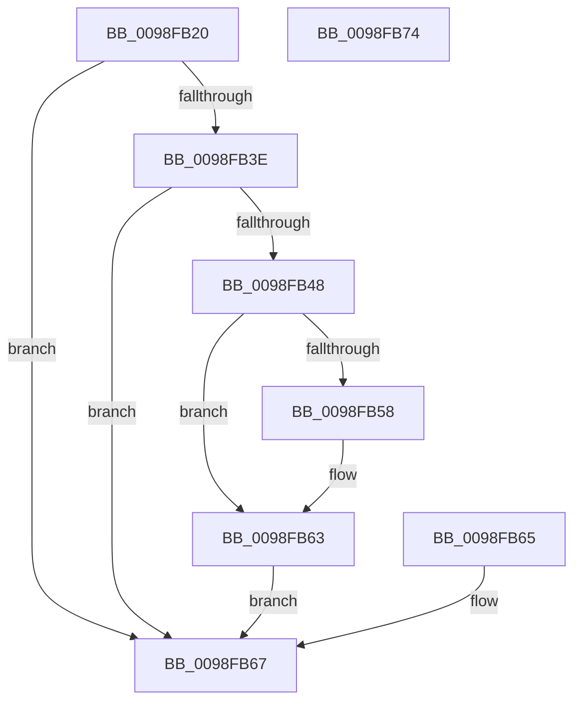

# PopEtGetProcessImageInfo

- RVA: `0x0098FB20`–`0x0098FB75` (길이 `85` bytes)
- VA: `0x000000014098FB20`
- 실행 섹션: `PAGE`
- PDB 이름 있음: `예`; PDB Function 태그: `아니요`
- unwind 정보 RVA: `0x00098B04`
- 디코드: `30`개 명령, `85/85` bytes 표시
- 미해석 바이트: `0` (있으면 어셈블리에 `.byte`로 보존)

> 이 문서는 커널 이미지의 기계어와 PDB 기호를 분석해 생성했습니다. 4번과 5번은 함수 원형과 자료형을 바이너리 사용 방식에서 추정한 C 해석이며 원본 소스 복구 결과는 아닙니다.

## 1. Dependencies

- 직접 호출 지점: **2**; 고유 호출 대상: **2**
- 직접 호출자로 확인된 함수: **1**
- RIP 상대 이미지 참조: **0**

### Outgoing calls
- `0x0098FB3E` → [PsGetProcessSectionBaseAddress](../../text/48/PsGetProcessSectionBaseAddress_function_0048C060.md) (function, `0x0048C060`)
- `0x0098FB4B` → [RtlImageNtHeader](../../text/44/RtlImageNtHeader_function_00443B60.md) (function, `0x00443B60`)

### Direct callers
- [PopEtGetProcessAppId](PopEtGetProcessAppId_function_0098EBDC.md) at `0x0098EC6C`

### Static image references
- 디코드된 RIP-relative 메모리 참조가 없습니다.

## 2. Other-region calls and transfers

- 다른 실행 섹션으로 향하는 call: **2**
  - `0x0098FB3E` → [PsGetProcessSectionBaseAddress](../../text/48/PsGetProcessSectionBaseAddress_function_0048C060.md) (`PAGE` → `.text`)
  - `0x0098FB4B` → [RtlImageNtHeader](../../text/44/RtlImageNtHeader_function_00443B60.md) (`PAGE` → `.text`)
- 별도 외부 분기/꼬리 이동을 확인하지 못했습니다.

## 3. Assembly (complete function range)

```asm
0098FB20  48 89 5C 24 08                  mov qword ptr [rsp + 8], rbx
0098FB25  57                              push rdi
0098FB26  48 83 EC 20                     sub rsp, 0x20
0098FB2A  48 8B FA                        mov rdi, rdx
0098FB2D  33 DB                           xor ebx, ebx
0098FB2F  33 C0                           xor eax, eax
0098FB31  48 89 02                        mov qword ptr [rdx], rax
0098FB34  8B 81 FC 05 00 00               mov eax, dword ptr [rcx + 0x5fc]
0098FB3A  A8 01                           test al, 1
0098FB3C  75 29                           jne 0x14098fb67
0098FB3E  E8 1D C5 AF FF                  call 0x14048c060
0098FB43  48 85 C0                        test rax, rax
0098FB46  74 1F                           je 0x14098fb67
0098FB48  48 8B C8                        mov rcx, rax
0098FB4B  E8 10 40 AB FF                  call 0x140443b60
0098FB50  48 8B C8                        mov rcx, rax
0098FB53  48 85 C0                        test rax, rax
0098FB56  74 0B                           je 0x14098fb63
0098FB58  8B 40 58                        mov eax, dword ptr [rax + 0x58]
0098FB5B  89 07                           mov dword ptr [rdi], eax
0098FB5D  8B 41 08                        mov eax, dword ptr [rcx + 8]
0098FB60  89 47 04                        mov dword ptr [rdi + 4], eax
0098FB63  EB 02                           jmp 0x14098fb67
0098FB65  8B D8                           mov ebx, eax
0098FB67  8B C3                           mov eax, ebx
0098FB69  48 8B 5C 24 30                  mov rbx, qword ptr [rsp + 0x30]
0098FB6E  48 83 C4 20                     add rsp, 0x20
0098FB72  5F                              pop rdi
0098FB73  C3                              ret
0098FB74  CC                              int3
```

## 4. C-style interpretation (structured pseudocode)

```c
__int64 __fastcall PopEtGetProcessImageInfo(__int64 a1, __int64 a2)
{
    __int64 result;
    __int64 v_rbx;
    __int64 v_rsp;
    unsigned __int64 v_stack_p8;

    v_stack_p8 = v_rbx;
    v_rsp = (v_rsp) - (32);
    v_rbx = 0;
    result = 0;
    *(unsigned __int64 *)(a2) = 0;
    if ((((unsigned __int8)((unsigned int)(*(unsigned int *)(a1 + 1532)))) & (1)) != 0) goto loc_0098FB67;
    result = PsGetProcessSectionBaseAddress(a1, a2, a3, a4);
    if (result == 0) goto loc_0098FB67;
    result = RtlImageNtHeader(result, a2, a3, a4);
    if (result != 0) {
        result = *(unsigned int *)(result + 88);
        *(unsigned int *)(a2) = (unsigned int)(result);
        result = *(unsigned int *)(result + 8);
        *(unsigned int *)(a2 + 4) = (unsigned int)(result);
    }
    goto loc_0098FB67;
loc_0098FB67:
    v_rsp = (v_rsp) + (32);
    return 0;
}
```

## 5. (Beta) C Style

```c
int64_t PopEtGetProcessImageInfo(void *Arg1, void *Arg2)
{
    uint8_t *arg1 = (uint8_t *)Arg1;
    uint8_t *arg2 = (uint8_t *)Arg2;

    int64_t result;
    int64_t local_rbx;
    int64_t local_rsp;
    uint64_t v_stack_p8;

    v_stack_p8 = local_rbx;
    local_rsp = (local_rsp) - (32);
    local_rbx = 0;
    result = 0;
    *(uint64_t *)(arg2) = 0;
    if ((((uint8_t)((uint32_t)(*(uint32_t *)(arg1 + 0x5FC)))) & (1)) != 0) goto loc_0098FB67;
    result = PsGetProcessSectionBaseAddress(Arg1, Arg2, a3, a4);
    if (result == 0) goto loc_0098FB67;
    result = RtlImageNtHeader(result, Arg2, a3, a4);
    if (result != 0) {
        result = *(uint32_t *)(result + 0x58);
        *(uint32_t *)(arg2) = (uint32_t)(result);
        result = *(uint32_t *)(result + 0x8);
        *(uint32_t *)(arg2 + 0x4) = (uint32_t)(result);
    }
    goto loc_0098FB67;
loc_0098FB67:
    local_rsp = (local_rsp) + (32);
    return 0;
}
```

### 관측된 메모리 오프셋

구조체 형식이 확인되지 않은 접근은 인자 기준의 오프셋으로만 기록했습니다.

| 기준 인자 | 오프셋 표현 | 폭 (bit) | 접근 |
|---|---:|---:|---|
| `Arg1` | `+ 0x5FC` | `32` | `R` |
| `Arg2` | `+ 0x0` | `32` | `W` |
| `Arg2` | `+ 0x0` | `64` | `W` |
| `Arg2` | `+ 0x4` | `32` | `W` |

## 6. Execution-region graph

[열기: 2D/3D 그래프와 함수 탐색 컨트롤 패널](../../../control-panel.html?section=page&rva=0x0098FB20&view=graph)

- 2D 그래프는 위에서 아래로 흐르고, 3D 그래프는 빈 공간을 드래그해 회전합니다. Shift+드래그는 이동, 휠은 확대·축소, 함수 노드 선택은 대상 보고서 이동입니다.

### Static fallback


