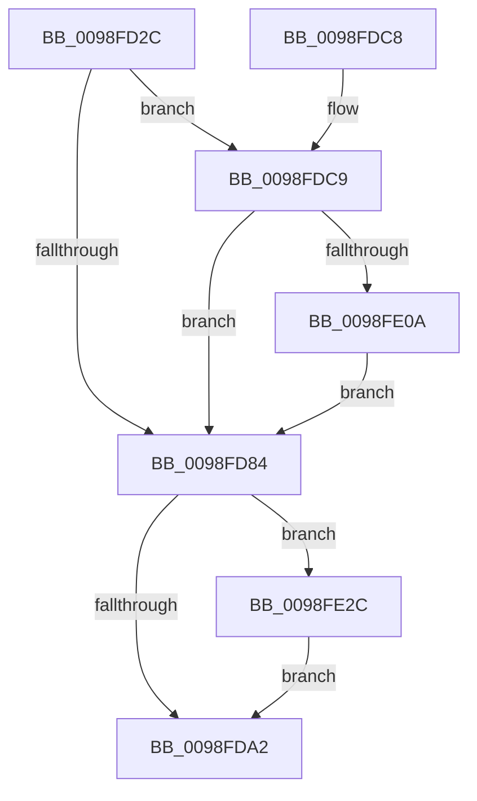

# PopEtGetProcessSidAndPackageIdentity

- RVA: `0x0098FD2C`–`0x0098FE39` (길이 `269` bytes)
- VA: `0x000000014098FD2C`
- 실행 섹션: `PAGE`
- PDB 이름 있음: `예`; PDB Function 태그: `아니요`
- unwind 정보 RVA: `0x00098B4C`
- 디코드: `72`개 명령, `269/269` bytes 표시
- 미해석 바이트: `0` (있으면 어셈블리에 `.byte`로 보존)

> 이 문서는 커널 이미지의 기계어와 PDB 기호를 분석해 생성했습니다. 4번과 5번은 함수 원형과 자료형을 바이너리 사용 방식에서 추정한 C 해석이며 원본 소스 복구 결과는 아닙니다.

## 1. Dependencies

- 직접 호출 지점: **6**; 고유 호출 대상: **5**
- 직접 호출자로 확인된 함수: **1**
- RIP 상대 이미지 참조: **2**

### Outgoing calls
- `0x0098FD58` → [PsReferencePrimaryTokenWithTag](../../text/20/PsReferencePrimaryTokenWithTag_function_0020FF80.md) (function, `0x0020FF80`)
- `0x0098FD6A` → [SeSecurityAttributePresent](../../text/21/SeSecurityAttributePresent_function_00213660.md) (function, `0x00213660`)
- `0x0098FD7B` → [SeSecurityAttributePresent](../../text/21/SeSecurityAttributePresent_function_00213660.md) (function, `0x00213660`)
- `0x0098FD95` → [SeQueryUserSidToken](../99/SeQueryUserSidToken_function_00990950.md) (function, `0x00990950`)
- `0x0098FDB2` → [ObFastDereferenceObject](../../text/3E/ObFastDereferenceObject_function_003ED5F0.md) (function, `0x003ED5F0`)
- `0x0098FDFD` → [RtlQueryPackageIdentity](../../text/45/RtlQueryPackageIdentity_function_0045C390.md) (function, `0x0045C390`)

### Direct callers
- [PopEtGetProcessAppId](PopEtGetProcessAppId_function_0098EBDC.md) at `0x0098EC7C`

### Static image references
- `0x0098FD5D` → RVA `0x00B4BEA8` (`PspSysAppIdClaim`; read)
- `0x0098FD6F` → RVA `0x00B4BE98` (`PspPackagedAppClaim`; read)

## 2. Other-region calls and transfers

- 다른 실행 섹션으로 향하는 call: **5**
  - `0x0098FD58` → [PsReferencePrimaryTokenWithTag](../../text/20/PsReferencePrimaryTokenWithTag_function_0020FF80.md) (`PAGE` → `.text`)
  - `0x0098FD6A` → [SeSecurityAttributePresent](../../text/21/SeSecurityAttributePresent_function_00213660.md) (`PAGE` → `.text`)
  - `0x0098FD7B` → [SeSecurityAttributePresent](../../text/21/SeSecurityAttributePresent_function_00213660.md) (`PAGE` → `.text`)
  - `0x0098FDB2` → [ObFastDereferenceObject](../../text/3E/ObFastDereferenceObject_function_003ED5F0.md) (`PAGE` → `.text`)
  - `0x0098FDFD` → [RtlQueryPackageIdentity](../../text/45/RtlQueryPackageIdentity_function_0045C390.md) (`PAGE` → `.text`)
- 별도 외부 분기/꼬리 이동을 확인하지 못했습니다.

## 3. Assembly (complete function range)

```asm
0098FD2C  48 89 5C 24 18                  mov qword ptr [rsp + 0x18], rbx
0098FD31  55                              push rbp
0098FD32  56                              push rsi
0098FD33  57                              push rdi
0098FD34  41 56                           push r14
0098FD36  41 57                           push r15
0098FD38  48 83 EC 30                     sub rsp, 0x30
0098FD3C  33 C0                           xor eax, eax
0098FD3E  48 8B F2                        mov rsi, rdx
0098FD41  45 33 FF                        xor r15d, r15d
0098FD44  49 8B F8                        mov rdi, r8
0098FD47  45 89 38                        mov dword ptr [r8], r15d
0098FD4A  4C 8B F1                        mov r14, rcx
0098FD4D  48 89 02                        mov qword ptr [rdx], rax
0098FD50  89 42 08                        mov dword ptr [rdx + 8], eax
0098FD53  BA 44 66 6C 74                  mov edx, 0x746c6644
0098FD58  E8 23 02 88 FF                  call 0x14020ff80
0098FD5D  48 8D 15 44 C1 1B 00            lea rdx, [rip + 0x1bc144]
0098FD64  48 8B C8                        mov rcx, rax
0098FD67  48 8B E8                        mov rbp, rax
0098FD6A  E8 F1 38 88 FF                  call 0x140213660
0098FD6F  48 8D 15 22 C1 1B 00            lea rdx, [rip + 0x1bc122]
0098FD76  48 8B CD                        mov rcx, rbp
0098FD79  8A D8                           mov bl, al
0098FD7B  E8 E0 38 88 FF                  call 0x140213660
0098FD80  84 DB                           test bl, bl
0098FD82  75 45                           jne 0x14098fdc9
0098FD84  4C 8D 4C 24 60                  lea r9, [rsp + 0x60]
0098FD89  41 B8 44 00 00 00               mov r8d, 0x44
0098FD8F  48 8B D6                        mov rdx, rsi
0098FD92  48 8B CD                        mov rcx, rbp
0098FD95  E8 B6 0B 00 00                  call 0x140990950
0098FD9A  85 C0                           test eax, eax
0098FD9C  0F 88 8A 00 00 00               js 0x14098fe2c
0098FDA2  49 8D 8E 48 02 00 00            lea rcx, [r14 + 0x248]
0098FDA9  41 B8 44 66 6C 74               mov r8d, 0x746c6644
0098FDAF  48 8B D5                        mov rdx, rbp
0098FDB2  E8 39 D8 A5 FF                  call 0x1403ed5f0
0098FDB7  48 8B 5C 24 70                  mov rbx, qword ptr [rsp + 0x70]
0098FDBC  48 83 C4 30                     add rsp, 0x30
0098FDC0  41 5F                           pop r15
0098FDC2  41 5E                           pop r14
0098FDC4  5F                              pop rdi
0098FDC5  5E                              pop rsi
0098FDC6  5D                              pop rbp
0098FDC7  C3                              ret
0098FDC8  CC                              int3
0098FDC9  48 8D 44 24 68                  lea rax, [rsp + 0x68]
0098FDCE  4C 89 7C 24 28                  mov qword ptr [rsp + 0x28], r15
0098FDD3  4C 8D 8F 04 01 00 00            lea r9, [rdi + 0x104]
0098FDDA  48 89 44 24 20                  mov qword ptr [rsp + 0x20], rax
0098FDDF  48 8D 57 04                     lea rdx, [rdi + 4]
0098FDE3  48 C7 44 24 60 00 01 00 00      mov qword ptr [rsp + 0x60], 0x100
0098FDEC  4C 8D 44 24 60                  lea r8, [rsp + 0x60]
0098FDF1  48 C7 44 24 68 84 00 00 00      mov qword ptr [rsp + 0x68], 0x84
0098FDFA  48 8B CD                        mov rcx, rbp
0098FDFD  E8 8E C5 AC FF                  call 0x14045c390
0098FE02  85 C0                           test eax, eax
0098FE04  0F 88 7A FF FF FF               js 0x14098fd84
0098FE0A  48 8B 44 24 60                  mov rax, qword ptr [rsp + 0x60]
0098FE0F  48 D1 E8                        shr rax, 1
0098FE12  66 FF C8                        dec ax
0098FE15  66 89 07                        mov word ptr [rdi], ax
0098FE18  48 8B 44 24 68                  mov rax, qword ptr [rsp + 0x68]
0098FE1D  48 D1 E8                        shr rax, 1
0098FE20  66 FF C8                        dec ax
0098FE23  66 89 47 02                     mov word ptr [rdi + 2], ax
0098FE27  E9 58 FF FF FF                  jmp 0x14098fd84
0098FE2C  33 C0                           xor eax, eax
0098FE2E  48 89 06                        mov qword ptr [rsi], rax
0098FE31  89 46 08                        mov dword ptr [rsi + 8], eax
0098FE34  E9 69 FF FF FF                  jmp 0x14098fda2
```

## 4. C-style interpretation (structured pseudocode)

```c
__int64 __fastcall PopEtGetProcessSidAndPackageIdentity(__int64 a1, __int64 a2, __int64 a3)
{
    __int64 result;
    __int64 v_r15;
    __int64 v_rsp;
    unsigned __int64 v_stack_p18;
    unsigned __int64 v_stack_p20;
    unsigned __int64 v_stack_p28;
    unsigned __int64 v_stack_p60;
    unsigned __int64 v_stack_p68;
    unsigned __int64 v_stack_p8;

    v_stack_p18 = v_rbx;
    v_rsp = (v_rsp) - (48);
    result = 0;
    v_r15 = 0;
    *(unsigned int *)(a3) = 0;
    *(unsigned __int64 *)(a2) = 0;
    *(unsigned int *)(a2 + 8) = 0;
    result = PsReferencePrimaryTokenWithTag(a1, (unsigned int)(0x746C6644ULL), a3, a4);
    result = SeSecurityAttributePresent(result, v_rip + 1818948, a3, a4);
    result = SeSecurityAttributePresent(result, v_rip + 1818914, a3, a4);
    if ((unsigned __int8)((unsigned __int8)(result)) != 0) goto loc_0098FDC9;
loc_0098FD84:
    result = SeQueryUserSidToken(result, a2, 68, v_stack_p8);
    if (sign_flag) goto loc_0098FE2C;
loc_0098FDA2:
    result = ObFastDereferenceObject(a1 + 584, result, (unsigned int)(0x746C6644ULL), v_stack_p8);
    v_rsp = (v_rsp) + (48);
    return result;
loc_0098FDC9:
    v_stack_p28 = 0;
    v_stack_p20 = v_stack_p68;
    v_stack_p60 = 256;
    v_stack_p68 = 132;
    result = RtlQueryPackageIdentity(result, a3 + 4, v_stack_p60, a3 + 260);
    if (sign_flag) goto loc_0098FD84;
    result = (v_stack_p60) >> (1);
    result = (unsigned __int16)((result) - 1);
    *(unsigned __int16 *)(a3) = (unsigned __int16)(result);
    result = (v_stack_p68) >> (1);
    result = (unsigned __int16)((result) - 1);
    *(unsigned __int16 *)(a3 + 2) = (unsigned __int16)(result);
    goto loc_0098FD84;
loc_0098FE2C:
    result = 0;
    *(unsigned __int64 *)(a2) = 0;
    *(unsigned int *)(a2 + 8) = 0;
    goto loc_0098FDA2;
}
```

## 5. (Beta) C Style

```c
int64_t PopEtGetProcessSidAndPackageIdentity(void *Arg1, void *Arg2, void *Arg3)
{
    uint8_t *arg1 = (uint8_t *)Arg1;
    uint8_t *arg2 = (uint8_t *)Arg2;
    uint8_t *arg3 = (uint8_t *)Arg3;

    int64_t result;
    int64_t local_r15;
    int64_t local_rsp;
    uint64_t v_stack_p18;
    uint64_t v_stack_p20;
    uint64_t v_stack_p28;
    uint64_t v_stack_p60;
    uint64_t v_stack_p68;
    uint64_t v_stack_p8;

    v_stack_p18 = local_rbx;
    local_rsp = (local_rsp) - (48);
    result = 0;
    local_r15 = 0;
    *(uint32_t *)(arg3) = 0;
    *(uint64_t *)(arg2) = 0;
    *(uint32_t *)(arg2 + 0x8) = 0;
    result = PsReferencePrimaryTokenWithTag(Arg1, (uint32_t)(0x746C6644ULL), Arg3, a4);
    result = SeSecurityAttributePresent(result, v_rip + 1818948, Arg3, a4);
    result = SeSecurityAttributePresent(result, v_rip + 1818914, Arg3, a4);
    if ((uint8_t)((uint8_t)(result)) != 0) goto loc_0098FDC9;
loc_0098FD84:
    result = SeQueryUserSidToken(result, Arg2, 68, v_stack_p8);
    if (sign_flag) goto loc_0098FE2C;
loc_0098FDA2:
    result = ObFastDereferenceObject(Arg1 + 584, result, (uint32_t)(0x746C6644ULL), v_stack_p8);
    local_rsp = (local_rsp) + (48);
    return result;
loc_0098FDC9:
    v_stack_p28 = 0;
    v_stack_p20 = v_stack_p68;
    v_stack_p60 = 256;
    v_stack_p68 = 132;
    result = RtlQueryPackageIdentity(result, Arg3 + 4, v_stack_p60, Arg3 + 260);
    if (sign_flag) goto loc_0098FD84;
    result = (v_stack_p60) >> (1);
    result = (uint16_t)((result) - 1);
    *(uint16_t *)(arg3) = (uint16_t)(result);
    result = (v_stack_p68) >> (1);
    result = (uint16_t)((result) - 1);
    *(uint16_t *)(arg3 + 0x2) = (uint16_t)(result);
    goto loc_0098FD84;
loc_0098FE2C:
    result = 0;
    *(uint64_t *)(arg2) = 0;
    *(uint32_t *)(arg2 + 0x8) = 0;
    goto loc_0098FDA2;
}
```

### 관측된 메모리 오프셋

구조체 형식이 확인되지 않은 접근은 인자 기준의 오프셋으로만 기록했습니다.

| 기준 인자 | 오프셋 표현 | 폭 (bit) | 접근 |
|---|---:|---:|---|
| `Arg1` | `+ 0x248` | `64` | `R` |
| `Arg2` | `+ 0x0` | `64` | `W` |
| `Arg2` | `+ 0x8` | `32` | `W` |
| `Arg3` | `+ 0x0` | `16` | `W` |
| `Arg3` | `+ 0x0` | `32` | `W` |
| `Arg3` | `+ 0x2` | `16` | `W` |
| `Arg3` | `+ 0x4` | `64` | `R` |
| `Arg3` | `+ 0x104` | `64` | `R` |

## 6. Execution-region graph

[열기: 2D/3D 그래프와 함수 탐색 컨트롤 패널](../../../control-panel.html?section=page&rva=0x0098FD2C&view=graph)

- 2D 그래프는 위에서 아래로 흐르고, 3D 그래프는 빈 공간을 드래그해 회전합니다. Shift+드래그는 이동, 휠은 확대·축소, 함수 노드 선택은 대상 보고서 이동입니다.

### Static fallback


