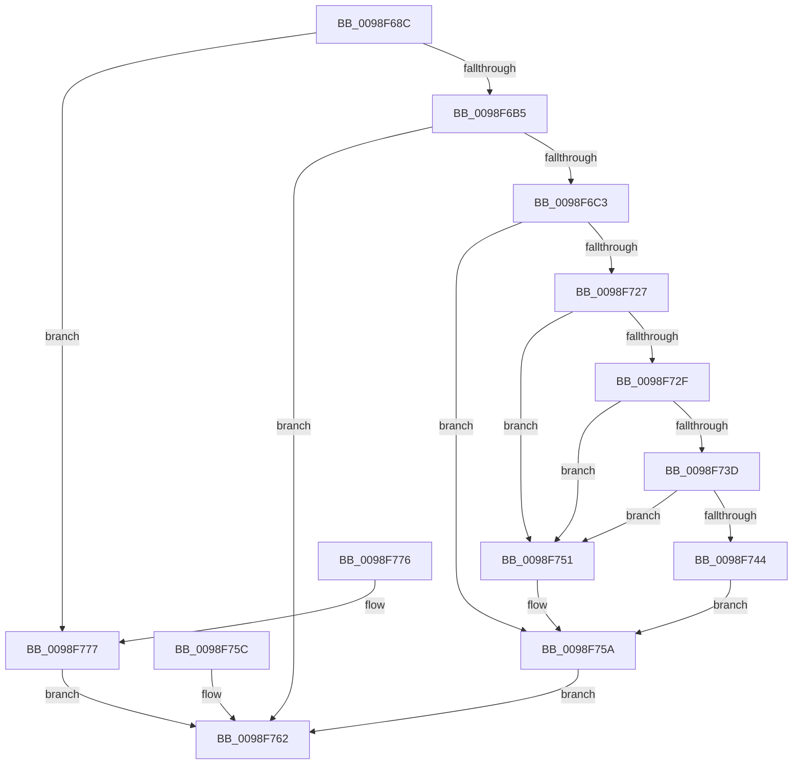

# PopEtGetProcessVersionInfo

- RVA: `0x0098F68C`–`0x0098F791` (길이 `261` bytes)
- VA: `0x000000014098F68C`
- 실행 섹션: `PAGE`
- PDB 이름 있음: `예`; PDB Function 태그: `아니요`
- unwind 정보 RVA: `0x00098A60`
- 디코드: `66`개 명령, `261/261` bytes 표시
- 미해석 바이트: `0` (있으면 어셈블리에 `.byte`로 보존)

> 이 문서는 커널 이미지의 기계어와 PDB 기호를 분석해 생성했습니다. 4번과 5번은 함수 원형과 자료형을 바이너리 사용 방식에서 추정한 C 해석이며 원본 소스 복구 결과는 아닙니다.

## 1. Dependencies

- 직접 호출 지점: **2**; 고유 호출 대상: **2**
- 직접 호출자로 확인된 함수: **1**
- RIP 상대 이미지 참조: **1**

### Outgoing calls
- `0x0098F6B5` → [PsGetProcessSectionBaseAddress](../../text/48/PsGetProcessSectionBaseAddress_function_0048C060.md) (function, `0x0048C060`)
- `0x0098F718` → [LdrResSearchResource](LdrResSearchResource_function_0098F7A0.md) (function, `0x0098F7A0`)

### Direct callers
- [PopEtGetProcessAppId](PopEtGetProcessAppId_function_0098EBDC.md) at `0x0098ECA0`

### Static image references
- `0x0098F777` → RVA `0x00E67A30` (`.data`; read)

## 2. Other-region calls and transfers

- 다른 실행 섹션으로 향하는 call: **1**
  - `0x0098F6B5` → [PsGetProcessSectionBaseAddress](../../text/48/PsGetProcessSectionBaseAddress_function_0048C060.md) (`PAGE` → `.text`)
- 별도 외부 분기/꼬리 이동을 확인하지 못했습니다.

## 3. Assembly (complete function range)

```asm
0098F68C  48 89 5C 24 10                  mov qword ptr [rsp + 0x10], rbx
0098F691  48 89 74 24 20                  mov qword ptr [rsp + 0x20], rsi
0098F696  57                              push rdi
0098F697  48 83 EC 60                     sub rsp, 0x60
0098F69B  48 8B FA                        mov rdi, rdx
0098F69E  33 F6                           xor esi, esi
0098F6A0  8B DE                           mov ebx, esi
0098F6A2  33 C0                           xor eax, eax
0098F6A4  48 89 02                        mov qword ptr [rdx], rax
0098F6A7  8B 81 FC 05 00 00               mov eax, dword ptr [rcx + 0x5fc]
0098F6AD  A8 01                           test al, 1
0098F6AF  0F 85 C2 00 00 00               jne 0x14098f777
0098F6B5  E8 A6 C9 AF FF                  call 0x14048c060
0098F6BA  48 85 C0                        test rax, rax
0098F6BD  0F 84 9F 00 00 00               je 0x14098f762
0098F6C3  48 C7 44 24 48 10 00 00 00      mov qword ptr [rsp + 0x48], 0x10
0098F6CC  48 C7 44 24 50 01 00 00 00      mov qword ptr [rsp + 0x50], 1
0098F6D5  48 89 74 24 58                  mov qword ptr [rsp + 0x58], rsi
0098F6DA  48 89 74 24 70                  mov qword ptr [rsp + 0x70], rsi
0098F6DF  48 89 B4 24 80 00 00 00         mov qword ptr [rsp + 0x80], rsi
0098F6E7  48 89 74 24 38                  mov qword ptr [rsp + 0x38], rsi
0098F6EC  48 89 74 24 30                  mov qword ptr [rsp + 0x30], rsi
0098F6F1  48 8D 4C 24 70                  lea rcx, [rsp + 0x70]
0098F6F6  48 89 4C 24 28                  mov qword ptr [rsp + 0x28], rcx
0098F6FB  48 8D 8C 24 80 00 00 00         lea rcx, [rsp + 0x80]
0098F703  48 89 4C 24 20                  mov qword ptr [rsp + 0x20], rcx
0098F708  44 8D 4E 30                     lea r9d, [rsi + 0x30]
0098F70C  44 8D 46 03                     lea r8d, [rsi + 3]
0098F710  48 8D 54 24 48                  lea rdx, [rsp + 0x48]
0098F715  48 8B C8                        mov rcx, rax
0098F718  E8 83 00 00 00                  call 0x14098f7a0
0098F71D  8B D8                           mov ebx, eax
0098F71F  89 44 24 40                     mov dword ptr [rsp + 0x40], eax
0098F723  85 C0                           test eax, eax
0098F725  78 33                           js 0x14098f75a
0098F727  48 83 7C 24 70 5C               cmp qword ptr [rsp + 0x70], 0x5c
0098F72D  72 22                           jb 0x14098f751
0098F72F  48 8B 8C 24 80 00 00 00         mov rcx, qword ptr [rsp + 0x80]
0098F737  66 39 71 04                     cmp word ptr [rcx + 4], si
0098F73B  75 14                           jne 0x14098f751
0098F73D  66 83 79 02 34                  cmp word ptr [rcx + 2], 0x34
0098F742  75 0D                           jne 0x14098f751
0098F744  8B 41 34                        mov eax, dword ptr [rcx + 0x34]
0098F747  89 07                           mov dword ptr [rdi], eax
0098F749  8B 41 30                        mov eax, dword ptr [rcx + 0x30]
0098F74C  89 47 04                        mov dword ptr [rdi + 4], eax
0098F74F  EB 09                           jmp 0x14098f75a
0098F751  BB 0D 00 00 C0                  mov ebx, 0xc000000d
0098F756  89 5C 24 40                     mov dword ptr [rsp + 0x40], ebx
0098F75A  EB 06                           jmp 0x14098f762
0098F75C  8B D8                           mov ebx, eax
0098F75E  89 44 24 40                     mov dword ptr [rsp + 0x40], eax
0098F762  8B C3                           mov eax, ebx
0098F764  4C 8D 5C 24 60                  lea r11, [rsp + 0x60]
0098F769  49 8B 5B 18                     mov rbx, qword ptr [r11 + 0x18]
0098F76D  49 8B 73 28                     mov rsi, qword ptr [r11 + 0x28]
0098F771  49 8B E3                        mov rsp, r11
0098F774  5F                              pop rdi
0098F775  C3                              ret
0098F776  CC                              int3
0098F777  48 8B 0D B2 82 4D 00            mov rcx, qword ptr [rip + 0x4d82b2]
0098F77E  8B 81 28 04 00 00               mov eax, dword ptr [rcx + 0x428]
0098F784  89 02                           mov dword ptr [rdx], eax
0098F786  8B 81 2C 04 00 00               mov eax, dword ptr [rcx + 0x42c]
0098F78C  89 42 04                        mov dword ptr [rdx + 4], eax
0098F78F  EB D1                           jmp 0x14098f762
```

## 4. C-style interpretation (structured pseudocode)

```c
__int64 __fastcall PopEtGetProcessVersionInfo(__int64 a1, __int64 a2)
{
    __int64 result;
    __int64 v_rsi;
    __int64 v_rsp;
    unsigned __int64 v_stack_m10;
    unsigned __int64 v_stack_m18;
    unsigned __int64 v_stack_m20;
    unsigned int v_stack_m28;
    unsigned __int64 v_stack_m30;
    unsigned __int64 v_stack_m38;
    unsigned __int64 v_stack_m40;
    unsigned __int64 v_stack_m48;
    unsigned __int64 v_stack_m8;
    unsigned __int64 v_stack_p10;
    unsigned __int64 v_stack_p18;
    unsigned __int64 v_stack_p20;
    unsigned __int64 v_stack_p8;

    v_stack_p10 = v_rbx;
    v_stack_p20 = v_rsi;
    v_rsp = (v_rsp) - (96);
    v_rsi = 0;
    result = 0;
    *(unsigned __int64 *)(a2) = 0;
    if ((((unsigned __int8)((unsigned int)(*(unsigned int *)(a1 + 1532)))) & (1)) != 0) goto loc_0098F777;
    result = PsGetProcessSectionBaseAddress(a1, a2, a3, a4);
    if (result == 0) goto loc_0098F762;
    v_stack_m20 = 16;
    v_stack_m18 = 1;
    v_stack_m10 = 0;
    v_stack_p8 = 0;
    v_stack_p18 = 0;
    v_stack_m30 = 0;
    v_stack_m38 = 0;
    v_stack_m40 = v_stack_p8;
    v_stack_m48 = v_stack_p18;
    result = LdrResSearchResource(result, v_stack_m20, v_rsi + 3, v_rsi + 48);
    v_stack_m28 = (unsigned int)(result);
    if (sign_flag) goto loc_0098F75A;
    if (v_stack_p8 < 92) goto loc_0098F751;
    if ((*(unsigned __int16 *)(v_stack_p18 + 4)) != 0) goto loc_0098F751;
    if ((*(unsigned __int16 *)(v_stack_p18 + 2)) != 52) goto loc_0098F751;
    *(unsigned int *)(a2) = (unsigned int)((unsigned int)(*(unsigned int *)(v_stack_p18 + 52)));
    *(unsigned int *)(a2 + 4) = (unsigned int)((unsigned int)(*(unsigned int *)(v_stack_p18 + 48)));
    goto loc_0098F75A;
loc_0098F751:
    v_stack_m28 = (unsigned int)((unsigned int)(0xC000000DULL));
loc_0098F75A:
    goto loc_0098F762;
loc_0098F762:
    return (unsigned int)((unsigned int)((unsigned int)(0xC000000DULL)));
loc_0098F777:
    *(unsigned int *)(v_stack_m20) = (unsigned int)((unsigned int)(*(unsigned int *)(*(unsigned __int64 *)(v_rip + 5079730) + 1064)));
    *(unsigned int *)(v_stack_m20 + 4) = (unsigned int)((unsigned int)(*(unsigned int *)(*(unsigned __int64 *)(v_rip + 5079730) + 1068)));
    goto loc_0098F762;
}
```

## 5. (Beta) C Style

```c
int64_t PopEtGetProcessVersionInfo(void *Arg1, void *Arg2)
{
    uint8_t *arg1 = (uint8_t *)Arg1;
    uint8_t *arg2 = (uint8_t *)Arg2;

    int64_t result;
    int64_t local_rsi;
    int64_t local_rsp;
    uint64_t v_stack_m10;
    uint64_t v_stack_m18;
    uint64_t v_stack_m20;
    uint32_t v_stack_m28;
    uint64_t v_stack_m30;
    uint64_t v_stack_m38;
    uint64_t v_stack_m40;
    uint64_t v_stack_m48;
    uint64_t v_stack_m8;
    uint64_t v_stack_p10;
    uint64_t v_stack_p18;
    uint64_t v_stack_p20;
    uint64_t v_stack_p8;

    v_stack_p10 = local_rbx;
    v_stack_p20 = local_rsi;
    local_rsp = (local_rsp) - (96);
    local_rsi = 0;
    result = 0;
    *(uint64_t *)(arg2) = 0;
    if ((((uint8_t)((uint32_t)(*(uint32_t *)(arg1 + 0x5FC)))) & (1)) != 0) goto loc_0098F777;
    result = PsGetProcessSectionBaseAddress(Arg1, Arg2, a3, a4);
    if (result == 0) goto loc_0098F762;
    v_stack_m20 = 16;
    v_stack_m18 = 1;
    v_stack_m10 = 0;
    v_stack_p8 = 0;
    v_stack_p18 = 0;
    v_stack_m30 = 0;
    v_stack_m38 = 0;
    v_stack_m40 = v_stack_p8;
    v_stack_m48 = v_stack_p18;
    result = LdrResSearchResource(result, v_stack_m20, local_rsi + 3, local_rsi + 48);
    v_stack_m28 = (uint32_t)(result);
    if (sign_flag) goto loc_0098F75A;
    if (v_stack_p8 < 92) goto loc_0098F751;
    if ((*(uint16_t *)(v_stack_p18 + 0x4)) != 0) goto loc_0098F751;
    if ((*(uint16_t *)(v_stack_p18 + 0x2)) != 52) goto loc_0098F751;
    *(uint32_t *)(arg2) = (uint32_t)((uint32_t)(*(uint32_t *)(v_stack_p18 + 0x34)));
    *(uint32_t *)(arg2 + 0x4) = (uint32_t)((uint32_t)(*(uint32_t *)(v_stack_p18 + 0x30)));
    goto loc_0098F75A;
loc_0098F751:
    v_stack_m28 = (uint32_t)((uint32_t)(0xC000000DULL));
loc_0098F75A:
    goto loc_0098F762;
loc_0098F762:
    return (uint32_t)((uint32_t)((uint32_t)(0xC000000DULL)));
loc_0098F777:
    *(uint32_t *)(v_stack_m20) = (uint32_t)((uint32_t)(*(uint32_t *)(*(uint64_t *)(v_rip + 0x4D82B2) + 0x428)));
    *(uint32_t *)(v_stack_m20 + 0x4) = (uint32_t)((uint32_t)(*(uint32_t *)(*(uint64_t *)(v_rip + 0x4D82B2) + 0x42C)));
    goto loc_0098F762;
}
```

### 관측된 메모리 오프셋

구조체 형식이 확인되지 않은 접근은 인자 기준의 오프셋으로만 기록했습니다.

| 기준 인자 | 오프셋 표현 | 폭 (bit) | 접근 |
|---|---:|---:|---|
| `Arg1` | `+ 0x5FC` | `32` | `R` |
| `Arg2` | `+ 0x0` | `32` | `W` |
| `Arg2` | `+ 0x0` | `64` | `W` |
| `Arg2` | `+ 0x4` | `32` | `W` |

## 6. Execution-region graph

[열기: 2D/3D 그래프와 함수 탐색 컨트롤 패널](../../../control-panel.html?section=page&rva=0x0098F68C&view=graph)

- 2D 그래프는 위에서 아래로 흐르고, 3D 그래프는 빈 공간을 드래그해 회전합니다. Shift+드래그는 이동, 휠은 확대·축소, 함수 노드 선택은 대상 보고서 이동입니다.

### Static fallback


