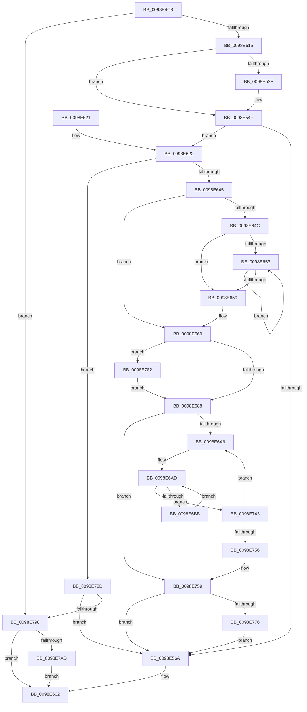

# PopEtProcessSnapshotCreate

- RVA: `0x0098E4C8`–`0x0098E7C8` (길이 `768` bytes)
- VA: `0x000000014098E4C8`
- 실행 섹션: `PAGE`
- PDB 이름 있음: `예`; PDB Function 태그: `아니요`
- unwind 정보 RVA: `0x0009891C`
- 디코드: `208`개 명령, `768/768` bytes 표시
- 미해석 바이트: `0` (있으면 어셈블리에 `.byte`로 보존)

> 이 문서는 커널 이미지의 기계어와 PDB 기호를 분석해 생성했습니다. 4번과 5번은 함수 원형과 자료형을 바이너리 사용 방식에서 추정한 C 해석이며 원본 소스 복구 결과는 아닙니다.

## 1. Dependencies

- 직접 호출 지점: **8**; 고유 호출 대상: **8**
- 직접 호출자로 확인된 함수: **1**
- RIP 상대 이미지 참조: **1**

### Outgoing calls
- `0x0098E501` → [ExAllocatePool2](../../poolcode/B8/ExAllocatePool2_function_00B820F0.md) (function, `0x00B820F0`)
- `0x0098E51D` → [memset](../../text/6C/memset_function_006C6C40.md) (function, `0x006C6C40`)
- `0x0098E531` → [PopEtAggregateKeyCopyFromProcess](PopEtAggregateKeyCopyFromProcess_function_0098D0D4.md) (function, `0x0098D0D4`)
- `0x0098E54A` → [RtlInternEntryDereference](RtlInternEntryDereference_function_0098DCB4.md) (function, `0x0098DCB4`)
- `0x0098E634` → [PopEtAllocate](PopEtAllocate_function_0098C8E0.md) (function, `0x0098C8E0`)
- `0x0098E778` → [PopEtBucketsFree](../76/PopEtBucketsFree_function_00769B24.md) (function, `0x00769B24`)
- `0x0098E7B1` → [PopEtAggregateKeyCleanup](PopEtAggregateKeyCleanup_function_0098D304.md) (function, `0x0098D304`)
- `0x0098E7BE` → [ExFreePoolWithTag](../../poolcode/B8/ExFreePoolWithTag_function_00B82870.md) (function, `0x00B82870`)

### Direct callers
- [PopEtProcessSnapshotUpdate](PopEtProcessSnapshotUpdate_function_0098D430.md) at `0x0098D4EA`

### Static image references
- `0x0098E53F` → RVA `0x00E67A30` (`.data`; read)

## 2. Other-region calls and transfers

- 다른 실행 섹션으로 향하는 call: **3**
  - `0x0098E501` → [ExAllocatePool2](../../poolcode/B8/ExAllocatePool2_function_00B820F0.md) (`PAGE` → `POOLCODE`)
  - `0x0098E51D` → [memset](../../text/6C/memset_function_006C6C40.md) (`PAGE` → `.text`)
  - `0x0098E7BE` → [ExFreePoolWithTag](../../poolcode/B8/ExFreePoolWithTag_function_00B82870.md) (`PAGE` → `POOLCODE`)
- 별도 외부 분기/꼬리 이동을 확인하지 못했습니다.

## 3. Assembly (complete function range)

```asm
0098E4C8  48 89 5C 24 10                  mov qword ptr [rsp + 0x10], rbx
0098E4CD  48 89 6C 24 18                  mov qword ptr [rsp + 0x18], rbp
0098E4D2  48 89 74 24 20                  mov qword ptr [rsp + 0x20], rsi
0098E4D7  57                              push rdi
0098E4D8  41 54                           push r12
0098E4DA  41 55                           push r13
0098E4DC  41 56                           push r14
0098E4DE  41 57                           push r15
0098E4E0  48 83 EC 20                     sub rsp, 0x20
0098E4E4  4C 8B 71 10                     mov r14, qword ptr [rcx + 0x10]
0098E4E8  4C 8B EA                        mov r13, rdx
0098E4EB  48 8B 79 08                     mov rdi, qword ptr [rcx + 8]
0098E4EF  BB F8 01 00 00                  mov ebx, 0x1f8
0098E4F4  8B D3                           mov edx, ebx
0098E4F6  41 B8 50 6F 45 54               mov r8d, 0x54456f50
0098E4FC  B9 00 01 00 00                  mov ecx, 0x100
0098E501  E8 EA 3B 1F 00                  call 0x140b820f0
0098E506  45 33 FF                        xor r15d, r15d
0098E509  48 8B F0                        mov rsi, rax
0098E50C  48 85 C0                        test rax, rax
0098E50F  0F 84 83 02 00 00               je 0x14098e798
0098E515  44 8B C3                        mov r8d, ebx
0098E518  33 D2                           xor edx, edx
0098E51A  48 8B C8                        mov rcx, rax
0098E51D  E8 1E 87 D3 FF                  call 0x1406c6c40
0098E522  4D 8D 46 20                     lea r8, [r14 + 0x20]
0098E526  48 89 7E 08                     mov qword ptr [rsi + 8], rdi
0098E52A  48 8D 4E 10                     lea rcx, [rsi + 0x10]
0098E52E  48 8B D7                        mov rdx, rdi
0098E531  E8 9E EB FF FF                  call 0x14098d0d4
0098E536  48 8B 56 18                     mov rdx, qword ptr [rsi + 0x18]
0098E53A  48 85 D2                        test rdx, rdx
0098E53D  74 10                           je 0x14098e54f
0098E53F  48 8B 0D EA 94 4D 00            mov rcx, qword ptr [rip + 0x4d94ea]
0098E546  48 83 C1 38                     add rcx, 0x38
0098E54A  E8 65 F7 FF FF                  call 0x14098dcb4
0098E54F  4C 89 7E 18                     mov qword ptr [rsi + 0x18], r15
0098E553  49 83 CC FF                     or r12, 0xffffffffffffffff
0098E557  41 8B 5E 44                     mov ebx, dword ptr [r14 + 0x44]
0098E55B  C1 EB 05                        shr ebx, 5
0098E55E  03 DB                           add ebx, ebx
0098E560  41 39 5E 40                     cmp dword ptr [r14 + 0x40], ebx
0098E564  0F 83 B8 00 00 00               jae 0x14098e622
0098E56A  41 8B 4E 44                     mov ecx, dword ptr [r14 + 0x44]
0098E56E  8B F9                           mov edi, ecx
0098E570  83 E1 1F                        and ecx, 0x1f
0098E573  C1 EF 05                        shr edi, 5
0098E576  49 D3 E4                        shl r12, cl
0098E579  4C 23 66 08                     and r12, qword ptr [rsi + 8]
0098E57D  4C 89 64 24 50                  mov qword ptr [rsp + 0x50], r12
0098E582  41 0F B6 C4                     movzx eax, r12b
0098E586  48 05 CB 5D B1 00               add rax, 0xb15dcb
0098E58C  49 89 75 00                     mov qword ptr [r13], rsi
0098E590  48 6B C8 25                     imul rcx, rax, 0x25
0098E594  0F B6 44 24 51                  movzx eax, byte ptr [rsp + 0x51]
0098E599  48 03 C8                        add rcx, rax
0098E59C  0F B6 44 24 52                  movzx eax, byte ptr [rsp + 0x52]
0098E5A1  48 6B D1 25                     imul rdx, rcx, 0x25
0098E5A5  48 03 D0                        add rdx, rax
0098E5A8  0F B6 44 24 53                  movzx eax, byte ptr [rsp + 0x53]
0098E5AD  48 6B CA 25                     imul rcx, rdx, 0x25
0098E5B1  48 03 C8                        add rcx, rax
0098E5B4  0F B6 44 24 54                  movzx eax, byte ptr [rsp + 0x54]
0098E5B9  48 6B D1 25                     imul rdx, rcx, 0x25
0098E5BD  48 03 D0                        add rdx, rax
0098E5C0  0F B6 44 24 55                  movzx eax, byte ptr [rsp + 0x55]
0098E5C5  48 6B CA 25                     imul rcx, rdx, 0x25
0098E5C9  48 03 C8                        add rcx, rax
0098E5CC  0F B6 44 24 56                  movzx eax, byte ptr [rsp + 0x56]
0098E5D1  48 6B D1 25                     imul rdx, rcx, 0x25
0098E5D5  48 03 D0                        add rdx, rax
0098E5D8  0F B6 44 24 57                  movzx eax, byte ptr [rsp + 0x57]
0098E5DD  48 6B CA 25                     imul rcx, rdx, 0x25
0098E5E1  8D 57 FF                        lea edx, [rdi - 1]
0098E5E4  41 8B FF                        mov edi, r15d
0098E5E7  48 03 C1                        add rax, rcx
0098E5EA  49 8B 4E 48                     mov rcx, qword ptr [r14 + 0x48]
0098E5EE  8B C0                           mov eax, eax
0098E5F0  48 23 D0                        and rdx, rax
0098E5F3  48 8B 04 D1                     mov rax, qword ptr [rcx + rdx*8]
0098E5F7  48 89 06                        mov qword ptr [rsi], rax
0098E5FA  48 89 34 D1                     mov qword ptr [rcx + rdx*8], rsi
0098E5FE  41 FF 46 40                     inc dword ptr [r14 + 0x40]
0098E602  48 8B 5C 24 58                  mov rbx, qword ptr [rsp + 0x58]
0098E607  8B C7                           mov eax, edi
0098E609  48 8B 6C 24 60                  mov rbp, qword ptr [rsp + 0x60]
0098E60E  48 8B 74 24 68                  mov rsi, qword ptr [rsp + 0x68]
0098E613  48 83 C4 20                     add rsp, 0x20
0098E617  41 5F                           pop r15
0098E619  41 5E                           pop r14
0098E61B  41 5D                           pop r13
0098E61D  41 5C                           pop r12
0098E61F  5F                              pop rdi
0098E620  C3                              ret
0098E621  CC                              int3
0098E622  B8 04 00 00 00                  mov eax, 4
0098E627  3B D8                           cmp ebx, eax
0098E629  0F 42 D8                        cmovb ebx, eax
0098E62C  33 D2                           xor edx, edx
0098E62E  8B CB                           mov ecx, ebx
0098E630  48 C1 E1 03                     shl rcx, 3
0098E634  E8 A7 E2 FF FF                  call 0x14098c8e0
0098E639  4C 8B C0                        mov r8, rax
0098E63C  48 85 C0                        test rax, rax
0098E63F  0F 84 48 01 00 00               je 0x14098e78d
0098E645  8D 4B FF                        lea ecx, [rbx - 1]
0098E648  85 CB                           test ebx, ecx
0098E64A  74 14                           je 0x14098e660
0098E64C  83 C9 FF                        or ecx, 0xffffffff
0098E64F  85 DB                           test ebx, ebx
0098E651  74 06                           je 0x14098e659
0098E653  FF C1                           inc ecx
0098E655  D1 EB                           shr ebx, 1
0098E657  75 FA                           jne 0x14098e653
0098E659  BB 01 00 00 00                  mov ebx, 1
0098E65E  D3 E3                           shl ebx, cl
0098E660  B8 00 00 00 04                  mov eax, 0x4000000
0098E665  3B D8                           cmp ebx, eax
0098E667  0F 47 D8                        cmova ebx, eax
0098E66A  49 8D 46 40                     lea rax, [r14 + 0x40]
0098E66E  48 83 C8 01                     or rax, 1
0098E672  8B CB                           mov ecx, ebx
0098E674  49 8D 14 D8                     lea rdx, [r8 + rbx*8]
0098E678  4C 3B C2                        cmp r8, rdx
0098E67B  49 0F 47 CF                     cmova rcx, r15
0098E67F  48 85 C9                        test rcx, rcx
0098E682  0F 85 FA 00 00 00               jne 0x14098e782
0098E688  41 8B 56 44                     mov edx, dword ptr [r14 + 0x44]
0098E68C  4D 8B D4                        mov r10, r12
0098E68F  8B CA                           mov ecx, edx
0098E691  41 8B FF                        mov edi, r15d
0098E694  83 E1 1F                        and ecx, 0x1f
0098E697  49 D3 E2                        shl r10, cl
0098E69A  F7 C2 E0 FF FF FF               test edx, 0xffffffe0
0098E6A0  0F 86 B3 00 00 00               jbe 0x14098e759
0098E6A6  4D 8B 7E 48                     mov r15, qword ptr [r14 + 0x48]
0098E6AA  44 8B DF                        mov r11d, edi
0098E6AD  4F 8B 0C DF                     mov r9, qword ptr [r15 + r11*8]
0098E6B1  41 F6 C1 01                     test r9b, 1
0098E6B5  0F 85 88 00 00 00               jne 0x14098e743
0098E6BB  49 8B 01                        mov rax, qword ptr [r9]
0098E6BE  4B 89 04 DF                     mov qword ptr [r15 + r11*8], rax
0098E6C2  49 8B 41 08                     mov rax, qword ptr [r9 + 8]
0098E6C6  49 23 C2                        and rax, r10
0098E6C9  48 89 44 24 50                  mov qword ptr [rsp + 0x50], rax
0098E6CE  0F B6 C0                        movzx eax, al
0098E6D1  48 05 CB 5D B1 00               add rax, 0xb15dcb
0098E6D7  48 6B C8 25                     imul rcx, rax, 0x25
0098E6DB  0F B6 44 24 51                  movzx eax, byte ptr [rsp + 0x51]
0098E6E0  48 03 C8                        add rcx, rax
0098E6E3  0F B6 44 24 52                  movzx eax, byte ptr [rsp + 0x52]
0098E6E8  48 6B D1 25                     imul rdx, rcx, 0x25
0098E6EC  48 03 D0                        add rdx, rax
0098E6EF  0F B6 44 24 53                  movzx eax, byte ptr [rsp + 0x53]
0098E6F4  48 6B CA 25                     imul rcx, rdx, 0x25
0098E6F8  48 03 C8                        add rcx, rax
0098E6FB  0F B6 44 24 54                  movzx eax, byte ptr [rsp + 0x54]
0098E700  48 6B D1 25                     imul rdx, rcx, 0x25
0098E704  48 03 D0                        add rdx, rax
0098E707  0F B6 44 24 55                  movzx eax, byte ptr [rsp + 0x55]
0098E70C  48 6B CA 25                     imul rcx, rdx, 0x25
0098E710  48 03 C8                        add rcx, rax
0098E713  0F B6 44 24 56                  movzx eax, byte ptr [rsp + 0x56]
0098E718  48 6B D1 25                     imul rdx, rcx, 0x25
0098E71C  48 03 D0                        add rdx, rax
0098E71F  0F B6 44 24 57                  movzx eax, byte ptr [rsp + 0x57]
0098E724  48 6B CA 25                     imul rcx, rdx, 0x25
0098E728  8D 53 FF                        lea edx, [rbx - 1]
0098E72B  48 03 C1                        add rax, rcx
0098E72E  8B C0                           mov eax, eax
0098E730  48 23 D0                        and rdx, rax
0098E733  49 8B 04 D0                     mov rax, qword ptr [r8 + rdx*8]
0098E737  49 89 01                        mov qword ptr [r9], rax
0098E73A  4D 89 0C D0                     mov qword ptr [r8 + rdx*8], r9
0098E73E  E9 6A FF FF FF                  jmp 0x14098e6ad
0098E743  41 8B 56 44                     mov edx, dword ptr [r14 + 0x44]
0098E747  FF C7                           inc edi
0098E749  8B C2                           mov eax, edx
0098E74B  C1 E8 05                        shr eax, 5
0098E74E  3B F8                           cmp edi, eax
0098E750  0F 82 50 FF FF FF               jb 0x14098e6a6
0098E756  45 33 FF                        xor r15d, r15d
0098E759  49 8B 4E 48                     mov rcx, qword ptr [r14 + 0x48]
0098E75D  83 E2 1F                        and edx, 0x1f
0098E760  C1 E3 05                        shl ebx, 5
0098E763  0B D3                           or edx, ebx
0098E765  4D 89 46 48                     mov qword ptr [r14 + 0x48], r8
0098E769  41 89 56 44                     mov dword ptr [r14 + 0x44], edx
0098E76D  48 85 C9                        test rcx, rcx
0098E770  0F 84 F4 FD FF FF               je 0x14098e56a
0098E776  33 D2                           xor edx, edx
0098E778  E8 A7 B3 DD FF                  call 0x140769b24
0098E77D  E9 E8 FD FF FF                  jmp 0x14098e56a
0098E782  49 8B F8                        mov rdi, r8
0098E785  F3 48 AB                        rep stosq qword ptr [rdi], rax
0098E788  E9 FB FE FF FF                  jmp 0x14098e688
0098E78D  41 83 7E 44 20                  cmp dword ptr [r14 + 0x44], 0x20
0098E792  0F 83 D2 FD FF FF               jae 0x14098e56a
0098E798  41 FF 86 6C 02 00 00            inc dword ptr [r14 + 0x26c]
0098E79F  BF 9A 00 00 C0                  mov edi, 0xc000009a
0098E7A4  48 85 F6                        test rsi, rsi
0098E7A7  0F 84 55 FE FF FF               je 0x14098e602
0098E7AD  48 8D 4E 10                     lea rcx, [rsi + 0x10]
0098E7B1  E8 4E EB FF FF                  call 0x14098d304
0098E7B6  BA 50 6F 45 54                  mov edx, 0x54456f50
0098E7BB  48 8B CE                        mov rcx, rsi
0098E7BE  E8 AD 40 1F 00                  call 0x140b82870
0098E7C3  E9 3A FE FF FF                  jmp 0x14098e602
```

## 4. C-style interpretation (structured pseudocode)

```c
__int64 __fastcall PopEtProcessSnapshotCreate(__int64 a1, __int64 a2)
{
    __int64 result;
    __int64 v_r10;
    __int64 v_r12;
    __int64 v_r15;
    __int64 v_rbx;
    __int64 v_rdi;
    __int64 v_rsp;
    unsigned __int64 v_stack_p10;
    unsigned __int64 v_stack_p18;
    unsigned __int64 v_stack_p20;
    unsigned __int64 v_stack_p50;
    unsigned __int8 v_stack_p51;
    unsigned __int8 v_stack_p52;
    unsigned __int8 v_stack_p53;
    unsigned __int8 v_stack_p54;
    unsigned __int8 v_stack_p55;
    unsigned __int8 v_stack_p56;
    unsigned __int8 v_stack_p57;
    unsigned __int64 v_stack_p8;
    unsigned __int8 v_stack_p9;
    unsigned __int8 v_stack_pA;
    unsigned __int8 v_stack_pB;
    unsigned __int8 v_stack_pC;
    unsigned __int8 v_stack_pD;
    unsigned __int8 v_stack_pE;
    unsigned __int8 v_stack_pF;

    v_stack_p10 = v_rbx;
    v_stack_p18 = v_rbp;
    v_stack_p20 = v_rsi;
    v_rsp = (v_rsp) - (32);
    result = ExAllocatePool2(256, 504, (unsigned int)(0x54456F50ULL), a4);
    v_r15 = 0;
    if (result == 0) goto loc_0098E798;
    a2 = 0;
    result = memset(result, a2, 504, a4);
    *(unsigned __int64 *)(result + 8) = *(unsigned __int64 *)(a1 + 8);
    result = PopEtAggregateKeyCopyFromProcess(result + 16, *(unsigned __int64 *)(a1 + 8), *(unsigned __int64 *)(a1 + 16) + 32, a4);
    if (*(unsigned __int64 *)(result + 24) != 0) {
        a1 = *(unsigned __int64 *)(v_rip + 5084394);
        a1 = (a1) + (56);
        result = RtlInternEntryDereference(a1, *(unsigned __int64 *)(result + 24), *(unsigned __int64 *)(a1 + 16) + 32, a4);
    }
    *(unsigned __int64 *)(result + 24) = 0;
    v_r12 = (v_r12) | (-1);
    v_rbx = (unsigned int)(((unsigned int)(*(unsigned int *)(*(unsigned __int64 *)(a1 + 16) + 68))) >> (5));
    v_rbx = (unsigned int)((v_rbx) + ((unsigned int)(v_rbx)));
    if ((*(unsigned int *)(*(unsigned __int64 *)(a1 + 16) + 64)) >= ((unsigned int)(v_rbx))) goto loc_0098E622;
loc_0098E56A:
    a1 = (unsigned int)(((unsigned int)(*(unsigned int *)(*(unsigned __int64 *)(a1 + 16) + 68))) & (31));
    v_rdi = (unsigned int)(((unsigned int)((unsigned int)((unsigned int)(*(unsigned int *)(*(unsigned __int64 *)(a1 + 16) + 68))))) >> (5));
    v_r12 = (v_r12) << ((unsigned __int8)(a1));
    v_r12 = (v_r12) & (*(unsigned __int64 *)(result + 8));
    v_stack_p8 = v_r12;
    result = ((unsigned __int8)(v_r12)) + (0xB15DCBULL);
    *(unsigned __int64 *)(a2) = result;
    a1 = (a1) * (result);
    a1 = (a1) + (v_stack_p9);
    a2 = (*(unsigned __int64 *)(result + 24)) * (a1);
    a2 = (a2) + (v_stack_pA);
    a1 = (a1) * (a2);
    a1 = (a1) + (v_stack_pB);
    a2 = (a2) * (a1);
    a2 = (a2) + (v_stack_pC);
    a1 = (a1) * (a2);
    a1 = (a1) + (v_stack_pD);
    a2 = (a2) * (a1);
    a2 = (a2) + (v_stack_pE);
    a1 = (a1) * (a2);
    result = (v_stack_pF) + (a1);
    a2 = (v_rdi - 1) & ((unsigned int)((unsigned int)(result)));
    *(unsigned __int64 *)(result) = *(unsigned __int64 *)(*(unsigned __int64 *)(*(unsigned __int64 *)(a1 + 16) + 72) + a2 * 8);
    *(unsigned __int64 *)(*(unsigned __int64 *)(*(unsigned __int64 *)(a1 + 16) + 72) + a2 * 8) = result;
loc_0098E602:
    v_rsp = (v_rsp) + (32);
    return 0;
loc_0098E622:
    v_rbx = v_stack_p10;
    if (((unsigned int)(v_stack_p10)) < 4) { v_rbx = 4; }
    a2 = 0;
    a1 = ((unsigned int)((unsigned int)(v_rbx))) << (3);
    result = PopEtAllocate(a1, a2, *(unsigned __int64 *)(a1 + 16) + 32, a4);
    if (result == 0) goto loc_0098E78D;
    if ((((unsigned int)(v_rbx)) & ((unsigned int)(v_rbx - 1))) == 0) goto loc_0098E660;
    a1 = (unsigned int)((v_rbx - 1) | (0xFFFFFFFFULL));
    if ((unsigned int)(v_rbx) == 0) goto loc_0098E659;
loc_0098E653:
    a1 = (unsigned int)((a1) + 1);
    v_rbx = (unsigned int)((v_rbx) >> (1));
    if (condition_is_not_equal) goto loc_0098E653;
loc_0098E659:
    v_rbx = (unsigned int)((1) << ((unsigned __int8)(a1)));
loc_0098E660:
    if (((unsigned int)(v_rbx)) > ((unsigned int)((unsigned int)(0x4000000ULL)))) { v_rbx = (unsigned int)((unsigned int)(0x4000000ULL)); }
    result = (*(unsigned __int64 *)(a1 + 16) + 64) | (1);
    a1 = (unsigned int)((unsigned int)(v_rbx));
    if (result > (result + v_rbx * 8)) { a1 = 0; }
    if (a1 != 0) goto loc_0098E782;
loc_0098E688:
    a1 = (unsigned int)(((unsigned int)((unsigned int)((unsigned int)(*(unsigned int *)(*(unsigned __int64 *)(a1 + 16) + 68))))) & (31));
    v_r10 = (v_r12) << ((unsigned __int8)(a1));
    if (condition_is_below_or_equal) goto loc_0098E759;
loc_0098E6A6:
loc_0098E6AD:
    if ((((unsigned __int8)(*(unsigned __int64 *)(*(unsigned __int64 *)(*(unsigned __int64 *)(a1 + 16) + 72) + 0 * 8))) & (1)) != 0) goto loc_0098E743;
    *(unsigned __int64 *)(*(unsigned __int64 *)(*(unsigned __int64 *)(a1 + 16) + 72) + 0 * 8) = *(unsigned __int64 *)(*(unsigned __int64 *)(*(unsigned __int64 *)(*(unsigned __int64 *)(a1 + 16) + 72) + 0 * 8));
    result = (*(unsigned __int64 *)(*(unsigned __int64 *)(*(unsigned __int64 *)(*(unsigned __int64 *)(a1 + 16) + 72) + 0 * 8) + 8)) & (v_r10);
    v_stack_p50 = result;
    result = ((unsigned __int8)(result)) + (0xB15DCBULL);
    a1 = (a1) * (result);
    a1 = (a1) + (v_stack_p51);
    a2 = ((unsigned int)(*(unsigned int *)(*(unsigned __int64 *)(a1 + 16) + 68))) * (a1);
    a2 = (a2) + (v_stack_p52);
    a1 = (a1) * (a2);
    a1 = (a1) + (v_stack_p53);
    a2 = (a2) * (a1);
    a2 = (a2) + (v_stack_p54);
    a1 = (a1) * (a2);
    a1 = (a1) + (v_stack_p55);
    a2 = (a2) * (a1);
    a2 = (a2) + (v_stack_p56);
    a1 = (a1) * (a2);
    result = (v_stack_p57) + (a1);
    a2 = (v_rbx - 1) & ((unsigned int)((unsigned int)(result)));
    *(unsigned __int64 *)(*(unsigned __int64 *)(*(unsigned __int64 *)(*(unsigned __int64 *)(a1 + 16) + 72) + 0 * 8)) = *(unsigned __int64 *)(result + a2 * 8);
    *(unsigned __int64 *)(result + a2 * 8) = *(unsigned __int64 *)(*(unsigned __int64 *)(*(unsigned __int64 *)(a1 + 16) + 72) + 0 * 8);
    goto loc_0098E6AD;
loc_0098E743:
    v_rdi = (unsigned int)((0) + 1);
    result = (unsigned int)(((unsigned int)((unsigned int)((unsigned int)(*(unsigned int *)(*(unsigned __int64 *)(a1 + 16) + 68))))) >> (5));
    if (((unsigned int)(v_rdi)) < ((unsigned int)(result))) goto loc_0098E6A6;
    v_r15 = 0;
loc_0098E759:
    a2 = (unsigned int)(((unsigned int)(*(unsigned int *)(*(unsigned __int64 *)(a1 + 16) + 68))) & (31));
    v_rbx = (unsigned int)((v_rbx) << (5));
    a2 = (unsigned int)((a2) | ((unsigned int)(v_rbx)));
    *(unsigned __int64 *)(*(unsigned __int64 *)(a1 + 16) + 72) = result;
    *(unsigned int *)(*(unsigned __int64 *)(a1 + 16) + 68) = (unsigned int)(a2);
    if (*(unsigned __int64 *)(*(unsigned __int64 *)(a1 + 16) + 72) == 0) goto loc_0098E56A;
    a2 = 0;
    result = PopEtBucketsFree(*(unsigned __int64 *)(*(unsigned __int64 *)(a1 + 16) + 72), a2, result, *(unsigned __int64 *)(*(unsigned __int64 *)(*(unsigned __int64 *)(a1 + 16) + 72) + 0 * 8));
    goto loc_0098E56A;
loc_0098E782:
    goto loc_0098E688;
loc_0098E78D:
    if ((*(unsigned int *)(*(unsigned __int64 *)(a1 + 16) + 68)) >= 32) goto loc_0098E56A;
loc_0098E798:
    if (v_stack_p20 == 0) goto loc_0098E602;
    result = PopEtAggregateKeyCleanup(v_stack_p20 + 16, a2, result, *(unsigned __int64 *)(*(unsigned __int64 *)(*(unsigned __int64 *)(a1 + 16) + 72) + 0 * 8));
    result = ExFreePoolWithTag(v_stack_p20, (unsigned int)(0x54456F50ULL), result, *(unsigned __int64 *)(*(unsigned __int64 *)(*(unsigned __int64 *)(a1 + 16) + 72) + 0 * 8));
    goto loc_0098E602;
}
```

## 5. (Beta) C Style

```c
int64_t PopEtProcessSnapshotCreate(void *Arg1, void *Arg2)
{
    uint8_t *arg1 = (uint8_t *)Arg1;
    uint8_t *arg2 = (uint8_t *)Arg2;

    int64_t result;
    int64_t local_r10;
    int64_t local_r12;
    int64_t local_r15;
    int64_t local_rbx;
    int64_t local_rdi;
    int64_t local_rsp;
    uint64_t v_stack_p10;
    uint64_t v_stack_p18;
    uint64_t v_stack_p20;
    uint64_t v_stack_p50;
    uint8_t v_stack_p51;
    uint8_t v_stack_p52;
    uint8_t v_stack_p53;
    uint8_t v_stack_p54;
    uint8_t v_stack_p55;
    uint8_t v_stack_p56;
    uint8_t v_stack_p57;
    uint64_t v_stack_p8;
    uint8_t v_stack_p9;
    uint8_t v_stack_pA;
    uint8_t v_stack_pB;
    uint8_t v_stack_pC;
    uint8_t v_stack_pD;
    uint8_t v_stack_pE;
    uint8_t v_stack_pF;

    v_stack_p10 = local_rbx;
    v_stack_p18 = local_rbp;
    v_stack_p20 = local_rsi;
    local_rsp = (local_rsp) - (32);
    result = ExAllocatePool2(256, 504, (uint32_t)(0x54456F50ULL), a4);
    local_r15 = 0;
    if (result == 0) goto loc_0098E798;
    Arg2 = 0;
    result = memset(result, Arg2, 504, a4);
    *(uint64_t *)(result + 0x8) = *(uint64_t *)(arg1 + 0x8);
    result = PopEtAggregateKeyCopyFromProcess(result + 16, *(uint64_t *)(arg1 + 0x8), *(uint64_t *)(arg1 + 0x10) + 32, a4);
    if (*(uint64_t *)(result + 0x18) != 0) {
        Arg1 = *(uint64_t *)(v_rip + 0x4D94EA);
        Arg1 = (Arg1) + (56);
        result = RtlInternEntryDereference(Arg1, *(uint64_t *)(result + 0x18), *(uint64_t *)(arg1 + 0x10) + 32, a4);
    }
    *(uint64_t *)(result + 0x18) = 0;
    local_r12 = (local_r12) | (-1);
    local_rbx = (uint32_t)(((uint32_t)(*(uint32_t *)(*(uint64_t *)(arg1 + 0x10) + 0x44))) >> (5));
    local_rbx = (uint32_t)((local_rbx) + ((uint32_t)(local_rbx)));
    if ((*(uint32_t *)(*(uint64_t *)(arg1 + 0x10) + 0x40)) >= ((uint32_t)(local_rbx))) goto loc_0098E622;
loc_0098E56A:
    Arg1 = (uint32_t)(((uint32_t)(*(uint32_t *)(*(uint64_t *)(arg1 + 0x10) + 0x44))) & (31));
    local_rdi = (uint32_t)(((uint32_t)((uint32_t)((uint32_t)(*(uint32_t *)(*(uint64_t *)(arg1 + 0x10) + 0x44))))) >> (5));
    local_r12 = (local_r12) << ((uint8_t)(Arg1));
    local_r12 = (local_r12) & (*(uint64_t *)(result + 0x8));
    v_stack_p8 = local_r12;
    result = ((uint8_t)(local_r12)) + (0xB15DCBULL);
    *(uint64_t *)(arg2) = result;
    Arg1 = (Arg1) * (result);
    Arg1 = (Arg1) + (v_stack_p9);
    Arg2 = (*(uint64_t *)(result + 0x18)) * (Arg1);
    Arg2 = (Arg2) + (v_stack_pA);
    Arg1 = (Arg1) * (Arg2);
    Arg1 = (Arg1) + (v_stack_pB);
    Arg2 = (Arg2) * (Arg1);
    Arg2 = (Arg2) + (v_stack_pC);
    Arg1 = (Arg1) * (Arg2);
    Arg1 = (Arg1) + (v_stack_pD);
    Arg2 = (Arg2) * (Arg1);
    Arg2 = (Arg2) + (v_stack_pE);
    Arg1 = (Arg1) * (Arg2);
    result = (v_stack_pF) + (Arg1);
    Arg2 = (local_rdi - 1) & ((uint32_t)((uint32_t)(result)));
    *(uint64_t *)(result) = *(uint64_t *)(*(uint64_t *)(*(uint64_t *)(arg1 + 0x10) + 0x48) + arg2 * 8);
    *(uint64_t *)(*(uint64_t *)(*(uint64_t *)(arg1 + 0x10) + 0x48) + arg2 * 8) = result;
loc_0098E602:
    local_rsp = (local_rsp) + (32);
    return 0;
loc_0098E622:
    local_rbx = v_stack_p10;
    if (((uint32_t)(v_stack_p10)) < 4) { local_rbx = 4; }
    Arg2 = 0;
    Arg1 = ((uint32_t)((uint32_t)(local_rbx))) << (3);
    result = PopEtAllocate(Arg1, Arg2, *(uint64_t *)(arg1 + 0x10) + 32, a4);
    if (result == 0) goto loc_0098E78D;
    if ((((uint32_t)(local_rbx)) & ((uint32_t)(local_rbx - 1))) == 0) goto loc_0098E660;
    Arg1 = (uint32_t)((local_rbx - 1) | (0xFFFFFFFFULL));
    if ((uint32_t)(local_rbx) == 0) goto loc_0098E659;
loc_0098E653:
    Arg1 = (uint32_t)((Arg1) + 1);
    local_rbx = (uint32_t)((local_rbx) >> (1));
    if (condition_is_not_equal) goto loc_0098E653;
loc_0098E659:
    local_rbx = (uint32_t)((1) << ((uint8_t)(Arg1)));
loc_0098E660:
    if (((uint32_t)(local_rbx)) > ((uint32_t)((uint32_t)(0x4000000ULL)))) { local_rbx = (uint32_t)((uint32_t)(0x4000000ULL)); }
    result = (*(uint64_t *)(arg1 + 0x10) + 64) | (1);
    Arg1 = (uint32_t)((uint32_t)(local_rbx));
    if (result > (result + local_rbx * 8)) { Arg1 = 0; }
    if (Arg1 != NULL) goto loc_0098E782;
loc_0098E688:
    Arg1 = (uint32_t)(((uint32_t)((uint32_t)((uint32_t)(*(uint32_t *)(*(uint64_t *)(arg1 + 0x10) + 0x44))))) & (31));
    local_r10 = (local_r12) << ((uint8_t)(Arg1));
    if (condition_is_below_or_equal) goto loc_0098E759;
loc_0098E6A6:
loc_0098E6AD:
    if ((((uint8_t)(*(uint64_t *)(*(uint64_t *)(*(uint64_t *)(arg1 + 0x10) + 0x48) + 0x0 * 8))) & (1)) != 0) goto loc_0098E743;
    *(uint64_t *)(*(uint64_t *)(*(uint64_t *)(arg1 + 0x10) + 0x48) + 0x0 * 8) = *(uint64_t *)(*(uint64_t *)(*(uint64_t *)(*(uint64_t *)(arg1 + 0x10) + 0x48) + 0x0 * 8));
    result = (*(uint64_t *)(*(uint64_t *)(*(uint64_t *)(*(uint64_t *)(arg1 + 0x10) + 0x48) + 0x0 * 8) + 0x8)) & (local_r10);
    v_stack_p50 = result;
    result = ((uint8_t)(result)) + (0xB15DCBULL);
    Arg1 = (Arg1) * (result);
    Arg1 = (Arg1) + (v_stack_p51);
    Arg2 = ((uint32_t)(*(uint32_t *)(*(uint64_t *)(arg1 + 0x10) + 0x44))) * (Arg1);
    Arg2 = (Arg2) + (v_stack_p52);
    Arg1 = (Arg1) * (Arg2);
    Arg1 = (Arg1) + (v_stack_p53);
    Arg2 = (Arg2) * (Arg1);
    Arg2 = (Arg2) + (v_stack_p54);
    Arg1 = (Arg1) * (Arg2);
    Arg1 = (Arg1) + (v_stack_p55);
    Arg2 = (Arg2) * (Arg1);
    Arg2 = (Arg2) + (v_stack_p56);
    Arg1 = (Arg1) * (Arg2);
    result = (v_stack_p57) + (Arg1);
    Arg2 = (local_rbx - 1) & ((uint32_t)((uint32_t)(result)));
    *(uint64_t *)(*(uint64_t *)(*(uint64_t *)(*(uint64_t *)(arg1 + 0x10) + 0x48) + 0x0 * 8)) = *(uint64_t *)(result + arg2 * 8);
    *(uint64_t *)(result + arg2 * 8) = *(uint64_t *)(*(uint64_t *)(*(uint64_t *)(arg1 + 0x10) + 0x48) + 0x0 * 8);
    goto loc_0098E6AD;
loc_0098E743:
    local_rdi = (uint32_t)((0) + 1);
    result = (uint32_t)(((uint32_t)((uint32_t)((uint32_t)(*(uint32_t *)(*(uint64_t *)(arg1 + 0x10) + 0x44))))) >> (5));
    if (((uint32_t)(local_rdi)) < ((uint32_t)(result))) goto loc_0098E6A6;
    local_r15 = 0;
loc_0098E759:
    Arg2 = (uint32_t)(((uint32_t)(*(uint32_t *)(*(uint64_t *)(arg1 + 0x10) + 0x44))) & (31));
    local_rbx = (uint32_t)((local_rbx) << (5));
    Arg2 = (uint32_t)((Arg2) | ((uint32_t)(local_rbx)));
    *(uint64_t *)(*(uint64_t *)(arg1 + 0x10) + 0x48) = result;
    *(uint32_t *)(*(uint64_t *)(arg1 + 0x10) + 0x44) = (uint32_t)(Arg2);
    if (*(uint64_t *)(*(uint64_t *)(arg1 + 0x10) + 0x48) == 0) goto loc_0098E56A;
    Arg2 = 0;
    result = PopEtBucketsFree(*(uint64_t *)(*(uint64_t *)(arg1 + 0x10) + 0x48), Arg2, result, *(uint64_t *)(*(uint64_t *)(*(uint64_t *)(arg1 + 0x10) + 0x48) + 0x0 * 8));
    goto loc_0098E56A;
loc_0098E782:
    goto loc_0098E688;
loc_0098E78D:
    if ((*(uint32_t *)(*(uint64_t *)(arg1 + 0x10) + 0x44)) >= 32) goto loc_0098E56A;
loc_0098E798:
    if (v_stack_p20 == 0) goto loc_0098E602;
    result = PopEtAggregateKeyCleanup(v_stack_p20 + 16, Arg2, result, *(uint64_t *)(*(uint64_t *)(*(uint64_t *)(arg1 + 0x10) + 0x48) + 0x0 * 8));
    result = ExFreePoolWithTag(v_stack_p20, (uint32_t)(0x54456F50ULL), result, *(uint64_t *)(*(uint64_t *)(*(uint64_t *)(arg1 + 0x10) + 0x48) + 0x0 * 8));
    goto loc_0098E602;
}
```

### 관측된 메모리 오프셋

구조체 형식이 확인되지 않은 접근은 인자 기준의 오프셋으로만 기록했습니다.

| 기준 인자 | 오프셋 표현 | 폭 (bit) | 접근 |
|---|---:|---:|---|
| `Arg1` | `+ 0x8` | `64` | `R` |
| `Arg1` | `+ 0x10` | `64` | `R` |
| `Arg2` | `+ 0x0` | `64` | `W` |

## 6. Execution-region graph

[열기: 2D/3D 그래프와 함수 탐색 컨트롤 패널](../../../control-panel.html?section=page&rva=0x0098E4C8&view=graph)

- 2D 그래프는 위에서 아래로 흐르고, 3D 그래프는 빈 공간을 드래그해 회전합니다. Shift+드래그는 이동, 휠은 확대·축소, 함수 노드 선택은 대상 보고서 이동입니다.

### Static fallback


