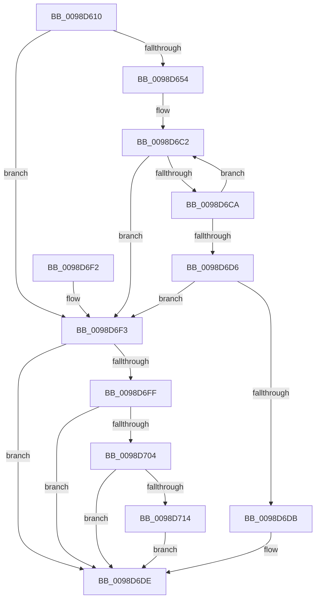

# PopEtProcessSnapshotFind

- RVA: `0x0098D610`–`0x0098D71D` (길이 `269` bytes)
- VA: `0x000000014098D610`
- 실행 섹션: `PAGE`
- PDB 이름 있음: `예`; PDB Function 태그: `아니요`
- unwind 정보 RVA: `0x00098844`
- 디코드: `74`개 명령, `269/269` bytes 표시
- 미해석 바이트: `0` (있으면 어셈블리에 `.byte`로 보존)

> 이 문서는 커널 이미지의 기계어와 PDB 기호를 분석해 생성했습니다. 4번과 5번은 함수 원형과 자료형을 바이너리 사용 방식에서 추정한 C 해석이며 원본 소스 복구 결과는 아닙니다.

## 1. Dependencies

- 직접 호출 지점: **0**; 고유 호출 대상: **0**
- 직접 호출자로 확인된 함수: **1**
- RIP 상대 이미지 참조: **0**

### Outgoing calls
- 직접 디코드된 call 명령이 없습니다.

### Direct callers
- [PopEtProcessSnapshotUpdate](PopEtProcessSnapshotUpdate_function_0098D430.md) at `0x0098D480`

### Static image references
- 디코드된 RIP-relative 메모리 참조가 없습니다.

## 2. Other-region calls and transfers

- 다른 실행 섹션으로 향하는 call: **0**
- 별도 외부 분기/꼬리 이동을 확인하지 못했습니다.

## 3. Assembly (complete function range)

```asm
0098D610  48 89 5C 24 10                  mov qword ptr [rsp + 0x10], rbx
0098D615  48 89 6C 24 18                  mov qword ptr [rsp + 0x18], rbp
0098D61A  48 89 74 24 20                  mov qword ptr [rsp + 0x20], rsi
0098D61F  57                              push rdi
0098D620  4C 8B 49 10                     mov r9, qword ptr [rcx + 0x10]
0098D624  48 8B F1                        mov rsi, rcx
0098D627  48 8B 69 08                     mov rbp, qword ptr [rcx + 8]
0098D62B  48 83 CF FF                     or rdi, 0xffffffffffffffff
0098D62F  45 33 D2                        xor r10d, r10d
0098D632  41 8B 59 44                     mov ebx, dword ptr [r9 + 0x44]
0098D636  8B CB                           mov ecx, ebx
0098D638  83 E1 1F                        and ecx, 0x1f
0098D63B  C1 EB 05                        shr ebx, 5
0098D63E  48 D3 E7                        shl rdi, cl
0098D641  4C 8B DF                        mov r11, rdi
0098D644  4C 23 DD                        and r11, rbp
0098D647  4C 89 5C 24 10                  mov qword ptr [rsp + 0x10], r11
0098D64C  85 DB                           test ebx, ebx
0098D64E  0F 84 9F 00 00 00               je 0x14098d6f3
0098D654  41 0F B6 C3                     movzx eax, r11b
0098D658  48 05 CB 5D B1 00               add rax, 0xb15dcb
0098D65E  48 6B C8 25                     imul rcx, rax, 0x25
0098D662  0F B6 44 24 11                  movzx eax, byte ptr [rsp + 0x11]
0098D667  48 03 C8                        add rcx, rax
0098D66A  0F B6 44 24 12                  movzx eax, byte ptr [rsp + 0x12]
0098D66F  48 6B D1 25                     imul rdx, rcx, 0x25
0098D673  48 03 D0                        add rdx, rax
0098D676  0F B6 44 24 13                  movzx eax, byte ptr [rsp + 0x13]
0098D67B  48 6B CA 25                     imul rcx, rdx, 0x25
0098D67F  48 03 C8                        add rcx, rax
0098D682  0F B6 44 24 14                  movzx eax, byte ptr [rsp + 0x14]
0098D687  48 6B D1 25                     imul rdx, rcx, 0x25
0098D68B  48 03 D0                        add rdx, rax
0098D68E  0F B6 44 24 15                  movzx eax, byte ptr [rsp + 0x15]
0098D693  48 6B CA 25                     imul rcx, rdx, 0x25
0098D697  48 03 C8                        add rcx, rax
0098D69A  0F B6 44 24 16                  movzx eax, byte ptr [rsp + 0x16]
0098D69F  48 6B D1 25                     imul rdx, rcx, 0x25
0098D6A3  8D 4B FF                        lea ecx, [rbx - 1]
0098D6A6  48 03 D0                        add rdx, rax
0098D6A9  0F B6 44 24 17                  movzx eax, byte ptr [rsp + 0x17]
0098D6AE  4C 6B C2 25                     imul r8, rdx, 0x25
0098D6B2  49 03 C0                        add rax, r8
0098D6B5  8B C0                           mov eax, eax
0098D6B7  48 23 C8                        and rcx, rax
0098D6BA  49 8B 41 48                     mov rax, qword ptr [r9 + 0x48]
0098D6BE  48 8D 14 C8                     lea rdx, [rax + rcx*8]
0098D6C2  48 8B 12                        mov rdx, qword ptr [rdx]
0098D6C5  F6 C2 01                        test dl, 1
0098D6C8  75 29                           jne 0x14098d6f3
0098D6CA  48 8B 42 08                     mov rax, qword ptr [rdx + 8]
0098D6CE  48 23 C7                        and rax, rdi
0098D6D1  4C 3B D8                        cmp r11, rax
0098D6D4  75 EC                           jne 0x14098d6c2
0098D6D6  48 85 D2                        test rdx, rdx
0098D6D9  74 18                           je 0x14098d6f3
0098D6DB  4C 8B D2                        mov r10, rdx
0098D6DE  48 8B 5C 24 18                  mov rbx, qword ptr [rsp + 0x18]
0098D6E3  49 8B C2                        mov rax, r10
0098D6E6  48 8B 6C 24 20                  mov rbp, qword ptr [rsp + 0x20]
0098D6EB  48 8B 74 24 28                  mov rsi, qword ptr [rsp + 0x28]
0098D6F0  5F                              pop rdi
0098D6F1  C3                              ret
0098D6F2  CC                              int3
0098D6F3  41 8B 89 84 02 00 00            mov ecx, dword ptr [r9 + 0x284]
0098D6FA  F6 C1 01                        test cl, 1
0098D6FD  75 DF                           jne 0x14098d6de
0098D6FF  83 3E 01                        cmp dword ptr [rsi], 1
0098D702  74 DA                           je 0x14098d6de
0098D704  48 8B 8D 68 06 00 00            mov rcx, qword ptr [rbp + 0x668]
0098D70B  83 B9 DC 01 00 00 01            cmp dword ptr [rcx + 0x1dc], 1
0098D712  76 CA                           jbe 0x14098d6de
0098D714  41 FF 81 68 02 00 00            inc dword ptr [r9 + 0x268]
0098D71B  EB C1                           jmp 0x14098d6de
```

## 4. C-style interpretation (structured pseudocode)

```c
__int64 __fastcall PopEtProcessSnapshotFind(__int64 a1)
{
    __int64 result;
    __int64 v_r10;
    __int64 v_r11;
    __int64 v_rbx;
    __int64 v_rdi;
    unsigned __int64 v_stack_p10;
    unsigned __int64 v_stack_p18;
    unsigned __int64 v_stack_p20;
    unsigned __int64 v_stack_p8;
    unsigned __int8 v_stack_p9;
    unsigned __int8 v_stack_pA;
    unsigned __int8 v_stack_pB;
    unsigned __int8 v_stack_pC;
    unsigned __int8 v_stack_pD;
    unsigned __int8 v_stack_pE;
    unsigned __int8 v_stack_pF;

    v_stack_p10 = v_rbx;
    v_stack_p18 = v_rbp;
    v_stack_p20 = v_rsi;
    v_rdi = (v_rdi) | (-1);
    v_r10 = 0;
    a1 = (unsigned int)(((unsigned int)((unsigned int)((unsigned int)(*(unsigned int *)(*(unsigned __int64 *)(a1 + 16) + 68))))) & (31));
    v_rbx = (unsigned int)(((unsigned int)(*(unsigned int *)(*(unsigned __int64 *)(a1 + 16) + 68))) >> (5));
    v_rdi = (v_rdi) << ((unsigned __int8)(a1));
    v_r11 = (v_rdi) & (*(unsigned __int64 *)(a1 + 8));
    v_stack_p8 = v_r11;
    if ((unsigned int)(v_rbx) == 0) goto loc_0098D6F3;
    result = ((unsigned __int8)(v_r11)) + (0xB15DCBULL);
    a1 = (a1) * (result);
    a1 = (a1) + (v_stack_p9);
    a2 = (a2) * (a1);
    a2 = (a2) + (v_stack_pA);
    a1 = (a1) * (a2);
    a1 = (a1) + (v_stack_pB);
    a2 = (a2) * (a1);
    a2 = (a2) + (v_stack_pC);
    a1 = (a1) * (a2);
    a1 = (a1) + (v_stack_pD);
    a2 = (a2) * (a1);
    a2 = (a2) + (v_stack_pE);
    a3 = (a3) * (a2);
    result = (v_stack_pF) + (a3);
    a1 = (v_rbx - 1) & ((unsigned int)((unsigned int)(result)));
loc_0098D6C2:
    if ((((unsigned __int8)(*(unsigned __int64 *)(*(unsigned __int64 *)(*(unsigned __int64 *)(a1 + 16) + 72) + a1 * 8))) & (1)) != 0) goto loc_0098D6F3;
    result = (*(unsigned __int64 *)(*(unsigned __int64 *)(*(unsigned __int64 *)(*(unsigned __int64 *)(a1 + 16) + 72) + a1 * 8) + 8)) & (v_rdi);
    if (v_r11 != result) goto loc_0098D6C2;
    if (*(unsigned __int64 *)(*(unsigned __int64 *)(*(unsigned __int64 *)(a1 + 16) + 72) + a1 * 8) == 0) goto loc_0098D6F3;
loc_0098D6DE:
    return *(unsigned __int64 *)(*(unsigned __int64 *)(*(unsigned __int64 *)(a1 + 16) + 72) + a1 * 8);
loc_0098D6F3:
    if ((((unsigned __int8)((unsigned int)(*(unsigned int *)(*(unsigned __int64 *)(a1 + 16) + 644)))) & (1)) != 0) goto loc_0098D6DE;
    if ((*(unsigned int *)(v_stack_p20)) == 1) goto loc_0098D6DE;
    if ((*(unsigned int *)(*(unsigned __int64 *)(v_stack_p18 + 1640) + 476)) <= 1) goto loc_0098D6DE;
    goto loc_0098D6DE;
}
```

## 5. (Beta) C Style

```c
int64_t PopEtProcessSnapshotFind(void *Arg1)
{
    uint8_t *arg1 = (uint8_t *)Arg1;

    int64_t result;
    int64_t local_r10;
    int64_t local_r11;
    int64_t local_rbx;
    int64_t local_rdi;
    uint64_t v_stack_p10;
    uint64_t v_stack_p18;
    uint64_t v_stack_p20;
    uint64_t v_stack_p8;
    uint8_t v_stack_p9;
    uint8_t v_stack_pA;
    uint8_t v_stack_pB;
    uint8_t v_stack_pC;
    uint8_t v_stack_pD;
    uint8_t v_stack_pE;
    uint8_t v_stack_pF;

    v_stack_p10 = local_rbx;
    v_stack_p18 = local_rbp;
    v_stack_p20 = local_rsi;
    local_rdi = (local_rdi) | (-1);
    local_r10 = 0;
    Arg1 = (uint32_t)(((uint32_t)((uint32_t)((uint32_t)(*(uint32_t *)(*(uint64_t *)(arg1 + 0x10) + 0x44))))) & (31));
    local_rbx = (uint32_t)(((uint32_t)(*(uint32_t *)(*(uint64_t *)(arg1 + 0x10) + 0x44))) >> (5));
    local_rdi = (local_rdi) << ((uint8_t)(Arg1));
    local_r11 = (local_rdi) & (*(uint64_t *)(arg1 + 0x8));
    v_stack_p8 = local_r11;
    if ((uint32_t)(local_rbx) == 0) goto loc_0098D6F3;
    result = ((uint8_t)(local_r11)) + (0xB15DCBULL);
    Arg1 = (Arg1) * (result);
    Arg1 = (Arg1) + (v_stack_p9);
    a2 = (a2) * (Arg1);
    a2 = (a2) + (v_stack_pA);
    Arg1 = (Arg1) * (a2);
    Arg1 = (Arg1) + (v_stack_pB);
    a2 = (a2) * (Arg1);
    a2 = (a2) + (v_stack_pC);
    Arg1 = (Arg1) * (a2);
    Arg1 = (Arg1) + (v_stack_pD);
    a2 = (a2) * (Arg1);
    a2 = (a2) + (v_stack_pE);
    a3 = (a3) * (a2);
    result = (v_stack_pF) + (a3);
    Arg1 = (local_rbx - 1) & ((uint32_t)((uint32_t)(result)));
loc_0098D6C2:
    if ((((uint8_t)(*(uint64_t *)(*(uint64_t *)(*(uint64_t *)(arg1 + 0x10) + 0x48) + arg1 * 8))) & (1)) != 0) goto loc_0098D6F3;
    result = (*(uint64_t *)(*(uint64_t *)(*(uint64_t *)(*(uint64_t *)(arg1 + 0x10) + 0x48) + arg1 * 8) + 0x8)) & (local_rdi);
    if (local_r11 != result) goto loc_0098D6C2;
    if (*(uint64_t *)(*(uint64_t *)(*(uint64_t *)(arg1 + 0x10) + 0x48) + arg1 * 8) == 0) goto loc_0098D6F3;
loc_0098D6DE:
    return *(uint64_t *)(*(uint64_t *)(*(uint64_t *)(arg1 + 0x10) + 0x48) + arg1 * 8);
loc_0098D6F3:
    if ((((uint8_t)((uint32_t)(*(uint32_t *)(*(uint64_t *)(arg1 + 0x10) + 0x284)))) & (1)) != 0) goto loc_0098D6DE;
    if ((*(uint32_t *)(v_stack_p20)) == 1) goto loc_0098D6DE;
    if ((*(uint32_t *)(*(uint64_t *)(v_stack_p18 + 0x668) + 0x1DC)) <= 1) goto loc_0098D6DE;
    goto loc_0098D6DE;
}
```

### 관측된 메모리 오프셋

구조체 형식이 확인되지 않은 접근은 인자 기준의 오프셋으로만 기록했습니다.

| 기준 인자 | 오프셋 표현 | 폭 (bit) | 접근 |
|---|---:|---:|---|
| `Arg1` | `+ 0x0` | `32` | `R` |
| `Arg1` | `+ 0x8` | `64` | `R` |
| `Arg1` | `+ 0x10` | `64` | `R` |

## 6. Execution-region graph

[열기: 2D/3D 그래프와 함수 탐색 컨트롤 패널](../../../control-panel.html?section=page&rva=0x0098D610&view=graph)

- 2D 그래프는 위에서 아래로 흐르고, 3D 그래프는 빈 공간을 드래그해 회전합니다. Shift+드래그는 이동, 휠은 확대·축소, 함수 노드 선택은 대상 보고서 이동입니다.

### Static fallback


