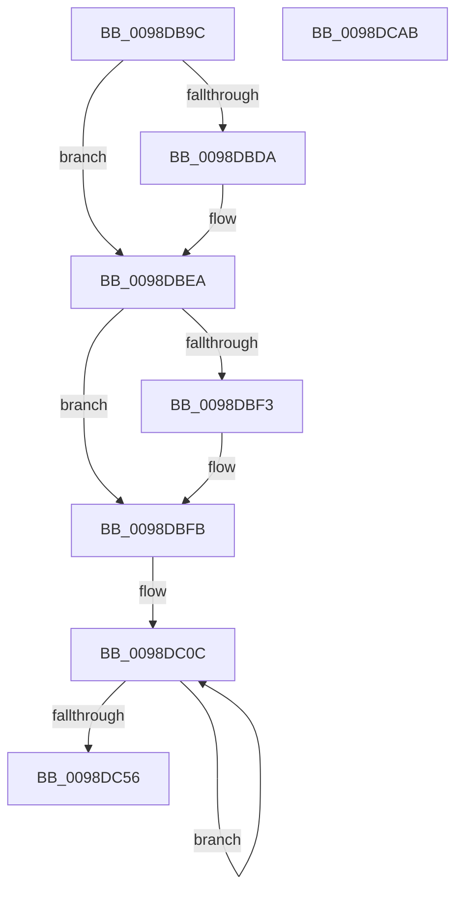

# PopEtProcessSnapshotUpdateFromSnapshotContext

- RVA: `0x0098DB9C`–`0x0098DCAC` (길이 `272` bytes)
- VA: `0x000000014098DB9C`
- 실행 섹션: `PAGE`
- PDB 이름 있음: `예`; PDB Function 태그: `아니요`
- unwind 정보 RVA: `0x0005E6B4`
- 디코드: `69`개 명령, `272/272` bytes 표시
- 미해석 바이트: `0` (있으면 어셈블리에 `.byte`로 보존)

> 이 문서는 커널 이미지의 기계어와 PDB 기호를 분석해 생성했습니다. 4번과 5번은 함수 원형과 자료형을 바이너리 사용 방식에서 추정한 C 해석이며 원본 소스 복구 결과는 아닙니다.

## 1. Dependencies

- 직접 호출 지점: **2**; 고유 호출 대상: **2**
- 직접 호출자로 확인된 함수: **1**
- RIP 상대 이미지 참조: **1**

### Outgoing calls
- `0x0098DBE5` → [RtlInternEntryDereference](RtlInternEntryDereference_function_0098DCB4.md) (function, `0x0098DCB4`)
- `0x0098DBF6` → [PopEtStringReference](PopEtStringReference_function_0098DE50.md) (function, `0x0098DE50`)

### Direct callers
- [PopEtProcessSnapshotUpdate](PopEtProcessSnapshotUpdate_function_0098D430.md) at `0x0098D4B1`

### Static image references
- `0x0098DBDA` → RVA `0x00E67A30` (`.data`; read)

## 2. Other-region calls and transfers

- 다른 실행 섹션으로 향하는 call: **0**
- 별도 외부 분기/꼬리 이동을 확인하지 못했습니다.

## 3. Assembly (complete function range)

```asm
0098DB9C  48 8B C4                        mov rax, rsp
0098DB9F  48 89 58 08                     mov qword ptr [rax + 8], rbx
0098DBA3  48 89 68 10                     mov qword ptr [rax + 0x10], rbp
0098DBA7  48 89 70 18                     mov qword ptr [rax + 0x18], rsi
0098DBAB  48 89 78 20                     mov qword ptr [rax + 0x20], rdi
0098DBAF  41 56                           push r14
0098DBB1  48 83 EC 20                     sub rsp, 0x20
0098DBB5  48 8B 42 08                     mov rax, qword ptr [rdx + 8]
0098DBB9  48 8B F2                        mov rsi, rdx
0098DBBC  4C 8B 72 10                     mov r14, qword ptr [rdx + 0x10]
0098DBC0  48 8B D9                        mov rbx, rcx
0098DBC3  48 8B 51 18                     mov rdx, qword ptr [rcx + 0x18]
0098DBC7  48 8B A8 68 06 00 00            mov rbp, qword ptr [rax + 0x668]
0098DBCE  48 8B BD D0 01 00 00            mov rdi, qword ptr [rbp + 0x1d0]
0098DBD5  48 85 D2                        test rdx, rdx
0098DBD8  74 10                           je 0x14098dbea
0098DBDA  48 8B 0D 4F 9E 4D 00            mov rcx, qword ptr [rip + 0x4d9e4f]
0098DBE1  48 83 C1 38                     add rcx, 0x38
0098DBE5  E8 CA 00 00 00                  call 0x14098dcb4
0098DBEA  48 89 7B 18                     mov qword ptr [rbx + 0x18], rdi
0098DBEE  48 85 FF                        test rdi, rdi
0098DBF1  74 08                           je 0x14098dbfb
0098DBF3  48 8B CF                        mov rcx, rdi
0098DBF6  E8 55 02 00 00                  call 0x14098de50
0098DBFB  48 8B 46 18                     mov rax, qword ptr [rsi + 0x18]
0098DBFF  48 8D 4B 30                     lea rcx, [rbx + 0x30]
0098DC03  BA 03 00 00 00                  mov edx, 3
0098DC08  44 8D 42 7D                     lea r8d, [rdx + 0x7d]
0098DC0C  0F 10 00                        movups xmm0, xmmword ptr [rax]
0098DC0F  0F 11 01                        movups xmmword ptr [rcx], xmm0
0098DC12  0F 10 48 10                     movups xmm1, xmmword ptr [rax + 0x10]
0098DC16  0F 11 49 10                     movups xmmword ptr [rcx + 0x10], xmm1
0098DC1A  0F 10 40 20                     movups xmm0, xmmword ptr [rax + 0x20]
0098DC1E  0F 11 41 20                     movups xmmword ptr [rcx + 0x20], xmm0
0098DC22  0F 10 48 30                     movups xmm1, xmmword ptr [rax + 0x30]
0098DC26  0F 11 49 30                     movups xmmword ptr [rcx + 0x30], xmm1
0098DC2A  0F 10 40 40                     movups xmm0, xmmword ptr [rax + 0x40]
0098DC2E  0F 11 41 40                     movups xmmword ptr [rcx + 0x40], xmm0
0098DC32  0F 10 48 50                     movups xmm1, xmmword ptr [rax + 0x50]
0098DC36  0F 11 49 50                     movups xmmword ptr [rcx + 0x50], xmm1
0098DC3A  0F 10 40 60                     movups xmm0, xmmword ptr [rax + 0x60]
0098DC3E  0F 11 41 60                     movups xmmword ptr [rcx + 0x60], xmm0
0098DC42  49 03 C8                        add rcx, r8
0098DC45  0F 10 48 70                     movups xmm1, xmmword ptr [rax + 0x70]
0098DC49  49 03 C0                        add rax, r8
0098DC4C  0F 11 49 F0                     movups xmmword ptr [rcx - 0x10], xmm1
0098DC50  48 83 EA 01                     sub rdx, 1
0098DC54  75 B6                           jne 0x14098dc0c
0098DC56  0F 10 00                        movups xmm0, xmmword ptr [rax]
0098DC59  48 8B 74 24 40                  mov rsi, qword ptr [rsp + 0x40]
0098DC5E  48 8B 7C 24 48                  mov rdi, qword ptr [rsp + 0x48]
0098DC63  0F 11 01                        movups xmmword ptr [rcx], xmm0
0098DC66  0F 10 48 10                     movups xmm1, xmmword ptr [rax + 0x10]
0098DC6A  0F 11 49 10                     movups xmmword ptr [rcx + 0x10], xmm1
0098DC6E  0F 10 40 20                     movups xmm0, xmmword ptr [rax + 0x20]
0098DC72  0F 11 41 20                     movups xmmword ptr [rcx + 0x20], xmm0
0098DC76  48 8B 40 30                     mov rax, qword ptr [rax + 0x30]
0098DC7A  48 89 41 30                     mov qword ptr [rcx + 0x30], rax
0098DC7E  8B 85 DC 01 00 00               mov eax, dword ptr [rbp + 0x1dc]
0098DC84  89 83 E8 01 00 00               mov dword ptr [rbx + 0x1e8], eax
0098DC8A  0F B7 85 D8 01 00 00            movzx eax, word ptr [rbp + 0x1d8]
0098DC91  66 41 23 46 24                  and ax, word ptr [r14 + 0x24]
0098DC96  48 8B 6C 24 38                  mov rbp, qword ptr [rsp + 0x38]
0098DC9B  66 89 43 2C                     mov word ptr [rbx + 0x2c], ax
0098DC9F  48 8B 5C 24 30                  mov rbx, qword ptr [rsp + 0x30]
0098DCA4  48 83 C4 20                     add rsp, 0x20
0098DCA8  41 5E                           pop r14
0098DCAA  C3                              ret
0098DCAB  CC                              int3
```

## 4. C-style interpretation (structured pseudocode)

```c
__int64 __fastcall PopEtProcessSnapshotUpdateFromSnapshotContext(__int64 a1, __int64 a2)
{
    __int64 result;
    __int64 v_rsp;
    unsigned __int64 v_stack_p10;
    unsigned __int64 v_stack_p18;
    unsigned __int64 v_stack_p20;
    unsigned __int64 v_stack_p8;

    *(unsigned __int64 *)(v_rsp + 8) = v_rbx;
    *(unsigned __int64 *)(v_rsp + 16) = v_rbp;
    *(unsigned __int64 *)(v_rsp + 24) = v_rsi;
    *(unsigned __int64 *)(v_rsp + 32) = v_rdi;
    v_rsp = (v_rsp) - (32);
    result = *(unsigned __int64 *)(a2 + 8);
    if (*(unsigned __int64 *)(a1 + 24) != 0) {
        a1 = *(unsigned __int64 *)(v_rip + 5086799);
        a1 = (a1) + (56);
        result = RtlInternEntryDereference(a1, *(unsigned __int64 *)(a1 + 24), a3, a4);
    }
    *(unsigned __int64 *)(a1 + 24) = *(unsigned __int64 *)(*(unsigned __int64 *)(*(unsigned __int64 *)(a2 + 8) + 1640) + 464);
    if (*(unsigned __int64 *)(*(unsigned __int64 *)(*(unsigned __int64 *)(a2 + 8) + 1640) + 464) != 0) {
        a1 = *(unsigned __int64 *)(*(unsigned __int64 *)(*(unsigned __int64 *)(a2 + 8) + 1640) + 464);
        result = PopEtStringReference(a1, *(unsigned __int64 *)(a1 + 24), a3, a4);
    }
loc_0098DC0C:
    *(unsigned __int64 *)(a1 + 48) = v_xmm0;
    *(unsigned __int64 *)(a1 + 48 + 16) = v_xmm1;
    *(unsigned __int64 *)(a1 + 48 + 32) = v_xmm0;
    *(unsigned __int64 *)(a1 + 48 + 48) = v_xmm1;
    *(unsigned __int64 *)(a1 + 48 + 64) = v_xmm0;
    *(unsigned __int64 *)(a1 + 48 + 80) = v_xmm1;
    *(unsigned __int64 *)(a1 + 48 + 96) = v_xmm0;
    a1 = (a1 + 48) + (3 + 125);
    result = (*(unsigned __int64 *)(a2 + 24)) + (3 + 125);
    *(unsigned __int64 *)(a1 - 16) = v_xmm1;
    a2 = (3) - (1);
    if (condition_is_not_equal) goto loc_0098DC0C;
    *(unsigned __int64 *)(a1) = v_xmm0;
    *(unsigned __int64 *)(a1 + 16) = v_xmm1;
    *(unsigned __int64 *)(a1 + 32) = v_xmm0;
    *(unsigned __int64 *)(a1 + 48) = *(unsigned __int64 *)(result + 48);
    *(unsigned int *)(a1 + 488) = (unsigned int)((unsigned int)(*(unsigned int *)(*(unsigned __int64 *)(*(unsigned __int64 *)(a2 + 8) + 1640) + 476)));
    result = (unsigned __int16)((*(unsigned __int16 *)(*(unsigned __int64 *)(*(unsigned __int64 *)(a2 + 8) + 1640) + 472)) & (*(unsigned __int16 *)(*(unsigned __int64 *)(a2 + 16) + 36)));
    *(unsigned __int16 *)(a1 + 44) = (unsigned __int16)(result);
    v_rsp = (v_rsp) + (32);
    return result;
}
```

## 5. (Beta) C Style

```c
int64_t PopEtProcessSnapshotUpdateFromSnapshotContext(void *Arg1, void *Arg2)
{
    uint8_t *arg1 = (uint8_t *)Arg1;
    uint8_t *arg2 = (uint8_t *)Arg2;

    int64_t result;
    int64_t local_rsp;
    uint64_t v_stack_p10;
    uint64_t v_stack_p18;
    uint64_t v_stack_p20;
    uint64_t v_stack_p8;

    *(uint64_t *)(local_rsp + 0x8) = local_rbx;
    *(uint64_t *)(local_rsp + 0x10) = local_rbp;
    *(uint64_t *)(local_rsp + 0x18) = local_rsi;
    *(uint64_t *)(local_rsp + 0x20) = local_rdi;
    local_rsp = (local_rsp) - (32);
    result = *(uint64_t *)(arg2 + 0x8);
    if (*(uint64_t *)(arg1 + 0x18) != 0) {
        Arg1 = *(uint64_t *)(v_rip + 0x4D9E4F);
        Arg1 = (Arg1) + (56);
        result = RtlInternEntryDereference(Arg1, *(uint64_t *)(arg1 + 0x18), a3, a4);
    }
    *(uint64_t *)(arg1 + 0x18) = *(uint64_t *)(*(uint64_t *)(*(uint64_t *)(arg2 + 0x8) + 0x668) + 0x1D0);
    if (*(uint64_t *)(*(uint64_t *)(*(uint64_t *)(arg2 + 0x8) + 0x668) + 0x1D0) != 0) {
        Arg1 = *(uint64_t *)(*(uint64_t *)(*(uint64_t *)(arg2 + 0x8) + 0x668) + 0x1D0);
        result = PopEtStringReference(Arg1, *(uint64_t *)(arg1 + 0x18), a3, a4);
    }
loc_0098DC0C:
    *(uint64_t *)(arg1 + 0x30) = v_xmm0;
    *(uint64_t *)(arg1 + 0x30 + 0x10) = v_xmm1;
    *(uint64_t *)(arg1 + 0x30 + 0x20) = v_xmm0;
    *(uint64_t *)(arg1 + 0x30 + 0x30) = v_xmm1;
    *(uint64_t *)(arg1 + 0x30 + 0x40) = v_xmm0;
    *(uint64_t *)(arg1 + 0x30 + 0x50) = v_xmm1;
    *(uint64_t *)(arg1 + 0x30 + 0x60) = v_xmm0;
    Arg1 = (Arg1 + 48) + (3 + 125);
    result = (*(uint64_t *)(arg2 + 0x18)) + (3 + 125);
    *(uint64_t *)(arg1 - 0x10) = v_xmm1;
    Arg2 = (3) - (1);
    if (condition_is_not_equal) goto loc_0098DC0C;
    *(uint64_t *)(arg1) = v_xmm0;
    *(uint64_t *)(arg1 + 0x10) = v_xmm1;
    *(uint64_t *)(arg1 + 0x20) = v_xmm0;
    *(uint64_t *)(arg1 + 0x30) = *(uint64_t *)(result + 0x30);
    *(uint32_t *)(arg1 + 0x1E8) = (uint32_t)((uint32_t)(*(uint32_t *)(*(uint64_t *)(*(uint64_t *)(arg2 + 0x8) + 0x668) + 0x1DC)));
    result = (uint16_t)((*(uint16_t *)(*(uint64_t *)(*(uint64_t *)(arg2 + 0x8) + 0x668) + 0x1D8)) & (*(uint16_t *)(*(uint64_t *)(arg2 + 0x10) + 0x24)));
    *(uint16_t *)(arg1 + 0x2C) = (uint16_t)(result);
    local_rsp = (local_rsp) + (32);
    return result;
}
```

### 관측된 메모리 오프셋

구조체 형식이 확인되지 않은 접근은 인자 기준의 오프셋으로만 기록했습니다.

| 기준 인자 | 오프셋 표현 | 폭 (bit) | 접근 |
|---|---:|---:|---|
| `Arg1` | `- 0x10` | `128` | `R` |
| `Arg1` | `+ 0x0` | `128` | `R` |
| `Arg1` | `+ 0x10` | `128` | `R` |
| `Arg1` | `+ 0x18` | `64` | `R` |
| `Arg1` | `+ 0x18` | `64` | `W` |
| `Arg1` | `+ 0x20` | `128` | `R` |
| `Arg1` | `+ 0x2C` | `16` | `W` |
| `Arg1` | `+ 0x30` | `64` | `R` |
| `Arg1` | `+ 0x30` | `64` | `W` |
| `Arg1` | `+ 0x30` | `128` | `R` |
| `Arg1` | `+ 0x40` | `128` | `R` |
| `Arg1` | `+ 0x50` | `128` | `R` |
| `Arg1` | `+ 0x60` | `128` | `R` |
| `Arg1` | `+ 0x1E8` | `32` | `W` |
| `Arg2` | `+ 0x8` | `64` | `R` |
| `Arg2` | `+ 0x10` | `64` | `R` |
| `Arg2` | `+ 0x18` | `64` | `R` |

## 6. Execution-region graph

[열기: 2D/3D 그래프와 함수 탐색 컨트롤 패널](../../../control-panel.html?section=page&rva=0x0098DB9C&view=graph)

- 2D 그래프는 위에서 아래로 흐르고, 3D 그래프는 빈 공간을 드래그해 회전합니다. Shift+드래그는 이동, 휠은 확대·축소, 함수 노드 선택은 대상 보고서 이동입니다.

### Static fallback


