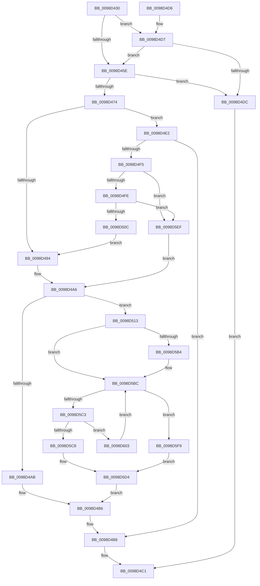

# PopEtProcessSnapshotUpdate

- RVA: `0x0098D430`–`0x0098D608` (길이 `472` bytes)
- VA: `0x000000014098D430`
- 실행 섹션: `PAGE`
- PDB 이름 있음: `예`; PDB Function 태그: `아니요`
- unwind 정보 RVA: `0x0009882C`
- 디코드: `130`개 명령, `472/472` bytes 표시
- 미해석 바이트: `0` (있으면 어셈블리에 `.byte`로 보존)

> 이 문서는 커널 이미지의 기계어와 PDB 기호를 분석해 생성했습니다. 4번과 5번은 함수 원형과 자료형을 바이너리 사용 방식에서 추정한 C 해석이며 원본 소스 복구 결과는 아닙니다.

## 1. Dependencies

- 직접 호출 지점: **8**; 고유 호출 대상: **8**
- 직접 호출자로 확인된 함수: **2**
- RIP 상대 이미지 참조: **1**

### Outgoing calls
- `0x0098D478` → [PopAcquireRwLockExclusive](../../text/43/PopAcquireRwLockExclusive_function_00430B44.md) (function, `0x00430B44`)
- `0x0098D480` → [PopEtProcessSnapshotFind](PopEtProcessSnapshotFind_function_0098D610.md) (function, `0x0098D610`)
- `0x0098D4A1` → [PopEtEnergyTrackerUpdateAggregate](PopEtEnergyTrackerUpdateAggregate_function_0098D724.md) (function, `0x0098D724`)
- `0x0098D4B1` → [PopEtProcessSnapshotUpdateFromSnapshotContext](PopEtProcessSnapshotUpdateFromSnapshotContext_function_0098DB9C.md) (function, `0x0098DB9C`)
- `0x0098D4BC` → [PopReleaseRwLock](../../text/2D/PopReleaseRwLock_function_002DFBBC.md) (function, `0x002DFBBC`)
- `0x0098D4EA` → [PopEtProcessSnapshotCreate](PopEtProcessSnapshotCreate_function_0098E4C8.md) (function, `0x0098E4C8`)
- `0x0098D5D8` → [PopEtAggregateKeyCleanup](PopEtAggregateKeyCleanup_function_0098D304.md) (function, `0x0098D304`)
- `0x0098D5E5` → [ExFreePoolWithTag](../../poolcode/B8/ExFreePoolWithTag_function_00B82870.md) (function, `0x00B82870`)

### Direct callers
- [PopEtProcessEnumSnapshotCallback](../91/PopEtProcessEnumSnapshotCallback_function_0091CCA0.md) at `0x0091CD6A`
- [PopEtEnergyTrackerEnumSnapshotCallback](PopEtEnergyTrackerEnumSnapshotCallback_function_0098D1AC.md) at `0x0098D1BC`

### Static image references
- `0x0098D45E` → RVA `0x00E67A30` (`.data`; read)

## 2. Other-region calls and transfers

- 다른 실행 섹션으로 향하는 call: **3**
  - `0x0098D478` → [PopAcquireRwLockExclusive](../../text/43/PopAcquireRwLockExclusive_function_00430B44.md) (`PAGE` → `.text`)
  - `0x0098D4BC` → [PopReleaseRwLock](../../text/2D/PopReleaseRwLock_function_002DFBBC.md) (`PAGE` → `.text`)
  - `0x0098D5E5` → [ExFreePoolWithTag](../../poolcode/B8/ExFreePoolWithTag_function_00B82870.md) (`PAGE` → `POOLCODE`)
- 별도 외부 분기/꼬리 이동을 확인하지 못했습니다.

## 3. Assembly (complete function range)

```asm
0098D430  48 89 5C 24 18                  mov qword ptr [rsp + 0x18], rbx
0098D435  48 89 6C 24 20                  mov qword ptr [rsp + 0x20], rbp
0098D43A  56                              push rsi
0098D43B  57                              push rdi
0098D43C  41 56                           push r14
0098D43E  48 83 EC 20                     sub rsp, 0x20
0098D442  48 8B 41 08                     mov rax, qword ptr [rcx + 8]
0098D446  48 8B F9                        mov rdi, rcx
0098D449  48 8B 69 10                     mov rbp, qword ptr [rcx + 0x10]
0098D44D  4C 8B B0 68 06 00 00            mov r14, qword ptr [rax + 0x668]
0098D454  8B 80 F4 01 00 00               mov eax, dword ptr [rax + 0x1f4]
0098D45A  A8 04                           test al, 4
0098D45C  75 79                           jne 0x14098d4d7
0098D45E  48 8B 05 CB A5 4D 00            mov rax, qword ptr [rip + 0x4da5cb]
0098D465  48 05 18 03 00 00               add rax, 0x318
0098D46B  49 39 86 C8 01 00 00            cmp qword ptr [r14 + 0x1c8], rax
0098D472  74 68                           je 0x14098d4dc
0098D474  48 8D 4D 10                     lea rcx, [rbp + 0x10]
0098D478  E8 C7 36 AA FF                  call 0x140430b44
0098D47D  48 8B CF                        mov rcx, rdi
0098D480  E8 8B 01 00 00                  call 0x14098d610
0098D485  33 F6                           xor esi, esi
0098D487  48 89 44 24 48                  mov qword ptr [rsp + 0x48], rax
0098D48C  48 8B D8                        mov rbx, rax
0098D48F  48 85 C0                        test rax, rax
0098D492  74 4E                           je 0x14098d4e2
0098D494  44 8B 0F                        mov r9d, dword ptr [rdi]
0098D497  48 8B D3                        mov rdx, rbx
0098D49A  4C 8B 47 18                     mov r8, qword ptr [rdi + 0x18]
0098D49E  48 8B CD                        mov rcx, rbp
0098D4A1  E8 7E 02 00 00                  call 0x14098d724
0098D4A6  83 3F 04                        cmp dword ptr [rdi], 4
0098D4A9  74 68                           je 0x14098d513
0098D4AB  48 8B D7                        mov rdx, rdi
0098D4AE  48 8B CB                        mov rcx, rbx
0098D4B1  E8 E6 06 00 00                  call 0x14098db9c
0098D4B6  8B DE                           mov ebx, esi
0098D4B8  48 8D 4D 10                     lea rcx, [rbp + 0x10]
0098D4BC  E8 FB 26 95 FF                  call 0x1402dfbbc
0098D4C1  48 8B 6C 24 58                  mov rbp, qword ptr [rsp + 0x58]
0098D4C6  8B C3                           mov eax, ebx
0098D4C8  48 8B 5C 24 50                  mov rbx, qword ptr [rsp + 0x50]
0098D4CD  48 83 C4 20                     add rsp, 0x20
0098D4D1  41 5E                           pop r14
0098D4D3  5F                              pop rdi
0098D4D4  5E                              pop rsi
0098D4D5  C3                              ret
0098D4D6  CC                              int3
0098D4D7  83 39 04                        cmp dword ptr [rcx], 4
0098D4DA  74 82                           je 0x14098d45e
0098D4DC  33 F6                           xor esi, esi
0098D4DE  8B DE                           mov ebx, esi
0098D4E0  EB DF                           jmp 0x14098d4c1
0098D4E2  48 8D 54 24 48                  lea rdx, [rsp + 0x48]
0098D4E7  48 8B CF                        mov rcx, rdi
0098D4EA  E8 D9 0F 00 00                  call 0x14098e4c8
0098D4EF  8B D8                           mov ebx, eax
0098D4F1  85 C0                           test eax, eax
0098D4F3  78 C3                           js 0x14098d4b8
0098D4F5  83 3F 01                        cmp dword ptr [rdi], 1
0098D4F8  0F 84 F1 00 00 00               je 0x14098d5ef
0098D4FE  41 83 BE DC 01 00 00 01         cmp dword ptr [r14 + 0x1dc], 1
0098D506  0F 87 E3 00 00 00               ja 0x14098d5ef
0098D50C  48 8B 5C 24 48                  mov rbx, qword ptr [rsp + 0x48]
0098D511  EB 81                           jmp 0x14098d494
0098D513  44 8B 4D 44                     mov r9d, dword ptr [rbp + 0x44]
0098D517  48 83 C8 FF                     or rax, 0xffffffffffffffff
0098D51B  41 8B C9                        mov ecx, r9d
0098D51E  41 C1 E9 05                     shr r9d, 5
0098D522  83 E1 1F                        and ecx, 0x1f
0098D525  48 D3 E0                        shl rax, cl
0098D528  48 23 43 08                     and rax, qword ptr [rbx + 8]
0098D52C  48 89 44 24 40                  mov qword ptr [rsp + 0x40], rax
0098D531  0F B6 C0                        movzx eax, al
0098D534  48 05 CB 5D B1 00               add rax, 0xb15dcb
0098D53A  48 6B C8 25                     imul rcx, rax, 0x25
0098D53E  0F B6 44 24 41                  movzx eax, byte ptr [rsp + 0x41]
0098D543  48 03 C8                        add rcx, rax
0098D546  0F B6 44 24 42                  movzx eax, byte ptr [rsp + 0x42]
0098D54B  48 6B D1 25                     imul rdx, rcx, 0x25
0098D54F  48 03 D0                        add rdx, rax
0098D552  0F B6 44 24 43                  movzx eax, byte ptr [rsp + 0x43]
0098D557  48 6B CA 25                     imul rcx, rdx, 0x25
0098D55B  48 03 C8                        add rcx, rax
0098D55E  0F B6 44 24 44                  movzx eax, byte ptr [rsp + 0x44]
0098D563  48 6B D1 25                     imul rdx, rcx, 0x25
0098D567  48 03 D0                        add rdx, rax
0098D56A  0F B6 44 24 45                  movzx eax, byte ptr [rsp + 0x45]
0098D56F  48 6B CA 25                     imul rcx, rdx, 0x25
0098D573  48 03 C8                        add rcx, rax
0098D576  0F B6 44 24 46                  movzx eax, byte ptr [rsp + 0x46]
0098D57B  48 6B D1 25                     imul rdx, rcx, 0x25
0098D57F  41 8D 49 FF                     lea ecx, [r9 - 1]
0098D583  48 03 D0                        add rdx, rax
0098D586  0F B6 44 24 47                  movzx eax, byte ptr [rsp + 0x47]
0098D58B  4C 6B C2 25                     imul r8, rdx, 0x25
0098D58F  49 03 C0                        add rax, r8
0098D592  8B C0                           mov eax, eax
0098D594  48 23 C8                        and rcx, rax
0098D597  48 8B 45 48                     mov rax, qword ptr [rbp + 0x48]
0098D59B  48 8D 14 C8                     lea rdx, [rax + rcx*8]
0098D59F  48 8B 03                        mov rax, qword ptr [rbx]
0098D5A2  48 B9 02 00 00 00 00 00 00 80   movabs rcx, 0x8000000000000002
0098D5AC  48 23 C1                        and rax, rcx
0098D5AF  48 3B C1                        cmp rax, rcx
0098D5B2  75 08                           jne 0x14098d5bc
0098D5B4  48 8B 06                        mov rax, qword ptr [rsi]
0098D5B7  48 8B 5C 24 48                  mov rbx, qword ptr [rsp + 0x48]
0098D5BC  48 8B 02                        mov rax, qword ptr [rdx]
0098D5BF  A8 01                           test al, 1
0098D5C1  75 36                           jne 0x14098d5f9
0098D5C3  48 3B C3                        cmp rax, rbx
0098D5C6  75 3B                           jne 0x14098d603
0098D5C8  48 8B 03                        mov rax, qword ptr [rbx]
0098D5CB  48 89 02                        mov qword ptr [rdx], rax
0098D5CE  FF 4D 40                        dec dword ptr [rbp + 0x40]
0098D5D1  48 09 0B                        or qword ptr [rbx], rcx
0098D5D4  48 8D 4B 10                     lea rcx, [rbx + 0x10]
0098D5D8  E8 27 FD FF FF                  call 0x14098d304
0098D5DD  BA 50 6F 45 54                  mov edx, 0x54456f50
0098D5E2  48 8B CB                        mov rcx, rbx
0098D5E5  E8 86 52 1F 00                  call 0x140b82870
0098D5EA  E9 C7 FE FF FF                  jmp 0x14098d4b6
0098D5EF  48 8B 5C 24 48                  mov rbx, qword ptr [rsp + 0x48]
0098D5F4  E9 AD FE FF FF                  jmp 0x14098d4a6
0098D5F9  48 8B 06                        mov rax, qword ptr [rsi]
0098D5FC  48 8B 5C 24 48                  mov rbx, qword ptr [rsp + 0x48]
0098D601  EB D1                           jmp 0x14098d5d4
0098D603  48 8B D0                        mov rdx, rax
0098D606  EB B4                           jmp 0x14098d5bc
```

## 4. C-style interpretation (structured pseudocode)

```c
__int64 __fastcall PopEtProcessSnapshotUpdate(__int64 a1)
{
    __int64 result;
    __int64 v_rbx;
    __int64 v_rsi;
    __int64 v_rsp;
    unsigned __int64 v_stack_p10;
    unsigned __int64 v_stack_p18;
    unsigned __int64 v_stack_p20;
    unsigned __int64 v_stack_p40;
    unsigned __int8 v_stack_p41;
    unsigned __int8 v_stack_p42;
    unsigned __int8 v_stack_p43;
    unsigned __int8 v_stack_p44;
    unsigned __int8 v_stack_p45;
    unsigned __int8 v_stack_p46;
    unsigned __int8 v_stack_p47;
    unsigned __int64 v_stack_p48;

    v_stack_p18 = v_rbx;
    v_stack_p20 = v_rbp;
    v_rsp = (v_rsp) - (32);
    if ((((unsigned __int8)((unsigned int)(*(unsigned int *)(*(unsigned __int64 *)(a1 + 8) + 500)))) & (4)) != 0) goto loc_0098D4D7;
loc_0098D45E:
    result = (*(unsigned __int64 *)(v_rip + 5088715)) + (792);
    if ((*(unsigned __int64 *)(*(unsigned __int64 *)(*(unsigned __int64 *)(a1 + 8) + 1640) + 456)) == result) goto loc_0098D4DC;
    result = PopAcquireRwLockExclusive(*(unsigned __int64 *)(a1 + 16) + 16, a2, a3, a4);
    result = PopEtProcessSnapshotFind(a1, a2, a3, a4);
    v_rsi = 0;
    v_stack_p10 = result;
    if (result == 0) goto loc_0098D4E2;
loc_0098D494:
    result = PopEtEnergyTrackerUpdateAggregate(*(unsigned __int64 *)(a1 + 16), result, *(unsigned __int64 *)(a1 + 24), (unsigned int)(*(unsigned int *)(a1)));
loc_0098D4A6:
    if ((*(unsigned int *)(a1)) == 4) goto loc_0098D513;
    result = PopEtProcessSnapshotUpdateFromSnapshotContext(result, a1, *(unsigned __int64 *)(a1 + 24), (unsigned int)(*(unsigned int *)(a1)));
loc_0098D4B6:
loc_0098D4B8:
    result = PopReleaseRwLock(*(unsigned __int64 *)(a1 + 16) + 16, a1, *(unsigned __int64 *)(a1 + 24), (unsigned int)(*(unsigned int *)(a1)));
loc_0098D4C1:
    v_rsp = (v_rsp) + (32);
    return 0;
loc_0098D4D7:
    if ((*(unsigned int *)(*(unsigned __int64 *)(a1 + 16) + 16)) == 4) goto loc_0098D45E;
loc_0098D4DC:
    v_rsi = 0;
    goto loc_0098D4C1;
loc_0098D4E2:
    result = PopEtProcessSnapshotCreate(a1, v_stack_p48, *(unsigned __int64 *)(a1 + 24), (unsigned int)(*(unsigned int *)(a1)));
    if (sign_flag) goto loc_0098D4B8;
    if ((*(unsigned int *)(a1)) == 1) goto loc_0098D5EF;
    if ((*(unsigned int *)(*(unsigned __int64 *)(*(unsigned __int64 *)(a1 + 8) + 1640) + 476)) > 1) goto loc_0098D5EF;
    goto loc_0098D494;
loc_0098D513:
    result = (result) | (-1);
    a4 = (unsigned int)(((unsigned int)(*(unsigned int *)(v_stack_p20 + 68))) >> (5));
    a1 = (unsigned int)(((unsigned int)((unsigned int)((unsigned int)(*(unsigned int *)(v_stack_p20 + 68))))) & (31));
    result = (result) << ((unsigned __int8)(a1));
    result = (result) & (*(unsigned __int64 *)(v_stack_p48 + 8));
    v_stack_p40 = result;
    result = ((unsigned __int8)(result)) + (0xB15DCBULL);
    a1 = (a1) * (result);
    a1 = (a1) + (v_stack_p41);
    a2 = (v_stack_p48) * (a1);
    a2 = (a2) + (v_stack_p42);
    a1 = (a1) * (a2);
    a1 = (a1) + (v_stack_p43);
    a2 = (a2) * (a1);
    a2 = (a2) + (v_stack_p44);
    a1 = (a1) * (a2);
    a1 = (a1) + (v_stack_p45);
    a2 = (a2) * (a1);
    a2 = (a2) + (v_stack_p46);
    a3 = (*(unsigned __int64 *)(a1 + 24)) * (a2);
    result = (v_stack_p47) + (a3);
    a1 = (a4 - 1) & ((unsigned int)((unsigned int)(result)));
    result = (*(unsigned __int64 *)(v_stack_p48)) & (a1);
    v_rbx = v_stack_p48;
    if (result == a1) {
        result = *(unsigned __int64 *)(v_rsi);
        v_rbx = v_stack_p48;
    }
    if ((((unsigned __int8)(*(unsigned __int64 *)(*(unsigned __int64 *)(v_stack_p20 + 72) + a1 * 8))) & (1)) != 0) goto loc_0098D5F9;
    if ((*(unsigned __int64 *)(*(unsigned __int64 *)(v_stack_p20 + 72) + a1 * 8)) != v_rbx) goto loc_0098D603;
    *(unsigned __int64 *)(*(unsigned __int64 *)(v_stack_p20 + 72) + a1 * 8) = *(unsigned __int64 *)(v_rbx);
loc_0098D5D4:
    result = PopEtAggregateKeyCleanup(v_rbx + 16, *(unsigned __int64 *)(v_stack_p20 + 72) + a1 * 8, a3, a4);
    result = ExFreePoolWithTag(v_rbx, (unsigned int)(0x54456F50ULL), a3, a4);
    goto loc_0098D4B6;
loc_0098D5EF:
    goto loc_0098D4A6;
loc_0098D5F9:
    goto loc_0098D5D4;
loc_0098D603:
    goto loc_0098D5BC;
}
```

## 5. (Beta) C Style

```c
int64_t PopEtProcessSnapshotUpdate(void *Arg1)
{
    uint8_t *arg1 = (uint8_t *)Arg1;

    int64_t result;
    int64_t local_rbx;
    int64_t local_rsi;
    int64_t local_rsp;
    uint64_t v_stack_p10;
    uint64_t v_stack_p18;
    uint64_t v_stack_p20;
    uint64_t v_stack_p40;
    uint8_t v_stack_p41;
    uint8_t v_stack_p42;
    uint8_t v_stack_p43;
    uint8_t v_stack_p44;
    uint8_t v_stack_p45;
    uint8_t v_stack_p46;
    uint8_t v_stack_p47;
    uint64_t v_stack_p48;

    v_stack_p18 = local_rbx;
    v_stack_p20 = local_rbp;
    local_rsp = (local_rsp) - (32);
    if ((((uint8_t)((uint32_t)(*(uint32_t *)(*(uint64_t *)(arg1 + 0x8) + 0x1F4)))) & (4)) != 0) goto loc_0098D4D7;
loc_0098D45E:
    result = (*(uint64_t *)(v_rip + 0x4DA5CB)) + (792);
    if ((*(uint64_t *)(*(uint64_t *)(*(uint64_t *)(arg1 + 0x8) + 0x668) + 0x1C8)) == result) goto loc_0098D4DC;
    result = PopAcquireRwLockExclusive(*(uint64_t *)(arg1 + 0x10) + 16, a2, a3, a4);
    result = PopEtProcessSnapshotFind(Arg1, a2, a3, a4);
    local_rsi = 0;
    v_stack_p10 = result;
    if (result == 0) goto loc_0098D4E2;
loc_0098D494:
    result = PopEtEnergyTrackerUpdateAggregate(*(uint64_t *)(arg1 + 0x10), result, *(uint64_t *)(arg1 + 0x18), (uint32_t)(*(uint32_t *)(arg1)));
loc_0098D4A6:
    if ((*(uint32_t *)(arg1)) == 4) goto loc_0098D513;
    result = PopEtProcessSnapshotUpdateFromSnapshotContext(result, Arg1, *(uint64_t *)(arg1 + 0x18), (uint32_t)(*(uint32_t *)(arg1)));
loc_0098D4B6:
loc_0098D4B8:
    result = PopReleaseRwLock(*(uint64_t *)(arg1 + 0x10) + 16, Arg1, *(uint64_t *)(arg1 + 0x18), (uint32_t)(*(uint32_t *)(arg1)));
loc_0098D4C1:
    local_rsp = (local_rsp) + (32);
    return 0;
loc_0098D4D7:
    if ((*(uint32_t *)(*(uint64_t *)(arg1 + 0x10) + 0x10)) == 4) goto loc_0098D45E;
loc_0098D4DC:
    local_rsi = 0;
    goto loc_0098D4C1;
loc_0098D4E2:
    result = PopEtProcessSnapshotCreate(Arg1, v_stack_p48, *(uint64_t *)(arg1 + 0x18), (uint32_t)(*(uint32_t *)(arg1)));
    if (sign_flag) goto loc_0098D4B8;
    if ((*(uint32_t *)(arg1)) == 1) goto loc_0098D5EF;
    if ((*(uint32_t *)(*(uint64_t *)(*(uint64_t *)(arg1 + 0x8) + 0x668) + 0x1DC)) > 1) goto loc_0098D5EF;
    goto loc_0098D494;
loc_0098D513:
    result = (result) | (-1);
    a4 = (uint32_t)(((uint32_t)(*(uint32_t *)(v_stack_p20 + 0x44))) >> (5));
    Arg1 = (uint32_t)(((uint32_t)((uint32_t)((uint32_t)(*(uint32_t *)(v_stack_p20 + 0x44))))) & (31));
    result = (result) << ((uint8_t)(Arg1));
    result = (result) & (*(uint64_t *)(v_stack_p48 + 0x8));
    v_stack_p40 = result;
    result = ((uint8_t)(result)) + (0xB15DCBULL);
    Arg1 = (Arg1) * (result);
    Arg1 = (Arg1) + (v_stack_p41);
    a2 = (v_stack_p48) * (Arg1);
    a2 = (a2) + (v_stack_p42);
    Arg1 = (Arg1) * (a2);
    Arg1 = (Arg1) + (v_stack_p43);
    a2 = (a2) * (Arg1);
    a2 = (a2) + (v_stack_p44);
    Arg1 = (Arg1) * (a2);
    Arg1 = (Arg1) + (v_stack_p45);
    a2 = (a2) * (Arg1);
    a2 = (a2) + (v_stack_p46);
    a3 = (*(uint64_t *)(arg1 + 0x18)) * (a2);
    result = (v_stack_p47) + (a3);
    Arg1 = (a4 - 1) & ((uint32_t)((uint32_t)(result)));
    result = (*(uint64_t *)(v_stack_p48)) & (Arg1);
    local_rbx = v_stack_p48;
    if (result == Arg1) {
        result = *(uint64_t *)(local_rsi);
        local_rbx = v_stack_p48;
    }
    if ((((uint8_t)(*(uint64_t *)(*(uint64_t *)(v_stack_p20 + 0x48) + arg1 * 8))) & (1)) != 0) goto loc_0098D5F9;
    if ((*(uint64_t *)(*(uint64_t *)(v_stack_p20 + 0x48) + arg1 * 8)) != local_rbx) goto loc_0098D603;
    *(uint64_t *)(*(uint64_t *)(v_stack_p20 + 0x48) + arg1 * 8) = *(uint64_t *)(local_rbx);
loc_0098D5D4:
    result = PopEtAggregateKeyCleanup(local_rbx + 16, *(uint64_t *)(v_stack_p20 + 0x48) + Arg1 * 8, a3, a4);
    result = ExFreePoolWithTag(local_rbx, (uint32_t)(0x54456F50ULL), a3, a4);
    goto loc_0098D4B6;
loc_0098D5EF:
    goto loc_0098D4A6;
loc_0098D5F9:
    goto loc_0098D5D4;
loc_0098D603:
    goto loc_0098D5BC;
}
```

### 관측된 메모리 오프셋

구조체 형식이 확인되지 않은 접근은 인자 기준의 오프셋으로만 기록했습니다.

| 기준 인자 | 오프셋 표현 | 폭 (bit) | 접근 |
|---|---:|---:|---|
| `Arg1` | `+ 0x0` | `32` | `R` |
| `Arg1` | `+ 0x8` | `64` | `R` |
| `Arg1` | `+ 0x10` | `64` | `R` |
| `Arg1` | `+ 0x18` | `64` | `R` |

## 6. Execution-region graph

[열기: 2D/3D 그래프와 함수 탐색 컨트롤 패널](../../../control-panel.html?section=page&rva=0x0098D430&view=graph)

- 2D 그래프는 위에서 아래로 흐르고, 3D 그래프는 빈 공간을 드래그해 회전합니다. Shift+드래그는 이동, 휠은 확대·축소, 함수 노드 선택은 대상 보고서 이동입니다.

### Static fallback


