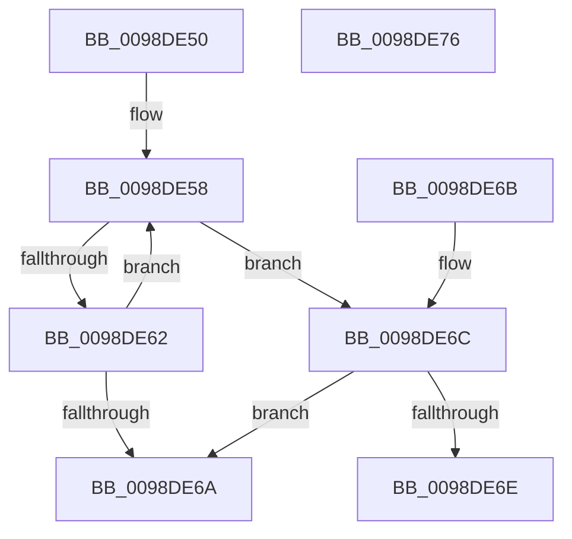

# PopEtStringReference

- RVA: `0x0098DE50`–`0x0098DE77` (길이 `39` bytes)
- VA: `0x000000014098DE50`
- 실행 섹션: `PAGE`
- PDB 이름 있음: `예`; PDB Function 태그: `아니요`
- unwind 정보 RVA: `0x000DB714`
- 디코드: `14`개 명령, `39/39` bytes 표시
- 미해석 바이트: `0` (있으면 어셈블리에 `.byte`로 보존)

> 이 문서는 커널 이미지의 기계어와 PDB 기호를 분석해 생성했습니다. 4번과 5번은 함수 원형과 자료형을 바이너리 사용 방식에서 추정한 C 해석이며 원본 소스 복구 결과는 아닙니다.

## 1. Dependencies

- 직접 호출 지점: **0**; 고유 호출 대상: **0**
- 직접 호출자로 확인된 함수: **3**
- RIP 상대 이미지 참조: **0**

### Outgoing calls
- 직접 디코드된 call 명령이 없습니다.

### Direct callers
- [PopEtAggregateKeyCopy](PopEtAggregateKeyCopy_function_0098D37C.md) at `0x0098D3A9`
- [PopEtStringSet](PopEtStringSet_function_0098D3E4.md) at `0x0098D417`
- [PopEtProcessSnapshotUpdateFromSnapshotContext](PopEtProcessSnapshotUpdateFromSnapshotContext_function_0098DB9C.md) at `0x0098DBF6`

### Static image references
- 디코드된 RIP-relative 메모리 참조가 없습니다.

## 2. Other-region calls and transfers

- 다른 실행 섹션으로 향하는 call: **0**
- 별도 외부 분기/꼬리 이동을 확인하지 못했습니다.

## 3. Assembly (complete function range)

```asm
0098DE50  0F 0D 49 10                     prefetchw byte ptr [rcx + 0x10]
0098DE54  48 8B 41 10                     mov rax, qword ptr [rcx + 0x10]
0098DE58  48 8D 50 01                     lea rdx, [rax + 1]
0098DE5C  48 83 FA 01                     cmp rdx, 1
0098DE60  76 0A                           jbe 0x14098de6c
0098DE62  F0 48 0F B1 51 10               lock cmpxchg qword ptr [rcx + 0x10], rdx
0098DE68  75 EE                           jne 0x14098de58
0098DE6A  C3                              ret
0098DE6B  CC                              int3
0098DE6C  74 FC                           je 0x14098de6a
0098DE6E  B9 0E 00 00 00                  mov ecx, 0xe
0098DE73  CD 29                           int 0x29
0098DE75  C3                              ret
0098DE76  CC                              int3
```

## 4. C-style interpretation (structured pseudocode)

```c
__int64 __fastcall PopEtStringReference(__int64 a1)
{
loc_0098DE58:
    if ((*(unsigned __int64 *)(a1 + 16) + 1) <= 1) goto loc_0098DE6C;
    if ((*(unsigned __int64 *)(a1 + 16) + 1) != 1) goto loc_0098DE58;
loc_0098DE6A:
    return *(unsigned __int64 *)(a1 + 16);
loc_0098DE6C:
    if ((*(unsigned __int64 *)(a1 + 16) + 1) == 1) goto loc_0098DE6A;
    return *(unsigned __int64 *)(a1 + 16);
}
```

## 5. (Beta) C Style

```c
int64_t PopEtStringReference(void *Arg1)
{
    uint8_t *arg1 = (uint8_t *)Arg1;

loc_0098DE58:
    if ((*(uint64_t *)(arg1 + 0x10) + 1) <= 1) goto loc_0098DE6C;
    if ((*(uint64_t *)(arg1 + 0x10) + 1) != 1) goto loc_0098DE58;
loc_0098DE6A:
    return *(uint64_t *)(arg1 + 0x10);
loc_0098DE6C:
    if ((*(uint64_t *)(arg1 + 0x10) + 1) == 1) goto loc_0098DE6A;
    return *(uint64_t *)(arg1 + 0x10);
}
```

### 관측된 메모리 오프셋

구조체 형식이 확인되지 않은 접근은 인자 기준의 오프셋으로만 기록했습니다.

| 기준 인자 | 오프셋 표현 | 폭 (bit) | 접근 |
|---|---:|---:|---|
| `Arg1` | `+ 0x10` | `8` | `R` |
| `Arg1` | `+ 0x10` | `64` | `R` |

## 6. Execution-region graph

[열기: 2D/3D 그래프와 함수 탐색 컨트롤 패널](../../../control-panel.html?section=page&rva=0x0098DE50&view=graph)

- 2D 그래프는 위에서 아래로 흐르고, 3D 그래프는 빈 공간을 드래그해 회전합니다. Shift+드래그는 이동, 휠은 확대·축소, 함수 노드 선택은 대상 보고서 이동입니다.

### Static fallback


