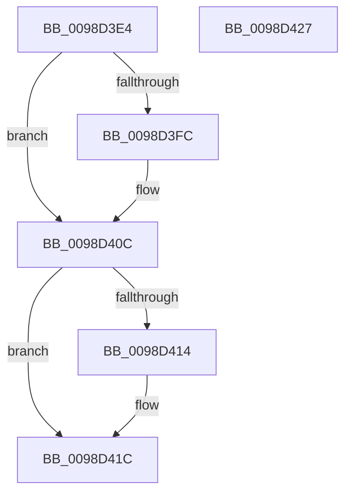

# PopEtStringSet

- RVA: `0x0098D3E4`–`0x0098D428` (길이 `68` bytes)
- VA: `0x000000014098D3E4`
- 실행 섹션: `PAGE`
- PDB 이름 있음: `예`; PDB Function 태그: `아니요`
- unwind 정보 RVA: `0x0005CAAC`
- 디코드: `21`개 명령, `68/68` bytes 표시
- 미해석 바이트: `0` (있으면 어셈블리에 `.byte`로 보존)

> 이 문서는 커널 이미지의 기계어와 PDB 기호를 분석해 생성했습니다. 4번과 5번은 함수 원형과 자료형을 바이너리 사용 방식에서 추정한 C 해석이며 원본 소스 복구 결과는 아닙니다.

## 1. Dependencies

- 직접 호출 지점: **2**; 고유 호출 대상: **2**
- 직접 호출자로 확인된 함수: **1**
- RIP 상대 이미지 참조: **1**

### Outgoing calls
- `0x0098D407` → [RtlInternEntryDereference](RtlInternEntryDereference_function_0098DCB4.md) (function, `0x0098DCB4`)
- `0x0098D417` → [PopEtStringReference](PopEtStringReference_function_0098DE50.md) (function, `0x0098DE50`)

### Direct callers
- [PopEtEnergyContextSetState](PopEtEnergyContextSetState_function_0098CF94.md) at `0x0098CFF2`

### Static image references
- `0x0098D3FC` → RVA `0x00E67A30` (`.data`; read)

## 2. Other-region calls and transfers

- 다른 실행 섹션으로 향하는 call: **0**
- 별도 외부 분기/꼬리 이동을 확인하지 못했습니다.

## 3. Assembly (complete function range)

```asm
0098D3E4  48 89 5C 24 08                  mov qword ptr [rsp + 8], rbx
0098D3E9  57                              push rdi
0098D3EA  48 83 EC 20                     sub rsp, 0x20
0098D3EE  48 8B DA                        mov rbx, rdx
0098D3F1  48 8B F9                        mov rdi, rcx
0098D3F4  48 8B 11                        mov rdx, qword ptr [rcx]
0098D3F7  48 85 D2                        test rdx, rdx
0098D3FA  74 10                           je 0x14098d40c
0098D3FC  48 8B 0D 2D A6 4D 00            mov rcx, qword ptr [rip + 0x4da62d]
0098D403  48 83 C1 38                     add rcx, 0x38
0098D407  E8 A8 08 00 00                  call 0x14098dcb4
0098D40C  48 89 1F                        mov qword ptr [rdi], rbx
0098D40F  48 85 DB                        test rbx, rbx
0098D412  74 08                           je 0x14098d41c
0098D414  48 8B CB                        mov rcx, rbx
0098D417  E8 34 0A 00 00                  call 0x14098de50
0098D41C  48 8B 5C 24 30                  mov rbx, qword ptr [rsp + 0x30]
0098D421  48 83 C4 20                     add rsp, 0x20
0098D425  5F                              pop rdi
0098D426  C3                              ret
0098D427  CC                              int3
```

## 4. C-style interpretation (structured pseudocode)

```c
__int64 __fastcall PopEtStringSet(__int64 a1, __int64 a2)
{
    __int64 result;
    __int64 v_rsp;
    unsigned __int64 v_stack_p8;

    v_stack_p8 = v_rbx;
    v_rsp = (v_rsp) - (32);
    if (*(unsigned __int64 *)(a1) != 0) {
        a1 = *(unsigned __int64 *)(v_rip + 5088813);
        a1 = (a1) + (56);
        result = RtlInternEntryDereference(a1, *(unsigned __int64 *)(a1), a3, a4);
    }
    *(unsigned __int64 *)(a1) = a2;
    if (a2 != 0) {
        a1 = a2;
        result = PopEtStringReference(a1, *(unsigned __int64 *)(a1), a3, a4);
    }
    v_rsp = (v_rsp) + (32);
    return result;
}
```

## 5. (Beta) C Style

```c
int64_t PopEtStringSet(void *Arg1, int64_t Arg2)
{
    uint8_t *arg1 = (uint8_t *)Arg1;

    int64_t result;
    int64_t local_rsp;
    uint64_t v_stack_p8;

    v_stack_p8 = local_rbx;
    local_rsp = (local_rsp) - (32);
    if (*(uint64_t *)(arg1) != 0) {
        Arg1 = *(uint64_t *)(v_rip + 0x4DA62D);
        Arg1 = (Arg1) + (56);
        result = RtlInternEntryDereference(Arg1, *(uint64_t *)(arg1), a3, a4);
    }
    *(uint64_t *)(arg1) = Arg2;
    if (Arg2 != 0) {
        Arg1 = Arg2;
        result = PopEtStringReference(Arg1, *(uint64_t *)(arg1), a3, a4);
    }
    local_rsp = (local_rsp) + (32);
    return result;
}
```

### 관측된 메모리 오프셋

구조체 형식이 확인되지 않은 접근은 인자 기준의 오프셋으로만 기록했습니다.

| 기준 인자 | 오프셋 표현 | 폭 (bit) | 접근 |
|---|---:|---:|---|
| `Arg1` | `+ 0x0` | `64` | `R` |
| `Arg1` | `+ 0x0` | `64` | `W` |

## 6. Execution-region graph

[열기: 2D/3D 그래프와 함수 탐색 컨트롤 패널](../../../control-panel.html?section=page&rva=0x0098D3E4&view=graph)

- 2D 그래프는 위에서 아래로 흐르고, 3D 그래프는 빈 공간을 드래그해 회전합니다. Shift+드래그는 이동, 휠은 확대·축소, 함수 노드 선택은 대상 보고서 이동입니다.

### Static fallback


