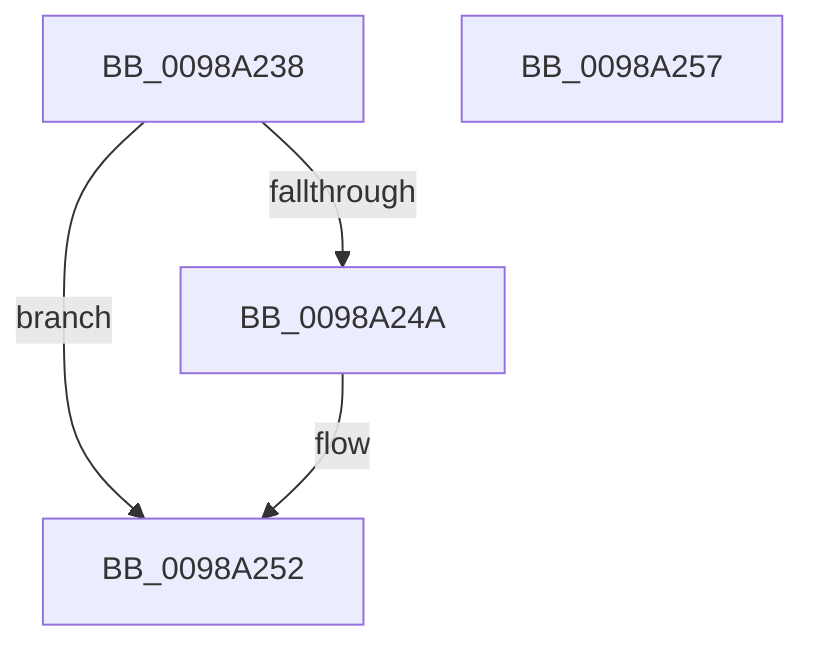

# PopPdcAreAllPhasesDisengaged

- RVA: `0x0098A238`–`0x0098A258` (길이 `32` bytes)
- VA: `0x000000014098A238`
- 실행 섹션: `PAGE`
- PDB 이름 있음: `예`; PDB Function 태그: `아니요`
- unwind 정보 RVA: `0x0005C788`
- 디코드: `10`개 명령, `32/32` bytes 표시
- 미해석 바이트: `0` (있으면 어셈블리에 `.byte`로 보존)

> 이 문서는 커널 이미지의 기계어와 PDB 기호를 분석해 생성했습니다. 4번과 5번은 함수 원형과 자료형을 바이너리 사용 방식에서 추정한 C 해석이며 원본 소스 복구 결과는 아닙니다.

## 1. Dependencies

- 직접 호출 지점: **1**; 고유 호출 대상: **1**
- 직접 호출자로 확인된 함수: **2**
- RIP 상대 이미지 참조: **1**

### Outgoing calls
- `0x0098A24D` → [guard_dispatch_icall](../../text/6B/guard_dispatch_icall_function_006BAAD0.md) (function, `0x006BAAD0`)

### Direct callers
- [PopPowerAggregatorScreenOffExitStateHandler](PopPowerAggregatorScreenOffExitStateHandler_function_00989EC0.md) at `0x00989EF6`
- [PopArmIdlePhaseWatchdog](PopArmIdlePhaseWatchdog_function_0098A10C.md) at `0x0098A13C`

### Static image references
- `0x0098A23C` → RVA `0x00E677F0` (`.data`; read)

## 2. Other-region calls and transfers

- 다른 실행 섹션으로 향하는 call: **1**
  - `0x0098A24D` → [guard_dispatch_icall](../../text/6B/guard_dispatch_icall_function_006BAAD0.md) (`PAGE` → `.text`)
- 별도 외부 분기/꼬리 이동을 확인하지 못했습니다.

## 3. Assembly (complete function range)

```asm
0098A238  48 83 EC 28                     sub rsp, 0x28
0098A23C  48 8B 0D AD D5 4D 00            mov rcx, qword ptr [rip + 0x4dd5ad]
0098A243  B0 01                           mov al, 1
0098A245  48 85 C9                        test rcx, rcx
0098A248  74 08                           je 0x14098a252
0098A24A  48 8B C1                        mov rax, rcx
0098A24D  E8 7E 08 D3 FF                  call 0x1406baad0
0098A252  48 83 C4 28                     add rsp, 0x28
0098A256  C3                              ret
0098A257  CC                              int3
```

## 4. C-style interpretation (structured pseudocode)

```c
__int64 __fastcall PopPdcAreAllPhasesDisengaged(void)
{
    __int64 result;
    __int64 v_rsp;

    v_rsp = (v_rsp) - (40);
    result = 1;
    if (*(unsigned __int64 *)(v_rip + 5100973) != 0) {
        result = *(unsigned __int64 *)(v_rip + 5100973);
        result = guard_dispatch_icall(*(unsigned __int64 *)(v_rip + 5100973), a2, a3, a4);
    }
    v_rsp = (v_rsp) + (40);
    return result;
}
```

## 5. (Beta) C Style

```c
void PopPdcAreAllPhasesDisengaged(void)
{
    int64_t result;
    int64_t local_rsp;

    local_rsp = (local_rsp) - (40);
    result = 1;
    if (*(uint64_t *)(v_rip + 0x4DD5AD) != 0) {
        result = *(uint64_t *)(v_rip + 0x4DD5AD);
        result = guard_dispatch_icall(*(uint64_t *)(v_rip + 0x4DD5AD), a2, a3, a4);
    }
    local_rsp = (local_rsp) + (40);
    return result;
}
```

## 6. Execution-region graph

[열기: 2D/3D 그래프와 함수 탐색 컨트롤 패널](../../../control-panel.html?section=page&rva=0x0098A238&view=graph)

- 2D 그래프는 위에서 아래로 흐르고, 3D 그래프는 빈 공간을 드래그해 회전합니다. Shift+드래그는 이동, 휠은 확대·축소, 함수 노드 선택은 대상 보고서 이동입니다.

### Static fallback


