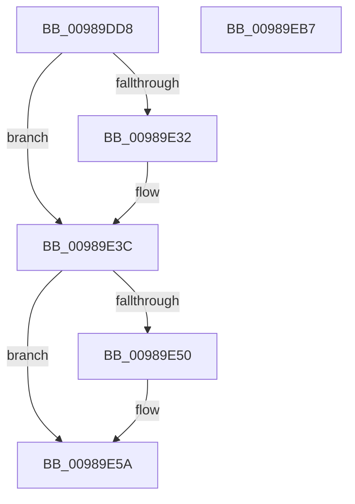

# PopPowerAggregatorDisengageModernStandby

- RVA: `0x00989DD8`–`0x00989EB8` (길이 `224` bytes)
- VA: `0x0000000140989DD8`
- 실행 섹션: `PAGE`
- PDB 이름 있음: `예`; PDB Function 태그: `아니요`
- unwind 정보 RVA: `0x00087EC4`
- 디코드: `47`개 명령, `224/224` bytes 표시
- 미해석 바이트: `0` (있으면 어셈블리에 `.byte`로 보존)

> 이 문서는 커널 이미지의 기계어와 PDB 기호를 분석해 생성했습니다. 4번과 5번은 함수 원형과 자료형을 바이너리 사용 방식에서 추정한 C 해석이며 원본 소스 복구 결과는 아닙니다.

## 1. Dependencies

- 직접 호출 지점: **10**; 고유 호출 대상: **8**
- 직접 호출자로 확인된 함수: **2**
- RIP 상대 이미지 참조: **5**

### Outgoing calls
- `0x00989DF0` → [PopPowerAggregatorEnterScreenOff](PopPowerAggregatorEnterScreenOff_function_00989F38.md) (function, `0x00989F38`)
- `0x00989DFC` → [PopReleaseRwLock](../../text/2D/PopReleaseRwLock_function_002DFBBC.md) (function, `0x002DFBBC`)
- `0x00989E01` → [PopPowerAggregatorDisengageDirectedDrips](../6F/PopPowerAggregatorDisengageDirectedDrips_function_006FF6C0.md) (function, `0x006FF6C0`)
- `0x00989E06` → [PopPowerAggregatorDisengageAggressiveStandbyActions](../6F/PopPowerAggregatorDisengageAggressiveStandbyActions_function_006FEB30.md) (function, `0x006FEB30`)
- `0x00989E37` → [guard_dispatch_icall](../../text/6B/guard_dispatch_icall_function_006BAAD0.md) (function, `0x006BAAD0`)
- `0x00989E55` → [guard_dispatch_icall](../../text/6B/guard_dispatch_icall_function_006BAAD0.md) (function, `0x006BAAD0`)
- `0x00989E85` → [ZwUpdateWnfStateData](../../text/6B/ZwUpdateWnfStateData_function_006B0D10.md) (function, `0x006B0D10`)
- `0x00989E93` → [guard_dispatch_icall](../../text/6B/guard_dispatch_icall_function_006BAAD0.md) (function, `0x006BAAD0`)
- `0x00989E9F` → [PopAcquireRwLockExclusive](../../text/43/PopAcquireRwLockExclusive_function_00430B44.md) (function, `0x00430B44`)
- `0x00989EAC` → [_security_check_cookie](../../text/6A/_security_check_cookie_function_006AC640.md) (function, `0x006AC640`)

### Direct callers
- [PopPowerAggregatorModernStandbyEnterStateHandler](../76/PopPowerAggregatorModernStandbyEnterStateHandler_function_00764C10.md) at `0x00764C1A`
- [PopPowerAggregatorModernStandbyExitStateHandler](PopPowerAggregatorModernStandbyExitStateHandler_function_00989D90.md) at `0x00989D9A`

### Static image references
- `0x00989DDE` → RVA `0x00E0A740` (`.data`; read)
- `0x00989DF5` → RVA `0x00F09710` (`.data`; read)
- `0x00989E0B` → RVA `0x00E677A8` (`.data`; read)
- `0x00989E69` → RVA `0x00013340` (`.rdata`; read)
- `0x00989E8A` → RVA `0x00E67808` (`.data`; read)

## 2. Other-region calls and transfers

- 다른 실행 섹션으로 향하는 call: **7**
  - `0x00989DFC` → [PopReleaseRwLock](../../text/2D/PopReleaseRwLock_function_002DFBBC.md) (`PAGE` → `.text`)
  - `0x00989E37` → [guard_dispatch_icall](../../text/6B/guard_dispatch_icall_function_006BAAD0.md) (`PAGE` → `.text`)
  - `0x00989E55` → [guard_dispatch_icall](../../text/6B/guard_dispatch_icall_function_006BAAD0.md) (`PAGE` → `.text`)
  - `0x00989E85` → [ZwUpdateWnfStateData](../../text/6B/ZwUpdateWnfStateData_function_006B0D10.md) (`PAGE` → `.text`)
  - `0x00989E93` → [guard_dispatch_icall](../../text/6B/guard_dispatch_icall_function_006BAAD0.md) (`PAGE` → `.text`)
  - `0x00989E9F` → [PopAcquireRwLockExclusive](../../text/43/PopAcquireRwLockExclusive_function_00430B44.md) (`PAGE` → `.text`)
  - `0x00989EAC` → [_security_check_cookie](../../text/6A/_security_check_cookie_function_006AC640.md) (`PAGE` → `.text`)
- 별도 외부 분기/꼬리 이동을 확인하지 못했습니다.

## 3. Assembly (complete function range)

```asm
00989DD8  40 53                           push rbx
00989DDA  48 83 EC 70                     sub rsp, 0x70
00989DDE  48 8B 05 5B 09 48 00            mov rax, qword ptr [rip + 0x48095b]
00989DE5  48 33 C4                        xor rax, rsp
00989DE8  48 89 44 24 60                  mov qword ptr [rsp + 0x60], rax
00989DED  8B 59 4C                        mov ebx, dword ptr [rcx + 0x4c]
00989DF0  E8 43 01 00 00                  call 0x140989f38
00989DF5  48 8D 0D 14 F9 57 00            lea rcx, [rip + 0x57f914]
00989DFC  E8 BB 5D 95 FF                  call 0x1402dfbbc
00989E01  E8 BA 58 D7 FF                  call 0x1406ff6c0
00989E06  E8 25 4D D7 FF                  call 0x1406feb30
00989E0B  48 8B 05 96 D9 4D 00            mov rax, qword ptr [rip + 0x4dd996]
00989E12  48 83 64 24 48 00               and qword ptr [rsp + 0x48], 0
00989E18  83 4C 24 58 FF                  or dword ptr [rsp + 0x58], 0xffffffff
00989E1D  C7 44 24 50 03 00 00 00         mov dword ptr [rsp + 0x50], 3
00989E25  C7 44 24 54 01 00 00 00         mov dword ptr [rsp + 0x54], 1
00989E2D  48 85 C0                        test rax, rax
00989E30  74 0A                           je 0x140989e3c
00989E32  48 8D 4C 24 48                  lea rcx, [rsp + 0x48]
00989E37  E8 94 0C D3 FF                  call 0x1406baad0
00989E3C  48 8B 05 65 D9 4D 00            mov rax, qword ptr [rip + 0x4dd965]
00989E43  C7 44 24 54 02 00 00 00         mov dword ptr [rsp + 0x54], 2
00989E4B  48 85 C0                        test rax, rax
00989E4E  74 0A                           je 0x140989e5a
00989E50  48 8D 4C 24 48                  lea rcx, [rsp + 0x48]
00989E55  E8 76 0C D3 FF                  call 0x1406baad0
00989E5A  83 64 24 30 00                  and dword ptr [rsp + 0x30], 0
00989E5F  48 8D 54 24 40                  lea rdx, [rsp + 0x40]
00989E64  83 64 24 28 00                  and dword ptr [rsp + 0x28], 0
00989E69  48 8D 0D D0 94 68 FF            lea rcx, [rip - 0x976b30]
00989E70  48 83 64 24 20 00               and qword ptr [rsp + 0x20], 0
00989E76  45 33 C9                        xor r9d, r9d
00989E79  C7 44 24 40 01 00 00 00         mov dword ptr [rsp + 0x40], 1
00989E81  45 8D 41 04                     lea r8d, [r9 + 4]
00989E85  E8 86 6E D2 FF                  call 0x1406b0d10
00989E8A  48 8B 05 77 D9 4D 00            mov rax, qword ptr [rip + 0x4dd977]
00989E91  8B CB                           mov ecx, ebx
00989E93  E8 38 0C D3 FF                  call 0x1406baad0
00989E98  48 8D 0D 71 F8 57 00            lea rcx, [rip + 0x57f871]
00989E9F  E8 A0 6C AA FF                  call 0x140430b44
00989EA4  48 8B 4C 24 60                  mov rcx, qword ptr [rsp + 0x60]
00989EA9  48 33 CC                        xor rcx, rsp
00989EAC  E8 8F 27 D2 FF                  call 0x1406ac640
00989EB1  48 83 C4 70                     add rsp, 0x70
00989EB5  5B                              pop rbx
00989EB6  C3                              ret
00989EB7  CC                              int3
```

## 4. C-style interpretation (structured pseudocode)

```c
__int64 __fastcall PopPowerAggregatorDisengageModernStandby(__int64 a1, __int64 a2, __int64 a3, int a4)
{
    __int64 result;
    __int64 v_rsp;
    unsigned __int64 v_stack_m18;
    unsigned int v_stack_m20;
    unsigned int v_stack_m24;
    unsigned int v_stack_m28;
    unsigned __int64 v_stack_m30;
    unsigned __int64 v_stack_m38;
    unsigned int v_stack_m48;
    unsigned int v_stack_m50;
    unsigned __int64 v_stack_m58;

    v_rsp = (v_rsp) - (112);
    result = (*(unsigned __int64 *)(v_rip + 4720987)) ^ (v_rsp);
    v_stack_m18 = result;
    result = PopPowerAggregatorEnterScreenOff(a1, a2, a3, a4);
    result = PopReleaseRwLock(v_rip + 5765396, a2, a3, a4);
    result = PopPowerAggregatorDisengageDirectedDrips(v_rip + 5765396, a2, a3, a4);
    result = PopPowerAggregatorDisengageAggressiveStandbyActions(v_rip + 5765396, a2, a3, a4);
    v_stack_m28 = 3;
    v_stack_m24 = 1;
    result = *(unsigned __int64 *)(v_rip + 5101974);
    if (*(unsigned __int64 *)(v_rip + 5101974) != 0) {
        a1 = v_stack_m30;
        result = guard_dispatch_icall(a1, a2, a3, a4);
    }
    v_stack_m24 = 2;
    result = *(unsigned __int64 *)(v_rip + 5101925);
    if (*(unsigned __int64 *)(v_rip + 5101925) != 0) {
        a1 = v_stack_m30;
        result = guard_dispatch_icall(a1, a2, a3, a4);
    }
    a4 = 0;
    v_stack_m38 = 1;
    result = ZwUpdateWnfStateData(v_rip - 9923376, v_stack_m38, a4 + 4, a4);
    result = guard_dispatch_icall((unsigned int)((unsigned int)((unsigned int)(*(unsigned int *)(a1 + 76)))), v_stack_m38, a4 + 4, a4);
    result = PopAcquireRwLockExclusive(v_rip + 5765233, v_stack_m38, a4 + 4, a4);
    a1 = (v_stack_m18) ^ (v_rsp);
    result = _security_check_cookie(a1, v_stack_m38, a4 + 4, a4);
    v_rsp = (v_rsp) + (112);
    return result;
}
```

## 5. (Beta) C Style

```c
int64_t PopPowerAggregatorDisengageModernStandby(void *Arg1, int64_t Arg2, int64_t Arg3, int32_t Arg4)
{
    uint8_t *arg1 = (uint8_t *)Arg1;

    int64_t result;
    int64_t local_rsp;
    uint64_t v_stack_m18;
    uint32_t v_stack_m20;
    uint32_t v_stack_m24;
    uint32_t v_stack_m28;
    uint64_t v_stack_m30;
    uint64_t v_stack_m38;
    uint32_t v_stack_m48;
    uint32_t v_stack_m50;
    uint64_t v_stack_m58;

    local_rsp = (local_rsp) - (112);
    result = (*(uint64_t *)(v_rip + 0x48095B)) ^ (local_rsp);
    v_stack_m18 = result;
    result = PopPowerAggregatorEnterScreenOff(Arg1, Arg2, Arg3, Arg4);
    result = PopReleaseRwLock(v_rip + 5765396, Arg2, Arg3, Arg4);
    result = PopPowerAggregatorDisengageDirectedDrips(v_rip + 5765396, Arg2, Arg3, Arg4);
    result = PopPowerAggregatorDisengageAggressiveStandbyActions(v_rip + 5765396, Arg2, Arg3, Arg4);
    v_stack_m28 = 3;
    v_stack_m24 = 1;
    result = *(uint64_t *)(v_rip + 0x4DD996);
    if (*(uint64_t *)(v_rip + 0x4DD996) != 0) {
        Arg1 = v_stack_m30;
        result = guard_dispatch_icall(Arg1, Arg2, Arg3, Arg4);
    }
    v_stack_m24 = 2;
    result = *(uint64_t *)(v_rip + 0x4DD965);
    if (*(uint64_t *)(v_rip + 0x4DD965) != 0) {
        Arg1 = v_stack_m30;
        result = guard_dispatch_icall(Arg1, Arg2, Arg3, Arg4);
    }
    Arg4 = 0;
    v_stack_m38 = 1;
    result = ZwUpdateWnfStateData(v_rip - 9923376, v_stack_m38, Arg4 + 4, Arg4);
    result = guard_dispatch_icall((uint32_t)((uint32_t)((uint32_t)(*(uint32_t *)(arg1 + 0x4C)))), v_stack_m38, Arg4 + 4, Arg4);
    result = PopAcquireRwLockExclusive(v_rip + 5765233, v_stack_m38, Arg4 + 4, Arg4);
    Arg1 = (v_stack_m18) ^ (local_rsp);
    result = _security_check_cookie(Arg1, v_stack_m38, Arg4 + 4, Arg4);
    local_rsp = (local_rsp) + (112);
    return result;
}
```

### 관측된 메모리 오프셋

구조체 형식이 확인되지 않은 접근은 인자 기준의 오프셋으로만 기록했습니다.

| 기준 인자 | 오프셋 표현 | 폭 (bit) | 접근 |
|---|---:|---:|---|
| `Arg1` | `+ 0x4C` | `32` | `R` |

## 6. Execution-region graph

[열기: 2D/3D 그래프와 함수 탐색 컨트롤 패널](../../../control-panel.html?section=page&rva=0x00989DD8&view=graph)

- 2D 그래프는 위에서 아래로 흐르고, 3D 그래프는 빈 공간을 드래그해 회전합니다. Shift+드래그는 이동, 휠은 확대·축소, 함수 노드 선택은 대상 보고서 이동입니다.

### Static fallback


