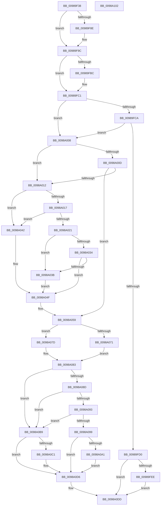

# PopPowerAggregatorEnterScreenOff

- RVA: `0x00989F38`–`0x0098A103` (길이 `459` bytes)
- VA: `0x0000000140989F38`
- 실행 섹션: `PAGE`
- PDB 이름 있음: `예`; PDB Function 태그: `아니요`
- unwind 정보 RVA: `0x00098654`
- 디코드: `118`개 명령, `459/459` bytes 표시
- 미해석 바이트: `0` (있으면 어셈블리에 `.byte`로 보존)

> 이 문서는 커널 이미지의 기계어와 PDB 기호를 분석해 생성했습니다. 4번과 5번은 함수 원형과 자료형을 바이너리 사용 방식에서 추정한 C 해석이며 원본 소스 복구 결과는 아닙니다.

## 1. Dependencies

- 직접 호출 지점: **14**; 고유 호출 대상: **13**
- 직접 호출자로 확인된 함수: **4**
- RIP 상대 이미지 참조: **6**

### Outgoing calls
- `0x00989FA0` → [PopPowerAggregatorSetCurrentState](PopPowerAggregatorSetCurrentState_function_0098A3B0.md) (function, `0x0098A3B0`)
- `0x00989FAC` → [PopReleaseRwLock](../../text/2D/PopReleaseRwLock_function_002DFBBC.md) (function, `0x002DFBBC`)
- `0x00989FBC` → [PopSleepstudySnapModernStandbySessionData](../AD/PopSleepstudySnapModernStandbySessionData_function_00AD529C.md) (function, `0x00AD529C`)
- `0x00989FD8` → [PdcPoPerfOverride](PdcPoPerfOverride_function_00989D34.md) (function, `0x00989D34`)
- `0x00989FDD` → [PopPdcDisengagePhases](PopPdcDisengagePhases_function_00989D5C.md) (function, `0x00989D5C`)
- `0x00989FFE` → [PopPowerRequestReferenceRelease](../../text/47/PopPowerRequestReferenceRelease_function_004775B0.md) (function, `0x004775B0`)
- `0x0098A045` → [PopGetMonitorReasonFromPowerEventId](../../text/4B/PopGetMonitorReasonFromPowerEventId_function_004BB2D8.md) (function, `0x004BB2D8`)
- `0x0098A054` → [PopSleepstudyStartNextSession](../AC/PopSleepstudyStartNextSession_function_00AC4720.md) (function, `0x00AC4720`)
- `0x0098A065` → [PopAcquirePolicyLock](../../pagelk/B7/PopAcquirePolicyLock_function_00B783C0.md) (function, `0x00B783C0`)
- `0x0098A083` → [PopReleasePolicyLock](../../pagelk/B7/PopReleasePolicyLock_function_00B78410.md) (function, `0x00B78410`)
- `0x0098A0B2` → [PopPowerRequestReferenceAcquire](../../text/47/PopPowerRequestReferenceAcquire_function_004776C0.md) (function, `0x004776C0`)
- `0x0098A0D1` → [PopPowerRequestReferenceRelease](../../text/47/PopPowerRequestReferenceRelease_function_004775B0.md) (function, `0x004775B0`)
- `0x0098A0D8` → [PopPdcEngagePhases](../76/PopPdcEngagePhases_function_007697B4.md) (function, `0x007697B4`)
- `0x0098A0E4` → [PopAcquireRwLockExclusive](../../text/43/PopAcquireRwLockExclusive_function_00430B44.md) (function, `0x00430B44`)

### Direct callers
- [PopPowerAggregatorScreenOffActiveToScreenOffStateHandler](../76/PopPowerAggregatorScreenOffActiveToScreenOffStateHandler_function_00764E70.md) at `0x00764E7D`
- [PopPowerAggregatorScreenOffEnterStateHandler](../76/PopPowerAggregatorScreenOffEnterStateHandler_function_00764E90.md) at `0x00764EA7`
- [PopPowerAggregatorDisengageModernStandby](PopPowerAggregatorDisengageModernStandby_function_00989DD8.md) at `0x00989DF0`
- [PopPowerAggregatorScreenOffExitStateHandler](PopPowerAggregatorScreenOffExitStateHandler_function_00989EC0.md) at `0x00989ED7`

### Static image references
- `0x00989FA5` → RVA `0x00F09710` (`.data`; read)
- `0x00989FD2` → RVA `0x00F0BD22` (`.data`; write)
- `0x00989FE2` → RVA `0x00F09720` (`.data`; read)
- `0x00989FEE` → RVA `0x00F0AD40` (`.data`; read)
- `0x00989FF8` → RVA `0x00F09720` (`.data`; write)
- `0x0098A071` → RVA `0x00E27E1C` (`.data`; write)

## 2. Other-region calls and transfers

- 다른 실행 섹션으로 향하는 call: **8**
  - `0x00989FAC` → [PopReleaseRwLock](../../text/2D/PopReleaseRwLock_function_002DFBBC.md) (`PAGE` → `.text`)
  - `0x00989FFE` → [PopPowerRequestReferenceRelease](../../text/47/PopPowerRequestReferenceRelease_function_004775B0.md) (`PAGE` → `.text`)
  - `0x0098A045` → [PopGetMonitorReasonFromPowerEventId](../../text/4B/PopGetMonitorReasonFromPowerEventId_function_004BB2D8.md) (`PAGE` → `.text`)
  - `0x0098A065` → [PopAcquirePolicyLock](../../pagelk/B7/PopAcquirePolicyLock_function_00B783C0.md) (`PAGE` → `PAGELK`)
  - `0x0098A083` → [PopReleasePolicyLock](../../pagelk/B7/PopReleasePolicyLock_function_00B78410.md) (`PAGE` → `PAGELK`)
  - `0x0098A0B2` → [PopPowerRequestReferenceAcquire](../../text/47/PopPowerRequestReferenceAcquire_function_004776C0.md) (`PAGE` → `.text`)
  - `0x0098A0D1` → [PopPowerRequestReferenceRelease](../../text/47/PopPowerRequestReferenceRelease_function_004775B0.md) (`PAGE` → `.text`)
  - `0x0098A0E4` → [PopAcquireRwLockExclusive](../../text/43/PopAcquireRwLockExclusive_function_00430B44.md) (`PAGE` → `.text`)
- 별도 외부 분기/꼬리 이동을 확인하지 못했습니다.

## 3. Assembly (complete function range)

```asm
00989F38  48 8B C4                        mov rax, rsp
00989F3B  48 89 58 08                     mov qword ptr [rax + 8], rbx
00989F3F  48 89 78 10                     mov qword ptr [rax + 0x10], rdi
00989F43  4C 89 70 18                     mov qword ptr [rax + 0x18], r14
00989F47  55                              push rbp
00989F48  48 8D 68 A1                     lea rbp, [rax - 0x5f]
00989F4C  48 81 EC 90 00 00 00            sub rsp, 0x90
00989F53  0F 10 41 48                     movups xmm0, xmmword ptr [rcx + 0x48]
00989F57  0F 10 51 38                     movups xmm2, xmmword ptr [rcx + 0x38]
00989F5B  0F 10 49 10                     movups xmm1, xmmword ptr [rcx + 0x10]
00989F5F  0F 11 45 17                     movups xmmword ptr [rbp + 0x17], xmm0
00989F63  0F 10 41 20                     movups xmm0, xmmword ptr [rcx + 0x20]
00989F67  66 0F 7E D3                     movd ebx, xmm2
00989F6B  0F 11 45 37                     movups xmmword ptr [rbp + 0x37], xmm0
00989F6F  0F 57 C0                        xorps xmm0, xmm0
00989F72  0F 11 45 E7                     movups xmmword ptr [rbp - 0x19], xmm0
00989F76  C7 45 E7 04 00 00 00            mov dword ptr [rbp - 0x19], 4
00989F7D  0F 11 55 07                     movups xmmword ptr [rbp + 7], xmm2
00989F81  0F 11 4D 27                     movups xmmword ptr [rbp + 0x27], xmm1
00989F85  0F 11 45 F7                     movups xmmword ptr [rbp - 9], xmm0
00989F89  83 FB 04                        cmp ebx, 4
00989F8C  75 0E                           jne 0x140989f9c
00989F8E  48 8B 45 17                     mov rax, qword ptr [rbp + 0x17]
00989F92  88 45 F7                        mov byte ptr [rbp - 9], al
00989F95  48 C1 E8 20                     shr rax, 0x20
00989F99  89 45 FB                        mov dword ptr [rbp - 5], eax
00989F9C  48 8D 55 E7                     lea rdx, [rbp - 0x19]
00989FA0  E8 0B 04 00 00                  call 0x14098a3b0
00989FA5  48 8D 0D 64 F7 57 00            lea rcx, [rip + 0x57f764]
00989FAC  E8 0B 5C 95 FF                  call 0x1402dfbbc
00989FB1  41 BE 01 00 00 00               mov r14d, 1
00989FB7  41 3B DE                        cmp ebx, r14d
00989FBA  75 05                           jne 0x140989fc1
00989FBC  E8 DB B2 14 00                  call 0x140ad529c
00989FC1  F7 45 27 FC FF FF FF            test dword ptr [rbp + 0x27], 0xfffffffc
00989FC8  75 3E                           jne 0x14098a008
00989FCA  44 39 75 27                     cmp dword ptr [rbp + 0x27], r14d
00989FCE  74 38                           je 0x14098a008
00989FD0  33 DB                           xor ebx, ebx
00989FD2  88 1D 4A 1D 58 00               mov byte ptr [rip + 0x581d4a], bl
00989FD8  E8 57 FD FF FF                  call 0x140989d34
00989FDD  E8 7A FD FF FF                  call 0x140989d5c
00989FE2  38 1D 38 F7 57 00               cmp byte ptr [rip + 0x57f738], bl
00989FE8  0F 84 EF 00 00 00               je 0x14098a0dd
00989FEE  48 8B 0D 4B 0D 58 00            mov rcx, qword ptr [rip + 0x580d4b]
00989FF5  41 8B D6                        mov edx, r14d
00989FF8  88 1D 22 F7 57 00               mov byte ptr [rip + 0x57f722], bl
00989FFE  E8 AD D5 AE FF                  call 0x1404775b0
0098A003  E9 D5 00 00 00                  jmp 0x14098a0dd
0098A008  83 FB 04                        cmp ebx, 4
0098A00B  74 05                           je 0x14098a012
0098A00D  41 3B DE                        cmp ebx, r14d
0098A010  75 47                           jne 0x14098a059
0098A012  41 3B DE                        cmp ebx, r14d
0098A015  75 2B                           jne 0x14098a042
0098A017  48 8B 45 0F                     mov rax, qword ptr [rbp + 0xf]
0098A01B  48 39 45 37                     cmp qword ptr [rbp + 0x37], rax
0098A01F  75 21                           jne 0x14098a042
0098A021  8B 45 1F                        mov eax, dword ptr [rbp + 0x1f]
0098A024  8B C8                           mov ecx, eax
0098A026  81 E1 00 00 00 FF               and ecx, 0xff000000
0098A02C  81 F9 00 00 00 01               cmp ecx, 0x1000000
0098A032  75 07                           jne 0x14098a03b
0098A034  A9 FF FF FF 00                  test eax, 0xffffff
0098A039  75 14                           jne 0x14098a04f
0098A03B  B8 32 00 00 00                  mov eax, 0x32
0098A040  EB 0D                           jmp 0x14098a04f
0098A042  8B 4D 2F                        mov ecx, dword ptr [rbp + 0x2f]
0098A045  E8 8E 12 B3 FF                  call 0x1404bb2d8
0098A04A  25 FF FF FF 00                  and eax, 0xffffff
0098A04F  8B D0                           mov edx, eax
0098A051  41 8B CE                        mov ecx, r14d
0098A054  E8 C7 A6 13 00                  call 0x140ac4720
0098A059  8A 45 3F                        mov al, byte ptr [rbp + 0x3f]
0098A05C  F6 D8                           neg al
0098A05E  1B FF                           sbb edi, edi
0098A060  F7 DF                           neg edi
0098A062  83 C7 3A                        add edi, 0x3a
0098A065  E8 56 E3 1E 00                  call 0x140b783c0
0098A06A  33 DB                           xor ebx, ebx
0098A06C  38 5D 42                        cmp byte ptr [rbp + 0x42], bl
0098A06F  74 0C                           je 0x14098a07d
0098A071  44 89 35 A4 DD 49 00            mov dword ptr [rip + 0x49dda4], r14d
0098A078  8D 7B 1A                        lea edi, [rbx + 0x1a]
0098A07B  EB 06                           jmp 0x14098a083
0098A07D  89 1D 99 DD 49 00               mov dword ptr [rip + 0x49dd99], ebx
0098A083  E8 88 E3 1E 00                  call 0x140b78410
0098A088  38 5D 3F                        cmp byte ptr [rbp + 0x3f], bl
0098A08B  74 2C                           je 0x14098a0b9
0098A08D  83 7D 27 04                     cmp dword ptr [rbp + 0x27], 4
0098A091  75 26                           jne 0x14098a0b9
0098A093  44 39 75 43                     cmp dword ptr [rbp + 0x43], r14d
0098A097  75 20                           jne 0x14098a0b9
0098A099  38 1D 81 F6 57 00               cmp byte ptr [rip + 0x57f681], bl
0098A09F  75 35                           jne 0x14098a0d6
0098A0A1  48 8B 0D 98 0C 58 00            mov rcx, qword ptr [rip + 0x580c98]
0098A0A8  41 8B D6                        mov edx, r14d
0098A0AB  44 88 35 6E F6 57 00            mov byte ptr [rip + 0x57f66e], r14b
0098A0B2  E8 09 D6 AE FF                  call 0x1404776c0
0098A0B7  EB 1D                           jmp 0x14098a0d6
0098A0B9  38 1D 61 F6 57 00               cmp byte ptr [rip + 0x57f661], bl
0098A0BF  74 15                           je 0x14098a0d6
0098A0C1  48 8B 0D 78 0C 58 00            mov rcx, qword ptr [rip + 0x580c78]
0098A0C8  41 8B D6                        mov edx, r14d
0098A0CB  88 1D 4F F6 57 00               mov byte ptr [rip + 0x57f64f], bl
0098A0D1  E8 DA D4 AE FF                  call 0x1404775b0
0098A0D6  8B CF                           mov ecx, edi
0098A0D8  E8 D7 F6 DD FF                  call 0x1407697b4
0098A0DD  48 8D 0D 2C F6 57 00            lea rcx, [rip + 0x57f62c]
0098A0E4  E8 5B 6A AA FF                  call 0x140430b44
0098A0E9  4C 8D 9C 24 90 00 00 00         lea r11, [rsp + 0x90]
0098A0F1  49 8B 5B 10                     mov rbx, qword ptr [r11 + 0x10]
0098A0F5  49 8B 7B 18                     mov rdi, qword ptr [r11 + 0x18]
0098A0F9  4D 8B 73 20                     mov r14, qword ptr [r11 + 0x20]
0098A0FD  49 8B E3                        mov rsp, r11
0098A100  5D                              pop rbp
0098A101  C3                              ret
0098A102  CC                              int3
```

## 4. C-style interpretation (structured pseudocode)

```c
__int64 __fastcall PopPowerAggregatorEnterScreenOff(__int64 a1)
{
    __int64 result;
    __int64 v_rbx;
    __int64 v_rdi;
    __int64 v_rsp;
    unsigned __int64 v_stack_m8;

    *(unsigned __int64 *)(v_rsp + 8) = v_rbx;
    *(unsigned __int64 *)(v_rsp + 16) = v_rdi;
    *(unsigned __int64 *)(v_rsp + 24) = v_r14;
    v_rsp = (v_rsp) - (144);
    *(unsigned __int64 *)(v_rsp - 95 + 23) = v_xmm0;
    *(unsigned __int64 *)(v_rsp - 95 + 55) = v_xmm0;
    *(unsigned __int64 *)(v_rsp - 95 - 25) = v_xmm0;
    *(unsigned int *)(v_rsp - 95 - 25) = 4;
    *(unsigned __int64 *)(v_rsp - 95 + 7) = v_xmm2;
    *(unsigned __int64 *)(v_rsp - 95 + 39) = v_xmm1;
    *(unsigned __int64 *)(v_rsp - 95 - 9) = v_xmm0;
    result = v_rsp;
    if (((unsigned int)(v_rbx)) == 4) {
        result = *(unsigned __int64 *)(v_rsp - 95 + 23);
        *(unsigned __int8 *)(v_rsp - 95 - 9) = (unsigned __int8)(result);
        result = (result) >> (32);
        *(unsigned int *)(v_rsp - 95 - 5) = (unsigned int)(result);
    }
    result = PopPowerAggregatorSetCurrentState(a1, v_rsp - 95 - 25, a3, a4);
    result = PopReleaseRwLock(v_rip + 5764964, v_rsp - 95 - 25, a3, a4);
    if (((unsigned int)(v_rbx)) == 1) {
        result = PopSleepstudySnapModernStandbySessionData(v_rip + 5764964, v_rsp - 95 - 25, a3, a4);
    }
    if (((*(unsigned int *)(v_rsp - 95 + 39)) & (0xFFFFFFFCULL)) != 0) goto loc_0098A008;
    if ((*(unsigned int *)(v_rsp - 95 + 39)) == 1) goto loc_0098A008;
    v_rbx = 0;
    *(unsigned __int8 *)(v_rip + 5774666) = 0;
    result = PdcPoPerfOverride(v_rip + 5764964, v_rsp - 95 - 25, a3, a4);
    result = PopPdcDisengagePhases(v_rip + 5764964, v_rsp - 95 - 25, a3, a4);
    if ((*(unsigned __int8 *)(v_rip + 5764920)) == 0) goto loc_0098A0DD;
    *(unsigned __int8 *)(v_rip + 5764898) = 0;
    result = PopPowerRequestReferenceRelease(*(unsigned __int64 *)(v_rip + 5770571), 1, a3, a4);
    goto loc_0098A0DD;
loc_0098A008:
    if (0 == 4) goto loc_0098A012;
    if (0 != 1) goto loc_0098A059;
loc_0098A012:
    if (0 != 1) goto loc_0098A042;
    if ((*(unsigned __int64 *)(v_rsp - 95 + 55)) != (*(unsigned __int64 *)(v_rsp - 95 + 15))) goto loc_0098A042;
    a1 = (unsigned int)(((unsigned int)((unsigned int)((unsigned int)(*(unsigned int *)(v_rsp - 95 + 31))))) & (0xFF000000ULL));
    if (((unsigned int)(a1)) != 0x1000000ULL) goto loc_0098A03B;
    if ((((unsigned int)((unsigned int)(*(unsigned int *)(v_rsp - 95 + 31)))) & (0xFFFFFFULL)) != 0) goto loc_0098A04F;
loc_0098A03B:
    goto loc_0098A04F;
loc_0098A042:
    result = PopGetMonitorReasonFromPowerEventId((unsigned int)(*(unsigned int *)(v_rsp - 95 + 47)), 1, a3, a4);
    result = (unsigned int)((result) & (0xFFFFFFULL));
loc_0098A04F:
    result = PopSleepstudyStartNextSession(1, (unsigned int)((unsigned int)(result)), a3, a4);
loc_0098A059:
    result = (unsigned __int8)(-(*(unsigned __int8 *)(v_rsp - 95 + 63)));
    v_rdi = (unsigned int)(-(v_rdi));
    v_rdi = (unsigned int)((v_rdi) + (58));
    result = PopAcquirePolicyLock(1, (unsigned int)((unsigned int)(result)), a3, a4);
    v_rbx = 0;
    if ((*(unsigned __int8 *)(v_rsp - 95 + 66)) == 0) goto loc_0098A07D;
    *(unsigned int *)(v_rip + 4840868) = 1;
    goto loc_0098A083;
loc_0098A07D:
    *(unsigned int *)(v_rip + 4840857) = 0;
loc_0098A083:
    result = PopReleasePolicyLock(1, (unsigned int)((unsigned int)(result)), a3, a4);
    if ((*(unsigned __int8 *)(v_rsp - 95 + 63)) == 0) goto loc_0098A0B9;
    if ((*(unsigned int *)(v_rsp - 95 + 39)) != 4) goto loc_0098A0B9;
    if ((*(unsigned int *)(v_rsp - 95 + 67)) != 1) goto loc_0098A0B9;
    if ((*(unsigned __int8 *)(v_rip + 5764737)) != 0) goto loc_0098A0D6;
    *(unsigned __int8 *)(v_rip + 5764718) = 1;
    result = PopPowerRequestReferenceAcquire(*(unsigned __int64 *)(v_rip + 5770392), 1, a3, a4);
    goto loc_0098A0D6;
loc_0098A0B9:
    if ((*(unsigned __int8 *)(v_rip + 5764705)) != 0) {
        a1 = *(unsigned __int64 *)(v_rip + 5770360);
        a2 = 1;
        *(unsigned __int8 *)(v_rip + 5764687) = 0;
        result = PopPowerRequestReferenceRelease(a1, a2, a3, a4);
    }
    result = PopPdcEngagePhases((unsigned int)((unsigned int)(v_rbx + 26)), a2, a3, a4);
loc_0098A0DD:
    result = PopAcquireRwLockExclusive(v_rip + 5764652, a2, a3, a4);
    return result;
}
```

## 5. (Beta) C Style

```c
int64_t PopPowerAggregatorEnterScreenOff(void *Arg1)
{
    uint8_t *arg1 = (uint8_t *)Arg1;

    int64_t result;
    int64_t local_rbx;
    int64_t local_rdi;
    int64_t local_rsp;
    uint64_t v_stack_m8;

    *(uint64_t *)(local_rsp + 0x8) = local_rbx;
    *(uint64_t *)(local_rsp + 0x10) = local_rdi;
    *(uint64_t *)(local_rsp + 0x18) = local_r14;
    local_rsp = (local_rsp) - (144);
    *(uint64_t *)(local_rsp - 0x5F + 0x17) = v_xmm0;
    *(uint64_t *)(local_rsp - 0x5F + 0x37) = v_xmm0;
    *(uint64_t *)(local_rsp - 0x5F - 0x19) = v_xmm0;
    *(uint32_t *)(local_rsp - 0x5F - 0x19) = 4;
    *(uint64_t *)(local_rsp - 0x5F + 0x7) = v_xmm2;
    *(uint64_t *)(local_rsp - 0x5F + 0x27) = v_xmm1;
    *(uint64_t *)(local_rsp - 0x5F - 0x9) = v_xmm0;
    result = local_rsp;
    if (((uint32_t)(local_rbx)) == 4) {
        result = *(uint64_t *)(local_rsp - 0x5F + 0x17);
        *(uint8_t *)(local_rsp - 0x5F - 0x9) = (uint8_t)(result);
        result = (result) >> (32);
        *(uint32_t *)(local_rsp - 0x5F - 0x5) = (uint32_t)(result);
    }
    result = PopPowerAggregatorSetCurrentState(Arg1, local_rsp - 95 - 25, a3, a4);
    result = PopReleaseRwLock(v_rip + 5764964, local_rsp - 95 - 25, a3, a4);
    if (((uint32_t)(local_rbx)) == 1) {
        result = PopSleepstudySnapModernStandbySessionData(v_rip + 5764964, local_rsp - 95 - 25, a3, a4);
    }
    if (((*(uint32_t *)(local_rsp - 0x5F + 0x27)) & (0xFFFFFFFCULL)) != 0) goto loc_0098A008;
    if ((*(uint32_t *)(local_rsp - 0x5F + 0x27)) == 1) goto loc_0098A008;
    local_rbx = 0;
    *(uint8_t *)(v_rip + 0x581D4A) = 0;
    result = PdcPoPerfOverride(v_rip + 5764964, local_rsp - 95 - 25, a3, a4);
    result = PopPdcDisengagePhases(v_rip + 5764964, local_rsp - 95 - 25, a3, a4);
    if ((*(uint8_t *)(v_rip + 0x57F738)) == 0) goto loc_0098A0DD;
    *(uint8_t *)(v_rip + 0x57F722) = 0;
    result = PopPowerRequestReferenceRelease(*(uint64_t *)(v_rip + 0x580D4B), 1, a3, a4);
    goto loc_0098A0DD;
loc_0098A008:
    if (0 == 4) goto loc_0098A012;
    if (0 != 1) goto loc_0098A059;
loc_0098A012:
    if (0 != 1) goto loc_0098A042;
    if ((*(uint64_t *)(local_rsp - 0x5F + 0x37)) != (*(uint64_t *)(local_rsp - 0x5F + 0xF))) goto loc_0098A042;
    Arg1 = (uint32_t)(((uint32_t)((uint32_t)((uint32_t)(*(uint32_t *)(local_rsp - 0x5F + 0x1F))))) & (0xFF000000ULL));
    if (((uint32_t)(Arg1)) != 0x1000000ULL) goto loc_0098A03B;
    if ((((uint32_t)((uint32_t)(*(uint32_t *)(local_rsp - 0x5F + 0x1F)))) & (0xFFFFFFULL)) != 0) goto loc_0098A04F;
loc_0098A03B:
    goto loc_0098A04F;
loc_0098A042:
    result = PopGetMonitorReasonFromPowerEventId((uint32_t)(*(uint32_t *)(local_rsp - 0x5F + 0x2F)), 1, a3, a4);
    result = (uint32_t)((result) & (0xFFFFFFULL));
loc_0098A04F:
    result = PopSleepstudyStartNextSession(1, (uint32_t)((uint32_t)(result)), a3, a4);
loc_0098A059:
    result = (uint8_t)(-(*(uint8_t *)(local_rsp - 0x5F + 0x3F)));
    local_rdi = (uint32_t)(-(local_rdi));
    local_rdi = (uint32_t)((local_rdi) + (58));
    result = PopAcquirePolicyLock(1, (uint32_t)((uint32_t)(result)), a3, a4);
    local_rbx = 0;
    if ((*(uint8_t *)(local_rsp - 0x5F + 0x42)) == 0) goto loc_0098A07D;
    *(uint32_t *)(v_rip + 0x49DDA4) = 1;
    goto loc_0098A083;
loc_0098A07D:
    *(uint32_t *)(v_rip + 0x49DD99) = 0;
loc_0098A083:
    result = PopReleasePolicyLock(1, (uint32_t)((uint32_t)(result)), a3, a4);
    if ((*(uint8_t *)(local_rsp - 0x5F + 0x3F)) == 0) goto loc_0098A0B9;
    if ((*(uint32_t *)(local_rsp - 0x5F + 0x27)) != 4) goto loc_0098A0B9;
    if ((*(uint32_t *)(local_rsp - 0x5F + 0x43)) != 1) goto loc_0098A0B9;
    if ((*(uint8_t *)(v_rip + 0x57F681)) != 0) goto loc_0098A0D6;
    *(uint8_t *)(v_rip + 0x57F66E) = 1;
    result = PopPowerRequestReferenceAcquire(*(uint64_t *)(v_rip + 0x580C98), 1, a3, a4);
    goto loc_0098A0D6;
loc_0098A0B9:
    if ((*(uint8_t *)(v_rip + 0x57F661)) != 0) {
        Arg1 = *(uint64_t *)(v_rip + 0x580C78);
        a2 = 1;
        *(uint8_t *)(v_rip + 0x57F64F) = 0;
        result = PopPowerRequestReferenceRelease(Arg1, a2, a3, a4);
    }
    result = PopPdcEngagePhases((uint32_t)((uint32_t)(local_rbx + 26)), a2, a3, a4);
loc_0098A0DD:
    result = PopAcquireRwLockExclusive(v_rip + 5764652, a2, a3, a4);
    return result;
}
```

### 관측된 메모리 오프셋

구조체 형식이 확인되지 않은 접근은 인자 기준의 오프셋으로만 기록했습니다.

| 기준 인자 | 오프셋 표현 | 폭 (bit) | 접근 |
|---|---:|---:|---|
| `Arg1` | `+ 0x10` | `128` | `R` |
| `Arg1` | `+ 0x20` | `128` | `R` |
| `Arg1` | `+ 0x38` | `128` | `R` |
| `Arg1` | `+ 0x48` | `128` | `R` |

## 6. Execution-region graph

[열기: 2D/3D 그래프와 함수 탐색 컨트롤 패널](../../../control-panel.html?section=page&rva=0x00989F38&view=graph)

- 2D 그래프는 위에서 아래로 흐르고, 3D 그래프는 빈 공간을 드래그해 회전합니다. Shift+드래그는 이동, 휠은 확대·축소, 함수 노드 선택은 대상 보고서 이동입니다.

### Static fallback


