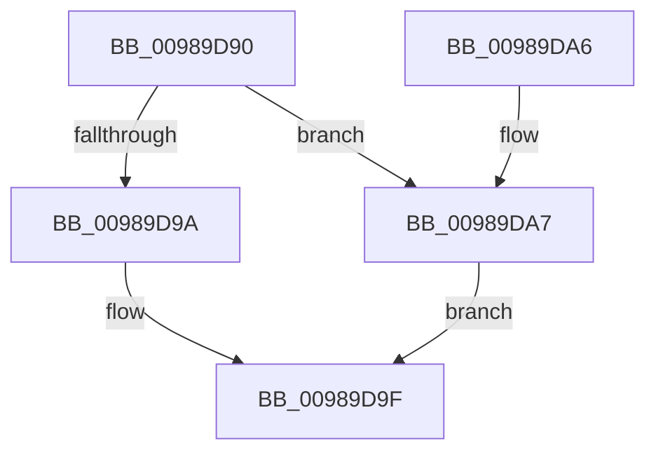

# PopPowerAggregatorModernStandbyExitStateHandler

- RVA: `0x00989D90`–`0x00989DD2` (길이 `66` bytes)
- VA: `0x0000000140989D90`
- 실행 섹션: `PAGE`
- PDB 이름 있음: `예`; PDB Function 태그: `아니요`
- unwind 정보 RVA: `0x00066F5C`
- 디코드: `16`개 명령, `66/66` bytes 표시
- 미해석 바이트: `0` (있으면 어셈블리에 `.byte`로 보존)

> 이 문서는 커널 이미지의 기계어와 PDB 기호를 분석해 생성했습니다. 4번과 5번은 함수 원형과 자료형을 바이너리 사용 방식에서 추정한 C 해석이며 원본 소스 복구 결과는 아닙니다.

## 1. Dependencies

- 직접 호출 지점: **5**; 고유 호출 대상: **5**
- 직접 호출자로 확인된 함수: **0**
- RIP 상대 이미지 참조: **2**

### Outgoing calls
- `0x00989D9A` → [PopPowerAggregatorDisengageModernStandby](PopPowerAggregatorDisengageModernStandby_function_00989DD8.md) (function, `0x00989DD8`)
- `0x00989DB5` → [PopReleaseRwLock](../../text/2D/PopReleaseRwLock_function_002DFBBC.md) (function, `0x002DFBBC`)
- `0x00989DBA` → [PdcPoPerfOverride](PdcPoPerfOverride_function_00989D34.md) (function, `0x00989D34`)
- `0x00989DBF` → [PopPdcDisengagePhases](PopPdcDisengagePhases_function_00989D5C.md) (function, `0x00989D5C`)
- `0x00989DCB` → [PopAcquireRwLockExclusive](../../text/43/PopAcquireRwLockExclusive_function_00430B44.md) (function, `0x00430B44`)

### Direct callers
- 이 함수 시작 RVA로 연결되는 직접 call은 확인되지 않았습니다. 간접 호출은 완전히 역산할 수 없습니다.

### Static image references
- `0x00989DA7` → RVA `0x00F09710` (`.data`; read)
- `0x00989DAE` → RVA `0x00F0BD22` (`.data`; write)

## 2. Other-region calls and transfers

- 다른 실행 섹션으로 향하는 call: **2**
  - `0x00989DB5` → [PopReleaseRwLock](../../text/2D/PopReleaseRwLock_function_002DFBBC.md) (`PAGE` → `.text`)
  - `0x00989DCB` → [PopAcquireRwLockExclusive](../../text/43/PopAcquireRwLockExclusive_function_00430B44.md) (`PAGE` → `.text`)
- 별도 외부 분기/꼬리 이동을 확인하지 못했습니다.

## 3. Assembly (complete function range)

```asm
00989D90  48 83 EC 28                     sub rsp, 0x28
00989D94  80 79 48 00                     cmp byte ptr [rcx + 0x48], 0
00989D98  74 0D                           je 0x140989da7
00989D9A  E8 39 00 00 00                  call 0x140989dd8
00989D9F  33 C0                           xor eax, eax
00989DA1  48 83 C4 28                     add rsp, 0x28
00989DA5  C3                              ret
00989DA6  CC                              int3
00989DA7  48 8D 0D 62 F9 57 00            lea rcx, [rip + 0x57f962]
00989DAE  C6 05 6D 1F 58 00 00            mov byte ptr [rip + 0x581f6d], 0
00989DB5  E8 02 5E 95 FF                  call 0x1402dfbbc
00989DBA  E8 75 FF FF FF                  call 0x140989d34
00989DBF  E8 98 FF FF FF                  call 0x140989d5c
00989DC4  48 8D 0D 45 F9 57 00            lea rcx, [rip + 0x57f945]
00989DCB  E8 74 6D AA FF                  call 0x140430b44
00989DD0  EB CD                           jmp 0x140989d9f
```

## 4. C-style interpretation (structured pseudocode)

```c
__int64 __fastcall PopPowerAggregatorModernStandbyExitStateHandler(__int64 a1)
{
    __int64 result;
    __int64 v_rsp;

    v_rsp = (v_rsp) - (40);
    if ((*(unsigned __int8 *)(a1 + 72)) == 0) goto loc_00989DA7;
    result = PopPowerAggregatorDisengageModernStandby(a1, a2, a3, a4);
loc_00989D9F:
    result = 0;
    v_rsp = (v_rsp) + (40);
    return result;
loc_00989DA7:
    *(unsigned __int8 *)(v_rip + 5775213) = 0;
    result = PopReleaseRwLock(v_rip + 5765474, a2, a3, a4);
    result = PdcPoPerfOverride(v_rip + 5765474, a2, a3, a4);
    result = PopPdcDisengagePhases(v_rip + 5765474, a2, a3, a4);
    result = PopAcquireRwLockExclusive(v_rip + 5765445, a2, a3, a4);
    goto loc_00989D9F;
}
```

## 5. (Beta) C Style

```c
int64_t PopPowerAggregatorModernStandbyExitStateHandler(void *Arg1)
{
    uint8_t *arg1 = (uint8_t *)Arg1;

    int64_t result;
    int64_t local_rsp;

    local_rsp = (local_rsp) - (40);
    if ((*(uint8_t *)(arg1 + 0x48)) == 0) goto loc_00989DA7;
    result = PopPowerAggregatorDisengageModernStandby(Arg1, a2, a3, a4);
loc_00989D9F:
    result = 0;
    local_rsp = (local_rsp) + (40);
    return result;
loc_00989DA7:
    *(uint8_t *)(v_rip + 0x581F6D) = 0;
    result = PopReleaseRwLock(v_rip + 5765474, a2, a3, a4);
    result = PdcPoPerfOverride(v_rip + 5765474, a2, a3, a4);
    result = PopPdcDisengagePhases(v_rip + 5765474, a2, a3, a4);
    result = PopAcquireRwLockExclusive(v_rip + 5765445, a2, a3, a4);
    goto loc_00989D9F;
}
```

### 관측된 메모리 오프셋

구조체 형식이 확인되지 않은 접근은 인자 기준의 오프셋으로만 기록했습니다.

| 기준 인자 | 오프셋 표현 | 폭 (bit) | 접근 |
|---|---:|---:|---|
| `Arg1` | `+ 0x48` | `8` | `R` |

## 6. Execution-region graph

[열기: 2D/3D 그래프와 함수 탐색 컨트롤 패널](../../../control-panel.html?section=page&rva=0x00989D90&view=graph)

- 2D 그래프는 위에서 아래로 흐르고, 3D 그래프는 빈 공간을 드래그해 회전합니다. Shift+드래그는 이동, 휠은 확대·축소, 함수 노드 선택은 대상 보고서 이동입니다.

### Static fallback


