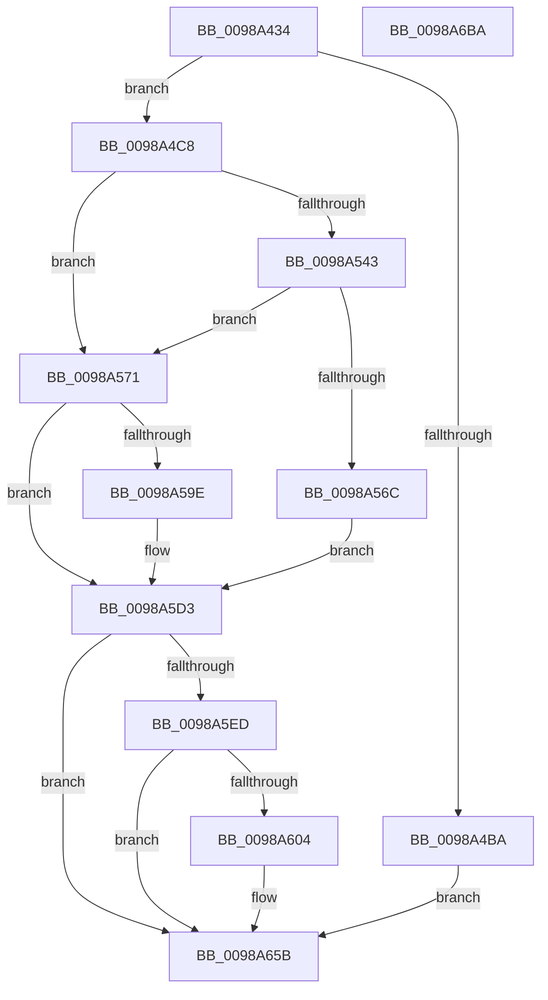

# PopPowerAggregatorNotifyCsStateExited

- RVA: `0x0098A434`–`0x0098A6BB` (길이 `647` bytes)
- VA: `0x000000014098A434`
- 실행 섹션: `PAGE`
- PDB 이름 있음: `예`; PDB Function 태그: `아니요`
- unwind 정보 RVA: `0x00098698`
- 디코드: `155`개 명령, `647/647` bytes 표시
- 미해석 바이트: `0` (있으면 어셈블리에 `.byte`로 보존)

> 이 문서는 커널 이미지의 기계어와 PDB 기호를 분석해 생성했습니다. 4번과 5번은 함수 원형과 자료형을 바이너리 사용 방식에서 추정한 C 해석이며 원본 소스 복구 결과는 아닙니다.

## 1. Dependencies

- 직접 호출 지점: **14**; 고유 호출 대상: **12**
- 직접 호출자로 확인된 함수: **1**
- RIP 상대 이미지 참조: **4**

### Outgoing calls
- `0x0098A4A4` → [PoBlockConsoleSwitchEx](../../text/43/PoBlockConsoleSwitchEx_function_00435CD4.md) (function, `0x00435CD4`)
- `0x0098A4B1` → [TtmIsEnabled](../91/TtmIsEnabled_function_009143D8.md) (function, `0x009143D8`)
- `0x0098A4BE` → [TtmNotifyLowPowerStateExited](TtmNotifyLowPowerStateExited_function_0098A878.md) (function, `0x0098A878`)
- `0x0098A509` → [memset](../../text/6C/memset_function_006C6C40.md) (function, `0x006C6C40`)
- `0x0098A519` → [PopIsStateTransitionBlockingThread](../../pagelk/B7/PopIsStateTransitionBlockingThread_function_00B79380.md) (function, `0x00B79380`)
- `0x0098A53A` → [PopDiagTraceWin32kCalloutStart](../91/PopDiagTraceWin32kCalloutStart_function_0091564C.md) (function, `0x0091564C`)
- `0x0098A563` → [ZwPowerInformation](../../text/6A/ZwPowerInformation_function_006ADCB0.md) (function, `0x006ADCB0`)
- `0x0098A58D` → [PopInvokeWin32CalloutWithWatchdog](../91/PopInvokeWin32CalloutWithWatchdog_function_00913920.md) (function, `0x00913920`)
- `0x0098A5A7` → [memset](../../text/6C/memset_function_006C6C40.md) (function, `0x006C6C40`)
- `0x0098A5CE` → [ZwPowerInformation](../../text/6A/ZwPowerInformation_function_006ADCB0.md) (function, `0x006ADCB0`)
- `0x0098A5FB` → [EtwEventEnabled](../../text/39/EtwEventEnabled_function_00392450.md) (function, `0x00392450`)
- `0x0098A656` → [EtwWrite](../../text/41/EtwWrite_function_0041C720.md) (function, `0x0041C720`)
- `0x0098A688` → [PopDispatchStateCallout](../91/PopDispatchStateCallout_function_0091248C.md) (function, `0x0091248C`)
- `0x0098A694` → [_security_check_cookie](../../text/6A/_security_check_cookie_function_006AC640.md) (function, `0x006AC640`)

### Direct callers
- [PopPowerAggregatorScreenOffActiveToActiveStateHandler](PopPowerAggregatorScreenOffActiveToActiveStateHandler_function_0098A360.md) at `0x0098A38E`

### Static image references
- `0x0098A457` → RVA `0x00E0A740` (`.data`; read)
- `0x0098A5D3` → RVA `0x00E67858` (`.data`; read)
- `0x0098A5ED` → RVA `0x00F0B408` (`.data`; read)
- `0x0098A5F4` → RVA `0x000119C8` (`.rdata`; read)

## 2. Other-region calls and transfers

- 다른 실행 섹션으로 향하는 call: **9**
  - `0x0098A4A4` → [PoBlockConsoleSwitchEx](../../text/43/PoBlockConsoleSwitchEx_function_00435CD4.md) (`PAGE` → `.text`)
  - `0x0098A509` → [memset](../../text/6C/memset_function_006C6C40.md) (`PAGE` → `.text`)
  - `0x0098A519` → [PopIsStateTransitionBlockingThread](../../pagelk/B7/PopIsStateTransitionBlockingThread_function_00B79380.md) (`PAGE` → `PAGELK`)
  - `0x0098A563` → [ZwPowerInformation](../../text/6A/ZwPowerInformation_function_006ADCB0.md) (`PAGE` → `.text`)
  - `0x0098A5A7` → [memset](../../text/6C/memset_function_006C6C40.md) (`PAGE` → `.text`)
  - `0x0098A5CE` → [ZwPowerInformation](../../text/6A/ZwPowerInformation_function_006ADCB0.md) (`PAGE` → `.text`)
  - `0x0098A5FB` → [EtwEventEnabled](../../text/39/EtwEventEnabled_function_00392450.md) (`PAGE` → `.text`)
  - `0x0098A656` → [EtwWrite](../../text/41/EtwWrite_function_0041C720.md) (`PAGE` → `.text`)
  - `0x0098A694` → [_security_check_cookie](../../text/6A/_security_check_cookie_function_006AC640.md) (`PAGE` → `.text`)
- 별도 외부 분기/꼬리 이동을 확인하지 못했습니다.

## 3. Assembly (complete function range)

```asm
0098A434  48 8B C4                        mov rax, rsp
0098A437  48 89 58 08                     mov qword ptr [rax + 8], rbx
0098A43B  48 89 70 10                     mov qword ptr [rax + 0x10], rsi
0098A43F  48 89 78 18                     mov qword ptr [rax + 0x18], rdi
0098A443  4C 89 60 20                     mov qword ptr [rax + 0x20], r12
0098A447  55                              push rbp
0098A448  41 56                           push r14
0098A44A  41 57                           push r15
0098A44C  48 8D 68 B8                     lea rbp, [rax - 0x48]
0098A450  48 81 EC 30 01 00 00            sub rsp, 0x130
0098A457  48 8B 05 E2 02 48 00            mov rax, qword ptr [rip + 0x4802e2]
0098A45E  48 33 C4                        xor rax, rsp
0098A461  48 89 45 20                     mov qword ptr [rbp + 0x20], rax
0098A465  0F 57 C0                        xorps xmm0, xmm0
0098A468  48 8D 54 24 38                  lea rdx, [rsp + 0x38]
0098A46D  33 C0                           xor eax, eax
0098A46F  48 8D 4D F0                     lea rcx, [rbp - 0x10]
0098A473  0F 11 45 00                     movups xmmword ptr [rbp], xmm0
0098A477  45 33 F6                        xor r14d, r14d
0098A47A  89 45 80                        mov dword ptr [rbp - 0x80], eax
0098A47D  45 33 C0                        xor r8d, r8d
0098A480  48 89 45 10                     mov qword ptr [rbp + 0x10], rax
0098A484  44 8D 78 01                     lea r15d, [rax + 1]
0098A488  44 89 74 24 38                  mov dword ptr [rsp + 0x38], r14d
0098A48D  44 89 7D 08                     mov dword ptr [rbp + 8], r15d
0098A491  0F 11 44 24 50                  movups xmmword ptr [rsp + 0x50], xmm0
0098A496  0F 11 44 24 60                  movups xmmword ptr [rsp + 0x60], xmm0
0098A49B  0F 11 44 24 70                  movups xmmword ptr [rsp + 0x70], xmm0
0098A4A0  0F 11 45 F0                     movups xmmword ptr [rbp - 0x10], xmm0
0098A4A4  E8 2B B8 AA FF                  call 0x140435cd4
0098A4A9  8B 44 24 38                     mov eax, dword ptr [rsp + 0x38]
0098A4AD  89 44 24 30                     mov dword ptr [rsp + 0x30], eax
0098A4B1  E8 22 9F F8 FF                  call 0x1409143d8
0098A4B6  84 C0                           test al, al
0098A4B8  74 0E                           je 0x14098a4c8
0098A4BA  8B 4C 24 30                     mov ecx, dword ptr [rsp + 0x30]
0098A4BE  E8 B5 03 00 00                  call 0x14098a878
0098A4C3  E9 93 01 00 00                  jmp 0x14098a65b
0098A4C8  0F 57 C0                        xorps xmm0, xmm0
0098A4CB  4C 89 75 80                     mov qword ptr [rbp - 0x80], r14
0098A4CF  0F 11 44 24 60                  movups xmmword ptr [rsp + 0x60], xmm0
0098A4D4  41 BC 60 00 00 00               mov r12d, 0x60
0098A4DA  33 D2                           xor edx, edx
0098A4DC  0F 11 44 24 70                  movups xmmword ptr [rsp + 0x70], xmm0
0098A4E1  45 8B C4                        mov r8d, r12d
0098A4E4  C7 44 24 60 05 00 00 00         mov dword ptr [rsp + 0x60], 5
0098A4EC  48 8D 4D 90                     lea rcx, [rbp - 0x70]
0098A4F0  44 88 74 24 64                  mov byte ptr [rsp + 0x64], r14b
0098A4F5  44 89 74 24 68                  mov dword ptr [rsp + 0x68], r14d
0098A4FA  4C 89 74 24 70                  mov qword ptr [rsp + 0x70], r14
0098A4FF  44 89 74 24 78                  mov dword ptr [rsp + 0x78], r14d
0098A504  0F 11 44 24 50                  movups xmmword ptr [rsp + 0x50], xmm0
0098A509  E8 32 C7 D3 FF                  call 0x1406c6c40
0098A50E  41 8B F6                        mov esi, r14d
0098A511  4C 89 74 24 48                  mov qword ptr [rsp + 0x48], r14
0098A516  41 8B FE                        mov edi, r14d
0098A519  E8 62 EE 1E 00                  call 0x140b79380
0098A51E  8A D8                           mov bl, al
0098A520  48 8D 54 24 50                  lea rdx, [rsp + 0x50]
0098A525  48 8D 44 24 30                  lea rax, [rsp + 0x30]
0098A52A  45 8A CF                        mov r9b, r15b
0098A52D  45 8B C7                        mov r8d, r15d
0098A530  48 89 44 24 20                  mov qword ptr [rsp + 0x20], rax
0098A535  41 8D 4C 24 A5                  lea ecx, [r12 - 0x5b]
0098A53A  E8 0D B1 F8 FF                  call 0x14091564c
0098A53F  84 DB                           test bl, bl
0098A541  75 2E                           jne 0x14098a571
0098A543  4C 8D 4C 24 48                  lea r9, [rsp + 0x48]
0098A548  C7 45 90 15 00 00 00            mov dword ptr [rbp - 0x70], 0x15
0098A54F  45 8B C4                        mov r8d, r12d
0098A552  C7 44 24 20 08 00 00 00         mov dword ptr [rsp + 0x20], 8
0098A55A  48 8D 55 90                     lea rdx, [rbp - 0x70]
0098A55E  41 8D 4C 24 F7                  lea ecx, [r12 - 9]
0098A563  E8 48 37 D2 FF                  call 0x1406adcb0
0098A568  85 C0                           test eax, eax
0098A56A  79 05                           jns 0x14098a571
0098A56C  41 8B FF                        mov edi, r15d
0098A56F  EB 62                           jmp 0x14098a5d3
0098A571  48 8B 44 24 48                  mov rax, qword ptr [rsp + 0x48]
0098A576  4C 8D 4C 24 30                  lea r9, [rsp + 0x30]
0098A57B  45 8B C7                        mov r8d, r15d
0098A57E  48 89 44 24 20                  mov qword ptr [rsp + 0x20], rax
0098A583  48 8D 54 24 50                  lea rdx, [rsp + 0x50]
0098A588  B9 05 00 00 00                  mov ecx, 5
0098A58D  E8 8E 93 F8 FF                  call 0x140913920
0098A592  48 8B 5C 24 48                  mov rbx, qword ptr [rsp + 0x48]
0098A597  8B F0                           mov esi, eax
0098A599  48 85 DB                        test rbx, rbx
0098A59C  74 35                           je 0x14098a5d3
0098A59E  4D 8B C4                        mov r8, r12
0098A5A1  48 8D 4D 90                     lea rcx, [rbp - 0x70]
0098A5A5  33 D2                           xor edx, edx
0098A5A7  E8 94 C6 D3 FF                  call 0x1406c6c40
0098A5AC  45 33 C9                        xor r9d, r9d
0098A5AF  C7 45 90 15 00 00 00            mov dword ptr [rbp - 0x70], 0x15
0098A5B6  45 8B C4                        mov r8d, r12d
0098A5B9  48 89 5D 98                     mov qword ptr [rbp - 0x68], rbx
0098A5BD  48 8D 55 90                     lea rdx, [rbp - 0x70]
0098A5C1  44 88 7D E8                     mov byte ptr [rbp - 0x18], r15b
0098A5C5  44 89 74 24 20                  mov dword ptr [rsp + 0x20], r14d
0098A5CA  41 8D 49 57                     lea ecx, [r9 + 0x57]
0098A5CE  E8 DD 36 D2 FF                  call 0x1406adcb0
0098A5D3  44 38 35 7E D2 4D 00            cmp byte ptr [rip + 0x4dd27e], r14b
0098A5DA  48 8D 44 24 50                  lea rax, [rsp + 0x50]
0098A5DF  48 89 45 88                     mov qword ptr [rbp - 0x78], rax
0098A5E3  89 7C 24 40                     mov dword ptr [rsp + 0x40], edi
0098A5E7  89 74 24 38                     mov dword ptr [rsp + 0x38], esi
0098A5EB  74 6E                           je 0x14098a65b
0098A5ED  48 8B 0D 14 0E 58 00            mov rcx, qword ptr [rip + 0x580e14]
0098A5F4  48 8D 15 CD 73 68 FF            lea rdx, [rip - 0x978c33]
0098A5FB  E8 50 7E A0 FF                  call 0x140392450
0098A600  84 C0                           test al, al
0098A602  74 57                           je 0x14098a65b
0098A604  48 8B 0D FD 0D 58 00            mov rcx, qword ptr [rip + 0x580dfd]
0098A60B  48 8D 45 88                     lea rax, [rbp - 0x78]
0098A60F  48 89 45 F0                     mov qword ptr [rbp - 0x10], rax
0098A613  48 8D 15 AE 73 68 FF            lea rdx, [rip - 0x978c52]
0098A61A  48 8D 44 24 38                  lea rax, [rsp + 0x38]
0098A61F  48 C7 45 F8 08 00 00 00         mov qword ptr [rbp - 8], 8
0098A627  48 89 45 00                     mov qword ptr [rbp], rax
0098A62B  41 B9 03 00 00 00               mov r9d, 3
0098A631  48 8D 44 24 40                  lea rax, [rsp + 0x40]
0098A636  48 C7 45 08 04 00 00 00         mov qword ptr [rbp + 8], 4
0098A63E  48 89 45 10                     mov qword ptr [rbp + 0x10], rax
0098A642  45 33 C0                        xor r8d, r8d
0098A645  48 8D 45 F0                     lea rax, [rbp - 0x10]
0098A649  48 C7 45 18 04 00 00 00         mov qword ptr [rbp + 0x18], 4
0098A651  48 89 44 24 20                  mov qword ptr [rsp + 0x20], rax
0098A656  E8 C5 20 A9 FF                  call 0x14041c720
0098A65B  33 C0                           xor eax, eax
0098A65D  48 8D 54 24 40                  lea rdx, [rsp + 0x40]
0098A662  0F 57 C0                        xorps xmm0, xmm0
0098A665  48 89 45 10                     mov qword ptr [rbp + 0x10], rax
0098A669  8B 44 24 30                     mov eax, dword ptr [rsp + 0x30]
0098A66D  48 8D 4D F0                     lea rcx, [rbp - 0x10]
0098A671  0F 11 45 00                     movups xmmword ptr [rbp], xmm0
0098A675  89 44 24 40                     mov dword ptr [rsp + 0x40], eax
0098A679  0F 11 45 F0                     movups xmmword ptr [rbp - 0x10], xmm0
0098A67D  44 89 7D 08                     mov dword ptr [rbp + 8], r15d
0098A681  C7 45 10 07 00 00 00            mov dword ptr [rbp + 0x10], 7
0098A688  E8 FF 7D F8 FF                  call 0x14091248c
0098A68D  48 8B 4D 20                     mov rcx, qword ptr [rbp + 0x20]
0098A691  48 33 CC                        xor rcx, rsp
0098A694  E8 A7 1F D2 FF                  call 0x1406ac640
0098A699  4C 8D 9C 24 30 01 00 00         lea r11, [rsp + 0x130]
0098A6A1  49 8B 5B 20                     mov rbx, qword ptr [r11 + 0x20]
0098A6A5  49 8B 73 28                     mov rsi, qword ptr [r11 + 0x28]
0098A6A9  49 8B 7B 30                     mov rdi, qword ptr [r11 + 0x30]
0098A6AD  4D 8B 63 38                     mov r12, qword ptr [r11 + 0x38]
0098A6B1  49 8B E3                        mov rsp, r11
0098A6B4  41 5F                           pop r15
0098A6B6  41 5E                           pop r14
0098A6B8  5D                              pop rbp
0098A6B9  C3                              ret
0098A6BA  CC                              int3
```

## 4. C-style interpretation (structured pseudocode)

```c
__int64 __fastcall PopPowerAggregatorNotifyCsStateExited(__int64 a1, __int64 a2, int a3)
{
    __int64 result;
    __int64 v_r14;
    __int64 v_rsp;
    unsigned __int64 v_stack_m100;
    unsigned int v_stack_m108;
    unsigned __int64 v_stack_m110;
    unsigned int v_stack_m118;
    unsigned __int64 v_stack_m128;
    unsigned __int64 v_stack_m18;
    unsigned int v_stack_mD0;
    unsigned __int64 v_stack_mD8;
    unsigned int v_stack_mE0;
    unsigned __int8 v_stack_mE4;
    unsigned __int64 v_stack_mE8;
    unsigned __int64 v_stack_mF8;

    *(unsigned __int64 *)(v_rsp + 8) = v_rbx;
    *(unsigned __int64 *)(v_rsp + 16) = v_rsi;
    *(unsigned __int64 *)(v_rsp + 24) = v_rdi;
    *(unsigned __int64 *)(v_rsp + 32) = v_r12;
    v_rsp = (v_rsp) - (304);
    result = (*(unsigned __int64 *)(v_rip + 4719330)) ^ (v_rsp);
    *(unsigned __int64 *)(v_rsp - 72 + 32) = result;
    result = 0;
    *(unsigned __int64 *)(v_rsp - 72) = v_xmm0;
    v_r14 = 0;
    *(unsigned int *)(v_rsp - 72 - 128) = 0;
    a3 = 0;
    *(unsigned __int64 *)(v_rsp - 72 + 16) = 0;
    v_stack_m110 = 0;
    *(unsigned int *)(v_rsp - 72 + 8) = (unsigned int)(result + 1);
    v_stack_mF8 = v_xmm0;
    v_stack_mE8 = v_xmm0;
    v_stack_mD8 = v_xmm0;
    *(unsigned __int64 *)(v_rsp - 72 - 16) = v_xmm0;
    result = PoBlockConsoleSwitchEx(v_rsp - 72 - 16, v_stack_m110, a3, a4);
    v_stack_m118 = (unsigned int)((unsigned int)(v_stack_m110));
    result = TtmIsEnabled(v_rsp - 72 - 16, v_stack_m110, a3, a4);
    if ((unsigned __int8)(result) == 0) goto loc_0098A4C8;
    result = TtmNotifyLowPowerStateExited((unsigned int)(v_stack_m118), v_stack_m110, a3, a4);
    goto loc_0098A65B;
loc_0098A4C8:
    *(unsigned __int64 *)(v_rsp - 72 - 128) = 0;
    v_stack_mE8 = v_xmm0;
    a2 = 0;
    v_stack_mD8 = v_xmm0;
    v_stack_mE8 = 5;
    v_stack_mE4 = 0;
    v_stack_mE0 = 0;
    v_stack_mD8 = 0;
    v_stack_mD0 = 0;
    v_stack_mF8 = v_xmm0;
    result = memset(v_rsp - 72 - 112, a2, 96, a4);
    v_stack_m100 = 0;
    result = PopIsStateTransitionBlockingThread(v_rsp - 72 - 112, a2, 96, a4);
    v_stack_m128 = v_stack_m118;
    result = PopDiagTraceWin32kCalloutStart(96 - 91, v_stack_mF8, (unsigned int)((unsigned int)(result + 1)), (unsigned __int8)(result + 1));
    if ((unsigned __int8)((unsigned __int8)(result)) != 0) goto loc_0098A571;
    *(unsigned int *)(v_rsp - 72 - 112) = 21;
    v_stack_m128 = 8;
    result = ZwPowerInformation(96 - 9, v_rsp - 72 - 112, 96, v_stack_m100);
    if (!sign_flag) goto loc_0098A571;
    goto loc_0098A5D3;
loc_0098A571:
    v_stack_m128 = v_stack_m100;
    result = PopInvokeWin32CalloutWithWatchdog(5, v_stack_mF8, (unsigned int)((unsigned int)(result + 1)), v_stack_m118);
    if (v_stack_m100 != 0) {
        a3 = 96;
        a1 = v_rsp - 72 - 112;
        a2 = 0;
        result = memset(a1, a2, a3, v_stack_m118);
        a4 = 0;
        *(unsigned int *)(v_rsp - 72 - 112) = 21;
        a3 = 96;
        *(unsigned __int64 *)(v_rsp - 72 - 104) = v_stack_m100;
        a2 = v_rsp - 72 - 112;
        *(unsigned __int8 *)(v_rsp - 72 - 24) = (unsigned __int8)(result + 1);
        v_stack_m128 = 0;
        a1 = a4 + 87;
        result = ZwPowerInformation(a1, a2, a3, a4);
    }
    *(unsigned __int64 *)(v_rsp - 72 - 120) = v_stack_mF8;
    v_stack_m108 = (unsigned int)((unsigned int)((unsigned int)(result + 1)));
    v_stack_m110 = (unsigned int)((unsigned int)((unsigned int)(result)));
    if ((*(unsigned __int8 *)(v_rip + 5100158)) == 0) goto loc_0098A65B;
    result = EtwEventEnabled(*(unsigned __int64 *)(v_rip + 5770772), v_rip - 9931827, a3, a4);
    if ((unsigned __int8)(result) != 0) {
        a1 = *(unsigned __int64 *)(v_rip + 5770749);
        result = v_rsp - 72 - 120;
        *(unsigned __int64 *)(v_rsp - 72 - 16) = result;
        a2 = v_rip - 9931858;
        result = v_stack_m110;
        *(unsigned __int64 *)(v_rsp - 72 - 8) = 8;
        *(unsigned __int64 *)(v_rsp - 72) = result;
        a4 = 3;
        result = v_stack_m108;
        *(unsigned __int64 *)(v_rsp - 72 + 8) = 4;
        *(unsigned __int64 *)(v_rsp - 72 + 16) = result;
        a3 = 0;
        result = v_rsp - 72 - 16;
        *(unsigned __int64 *)(v_rsp - 72 + 24) = 4;
        v_stack_m128 = result;
        result = EtwWrite(a1, a2, a3, a4);
    }
    result = 0;
    *(unsigned __int64 *)(v_rsp - 72 + 16) = 0;
    *(unsigned __int64 *)(v_rsp - 72) = v_xmm0;
    v_stack_m108 = (unsigned int)((unsigned int)(v_stack_m118));
    *(unsigned __int64 *)(v_rsp - 72 - 16) = v_xmm0;
    *(unsigned int *)(v_rsp - 72 + 8) = (unsigned int)(result + 1);
    *(unsigned int *)(v_rsp - 72 + 16) = 7;
    result = PopDispatchStateCallout(v_rsp - 72 - 16, v_stack_m108, a3, a4);
    a1 = (*(unsigned __int64 *)(v_rsp - 72 + 32)) ^ (v_rsp);
    result = _security_check_cookie(a1, v_stack_m108, a3, a4);
    return result;
}
```

## 5. (Beta) C Style

```c
int64_t PopPowerAggregatorNotifyCsStateExited(int64_t Arg1, int64_t Arg2, int32_t Arg3)
{
    int64_t result;
    int64_t local_r14;
    int64_t local_rsp;
    uint64_t v_stack_m100;
    uint32_t v_stack_m108;
    uint64_t v_stack_m110;
    uint32_t v_stack_m118;
    uint64_t v_stack_m128;
    uint64_t v_stack_m18;
    uint32_t v_stack_mD0;
    uint64_t v_stack_mD8;
    uint32_t v_stack_mE0;
    uint8_t v_stack_mE4;
    uint64_t v_stack_mE8;
    uint64_t v_stack_mF8;

    *(uint64_t *)(local_rsp + 0x8) = local_rbx;
    *(uint64_t *)(local_rsp + 0x10) = local_rsi;
    *(uint64_t *)(local_rsp + 0x18) = local_rdi;
    *(uint64_t *)(local_rsp + 0x20) = local_r12;
    local_rsp = (local_rsp) - (304);
    result = (*(uint64_t *)(v_rip + 0x4802E2)) ^ (local_rsp);
    *(uint64_t *)(local_rsp - 0x48 + 0x20) = result;
    result = 0;
    *(uint64_t *)(local_rsp - 0x48) = v_xmm0;
    local_r14 = 0;
    *(uint32_t *)(local_rsp - 0x48 - 0x80) = 0;
    Arg3 = 0;
    *(uint64_t *)(local_rsp - 0x48 + 0x10) = 0;
    v_stack_m110 = 0;
    *(uint32_t *)(local_rsp - 0x48 + 0x8) = (uint32_t)(result + 1);
    v_stack_mF8 = v_xmm0;
    v_stack_mE8 = v_xmm0;
    v_stack_mD8 = v_xmm0;
    *(uint64_t *)(local_rsp - 0x48 - 0x10) = v_xmm0;
    result = PoBlockConsoleSwitchEx(local_rsp - 72 - 16, v_stack_m110, Arg3, a4);
    v_stack_m118 = (uint32_t)((uint32_t)(v_stack_m110));
    result = TtmIsEnabled(local_rsp - 72 - 16, v_stack_m110, Arg3, a4);
    if ((uint8_t)(result) == 0) goto loc_0098A4C8;
    result = TtmNotifyLowPowerStateExited((uint32_t)(v_stack_m118), v_stack_m110, Arg3, a4);
    goto loc_0098A65B;
loc_0098A4C8:
    *(uint64_t *)(local_rsp - 0x48 - 0x80) = 0;
    v_stack_mE8 = v_xmm0;
    Arg2 = 0;
    v_stack_mD8 = v_xmm0;
    v_stack_mE8 = 5;
    v_stack_mE4 = 0;
    v_stack_mE0 = 0;
    v_stack_mD8 = 0;
    v_stack_mD0 = 0;
    v_stack_mF8 = v_xmm0;
    result = memset(local_rsp - 72 - 112, Arg2, 96, a4);
    v_stack_m100 = 0;
    result = PopIsStateTransitionBlockingThread(local_rsp - 72 - 112, Arg2, 96, a4);
    v_stack_m128 = v_stack_m118;
    result = PopDiagTraceWin32kCalloutStart(96 - 91, v_stack_mF8, (uint32_t)((uint32_t)(result + 1)), (uint8_t)(result + 1));
    if ((uint8_t)((uint8_t)(result)) != 0) goto loc_0098A571;
    *(uint32_t *)(local_rsp - 0x48 - 0x70) = 21;
    v_stack_m128 = 8;
    result = ZwPowerInformation(96 - 9, local_rsp - 72 - 112, 96, v_stack_m100);
    if (!sign_flag) goto loc_0098A571;
    goto loc_0098A5D3;
loc_0098A571:
    v_stack_m128 = v_stack_m100;
    result = PopInvokeWin32CalloutWithWatchdog(5, v_stack_mF8, (uint32_t)((uint32_t)(result + 1)), v_stack_m118);
    if (v_stack_m100 != 0) {
        Arg3 = 96;
        Arg1 = local_rsp - 72 - 112;
        Arg2 = 0;
        result = memset(Arg1, Arg2, Arg3, v_stack_m118);
        a4 = 0;
        *(uint32_t *)(local_rsp - 0x48 - 0x70) = 21;
        Arg3 = 96;
        *(uint64_t *)(local_rsp - 0x48 - 0x68) = v_stack_m100;
        Arg2 = local_rsp - 72 - 112;
        *(uint8_t *)(local_rsp - 0x48 - 0x18) = (uint8_t)(result + 1);
        v_stack_m128 = 0;
        Arg1 = a4 + 87;
        result = ZwPowerInformation(Arg1, Arg2, Arg3, a4);
    }
    *(uint64_t *)(local_rsp - 0x48 - 0x78) = v_stack_mF8;
    v_stack_m108 = (uint32_t)((uint32_t)((uint32_t)(result + 1)));
    v_stack_m110 = (uint32_t)((uint32_t)((uint32_t)(result)));
    if ((*(uint8_t *)(v_rip + 0x4DD27E)) == 0) goto loc_0098A65B;
    result = EtwEventEnabled(*(uint64_t *)(v_rip + 0x580E14), v_rip - 9931827, Arg3, a4);
    if ((uint8_t)(result) != 0) {
        Arg1 = *(uint64_t *)(v_rip + 0x580DFD);
        result = local_rsp - 72 - 120;
        *(uint64_t *)(local_rsp - 0x48 - 0x10) = result;
        Arg2 = v_rip - 9931858;
        result = v_stack_m110;
        *(uint64_t *)(local_rsp - 0x48 - 0x8) = 8;
        *(uint64_t *)(local_rsp - 0x48) = result;
        a4 = 3;
        result = v_stack_m108;
        *(uint64_t *)(local_rsp - 0x48 + 0x8) = 4;
        *(uint64_t *)(local_rsp - 0x48 + 0x10) = result;
        Arg3 = 0;
        result = local_rsp - 72 - 16;
        *(uint64_t *)(local_rsp - 0x48 + 0x18) = 4;
        v_stack_m128 = result;
        result = EtwWrite(Arg1, Arg2, Arg3, a4);
    }
    result = 0;
    *(uint64_t *)(local_rsp - 0x48 + 0x10) = 0;
    *(uint64_t *)(local_rsp - 0x48) = v_xmm0;
    v_stack_m108 = (uint32_t)((uint32_t)(v_stack_m118));
    *(uint64_t *)(local_rsp - 0x48 - 0x10) = v_xmm0;
    *(uint32_t *)(local_rsp - 0x48 + 0x8) = (uint32_t)(result + 1);
    *(uint32_t *)(local_rsp - 0x48 + 0x10) = 7;
    result = PopDispatchStateCallout(local_rsp - 72 - 16, v_stack_m108, Arg3, a4);
    Arg1 = (*(uint64_t *)(local_rsp - 0x48 + 0x20)) ^ (local_rsp);
    result = _security_check_cookie(Arg1, v_stack_m108, Arg3, a4);
    return result;
}
```

## 6. Execution-region graph

[열기: 2D/3D 그래프와 함수 탐색 컨트롤 패널](../../../control-panel.html?section=page&rva=0x0098A434&view=graph)

- 2D 그래프는 위에서 아래로 흐르고, 3D 그래프는 빈 공간을 드래그해 회전합니다. Shift+드래그는 이동, 휠은 확대·축소, 함수 노드 선택은 대상 보고서 이동입니다.

### Static fallback


