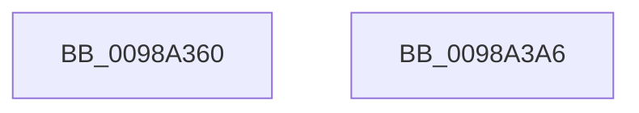

# PopPowerAggregatorScreenOffActiveToActiveStateHandler

- RVA: `0x0098A360`–`0x0098A3A7` (길이 `71` bytes)
- VA: `0x000000014098A360`
- 실행 섹션: `PAGE`
- PDB 이름 있음: `예`; PDB Function 태그: `아니요`
- unwind 정보 RVA: `0x00082420`
- 디코드: `17`개 명령, `71/71` bytes 표시
- 미해석 바이트: `0` (있으면 어셈블리에 `.byte`로 보존)

> 이 문서는 커널 이미지의 기계어와 PDB 기호를 분석해 생성했습니다. 4번과 5번은 함수 원형과 자료형을 바이너리 사용 방식에서 추정한 C 해석이며 원본 소스 복구 결과는 아닙니다.

## 1. Dependencies

- 직접 호출 지점: **4**; 고유 호출 대상: **4**
- 직접 호출자로 확인된 함수: **0**
- RIP 상대 이미지 참조: **1**

### Outgoing calls
- `0x0098A37D` → [PopPowerAggregatorSetCurrentState](PopPowerAggregatorSetCurrentState_function_0098A3B0.md) (function, `0x0098A3B0`)
- `0x0098A389` → [PopReleaseRwLock](../../text/2D/PopReleaseRwLock_function_002DFBBC.md) (function, `0x002DFBBC`)
- `0x0098A38E` → [PopPowerAggregatorNotifyCsStateExited](PopPowerAggregatorNotifyCsStateExited_function_0098A434.md) (function, `0x0098A434`)
- `0x0098A39A` → [PopAcquireRwLockExclusive](../../text/43/PopAcquireRwLockExclusive_function_00430B44.md) (function, `0x00430B44`)

### Direct callers
- 이 함수 시작 RVA로 연결되는 직접 call은 확인되지 않았습니다. 간접 호출은 완전히 역산할 수 없습니다.

### Static image references
- `0x0098A382` → RVA `0x00F09710` (`.data`; read)

## 2. Other-region calls and transfers

- 다른 실행 섹션으로 향하는 call: **2**
  - `0x0098A389` → [PopReleaseRwLock](../../text/2D/PopReleaseRwLock_function_002DFBBC.md) (`PAGE` → `.text`)
  - `0x0098A39A` → [PopAcquireRwLockExclusive](../../text/43/PopAcquireRwLockExclusive_function_00430B44.md) (`PAGE` → `.text`)
- 별도 외부 분기/꼬리 이동을 확인하지 못했습니다.

## 3. Assembly (complete function range)

```asm
0098A360  48 8B C4                        mov rax, rsp
0098A363  48 83 EC 48                     sub rsp, 0x48
0098A367  0F 57 C0                        xorps xmm0, xmm0
0098A36A  48 8D 50 D8                     lea rdx, [rax - 0x28]
0098A36E  0F 11 40 D8                     movups xmmword ptr [rax - 0x28], xmm0
0098A372  C7 40 D8 02 00 00 00            mov dword ptr [rax - 0x28], 2
0098A379  0F 11 40 E8                     movups xmmword ptr [rax - 0x18], xmm0
0098A37D  E8 2E 00 00 00                  call 0x14098a3b0
0098A382  48 8D 0D 87 F3 57 00            lea rcx, [rip + 0x57f387]
0098A389  E8 2E 58 95 FF                  call 0x1402dfbbc
0098A38E  E8 A1 00 00 00                  call 0x14098a434
0098A393  48 8D 0D 76 F3 57 00            lea rcx, [rip + 0x57f376]
0098A39A  E8 A5 67 AA FF                  call 0x140430b44
0098A39F  33 C0                           xor eax, eax
0098A3A1  48 83 C4 48                     add rsp, 0x48
0098A3A5  C3                              ret
0098A3A6  CC                              int3
```

## 4. C-style interpretation (structured pseudocode)

```c
__int64 __fastcall PopPowerAggregatorScreenOffActiveToActiveStateHandler(void)
{
    __int64 result;
    __int64 v_rsp;

    v_rsp = (v_rsp) - (72);
    *(unsigned __int64 *)(v_rsp - 40) = v_xmm0;
    *(unsigned int *)(v_rsp - 40) = 2;
    *(unsigned __int64 *)(v_rsp - 24) = v_xmm0;
    result = PopPowerAggregatorSetCurrentState(a1, v_rsp - 40, a3, a4);
    result = PopReleaseRwLock(v_rip + 5763975, v_rsp - 40, a3, a4);
    result = PopPowerAggregatorNotifyCsStateExited(v_rip + 5763975, v_rsp - 40, a3, a4);
    result = PopAcquireRwLockExclusive(v_rip + 5763958, v_rsp - 40, a3, a4);
    result = 0;
    v_rsp = (v_rsp) + (72);
    return result;
}
```

## 5. (Beta) C Style

```c
void PopPowerAggregatorScreenOffActiveToActiveStateHandler(void)
{
    int64_t result;
    int64_t local_rsp;

    local_rsp = (local_rsp) - (72);
    *(uint64_t *)(local_rsp - 0x28) = v_xmm0;
    *(uint32_t *)(local_rsp - 0x28) = 2;
    *(uint64_t *)(local_rsp - 0x18) = v_xmm0;
    result = PopPowerAggregatorSetCurrentState(a1, local_rsp - 40, a3, a4);
    result = PopReleaseRwLock(v_rip + 5763975, local_rsp - 40, a3, a4);
    result = PopPowerAggregatorNotifyCsStateExited(v_rip + 5763975, local_rsp - 40, a3, a4);
    result = PopAcquireRwLockExclusive(v_rip + 5763958, local_rsp - 40, a3, a4);
    result = 0;
    local_rsp = (local_rsp) + (72);
    return result;
}
```

## 6. Execution-region graph

[열기: 2D/3D 그래프와 함수 탐색 컨트롤 패널](../../../control-panel.html?section=page&rva=0x0098A360&view=graph)

- 2D 그래프는 위에서 아래로 흐르고, 3D 그래프는 빈 공간을 드래그해 회전합니다. Shift+드래그는 이동, 휠은 확대·축소, 함수 노드 선택은 대상 보고서 이동입니다.

### Static fallback


