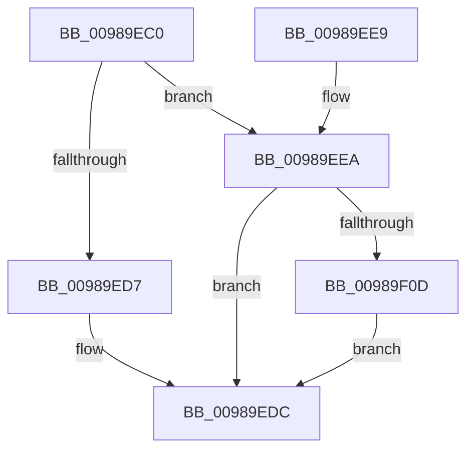

# PopPowerAggregatorScreenOffExitStateHandler

- RVA: `0x00989EC0`–`0x00989F31` (길이 `113` bytes)
- VA: `0x0000000140989EC0`
- 실행 섹션: `PAGE`
- PDB 이름 있음: `예`; PDB Function 태그: `아니요`
- unwind 정보 RVA: `0x00098644`
- 디코드: `30`개 명령, `113/113` bytes 표시
- 미해석 바이트: `0` (있으면 어셈블리에 `.byte`로 보존)

> 이 문서는 커널 이미지의 기계어와 PDB 기호를 분석해 생성했습니다. 4번과 5번은 함수 원형과 자료형을 바이너리 사용 방식에서 추정한 C 해석이며 원본 소스 복구 결과는 아닙니다.

## 1. Dependencies

- 직접 호출 지점: **5**; 고유 호출 대상: **5**
- 직접 호출자로 확인된 함수: **0**
- RIP 상대 이미지 참조: **1**

### Outgoing calls
- `0x00989ED7` → [PopPowerAggregatorEnterScreenOff](PopPowerAggregatorEnterScreenOff_function_00989F38.md) (function, `0x00989F38`)
- `0x00989EF1` → [PopReleaseRwLock](../../text/2D/PopReleaseRwLock_function_002DFBBC.md) (function, `0x002DFBBC`)
- `0x00989EF6` → [PopPdcAreAllPhasesDisengaged](PopPdcAreAllPhasesDisengaged_function_0098A238.md) (function, `0x0098A238`)
- `0x00989F04` → [PopAcquireRwLockExclusive](../../text/43/PopAcquireRwLockExclusive_function_00430B44.md) (function, `0x00430B44`)
- `0x00989F2A` → [PopPowerAggregatorSetCurrentState](PopPowerAggregatorSetCurrentState_function_0098A3B0.md) (function, `0x0098A3B0`)

### Direct callers
- 이 함수 시작 RVA로 연결되는 직접 call은 확인되지 않았습니다. 간접 호출은 완전히 역산할 수 없습니다.

### Static image references
- `0x00989EEA` → RVA `0x00F09710` (`.data`; read)

## 2. Other-region calls and transfers

- 다른 실행 섹션으로 향하는 call: **2**
  - `0x00989EF1` → [PopReleaseRwLock](../../text/2D/PopReleaseRwLock_function_002DFBBC.md) (`PAGE` → `.text`)
  - `0x00989F04` → [PopAcquireRwLockExclusive](../../text/43/PopAcquireRwLockExclusive_function_00430B44.md) (`PAGE` → `.text`)
- 별도 외부 분기/꼬리 이동을 확인하지 못했습니다.

## 3. Assembly (complete function range)

```asm
00989EC0  48 89 5C 24 08                  mov qword ptr [rsp + 8], rbx
00989EC5  57                              push rdi
00989EC6  48 83 EC 40                     sub rsp, 0x40
00989ECA  48 8B 41 20                     mov rax, qword ptr [rcx + 0x20]
00989ECE  48 8B F9                        mov rdi, rcx
00989ED1  48 39 41 40                     cmp qword ptr [rcx + 0x40], rax
00989ED5  74 13                           je 0x140989eea
00989ED7  E8 5C 00 00 00                  call 0x140989f38
00989EDC  48 8B 5C 24 50                  mov rbx, qword ptr [rsp + 0x50]
00989EE1  33 C0                           xor eax, eax
00989EE3  48 83 C4 40                     add rsp, 0x40
00989EE7  5F                              pop rdi
00989EE8  C3                              ret
00989EE9  CC                              int3
00989EEA  48 8D 0D 1F F8 57 00            lea rcx, [rip + 0x57f81f]
00989EF1  E8 C6 5C 95 FF                  call 0x1402dfbbc
00989EF6  E8 3D 03 00 00                  call 0x14098a238
00989EFB  48 8D 0D 0E F8 57 00            lea rcx, [rip + 0x57f80e]
00989F02  8A D8                           mov bl, al
00989F04  E8 3B 6C AA FF                  call 0x140430b44
00989F09  84 DB                           test bl, bl
00989F0B  74 CF                           je 0x140989edc
00989F0D  0F 57 C0                        xorps xmm0, xmm0
00989F10  48 8D 54 24 20                  lea rdx, [rsp + 0x20]
00989F15  0F 11 44 24 20                  movups xmmword ptr [rsp + 0x20], xmm0
00989F1A  48 8B CF                        mov rcx, rdi
00989F1D  C7 44 24 20 03 00 00 00         mov dword ptr [rsp + 0x20], 3
00989F25  0F 11 44 24 30                  movups xmmword ptr [rsp + 0x30], xmm0
00989F2A  E8 81 04 00 00                  call 0x14098a3b0
00989F2F  EB AB                           jmp 0x140989edc
```

## 4. C-style interpretation (structured pseudocode)

```c
__int64 __fastcall PopPowerAggregatorScreenOffExitStateHandler(__int64 a1)
{
    __int64 result;
    __int64 v_rsp;
    unsigned __int64 v_stack_p20;
    unsigned __int64 v_stack_p30;
    unsigned __int64 v_stack_p8;

    v_stack_p8 = v_rbx;
    v_rsp = (v_rsp) - (64);
    if ((*(unsigned __int64 *)(a1 + 64)) == (*(unsigned __int64 *)(a1 + 32))) goto loc_00989EEA;
    result = PopPowerAggregatorEnterScreenOff(a1, a2, a3, a4);
loc_00989EDC:
    result = 0;
    v_rsp = (v_rsp) + (64);
    return result;
loc_00989EEA:
    result = PopReleaseRwLock(v_rip + 5765151, a2, a3, a4);
    result = PopPdcAreAllPhasesDisengaged(v_rip + 5765151, a2, a3, a4);
    result = PopAcquireRwLockExclusive(v_rip + 5765134, a2, a3, a4);
    if ((unsigned __int8)((unsigned __int8)(result)) == 0) goto loc_00989EDC;
    v_stack_p20 = v_xmm0;
    v_stack_p20 = 3;
    v_stack_p30 = v_xmm0;
    result = PopPowerAggregatorSetCurrentState(a1, v_stack_p20, a3, a4);
    goto loc_00989EDC;
}
```

## 5. (Beta) C Style

```c
int64_t PopPowerAggregatorScreenOffExitStateHandler(void *Arg1)
{
    uint8_t *arg1 = (uint8_t *)Arg1;

    int64_t result;
    int64_t local_rsp;
    uint64_t v_stack_p20;
    uint64_t v_stack_p30;
    uint64_t v_stack_p8;

    v_stack_p8 = local_rbx;
    local_rsp = (local_rsp) - (64);
    if ((*(uint64_t *)(arg1 + 0x40)) == (*(uint64_t *)(arg1 + 0x20))) goto loc_00989EEA;
    result = PopPowerAggregatorEnterScreenOff(Arg1, a2, a3, a4);
loc_00989EDC:
    result = 0;
    local_rsp = (local_rsp) + (64);
    return result;
loc_00989EEA:
    result = PopReleaseRwLock(v_rip + 5765151, a2, a3, a4);
    result = PopPdcAreAllPhasesDisengaged(v_rip + 5765151, a2, a3, a4);
    result = PopAcquireRwLockExclusive(v_rip + 5765134, a2, a3, a4);
    if ((uint8_t)((uint8_t)(result)) == 0) goto loc_00989EDC;
    v_stack_p20 = v_xmm0;
    v_stack_p20 = 3;
    v_stack_p30 = v_xmm0;
    result = PopPowerAggregatorSetCurrentState(Arg1, v_stack_p20, a3, a4);
    goto loc_00989EDC;
}
```

### 관측된 메모리 오프셋

구조체 형식이 확인되지 않은 접근은 인자 기준의 오프셋으로만 기록했습니다.

| 기준 인자 | 오프셋 표현 | 폭 (bit) | 접근 |
|---|---:|---:|---|
| `Arg1` | `+ 0x20` | `64` | `R` |
| `Arg1` | `+ 0x40` | `64` | `R` |

## 6. Execution-region graph

[열기: 2D/3D 그래프와 함수 탐색 컨트롤 패널](../../../control-panel.html?section=page&rva=0x00989EC0&view=graph)

- 2D 그래프는 위에서 아래로 흐르고, 3D 그래프는 빈 공간을 드래그해 회전합니다. Shift+드래그는 이동, 휠은 확대·축소, 함수 노드 선택은 대상 보고서 이동입니다.

### Static fallback


