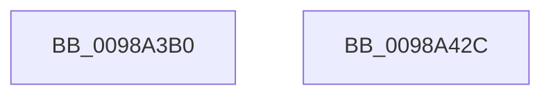

# PopPowerAggregatorSetCurrentState

- RVA: `0x0098A3B0`–`0x0098A42D` (길이 `125` bytes)
- VA: `0x000000014098A3B0`
- 실행 섹션: `PAGE`
- PDB 이름 있음: `예`; PDB Function 태그: `아니요`
- unwind 정보 RVA: `0x00060BC4`
- 디코드: `35`개 명령, `125/125` bytes 표시
- 미해석 바이트: `0` (있으면 어셈블리에 `.byte`로 보존)

> 이 문서는 커널 이미지의 기계어와 PDB 기호를 분석해 생성했습니다. 4번과 5번은 함수 원형과 자료형을 바이너리 사용 방식에서 추정한 C 해석이며 원본 소스 복구 결과는 아닙니다.

## 1. Dependencies

- 직접 호출 지점: **2**; 고유 호출 대상: **2**
- 직접 호출자로 확인된 함수: **8**
- RIP 상대 이미지 참조: **0**

### Outgoing calls
- `0x0098A3DA` → [PopPowerAggregatorDiagTraceInternalStateChange](PopPowerAggregatorDiagTraceInternalStateChange_function_0098A6C4.md) (function, `0x0098A6C4`)
- `0x0098A3E7` → [PopPowerAggregatorAllocateLogEntry](../91/PopPowerAggregatorAllocateLogEntry_function_00915F7C.md) (function, `0x00915F7C`)

### Direct callers
- [PopPowerAggregatorActiveToScreenOffStateHandler](../76/PopPowerAggregatorActiveToScreenOffStateHandler_function_007642F0.md) at `0x00764311`
- [PopPowerAggregatorEngageModernStandby](../76/PopPowerAggregatorEngageModernStandby_function_00764784.md) at `0x007647E6`
- [PopPowerAggregatorSystemTransitionEnterStateHandler](../76/PopPowerAggregatorSystemTransitionEnterStateHandler_function_007650E0.md) at `0x00765120`
- [PopPowerAggregatorSystemTransitionExitStateHandler](../76/PopPowerAggregatorSystemTransitionExitStateHandler_function_00765180.md) at `0x007651B2`
- [PopPowerAggregatorScreenOffExitStateHandler](PopPowerAggregatorScreenOffExitStateHandler_function_00989EC0.md) at `0x00989F2A`
- [PopPowerAggregatorEnterScreenOff](PopPowerAggregatorEnterScreenOff_function_00989F38.md) at `0x00989FA0`
- [PopPowerAggregatorScreenOffActiveToActiveStateHandler](PopPowerAggregatorScreenOffActiveToActiveStateHandler_function_0098A360.md) at `0x0098A37D`
- [PopPowerAggregatorDisplayPoweringOnStateHandler](../AC/PopPowerAggregatorDisplayPoweringOnStateHandler_function_00AC1BA0.md) at `0x00AC1BC1`

### Static image references
- 디코드된 RIP-relative 메모리 참조가 없습니다.

## 2. Other-region calls and transfers

- 다른 실행 섹션으로 향하는 call: **0**
- 별도 외부 분기/꼬리 이동을 확인하지 못했습니다.

## 3. Assembly (complete function range)

```asm
0098A3B0  48 89 5C 24 08                  mov qword ptr [rsp + 8], rbx
0098A3B5  48 89 74 24 10                  mov qword ptr [rsp + 0x10], rsi
0098A3BA  57                              push rdi
0098A3BB  48 83 EC 20                     sub rsp, 0x20
0098A3BF  8B 41 18                        mov eax, dword ptr [rcx + 0x18]
0098A3C2  48 8D 59 38                     lea rbx, [rcx + 0x38]
0098A3C6  89 42 04                        mov dword ptr [rdx + 4], eax
0098A3C9  48 8B F1                        mov rsi, rcx
0098A3CC  48 8B 41 20                     mov rax, qword ptr [rcx + 0x20]
0098A3D0  48 8B FA                        mov rdi, rdx
0098A3D3  48 8B CB                        mov rcx, rbx
0098A3D6  48 89 42 08                     mov qword ptr [rdx + 8], rax
0098A3DA  E8 E5 02 00 00                  call 0x14098a6c4
0098A3DF  BA 02 00 00 00                  mov edx, 2
0098A3E4  48 8B CE                        mov rcx, rsi
0098A3E7  E8 90 BB F8 FF                  call 0x140915f7c
0098A3EC  0F 10 03                        movups xmm0, xmmword ptr [rbx]
0098A3EF  0F 11 40 18                     movups xmmword ptr [rax + 0x18], xmm0
0098A3F3  0F 10 4B 10                     movups xmm1, xmmword ptr [rbx + 0x10]
0098A3F7  0F 11 48 28                     movups xmmword ptr [rax + 0x28], xmm1
0098A3FB  0F 10 07                        movups xmm0, xmmword ptr [rdi]
0098A3FE  0F 11 40 38                     movups xmmword ptr [rax + 0x38], xmm0
0098A402  0F 10 4F 10                     movups xmm1, xmmword ptr [rdi + 0x10]
0098A406  0F 11 48 48                     movups xmmword ptr [rax + 0x48], xmm1
0098A40A  0F 10 07                        movups xmm0, xmmword ptr [rdi]
0098A40D  0F 11 03                        movups xmmword ptr [rbx], xmm0
0098A410  0F 10 4F 10                     movups xmm1, xmmword ptr [rdi + 0x10]
0098A414  83 4E 08 02                     or dword ptr [rsi + 8], 2
0098A418  48 8B 74 24 38                  mov rsi, qword ptr [rsp + 0x38]
0098A41D  0F 11 4B 10                     movups xmmword ptr [rbx + 0x10], xmm1
0098A421  48 8B 5C 24 30                  mov rbx, qword ptr [rsp + 0x30]
0098A426  48 83 C4 20                     add rsp, 0x20
0098A42A  5F                              pop rdi
0098A42B  C3                              ret
0098A42C  CC                              int3
```

## 4. C-style interpretation (structured pseudocode)

```c
__int64 __fastcall PopPowerAggregatorSetCurrentState(__int64 a1, __int64 a2)
{
    __int64 result;
    __int64 v_rsp;
    unsigned __int64 v_stack_p10;
    unsigned __int64 v_stack_p8;

    v_stack_p8 = v_rbx;
    v_stack_p10 = v_rsi;
    v_rsp = (v_rsp) - (32);
    *(unsigned int *)(a2 + 4) = (unsigned int)((unsigned int)(*(unsigned int *)(a1 + 24)));
    *(unsigned __int64 *)(a2 + 8) = *(unsigned __int64 *)(a1 + 32);
    result = PopPowerAggregatorDiagTraceInternalStateChange(a1 + 56, a2, a3, a4);
    result = PopPowerAggregatorAllocateLogEntry(a1, 2, a3, a4);
    *(unsigned __int64 *)(result + 24) = v_xmm0;
    *(unsigned __int64 *)(result + 40) = v_xmm1;
    *(unsigned __int64 *)(result + 56) = v_xmm0;
    *(unsigned __int64 *)(result + 72) = v_xmm1;
    *(unsigned __int64 *)(a1 + 56) = v_xmm0;
    *(unsigned __int64 *)(a1 + 56 + 16) = v_xmm1;
    v_rsp = (v_rsp) + (32);
    return result;
}
```

## 5. (Beta) C Style

```c
int64_t PopPowerAggregatorSetCurrentState(void *Arg1, void *Arg2)
{
    uint8_t *arg1 = (uint8_t *)Arg1;
    uint8_t *arg2 = (uint8_t *)Arg2;

    int64_t result;
    int64_t local_rsp;
    uint64_t v_stack_p10;
    uint64_t v_stack_p8;

    v_stack_p8 = local_rbx;
    v_stack_p10 = local_rsi;
    local_rsp = (local_rsp) - (32);
    *(uint32_t *)(arg2 + 0x4) = (uint32_t)((uint32_t)(*(uint32_t *)(arg1 + 0x18)));
    *(uint64_t *)(arg2 + 0x8) = *(uint64_t *)(arg1 + 0x20);
    result = PopPowerAggregatorDiagTraceInternalStateChange(Arg1 + 56, Arg2, a3, a4);
    result = PopPowerAggregatorAllocateLogEntry(Arg1, 2, a3, a4);
    *(uint64_t *)(result + 0x18) = v_xmm0;
    *(uint64_t *)(result + 0x28) = v_xmm1;
    *(uint64_t *)(result + 0x38) = v_xmm0;
    *(uint64_t *)(result + 0x48) = v_xmm1;
    *(uint64_t *)(arg1 + 0x38) = v_xmm0;
    *(uint64_t *)(arg1 + 0x38 + 0x10) = v_xmm1;
    local_rsp = (local_rsp) + (32);
    return result;
}
```

### 관측된 메모리 오프셋

구조체 형식이 확인되지 않은 접근은 인자 기준의 오프셋으로만 기록했습니다.

| 기준 인자 | 오프셋 표현 | 폭 (bit) | 접근 |
|---|---:|---:|---|
| `Arg1` | `+ 0x0` | `128` | `R` |
| `Arg1` | `+ 0x8` | `32` | `R/W` |
| `Arg1` | `+ 0x10` | `128` | `R` |
| `Arg1` | `+ 0x18` | `32` | `R` |
| `Arg1` | `+ 0x20` | `64` | `R` |
| `Arg1` | `+ 0x38` | `64` | `R` |
| `Arg2` | `+ 0x0` | `128` | `R` |
| `Arg2` | `+ 0x4` | `32` | `W` |
| `Arg2` | `+ 0x8` | `64` | `W` |
| `Arg2` | `+ 0x10` | `128` | `R` |

## 6. Execution-region graph

[열기: 2D/3D 그래프와 함수 탐색 컨트롤 패널](../../../control-panel.html?section=page&rva=0x0098A3B0&view=graph)

- 2D 그래프는 위에서 아래로 흐르고, 3D 그래프는 빈 공간을 드래그해 회전합니다. Shift+드래그는 이동, 휠은 확대·축소, 함수 노드 선택은 대상 보고서 이동입니다.

### Static fallback


