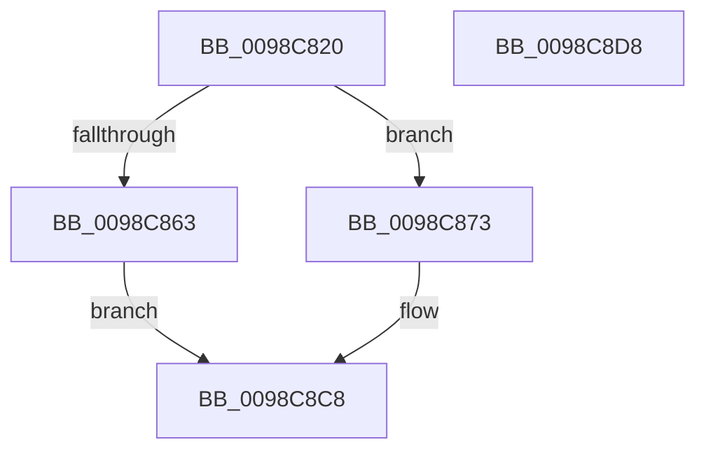

# PopPowerRequestCallbackDisplayRequired

- RVA: `0x0098C820`–`0x0098C8D9` (길이 `185` bytes)
- VA: `0x000000014098C820`
- 실행 섹션: `PAGE`
- PDB 이름 있음: `예`; PDB Function 태그: `아니요`
- unwind 정보 RVA: `0x000987BC`
- 디코드: `57`개 명령, `185/185` bytes 표시
- 미해석 바이트: `0` (있으면 어셈블리에 `.byte`로 보존)

> 이 문서는 커널 이미지의 기계어와 PDB 기호를 분석해 생성했습니다. 4번과 5번은 함수 원형과 자료형을 바이너리 사용 방식에서 추정한 C 해석이며 원본 소스 복구 결과는 아닙니다.

## 1. Dependencies

- 직접 호출 지점: **4**; 고유 호출 대상: **4**
- 직접 호출자로 확인된 함수: **0**
- RIP 상대 이미지 참조: **0**

### Outgoing calls
- `0x0098C855` → [PoEnergyContextUpdateComponentPower](PoEnergyContextUpdateComponentPower_function_0098CA08.md) (function, `0x0098CA08`)
- `0x0098C85A` → [TtmIsEnabled](../91/TtmIsEnabled_function_009143D8.md) (function, `0x009143D8`)
- `0x0098C86C` → [TtmNotifySessionDisplayRequiredChange](TtmNotifySessionDisplayRequiredChange_function_0098C6B4.md) (function, `0x0098C6B4`)
- `0x0098C8C3` → [PopInvokeWin32Callout](../91/PopInvokeWin32Callout_function_009125F4.md) (function, `0x009125F4`)

### Direct callers
- 이 함수 시작 RVA로 연결되는 직접 call은 확인되지 않았습니다. 간접 호출은 완전히 역산할 수 없습니다.

### Static image references
- 디코드된 RIP-relative 메모리 참조가 없습니다.

## 2. Other-region calls and transfers

- 다른 실행 섹션으로 향하는 call: **0**
- 별도 외부 분기/꼬리 이동을 확인하지 못했습니다.

## 3. Assembly (complete function range)

```asm
0098C820  48 89 5C 24 10                  mov qword ptr [rsp + 0x10], rbx
0098C825  55                              push rbp
0098C826  56                              push rsi
0098C827  57                              push rdi
0098C828  48 8B EC                        mov rbp, rsp
0098C82B  48 83 EC 60                     sub rsp, 0x60
0098C82F  33 C0                           xor eax, eax
0098C831  41 8A D8                        mov bl, r8b
0098C834  21 45 20                        and dword ptr [rbp + 0x20], eax
0098C837  48 8B F9                        mov rdi, rcx
0098C83A  48 8B 89 88 00 00 00            mov rcx, qword ptr [rcx + 0x88]
0098C841  BA 0C 00 00 00                  mov edx, 0xc
0098C846  89 45 C4                        mov dword ptr [rbp - 0x3c], eax
0098C849  41 8A C0                        mov al, r8b
0098C84C  F6 D8                           neg al
0098C84E  4D 1B C0                        sbb r8, r8
0098C851  49 83 C0 02                     add r8, 2
0098C855  E8 AE 01 00 00                  call 0x14098ca08
0098C85A  E8 79 7B F8 FF                  call 0x1409143d8
0098C85F  84 C0                           test al, al
0098C861  74 10                           je 0x14098c873
0098C863  8B 57 24                        mov edx, dword ptr [rdi + 0x24]
0098C866  44 8A C3                        mov r8b, bl
0098C869  8B 4F 10                        mov ecx, dword ptr [rdi + 0x10]
0098C86C  E8 43 FE FF FF                  call 0x14098c6b4
0098C871  EB 55                           jmp 0x14098c8c8
0098C873  0F 57 C0                        xorps xmm0, xmm0
0098C876  4C 8D 4F 10                     lea r9, [rdi + 0x10]
0098C87A  0F 11 45 D0                     movups xmmword ptr [rbp - 0x30], xmm0
0098C87E  F6 DB                           neg bl
0098C880  48 8D 55 C0                     lea rdx, [rbp - 0x40]
0098C884  0F 11 45 E0                     movups xmmword ptr [rbp - 0x20], xmm0
0098C888  1B C0                           sbb eax, eax
0098C88A  C7 45 D0 02 00 00 00            mov dword ptr [rbp - 0x30], 2
0098C891  83 E0 02                        and eax, 2
0098C894  FF C8                           dec eax
0098C896  89 45 30                        mov dword ptr [rbp + 0x30], eax
0098C899  33 C0                           xor eax, eax
0098C89B  88 45 D4                        mov byte ptr [rbp - 0x2c], al
0098C89E  0F 11 45 C0                     movups xmmword ptr [rbp - 0x40], xmm0
0098C8A2  8D 48 04                        lea ecx, [rax + 4]
0098C8A5  48 8D 45 30                     lea rax, [rbp + 0x30]
0098C8A9  89 4D D8                        mov dword ptr [rbp - 0x28], ecx
0098C8AC  48 89 45 E0                     mov qword ptr [rbp - 0x20], rax
0098C8B0  44 8D 41 FD                     lea r8d, [rcx - 3]
0098C8B4  48 8D 45 20                     lea rax, [rbp + 0x20]
0098C8B8  89 4D E8                        mov dword ptr [rbp - 0x18], ecx
0098C8BB  41 8D 48 04                     lea ecx, [r8 + 4]
0098C8BF  48 89 45 F0                     mov qword ptr [rbp - 0x10], rax
0098C8C3  E8 2C 5D F8 FF                  call 0x1409125f4
0098C8C8  48 8B 9C 24 88 00 00 00         mov rbx, qword ptr [rsp + 0x88]
0098C8D0  48 83 C4 60                     add rsp, 0x60
0098C8D4  5F                              pop rdi
0098C8D5  5E                              pop rsi
0098C8D6  5D                              pop rbp
0098C8D7  C3                              ret
0098C8D8  CC                              int3
```

## 4. C-style interpretation (structured pseudocode)

```c
__int64 __fastcall PopPowerRequestCallbackDisplayRequired(__int64 a1, __int64 a2, __int64 a3)
{
    __int64 result;
    __int64 v_rbx;
    __int64 v_rsp;
    unsigned __int64 v_stack_m28;
    unsigned int v_stack_m30;
    unsigned __int64 v_stack_m38;
    unsigned int v_stack_m40;
    unsigned __int8 v_stack_m44;
    unsigned __int64 v_stack_m48;
    unsigned int v_stack_m54;
    unsigned __int64 v_stack_m58;
    unsigned __int64 v_stack_p10;
    unsigned int v_stack_p18;
    unsigned int v_stack_p8;

    v_stack_p10 = v_rbx;
    v_rsp = (v_rsp) - (96);
    result = 0;
    v_stack_m54 = 0;
    result = (unsigned __int8)(-((unsigned __int8)(a3)));
    a3 = (a3) + (2);
    result = PoEnergyContextUpdateComponentPower(*(unsigned __int64 *)(a1 + 136), 12, a3, a4);
    result = TtmIsEnabled(*(unsigned __int64 *)(a1 + 136), 12, a3, a4);
    if ((unsigned __int8)(result) == 0) goto loc_0098C873;
    result = TtmNotifySessionDisplayRequiredChange((unsigned int)(*(unsigned int *)(a1 + 16)), (unsigned int)(*(unsigned int *)(a1 + 36)), (unsigned __int8)((unsigned __int8)(a3)), a4);
    goto loc_0098C8C8;
loc_0098C873:
    v_stack_m48 = v_xmm0;
    v_rbx = (unsigned __int8)(-((unsigned __int8)(a3)));
    v_stack_m38 = v_xmm0;
    v_stack_m48 = 2;
    result = (unsigned int)((result) & (2));
    result = (unsigned int)((result) - 1);
    v_stack_p18 = (unsigned int)(result);
    result = 0;
    v_stack_m44 = 0;
    v_stack_m58 = v_xmm0;
    v_stack_m40 = (unsigned int)(result + 4);
    v_stack_m38 = v_stack_p18;
    v_stack_m30 = (unsigned int)(result + 4);
    v_stack_m28 = v_stack_p8;
    result = PopInvokeWin32Callout(result + 4 - 3 + 4, v_stack_m58, result + 4 - 3, a1 + 16);
loc_0098C8C8:
    v_rsp = (v_rsp) + (96);
    return result;
}
```

## 5. (Beta) C Style

```c
int64_t PopPowerRequestCallbackDisplayRequired(void *Arg1, int64_t Arg2, int64_t Arg3)
{
    uint8_t *arg1 = (uint8_t *)Arg1;

    int64_t result;
    int64_t local_rbx;
    int64_t local_rsp;
    uint64_t v_stack_m28;
    uint32_t v_stack_m30;
    uint64_t v_stack_m38;
    uint32_t v_stack_m40;
    uint8_t v_stack_m44;
    uint64_t v_stack_m48;
    uint32_t v_stack_m54;
    uint64_t v_stack_m58;
    uint64_t v_stack_p10;
    uint32_t v_stack_p18;
    uint32_t v_stack_p8;

    v_stack_p10 = local_rbx;
    local_rsp = (local_rsp) - (96);
    result = 0;
    v_stack_m54 = 0;
    result = (uint8_t)(-((uint8_t)(Arg3)));
    Arg3 = (Arg3) + (2);
    result = PoEnergyContextUpdateComponentPower(*(uint64_t *)(arg1 + 0x88), 12, Arg3, a4);
    result = TtmIsEnabled(*(uint64_t *)(arg1 + 0x88), 12, Arg3, a4);
    if ((uint8_t)(result) == 0) goto loc_0098C873;
    result = TtmNotifySessionDisplayRequiredChange((uint32_t)(*(uint32_t *)(arg1 + 0x10)), (uint32_t)(*(uint32_t *)(arg1 + 0x24)), (uint8_t)((uint8_t)(Arg3)), a4);
    goto loc_0098C8C8;
loc_0098C873:
    v_stack_m48 = v_xmm0;
    local_rbx = (uint8_t)(-((uint8_t)(Arg3)));
    v_stack_m38 = v_xmm0;
    v_stack_m48 = 2;
    result = (uint32_t)((result) & (2));
    result = (uint32_t)((result) - 1);
    v_stack_p18 = (uint32_t)(result);
    result = 0;
    v_stack_m44 = 0;
    v_stack_m58 = v_xmm0;
    v_stack_m40 = (uint32_t)(result + 4);
    v_stack_m38 = v_stack_p18;
    v_stack_m30 = (uint32_t)(result + 4);
    v_stack_m28 = v_stack_p8;
    result = PopInvokeWin32Callout(result + 4 - 3 + 4, v_stack_m58, result + 4 - 3, Arg1 + 16);
loc_0098C8C8:
    local_rsp = (local_rsp) + (96);
    return result;
}
```

### 관측된 메모리 오프셋

구조체 형식이 확인되지 않은 접근은 인자 기준의 오프셋으로만 기록했습니다.

| 기준 인자 | 오프셋 표현 | 폭 (bit) | 접근 |
|---|---:|---:|---|
| `Arg1` | `+ 0x10` | `32` | `R` |
| `Arg1` | `+ 0x10` | `64` | `R` |
| `Arg1` | `+ 0x24` | `32` | `R` |
| `Arg1` | `+ 0x88` | `64` | `R` |

## 6. Execution-region graph

[열기: 2D/3D 그래프와 함수 탐색 컨트롤 패널](../../../control-panel.html?section=page&rva=0x0098C820&view=graph)

- 2D 그래프는 위에서 아래로 흐르고, 3D 그래프는 빈 공간을 드래그해 회전합니다. Shift+드래그는 이동, 휠은 확대·축소, 함수 노드 선택은 대상 보고서 이동입니다.

### Static fallback


