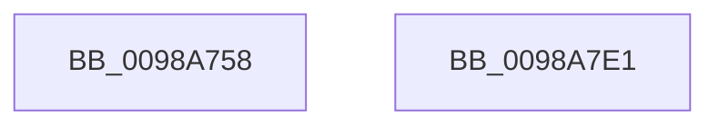

# PopScreenOff

- RVA: `0x0098A758`–`0x0098A7E2` (길이 `138` bytes)
- VA: `0x000000014098A758`
- 실행 섹션: `PAGE`
- PDB 이름 있음: `예`; PDB Function 태그: `아니요`
- unwind 정보 RVA: `0x000986C4`
- 디코드: `38`개 명령, `138/138` bytes 표시
- 미해석 바이트: `0` (있으면 어셈블리에 `.byte`로 보존)

> 이 문서는 커널 이미지의 기계어와 PDB 기호를 분석해 생성했습니다. 4번과 5번은 함수 원형과 자료형을 바이너리 사용 방식에서 추정한 C 해석이며 원본 소스 복구 결과는 아닙니다.

## 1. Dependencies

- 직접 호출 지점: **3**; 고유 호출 대상: **3**
- 직접 호출자로 확인된 함수: **3**
- RIP 상대 이미지 참조: **0**

### Outgoing calls
- `0x0098A78D` → [PoBlockConsoleSwitchEx](../../text/43/PoBlockConsoleSwitchEx_function_00435CD4.md) (function, `0x00435CD4`)
- `0x0098A7A2` → [PopControlMonitor](PopControlMonitor_function_0098A7F0.md) (function, `0x0098A7F0`)
- `0x0098A7D1` → [PopDispatchStateCallout](../91/PopDispatchStateCallout_function_0091248C.md) (function, `0x0091248C`)

### Direct callers
- [NtPowerInformation](../95/NtPowerInformation_function_00955D80.md) at `0x00957CFC`
- [PopPowerInformationInternal](../A8/PopPowerInformationInternal_function_00A8B7C0.md) at `0x00A8BE9E`
- [PopIssueActionRequest](../A9/PopIssueActionRequest_function_00A9CE54.md) at `0x00A9CF7C`

### Static image references
- 디코드된 RIP-relative 메모리 참조가 없습니다.

## 2. Other-region calls and transfers

- 다른 실행 섹션으로 향하는 call: **1**
  - `0x0098A78D` → [PoBlockConsoleSwitchEx](../../text/43/PoBlockConsoleSwitchEx_function_00435CD4.md) (`PAGE` → `.text`)
- 별도 외부 분기/꼬리 이동을 확인하지 못했습니다.

## 3. Assembly (complete function range)

```asm
0098A758  48 89 5C 24 18                  mov qword ptr [rsp + 0x18], rbx
0098A75D  55                              push rbp
0098A75E  48 8B EC                        mov rbp, rsp
0098A761  48 83 EC 50                     sub rsp, 0x50
0098A765  0F 57 C0                        xorps xmm0, xmm0
0098A768  48 8D 55 10                     lea rdx, [rbp + 0x10]
0098A76C  33 C0                           xor eax, eax
0098A76E  8B D9                           mov ebx, ecx
0098A770  21 45 10                        and dword ptr [rbp + 0x10], eax
0098A773  48 8D 4D D0                     lea rcx, [rbp - 0x30]
0098A777  0F 11 45 E0                     movups xmmword ptr [rbp - 0x20], xmm0
0098A77B  45 33 C0                        xor r8d, r8d
0098A77E  C7 45 E8 01 00 00 00            mov dword ptr [rbp - 0x18], 1
0098A785  0F 11 45 D0                     movups xmmword ptr [rbp - 0x30], xmm0
0098A789  48 89 45 F0                     mov qword ptr [rbp - 0x10], rax
0098A78D  E8 42 B5 AA FF                  call 0x140435cd4
0098A792  83 65 18 00                     and dword ptr [rbp + 0x18], 0
0098A796  48 8D 4D 18                     lea rcx, [rbp + 0x18]
0098A79A  89 5D 1C                        mov dword ptr [rbp + 0x1c], ebx
0098A79D  8B 5D 10                        mov ebx, dword ptr [rbp + 0x10]
0098A7A0  8B D3                           mov edx, ebx
0098A7A2  E8 49 00 00 00                  call 0x14098a7f0
0098A7A7  0F 57 C0                        xorps xmm0, xmm0
0098A7AA  89 5D 10                        mov dword ptr [rbp + 0x10], ebx
0098A7AD  33 C0                           xor eax, eax
0098A7AF  48 8D 55 10                     lea rdx, [rbp + 0x10]
0098A7B3  0F 11 45 E0                     movups xmmword ptr [rbp - 0x20], xmm0
0098A7B7  48 89 45 F0                     mov qword ptr [rbp - 0x10], rax
0098A7BB  48 8D 4D D0                     lea rcx, [rbp - 0x30]
0098A7BF  C7 45 E8 01 00 00 00            mov dword ptr [rbp - 0x18], 1
0098A7C6  C7 45 F0 07 00 00 00            mov dword ptr [rbp - 0x10], 7
0098A7CD  0F 11 45 D0                     movups xmmword ptr [rbp - 0x30], xmm0
0098A7D1  E8 B6 7C F8 FF                  call 0x14091248c
0098A7D6  48 8B 5C 24 70                  mov rbx, qword ptr [rsp + 0x70]
0098A7DB  48 83 C4 50                     add rsp, 0x50
0098A7DF  5D                              pop rbp
0098A7E0  C3                              ret
0098A7E1  CC                              int3
```

## 4. C-style interpretation (structured pseudocode)

```c
__int64 __fastcall PopScreenOff(int a1, __int64 a2, int a3)
{
    __int64 result;
    __int64 v_rsp;
    unsigned __int64 v_stack_m18;
    unsigned int v_stack_m20;
    unsigned __int64 v_stack_m28;
    unsigned __int64 v_stack_m38;
    unsigned int v_stack_p10;
    unsigned int v_stack_p14;
    unsigned __int64 v_stack_p18;
    unsigned __int64 v_stack_p8;

    v_stack_p18 = v_rbx;
    v_rsp = (v_rsp) - (80);
    result = 0;
    v_stack_m28 = v_xmm0;
    a3 = 0;
    v_stack_m20 = 1;
    v_stack_m38 = v_xmm0;
    v_stack_m18 = 0;
    result = PoBlockConsoleSwitchEx(v_stack_m38, v_stack_p8, a3, a4);
    v_stack_p14 = (unsigned int)((unsigned int)(a1));
    result = PopControlMonitor(v_stack_p10, (unsigned int)((unsigned int)((unsigned int)(v_stack_p8))), a3, a4);
    v_stack_p8 = (unsigned int)((unsigned int)(v_stack_p8));
    result = 0;
    v_stack_m28 = v_xmm0;
    v_stack_m18 = 0;
    v_stack_m20 = 1;
    v_stack_m18 = 7;
    v_stack_m38 = v_xmm0;
    result = PopDispatchStateCallout(v_stack_m38, v_stack_p8, a3, a4);
    v_rsp = (v_rsp) + (80);
    return result;
}
```

## 5. (Beta) C Style

```c
int64_t PopScreenOff(int32_t Arg1, int64_t Arg2, int32_t Arg3)
{
    int64_t result;
    int64_t local_rsp;
    uint64_t v_stack_m18;
    uint32_t v_stack_m20;
    uint64_t v_stack_m28;
    uint64_t v_stack_m38;
    uint32_t v_stack_p10;
    uint32_t v_stack_p14;
    uint64_t v_stack_p18;
    uint64_t v_stack_p8;

    v_stack_p18 = local_rbx;
    local_rsp = (local_rsp) - (80);
    result = 0;
    v_stack_m28 = v_xmm0;
    Arg3 = 0;
    v_stack_m20 = 1;
    v_stack_m38 = v_xmm0;
    v_stack_m18 = 0;
    result = PoBlockConsoleSwitchEx(v_stack_m38, v_stack_p8, Arg3, a4);
    v_stack_p14 = (uint32_t)((uint32_t)(Arg1));
    result = PopControlMonitor(v_stack_p10, (uint32_t)((uint32_t)((uint32_t)(v_stack_p8))), Arg3, a4);
    v_stack_p8 = (uint32_t)((uint32_t)(v_stack_p8));
    result = 0;
    v_stack_m28 = v_xmm0;
    v_stack_m18 = 0;
    v_stack_m20 = 1;
    v_stack_m18 = 7;
    v_stack_m38 = v_xmm0;
    result = PopDispatchStateCallout(v_stack_m38, v_stack_p8, Arg3, a4);
    local_rsp = (local_rsp) + (80);
    return result;
}
```

## 6. Execution-region graph

[열기: 2D/3D 그래프와 함수 탐색 컨트롤 패널](../../../control-panel.html?section=page&rva=0x0098A758&view=graph)

- 2D 그래프는 위에서 아래로 흐르고, 3D 그래프는 빈 공간을 드래그해 회전합니다. Shift+드래그는 이동, 휠은 확대·축소, 함수 노드 선택은 대상 보고서 이동입니다.

### Static fallback


