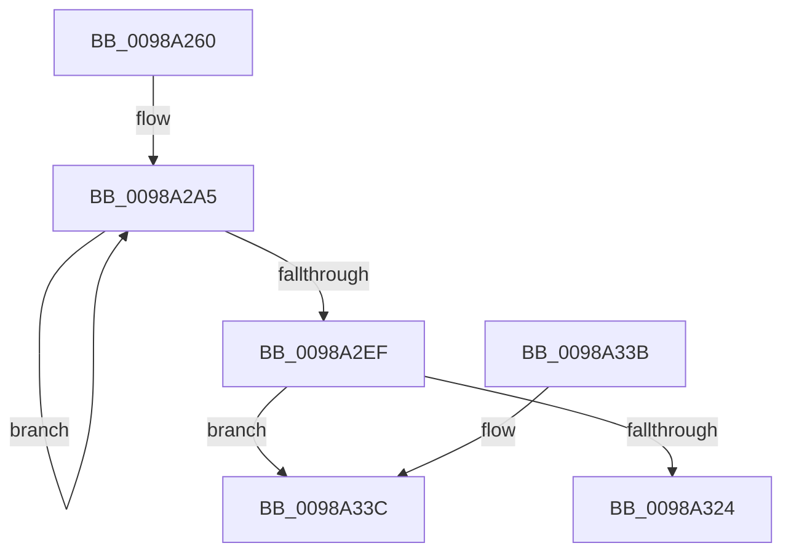

# PopSnapSystemIdleContext

- RVA: `0x0098A260`–`0x0098A34E` (길이 `238` bytes)
- VA: `0x000000014098A260`
- 실행 섹션: `PAGE`
- PDB 이름 있음: `예`; PDB Function 태그: `예`
- unwind 정보 RVA: `0x00093470`
- 디코드: `60`개 명령, `238/238` bytes 표시
- 미해석 바이트: `0` (있으면 어셈블리에 `.byte`로 보존)

> 이 문서는 커널 이미지의 기계어와 PDB 기호를 분석해 생성했습니다. 4번과 5번은 함수 원형과 자료형을 바이너리 사용 방식에서 추정한 C 해석이며 원본 소스 복구 결과는 아닙니다.

## 1. Dependencies

- 직접 호출 지점: **3**; 고유 호출 대상: **3**
- 직접 호출자로 확인된 함수: **2**
- RIP 상대 이미지 참조: **4**

### Outgoing calls
- `0x0098A277` → [PopAcquireRwLockExclusive](../../text/43/PopAcquireRwLockExclusive_function_00430B44.md) (function, `0x00430B44`)
- `0x0098A28A` → [ExAllocatePool2](../../poolcode/B8/ExAllocatePool2_function_00B820F0.md) (function, `0x00B820F0`)
- `0x0098A32B` → [PopReleaseRwLock](../../text/2D/PopReleaseRwLock_function_002DFBBC.md) (function, `0x002DFBBC`)

### Direct callers
- [PopIdlePhaseWatchdogCallback](../../text/4C/PopIdlePhaseWatchdogCallback_function_004CB090.md) at `0x004CB15A`
- [PopArmIdlePhaseWatchdog](PopArmIdlePhaseWatchdog_function_0098A10C.md) at `0x0098A151`

### Static image references
- `0x0098A270` → RVA `0x00F093E0` (`.data`; read)
- `0x0098A29A` → RVA `0x00E0B6B0` (`.data`; read)
- `0x0098A31B` → RVA `0x00E0B7D4` (`.data`; read)
- `0x0098A33C` → RVA `0x00E0B6FC` (`.data`; read)

## 2. Other-region calls and transfers

- 다른 실행 섹션으로 향하는 call: **3**
  - `0x0098A277` → [PopAcquireRwLockExclusive](../../text/43/PopAcquireRwLockExclusive_function_00430B44.md) (`PAGE` → `.text`)
  - `0x0098A28A` → [ExAllocatePool2](../../poolcode/B8/ExAllocatePool2_function_00B820F0.md) (`PAGE` → `POOLCODE`)
  - `0x0098A32B` → [PopReleaseRwLock](../../text/2D/PopReleaseRwLock_function_002DFBBC.md) (`PAGE` → `.text`)
- call이 아닌 외부 분기/꼬리 이동: **1**
  - `0x0098A349` → [sub_00B2B870](../B2/Unknown_function_00B2B870.md) (`tail-transfer`)

## 3. Assembly (complete function range)

```asm
0098A260  48 89 5C 24 08                  mov qword ptr [rsp + 8], rbx
0098A265  57                              push rdi
0098A266  48 83 EC 20                     sub rsp, 0x20
0098A26A  48 8B D9                        mov rbx, rcx
0098A26D  48 8B FA                        mov rdi, rdx
0098A270  48 8D 0D 69 F1 57 00            lea rcx, [rip + 0x57f169]
0098A277  E8 C8 68 AA FF                  call 0x140430b44
0098A27C  BA 48 01 00 00                  mov edx, 0x148
0098A281  41 B8 50 64 69 67               mov r8d, 0x67696450
0098A287  8D 4A B8                        lea ecx, [rdx - 0x48]
0098A28A  E8 61 7E 1F 00                  call 0x140b820f0
0098A28F  BA 02 00 00 00                  mov edx, 2
0098A294  48 89 03                        mov qword ptr [rbx], rax
0098A297  48 8B C8                        mov rcx, rax
0098A29A  48 8D 05 0F 14 48 00            lea rax, [rip + 0x48140f]
0098A2A1  44 8D 42 7E                     lea r8d, [rdx + 0x7e]
0098A2A5  0F 10 00                        movups xmm0, xmmword ptr [rax]
0098A2A8  0F 11 01                        movups xmmword ptr [rcx], xmm0
0098A2AB  0F 10 48 10                     movups xmm1, xmmword ptr [rax + 0x10]
0098A2AF  0F 11 49 10                     movups xmmword ptr [rcx + 0x10], xmm1
0098A2B3  0F 10 40 20                     movups xmm0, xmmword ptr [rax + 0x20]
0098A2B7  0F 11 41 20                     movups xmmword ptr [rcx + 0x20], xmm0
0098A2BB  0F 10 48 30                     movups xmm1, xmmword ptr [rax + 0x30]
0098A2BF  0F 11 49 30                     movups xmmword ptr [rcx + 0x30], xmm1
0098A2C3  0F 10 40 40                     movups xmm0, xmmword ptr [rax + 0x40]
0098A2C7  0F 11 41 40                     movups xmmword ptr [rcx + 0x40], xmm0
0098A2CB  0F 10 48 50                     movups xmm1, xmmword ptr [rax + 0x50]
0098A2CF  0F 11 49 50                     movups xmmword ptr [rcx + 0x50], xmm1
0098A2D3  0F 10 40 60                     movups xmm0, xmmword ptr [rax + 0x60]
0098A2D7  0F 11 41 60                     movups xmmword ptr [rcx + 0x60], xmm0
0098A2DB  49 03 C8                        add rcx, r8
0098A2DE  0F 10 48 70                     movups xmm1, xmmword ptr [rax + 0x70]
0098A2E2  49 03 C0                        add rax, r8
0098A2E5  0F 11 49 F0                     movups xmmword ptr [rcx - 0x10], xmm1
0098A2E9  48 83 EA 01                     sub rdx, 1
0098A2ED  75 B6                           jne 0x14098a2a5
0098A2EF  0F 10 00                        movups xmm0, xmmword ptr [rax]
0098A2F2  45 33 C9                        xor r9d, r9d
0098A2F5  0F 11 01                        movups xmmword ptr [rcx], xmm0
0098A2F8  0F 10 48 10                     movups xmm1, xmmword ptr [rax + 0x10]
0098A2FC  0F 11 49 10                     movups xmmword ptr [rcx + 0x10], xmm1
0098A300  0F 10 40 20                     movups xmm0, xmmword ptr [rax + 0x20]
0098A304  0F 11 41 20                     movups xmmword ptr [rcx + 0x20], xmm0
0098A308  0F 10 48 30                     movups xmm1, xmmword ptr [rax + 0x30]
0098A30C  0F 11 49 30                     movups xmmword ptr [rcx + 0x30], xmm1
0098A310  48 8B 40 40                     mov rax, qword ptr [rax + 0x40]
0098A314  48 89 41 40                     mov qword ptr [rcx + 0x40], rax
0098A318  44 89 0F                        mov dword ptr [rdi], r9d
0098A31B  44 39 0D B2 14 48 00            cmp dword ptr [rip + 0x4814b2], r9d
0098A322  75 18                           jne 0x14098a33c
0098A324  48 8D 0D B5 F0 57 00            lea rcx, [rip + 0x57f0b5]
0098A32B  E8 8C 58 95 FF                  call 0x1402dfbbc
0098A330  48 8B 5C 24 30                  mov rbx, qword ptr [rsp + 0x30]
0098A335  48 83 C4 20                     add rsp, 0x20
0098A339  5F                              pop rdi
0098A33A  C3                              ret
0098A33B  CC                              int3
0098A33C  48 8D 0D B9 13 48 00            lea rcx, [rip + 0x4813b9]
0098A343  41 B8 04 00 00 00               mov r8d, 4
0098A349  E9 22 15 1A 00                  jmp 0x140b2b870
```

## 4. C-style interpretation (structured pseudocode)

```c
__int64 __fastcall PopSnapSystemIdleContext(__int64 a1, __int64 a2, __int64 a3, int a4)
{
    __int64 result;
    __int64 v_rsp;
    unsigned __int64 v_stack_p8;

    v_stack_p8 = v_rbx;
    v_rsp = (v_rsp) - (32);
    result = PopAcquireRwLockExclusive(v_rip + 5763433, a2, a3, a4);
    result = ExAllocatePool2(328 - 72, 328, (unsigned int)(0x67696450ULL), a4);
    *(unsigned __int64 *)(a1) = result;
loc_0098A2A5:
    *(unsigned __int64 *)(result) = v_xmm0;
    *(unsigned __int64 *)(result + 16) = v_xmm1;
    *(unsigned __int64 *)(result + 32) = v_xmm0;
    *(unsigned __int64 *)(result + 48) = v_xmm1;
    *(unsigned __int64 *)(result + 64) = v_xmm0;
    *(unsigned __int64 *)(result + 80) = v_xmm1;
    *(unsigned __int64 *)(result + 96) = v_xmm0;
    a1 = (result) + (2 + 126);
    result = (v_rip + 4723727) + (2 + 126);
    *(unsigned __int64 *)(a1 - 16) = v_xmm1;
    a2 = (2) - (1);
    if (condition_is_not_equal) goto loc_0098A2A5;
    a4 = 0;
    *(unsigned __int64 *)(a1) = v_xmm0;
    *(unsigned __int64 *)(a1 + 16) = v_xmm1;
    *(unsigned __int64 *)(a1 + 32) = v_xmm0;
    *(unsigned __int64 *)(a1 + 48) = v_xmm1;
    *(unsigned __int64 *)(a1 + 64) = *(unsigned __int64 *)(result + 64);
    *(unsigned int *)(a2) = 0;
    if ((*(unsigned int *)(v_rip + 4723890)) != 0) goto loc_0098A33C;
    result = PopReleaseRwLock(v_rip + 5763253, a2, 2 + 126, a4);
    v_rsp = (v_rsp) + (32);
    return result;
loc_0098A33C:
}
```

## 5. (Beta) C Style

```c
int64_t PopSnapSystemIdleContext(void *Arg1, void *Arg2, int64_t Arg3, int32_t Arg4)
{
    uint8_t *arg1 = (uint8_t *)Arg1;
    uint8_t *arg2 = (uint8_t *)Arg2;

    int64_t result;
    int64_t local_rsp;
    uint64_t v_stack_p8;

    v_stack_p8 = local_rbx;
    local_rsp = (local_rsp) - (32);
    result = PopAcquireRwLockExclusive(v_rip + 5763433, Arg2, Arg3, Arg4);
    result = ExAllocatePool2(328 - 72, 328, (uint32_t)(0x67696450ULL), Arg4);
    *(uint64_t *)(arg1) = result;
loc_0098A2A5:
    *(uint64_t *)(result) = v_xmm0;
    *(uint64_t *)(result + 0x10) = v_xmm1;
    *(uint64_t *)(result + 0x20) = v_xmm0;
    *(uint64_t *)(result + 0x30) = v_xmm1;
    *(uint64_t *)(result + 0x40) = v_xmm0;
    *(uint64_t *)(result + 0x50) = v_xmm1;
    *(uint64_t *)(result + 0x60) = v_xmm0;
    Arg1 = (result) + (2 + 126);
    result = (v_rip + 4723727) + (2 + 126);
    *(uint64_t *)(arg1 - 0x10) = v_xmm1;
    Arg2 = (2) - (1);
    if (condition_is_not_equal) goto loc_0098A2A5;
    Arg4 = 0;
    *(uint64_t *)(arg1) = v_xmm0;
    *(uint64_t *)(arg1 + 0x10) = v_xmm1;
    *(uint64_t *)(arg1 + 0x20) = v_xmm0;
    *(uint64_t *)(arg1 + 0x30) = v_xmm1;
    *(uint64_t *)(arg1 + 0x40) = *(uint64_t *)(result + 0x40);
    *(uint32_t *)(arg2) = 0;
    if ((*(uint32_t *)(v_rip + 0x4814B2)) != 0) goto loc_0098A33C;
    result = PopReleaseRwLock(v_rip + 5763253, Arg2, 2 + 126, Arg4);
    local_rsp = (local_rsp) + (32);
    return result;
loc_0098A33C:
}
```

### 관측된 메모리 오프셋

구조체 형식이 확인되지 않은 접근은 인자 기준의 오프셋으로만 기록했습니다.

| 기준 인자 | 오프셋 표현 | 폭 (bit) | 접근 |
|---|---:|---:|---|
| `Arg1` | `+ 0x0` | `64` | `W` |
| `Arg2` | `+ 0x0` | `32` | `W` |

## 6. Execution-region graph

[열기: 2D/3D 그래프와 함수 탐색 컨트롤 패널](../../../control-panel.html?section=page&rva=0x0098A260&view=graph)

- 2D 그래프는 위에서 아래로 흐르고, 3D 그래프는 빈 공간을 드래그해 회전합니다. Shift+드래그는 이동, 휠은 확대·축소, 함수 노드 선택은 대상 보고서 이동입니다.

### Static fallback


