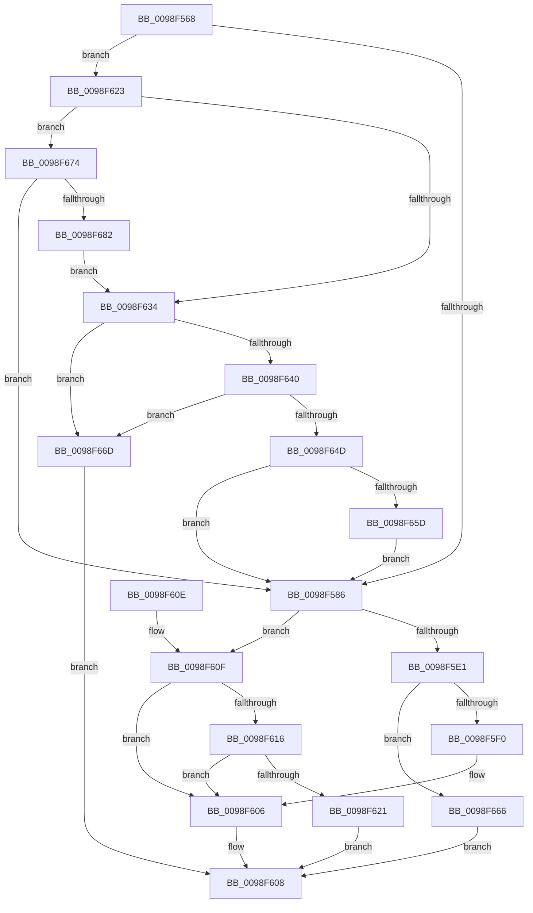

# PspLocateInPEManifest

- RVA: `0x0098F568`–`0x0098F684` (길이 `284` bytes)
- VA: `0x000000014098F568`
- 실행 섹션: `PAGE`
- PDB 이름 있음: `예`; PDB Function 태그: `아니요`
- unwind 정보 RVA: `0x00098A54`
- 디코드: `66`개 명령, `284/284` bytes 표시
- 미해석 바이트: `0` (있으면 어셈블리에 `.byte`로 보존)

> 이 문서는 커널 이미지의 기계어와 PDB 기호를 분석해 생성했습니다. 4번과 5번은 함수 원형과 자료형을 바이너리 사용 방식에서 추정한 C 해석이며 원본 소스 복구 결과는 아닙니다.

## 1. Dependencies

- 직접 호출 지점: **2**; 고유 호출 대상: **2**
- 직접 호출자로 확인된 함수: **1**
- RIP 상대 이미지 참조: **0**

### Outgoing calls
- `0x0098F5D8` → [LdrResSearchResource](LdrResSearchResource_function_0098F7A0.md) (function, `0x0098F7A0`)
- `0x0098F640` → [MiSectionControlArea](../../text/29/MiSectionControlArea_function_00294CB0.md) (function, `0x00294CB0`)

### Direct callers
- [PspSetupUserProcessAddressSpace](../AE/PspSetupUserProcessAddressSpace_function_00AEBDC8.md) at `0x00AEBECE`

### Static image references
- 디코드된 RIP-relative 메모리 참조가 없습니다.

## 2. Other-region calls and transfers

- 다른 실행 섹션으로 향하는 call: **1**
  - `0x0098F640` → [MiSectionControlArea](../../text/29/MiSectionControlArea_function_00294CB0.md) (`PAGE` → `.text`)
- 별도 외부 분기/꼬리 이동을 확인하지 못했습니다.

## 3. Assembly (complete function range)

```asm
0098F568  40 53                           push rbx
0098F56A  48 83 EC 60                     sub rsp, 0x60
0098F56E  48 83 B9 10 03 00 00 00         cmp qword ptr [rcx + 0x310], 0
0098F576  48 8B DA                        mov rbx, rdx
0098F579  4C 8B 91 B0 02 00 00            mov r10, qword ptr [rcx + 0x2b0]
0098F580  0F 85 9D 00 00 00               jne 0x14098f623
0098F586  48 83 64 24 38 00               and qword ptr [rsp + 0x38], 0
0098F58C  48 8D 4C 24 70                  lea rcx, [rsp + 0x70]
0098F591  48 83 64 24 30 00               and qword ptr [rsp + 0x30], 0
0098F597  48 8D 83 30 01 00 00            lea rax, [rbx + 0x130]
0098F59E  48 83 64 24 50 00               and qword ptr [rsp + 0x50], 0
0098F5A4  48 8D 54 24 40                  lea rdx, [rsp + 0x40]
0098F5A9  48 83 64 24 70 00               and qword ptr [rsp + 0x70], 0
0098F5AF  41 B9 30 00 00 00               mov r9d, 0x30
0098F5B5  48 89 4C 24 28                  mov qword ptr [rsp + 0x28], rcx
0098F5BA  49 8B CA                        mov rcx, r10
0098F5BD  48 C7 44 24 40 18 00 00 00      mov qword ptr [rsp + 0x40], 0x18
0098F5C6  48 C7 44 24 48 01 00 00 00      mov qword ptr [rsp + 0x48], 1
0098F5CF  45 8D 41 D3                     lea r8d, [r9 - 0x2d]
0098F5D3  48 89 44 24 20                  mov qword ptr [rsp + 0x20], rax
0098F5D8  E8 C3 01 00 00                  call 0x14098f7a0
0098F5DD  85 C0                           test eax, eax
0098F5DF  78 2E                           js 0x14098f60f
0098F5E1  48 8B 44 24 70                  mov rax, qword ptr [rsp + 0x70]
0098F5E6  B9 FF FF FF FF                  mov ecx, 0xffffffff
0098F5EB  48 3B C1                        cmp rax, rcx
0098F5EE  77 76                           ja 0x14098f666
0098F5F0  80 4B 10 20                     or byte ptr [rbx + 0x10], 0x20
0098F5F4  89 83 38 01 00 00               mov dword ptr [rbx + 0x138], eax
0098F5FA  48 8B 83 D8 00 00 00            mov rax, qword ptr [rbx + 0xd8]
0098F601  0F BA 68 08 0D                  bts dword ptr [rax + 8], 0xd
0098F606  33 C0                           xor eax, eax
0098F608  48 83 C4 60                     add rsp, 0x60
0098F60C  5B                              pop rbx
0098F60D  C3                              ret
0098F60E  CC                              int3
0098F60F  3D 04 02 00 C0                  cmp eax, 0xc0000204
0098F614  74 F0                           je 0x14098f606
0098F616  8D 88 77 FF FF 3F               lea ecx, [rax + 0x3fffff77]
0098F61C  83 F9 02                        cmp ecx, 2
0098F61F  76 E5                           jbe 0x14098f606
0098F621  EB E5                           jmp 0x14098f608
0098F623  0F B7 81 EC 06 00 00            movzx eax, word ptr [rcx + 0x6ec]
0098F62A  BA 4C 01 00 00                  mov edx, 0x14c
0098F62F  66 3B C2                        cmp ax, dx
0098F632  75 40                           jne 0x14098f674
0098F634  48 8B 89 A8 02 00 00            mov rcx, qword ptr [rcx + 0x2a8]
0098F63B  48 85 C9                        test rcx, rcx
0098F63E  74 2D                           je 0x14098f66d
0098F640  E8 6B 56 90 FF                  call 0x140294cb0
0098F645  8B 48 38                        mov ecx, dword ptr [rax + 0x38]
0098F648  F6 C1 20                        test cl, 0x20
0098F64B  74 20                           je 0x14098f66d
0098F64D  48 8B 80 90 00 00 00            mov rax, qword ptr [rax + 0x90]
0098F654  48 85 C0                        test rax, rax
0098F657  0F 85 29 FF FF FF               jne 0x14098f586
0098F65D  49 83 CA 01                     or r10, 1
0098F661  E9 20 FF FF FF                  jmp 0x14098f586
0098F666  B8 7B 00 00 C0                  mov eax, 0xc000007b
0098F66B  EB 9B                           jmp 0x14098f608
0098F66D  B8 05 00 00 C0                  mov eax, 0xc0000005
0098F672  EB 94                           jmp 0x14098f608
0098F674  BA C4 01 00 00                  mov edx, 0x1c4
0098F679  66 3B C2                        cmp ax, dx
0098F67C  0F 85 04 FF FF FF               jne 0x14098f586
0098F682  EB B0                           jmp 0x14098f634
```

## 4. C-style interpretation (structured pseudocode)

```c
__int64 __fastcall PspLocateInPEManifest(__int64 a1, __int64 a2)
{
    __int64 result;
    __int64 v_r10;
    __int64 v_rsp;
    unsigned __int64 v_stack_m18;
    unsigned __int64 v_stack_m20;
    unsigned __int64 v_stack_m28;
    unsigned __int64 v_stack_m30;
    unsigned __int64 v_stack_m38;
    unsigned __int64 v_stack_m40;
    unsigned __int64 v_stack_m48;
    unsigned __int64 v_stack_p8;

    v_rsp = (v_rsp) - (96);
    if ((*(unsigned __int64 *)(a1 + 784)) != 0) goto loc_0098F623;
loc_0098F586:
    v_stack_m40 = v_stack_p8;
    v_stack_m28 = 24;
    v_stack_m20 = 1;
    v_stack_m48 = a2 + 304;
    result = LdrResSearchResource(*(unsigned __int64 *)(a1 + 688), v_stack_m28, 48 - 45, 48);
    if (sign_flag) goto loc_0098F60F;
    if (v_stack_p8 > ((unsigned int)(0xFFFFFFFFULL))) goto loc_0098F666;
    *(unsigned int *)(a2 + 312) = (unsigned int)(v_stack_p8);
loc_0098F606:
    result = 0;
loc_0098F608:
    v_rsp = (v_rsp) + (96);
    return result;
loc_0098F60F:
    if (0 == 0xC0000204ULL) goto loc_0098F606;
    if (((unsigned int)(result + 1073741687)) <= 2) goto loc_0098F606;
    goto loc_0098F608;
loc_0098F623:
    if (((unsigned __int16)(*(unsigned __int16 *)(result + 1073741687 + 1772))) != 332) goto loc_0098F674;
loc_0098F634:
    if (*(unsigned __int64 *)(result + 1073741687 + 680) == 0) goto loc_0098F66D;
    result = MiSectionControlArea(*(unsigned __int64 *)(result + 1073741687 + 680), 332, 48 - 45, 48);
    if ((((unsigned __int8)((unsigned int)(*(unsigned int *)(result + 56)))) & (32)) == 0) goto loc_0098F66D;
    if (*(unsigned __int64 *)(result + 144) != 0) goto loc_0098F586;
    v_r10 = (*(unsigned __int64 *)(a1 + 688)) | (1);
    goto loc_0098F586;
loc_0098F666:
    goto loc_0098F608;
loc_0098F66D:
    goto loc_0098F608;
loc_0098F674:
    if (((unsigned __int16)((unsigned int)(0xC0000005ULL))) != 452) goto loc_0098F586;
    goto loc_0098F634;
}
```

## 5. (Beta) C Style

```c
int64_t PspLocateInPEManifest(void *Arg1, void *Arg2)
{
    uint8_t *arg1 = (uint8_t *)Arg1;
    uint8_t *arg2 = (uint8_t *)Arg2;

    int64_t result;
    int64_t local_r10;
    int64_t local_rsp;
    uint64_t v_stack_m18;
    uint64_t v_stack_m20;
    uint64_t v_stack_m28;
    uint64_t v_stack_m30;
    uint64_t v_stack_m38;
    uint64_t v_stack_m40;
    uint64_t v_stack_m48;
    uint64_t v_stack_p8;

    local_rsp = (local_rsp) - (96);
    if ((*(uint64_t *)(arg1 + 0x310)) != 0) goto loc_0098F623;
loc_0098F586:
    v_stack_m40 = v_stack_p8;
    v_stack_m28 = 24;
    v_stack_m20 = 1;
    v_stack_m48 = Arg2 + 304;
    result = LdrResSearchResource(*(uint64_t *)(arg1 + 0x2B0), v_stack_m28, 48 - 45, 48);
    if (sign_flag) goto loc_0098F60F;
    if (v_stack_p8 > ((uint32_t)(0xFFFFFFFFULL))) goto loc_0098F666;
    *(uint32_t *)(arg2 + 0x138) = (uint32_t)(v_stack_p8);
loc_0098F606:
    result = 0;
loc_0098F608:
    local_rsp = (local_rsp) + (96);
    return result;
loc_0098F60F:
    if (0 == 0xC0000204ULL) goto loc_0098F606;
    if (((uint32_t)(result + 1073741687)) <= 2) goto loc_0098F606;
    goto loc_0098F608;
loc_0098F623:
    if (((uint16_t)(*(uint16_t *)(result + 0x3FFFFF77 + 0x6EC))) != 332) goto loc_0098F674;
loc_0098F634:
    if (*(uint64_t *)(result + 0x3FFFFF77 + 0x2A8) == 0) goto loc_0098F66D;
    result = MiSectionControlArea(*(uint64_t *)(result + 0x3FFFFF77 + 0x2A8), 332, 48 - 45, 48);
    if ((((uint8_t)((uint32_t)(*(uint32_t *)(result + 0x38)))) & (32)) == 0) goto loc_0098F66D;
    if (*(uint64_t *)(result + 0x90) != 0) goto loc_0098F586;
    local_r10 = (*(uint64_t *)(arg1 + 0x2B0)) | (1);
    goto loc_0098F586;
loc_0098F666:
    goto loc_0098F608;
loc_0098F66D:
    goto loc_0098F608;
loc_0098F674:
    if (((uint16_t)((uint32_t)(0xC0000005ULL))) != 452) goto loc_0098F586;
    goto loc_0098F634;
}
```

### 관측된 메모리 오프셋

구조체 형식이 확인되지 않은 접근은 인자 기준의 오프셋으로만 기록했습니다.

| 기준 인자 | 오프셋 표현 | 폭 (bit) | 접근 |
|---|---:|---:|---|
| `Arg1` | `+ 0x2A8` | `64` | `R` |
| `Arg1` | `+ 0x2B0` | `64` | `R` |
| `Arg1` | `+ 0x310` | `64` | `R` |
| `Arg1` | `+ 0x6EC` | `16` | `R` |
| `Arg2` | `+ 0x10` | `8` | `R/W` |
| `Arg2` | `+ 0xD8` | `64` | `R` |
| `Arg2` | `+ 0x130` | `64` | `R` |
| `Arg2` | `+ 0x138` | `32` | `W` |

## 6. Execution-region graph

[열기: 2D/3D 그래프와 함수 탐색 컨트롤 패널](../../../control-panel.html?section=page&rva=0x0098F568&view=graph)

- 2D 그래프는 위에서 아래로 흐르고, 3D 그래프는 빈 공간을 드래그해 회전합니다. Shift+드래그는 이동, 휠은 확대·축소, 함수 노드 선택은 대상 보고서 이동입니다.

### Static fallback


