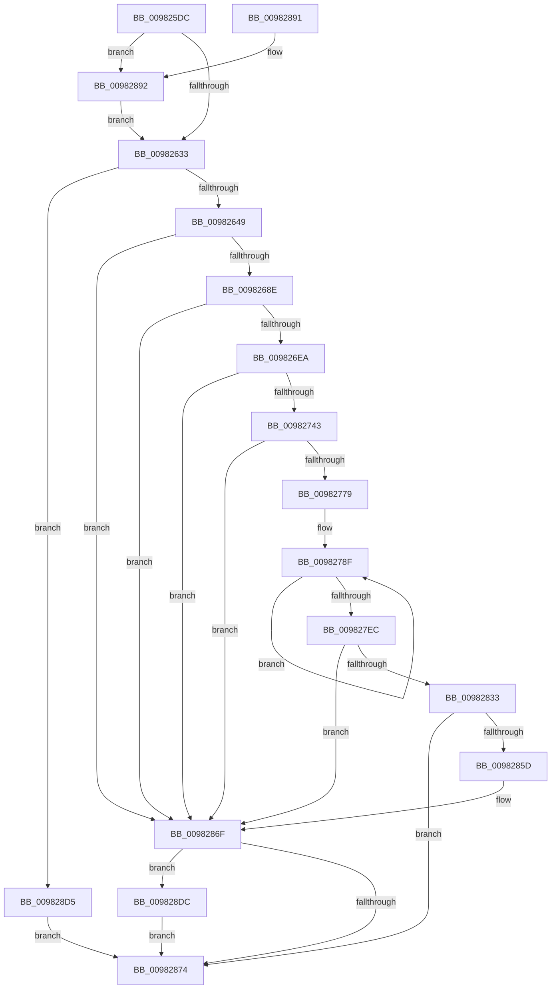

# PspSchedulerSharedDataRegionCreate

- RVA: `0x009825DC`–`0x009828E6` (길이 `778` bytes)
- VA: `0x00000001409825DC`
- 실행 섹션: `PAGE`
- PDB 이름 있음: `예`; PDB Function 태그: `아니요`
- unwind 정보 RVA: `0x0009795C`
- 디코드: `188`개 명령, `778/778` bytes 표시
- 미해석 바이트: `0` (있으면 어셈블리에 `.byte`로 보존)

> 이 문서는 커널 이미지의 기계어와 PDB 기호를 분석해 생성했습니다. 4번과 5번은 함수 원형과 자료형을 바이너리 사용 방식에서 추정한 C 해석이며 원본 소스 복구 결과는 아닙니다.

## 1. Dependencies

- 직접 호출 지점: **10**; 고유 호출 대상: **10**
- 직접 호출자로 확인된 함수: **1**
- RIP 상대 이미지 참조: **4**

### Outgoing calls
- `0x0098267B` → [ObCreateObjectEx](../89/ObCreateObjectEx_function_0089B1E0.md) (function, `0x0089B1E0`)
- `0x00982696` → [memset](../../text/6C/memset_function_006C6C40.md) (function, `0x006C6C40`)
- `0x009826DB` → [ObReferenceObjectByPointerWithTag](../../text/41/ObReferenceObjectByPointerWithTag_function_00419870.md) (function, `0x00419870`)
- `0x00982734` → [MmCreateSectionEx](MmCreateSectionEx_function_009839CC.md) (function, `0x009839CC`)
- `0x0098276A` → [MiMapViewInSystemSpace](MiMapViewInSystemSpace_function_009824D8.md) (function, `0x009824D8`)
- `0x00982828` → [MmMapViewOfSection](MmMapViewOfSection_function_00981680.md) (function, `0x00981680`)
- `0x00982852` → [ObInsertObjectEx](../8B/ObInsertObjectEx_function_008B97A0.md) (function, `0x008B97A0`)
- `0x009828B9` → [wil_details_FeatureReporting_ReportUsageToService](../../text/53/wil_details_FeatureReporting_ReportUsageToService_function_0053E6E4.md) (function, `0x0053E6E4`)
- `0x009828CB` → [wil_details_FeatureStateCache_TryEnableDeviceUsageFastPath](../../text/53/wil_details_FeatureStateCache_TryEnableDeviceUsageFastPath_function_0053E774.md) (function, `0x0053E774`)
- `0x009828DF` → [ObfDereferenceObject](../../text/2F/ObfDereferenceObject_function_002F9350.md) (function, `0x002F9350`)

### Direct callers
- [NtSetInformationProcess](../AE/NtSetInformationProcess_function_00AE5370.md) at `0x00AE9F3A`

### Static image references
- `0x0098261A` → RVA `0x00FC4928` (`.data`; read)
- `0x00982649` → RVA `0x00FC7030` (`ALMOSTRO`; read)
- `0x009826CC` → RVA `0x00FC6A98` (`ALMOSTRO`; read)
- `0x00982896` → RVA `0x000DE238` (`.rdata`; read)

## 2. Other-region calls and transfers

- 다른 실행 섹션으로 향하는 call: **5**
  - `0x00982696` → [memset](../../text/6C/memset_function_006C6C40.md) (`PAGE` → `.text`)
  - `0x009826DB` → [ObReferenceObjectByPointerWithTag](../../text/41/ObReferenceObjectByPointerWithTag_function_00419870.md) (`PAGE` → `.text`)
  - `0x009828B9` → [wil_details_FeatureReporting_ReportUsageToService](../../text/53/wil_details_FeatureReporting_ReportUsageToService_function_0053E6E4.md) (`PAGE` → `.text`)
  - `0x009828CB` → [wil_details_FeatureStateCache_TryEnableDeviceUsageFastPath](../../text/53/wil_details_FeatureStateCache_TryEnableDeviceUsageFastPath_function_0053E774.md) (`PAGE` → `.text`)
  - `0x009828DF` → [ObfDereferenceObject](../../text/2F/ObfDereferenceObject_function_002F9350.md) (`PAGE` → `.text`)
- 별도 외부 분기/꼬리 이동을 확인하지 못했습니다.

## 3. Assembly (complete function range)

```asm
009825DC  48 89 5C 24 08                  mov qword ptr [rsp + 8], rbx
009825E1  55                              push rbp
009825E2  56                              push rsi
009825E3  57                              push rdi
009825E4  41 54                           push r12
009825E6  41 55                           push r13
009825E8  41 56                           push r14
009825EA  41 57                           push r15
009825EC  48 8B EC                        mov rbp, rsp
009825EF  48 81 EC 80 00 00 00            sub rsp, 0x80
009825F6  45 33 ED                        xor r13d, r13d
009825F9  4C 8B E2                        mov r12, rdx
009825FC  4C 89 6D F0                     mov qword ptr [rbp - 0x10], r13
00982600  48 8B F1                        mov rsi, rcx
00982603  4C 89 6D 58                     mov qword ptr [rbp + 0x58], r13
00982607  65 48 8B 04 25 88 01 00 00      mov rax, qword ptr gs:[0x188]
00982610  4C 89 6D E0                     mov qword ptr [rbp - 0x20], r13
00982614  8A 98 32 02 00 00               mov bl, byte ptr [rax + 0x232]
0098261A  44 8B 05 07 23 64 00            mov r8d, dword ptr [rip + 0x642307]
00982621  4C 89 6D 50                     mov qword ptr [rbp + 0x50], r13
00982625  44 89 45 50                     mov dword ptr [rbp + 0x50], r8d
00982629  41 F6 C0 10                     test r8b, 0x10
0098262D  0F 84 5F 02 00 00               je 0x140982892
00982633  65 48 8B 04 25 88 01 00 00      mov rax, qword ptr gs:[0x188]
0098263C  48 3B B0 B8 00 00 00            cmp rsi, qword ptr [rax + 0xb8]
00982643  0F 85 8C 02 00 00               jne 0x1409828d5
00982649  48 8B 15 E0 49 64 00            mov rdx, qword ptr [rip + 0x6449e0]
00982650  48 8D 45 E0                     lea rax, [rbp - 0x20]
00982654  4C 89 6C 24 48                  mov qword ptr [rsp + 0x48], r13
00982659  41 BE F8 00 00 00               mov r14d, 0xf8
0098265F  48 89 44 24 40                  mov qword ptr [rsp + 0x40], rax
00982664  44 8A CB                        mov r9b, bl
00982667  44 89 6C 24 38                  mov dword ptr [rsp + 0x38], r13d
0098266C  45 33 C0                        xor r8d, r8d
0098266F  44 89 6C 24 30                  mov dword ptr [rsp + 0x30], r13d
00982674  8A CB                           mov cl, bl
00982676  44 89 74 24 28                  mov dword ptr [rsp + 0x28], r14d
0098267B  E8 60 8B F1 FF                  call 0x14089b1e0
00982680  48 8B 5D E0                     mov rbx, qword ptr [rbp - 0x20]
00982684  8B F8                           mov edi, eax
00982686  85 C0                           test eax, eax
00982688  0F 88 E1 01 00 00               js 0x14098286f
0098268E  45 8B C6                        mov r8d, r14d
00982691  33 D2                           xor edx, edx
00982693  48 8B CB                        mov rcx, rbx
00982696  E8 A5 45 D4 FF                  call 0x1406c6c40
0098269B  4C 89 AB C8 00 00 00            mov qword ptr [rbx + 0xc8], r13
009826A2  48 8D 83 E4 00 00 00            lea rax, [rbx + 0xe4]
009826A9  48 89 83 D8 00 00 00            mov qword ptr [rbx + 0xd8], rax
009826B0  45 33 C9                        xor r9d, r9d
009826B3  C7 83 D0 00 00 00 80 00 00 00   mov dword ptr [rbx + 0xd0], 0x80
009826BD  BA 00 02 00 00                  mov edx, 0x200
009826C2  44 89 AB E0 00 00 00            mov dword ptr [rbx + 0xe0], r13d
009826C9  48 8B CE                        mov rcx, rsi
009826CC  4C 8B 05 C5 43 64 00            mov r8, qword ptr [rip + 0x6443c5]
009826D3  C7 44 24 20 50 73 53 61         mov dword ptr [rsp + 0x20], 0x61537350
009826DB  E8 90 71 A9 FF                  call 0x140419870
009826E0  8B F8                           mov edi, eax
009826E2  85 C0                           test eax, eax
009826E4  0F 88 85 01 00 00               js 0x14098286f
009826EA  44 89 6C 24 50                  mov dword ptr [rsp + 0x50], r13d
009826EF  4C 8D B3 A8 00 00 00            lea r14, [rbx + 0xa8]
009826F6  4C 89 6C 24 48                  mov qword ptr [rsp + 0x48], r13
009826FB  0F 57 C0                        xorps xmm0, xmm0
009826FE  44 89 6C 24 38                  mov dword ptr [rsp + 0x38], r13d
00982703  41 BF 00 20 00 00               mov r15d, 0x2000
00982709  4C 89 6C 24 30                  mov qword ptr [rsp + 0x30], r13
0098270E  41 B9 04 00 00 00               mov r9d, 4
00982714  4C 89 6C 24 28                  mov qword ptr [rsp + 0x28], r13
00982719  45 8B C7                        mov r8d, r15d
0098271C  33 D2                           xor edx, edx
0098271E  C7 44 24 20 00 00 00 04         mov dword ptr [rsp + 0x20], 0x4000000
00982726  49 8B CE                        mov rcx, r14
00982729  48 89 B3 A0 00 00 00            mov qword ptr [rbx + 0xa0], rsi
00982730  0F 11 45 E0                     movups xmmword ptr [rbp - 0x20], xmm0
00982734  E8 93 12 00 00                  call 0x1409839cc
00982739  8B F8                           mov edi, eax
0098273B  85 C0                           test eax, eax
0098273D  0F 88 2C 01 00 00               js 0x14098286f
00982743  49 8B 0E                        mov rcx, qword ptr [r14]
00982746  4C 8D 4D E0                     lea r9, [rbp - 0x20]
0098274A  4C 89 7D 50                     mov qword ptr [rbp + 0x50], r15
0098274E  4C 8D 45 50                     lea r8, [rbp + 0x50]
00982752  4C 8D BB B0 00 00 00            lea r15, [rbx + 0xb0]
00982759  4C 89 6C 24 28                  mov qword ptr [rsp + 0x28], r13
0098275E  49 8B D7                        mov rdx, r15
00982761  4C 89 6D E0                     mov qword ptr [rbp - 0x20], r13
00982765  4C 89 6C 24 20                  mov qword ptr [rsp + 0x20], r13
0098276A  E8 69 FD FF FF                  call 0x1409824d8
0098276F  8B F8                           mov edi, eax
00982771  85 C0                           test eax, eax
00982773  0F 88 F6 00 00 00               js 0x14098286f
00982779  BF FF 0F 00 00                  mov edi, 0xfff
0098277E  48 8D 53 22                     lea rdx, [rbx + 0x22]
00982782  4D 8B C5                        mov r8, r13
00982785  41 B9 02 00 00 00               mov r9d, 2
0098278B  44 8D 5F 01                     lea r11d, [rdi + 1]
0098278F  49 8B 0F                        mov rcx, qword ptr [r15]
00982792  41 BA FF 1F 00 00               mov r10d, 0x1fff
00982798  4C 89 6A EE                     mov qword ptr [rdx - 0x12], r13
0098279C  49 03 C8                        add rcx, r8
0098279F  48 89 4A DE                     mov qword ptr [rdx - 0x22], rcx
009827A3  0F B7 C1                        movzx eax, cx
009827A6  66 23 C7                        and ax, di
009827A9  4C 89 6A E6                     mov qword ptr [rdx - 0x1a], r13
009827AD  66 41 03 C2                     add ax, r10w
009827B1  4C 89 6A F6                     mov qword ptr [rdx - 0xa], r13
009827B5  66 C1 E8 0C                     shr ax, 0xc
009827B9  4D 03 C3                        add r8, r11
009827BC  66 83 C0 06                     add ax, 6
009827C0  66 44 89 2A                     mov word ptr [rdx], r13w
009827C4  66 C1 E0 03                     shl ax, 3
009827C8  66 89 42 FE                     mov word ptr [rdx - 2], ax
009827CC  48 8B C1                        mov rax, rcx
009827CF  44 89 5A 1E                     mov dword ptr [rdx + 0x1e], r11d
009827D3  48 8D 52 50                     lea rdx, [rdx + 0x50]
009827D7  48 25 00 F0 FF FF               and rax, 0xfffffffffffff000
009827DD  23 CF                           and ecx, edi
009827DF  48 89 42 C6                     mov qword ptr [rdx - 0x3a], rax
009827E3  89 4A D2                        mov dword ptr [rdx - 0x2e], ecx
009827E6  49 83 E9 01                     sub r9, 1
009827EA  75 A3                           jne 0x14098278f
009827EC  49 8B 0E                        mov rcx, qword ptr [r14]
009827EF  48 8D 45 50                     lea rax, [rbp + 0x50]
009827F3  C7 44 24 48 04 00 00 00         mov dword ptr [rsp + 0x48], 4
009827FB  4C 8D 83 B8 00 00 00            lea r8, [rbx + 0xb8]
00982802  C7 44 24 40 00 00 40 00         mov dword ptr [rsp + 0x40], 0x400000
0098280A  48 8B D6                        mov rdx, rsi
0098280D  C7 44 24 38 01 00 00 00         mov dword ptr [rsp + 0x38], 1
00982815  48 89 44 24 30                  mov qword ptr [rsp + 0x30], rax
0098281A  48 8D 45 F0                     lea rax, [rbp - 0x10]
0098281E  48 89 44 24 28                  mov qword ptr [rsp + 0x28], rax
00982823  4C 89 6C 24 20                  mov qword ptr [rsp + 0x20], r13
00982828  E8 53 EE FF FF                  call 0x140981680
0098282D  8B F8                           mov edi, eax
0098282F  85 C0                           test eax, eax
00982831  78 3C                           js 0x14098286f
00982833  45 33 C9                        xor r9d, r9d
00982836  48 8D 45 58                     lea rax, [rbp + 0x58]
0098283A  48 89 44 24 30                  mov qword ptr [rsp + 0x30], rax
0098283F  33 D2                           xor edx, edx
00982841  4C 89 6C 24 28                  mov qword ptr [rsp + 0x28], r13
00982846  48 8B CB                        mov rcx, rbx
00982849  44 89 6C 24 20                  mov dword ptr [rsp + 0x20], r13d
0098284E  45 8D 41 01                     lea r8d, [r9 + 1]
00982852  E8 49 6F F3 FF                  call 0x1408b97a0
00982857  8B F8                           mov edi, eax
00982859  85 C0                           test eax, eax
0098285B  78 17                           js 0x140982874
0098285D  48 8B 45 58                     mov rax, qword ptr [rbp + 0x58]
00982861  49 8B DD                        mov rbx, r13
00982864  49 89 04 24                     mov qword ptr [r12], rax
00982868  41 8B FD                        mov edi, r13d
0098286B  4C 89 6D 58                     mov qword ptr [rbp + 0x58], r13
0098286F  48 85 DB                        test rbx, rbx
00982872  75 68                           jne 0x1409828dc
00982874  48 8B 9C 24 C0 00 00 00         mov rbx, qword ptr [rsp + 0xc0]
0098287C  8B C7                           mov eax, edi
0098287E  48 81 C4 80 00 00 00            add rsp, 0x80
00982885  41 5F                           pop r15
00982887  41 5E                           pop r14
00982889  41 5D                           pop r13
0098288B  41 5C                           pop r12
0098288D  5F                              pop rdi
0098288E  5E                              pop rsi
0098288F  5D                              pop rbp
00982890  C3                              ret
00982891  CC                              int3
00982892  48 8B 45 50                     mov rax, qword ptr [rbp + 0x50]
00982896  48 8D 0D 9B B9 75 FF            lea rcx, [rip - 0x8a4665]
0098289D  41 83 C8 01                     or r8d, 1
009828A1  48 89 45 50                     mov qword ptr [rbp + 0x50], rax
009828A5  44 89 45 50                     mov dword ptr [rbp + 0x50], r8d
009828A9  BF 03 00 00 00                  mov edi, 3
009828AE  48 8B 55 50                     mov rdx, qword ptr [rbp + 0x50]
009828B2  44 8B C7                        mov r8d, edi
009828B5  44 8D 4F FE                     lea r9d, [rdi - 2]
009828B9  E8 26 BE BB FF                  call 0x14053e6e4
009828BE  48 8B 4D 50                     mov rcx, qword ptr [rbp + 0x50]
009828C2  4C 8D 05 6F B9 75 FF            lea r8, [rip - 0x8a4691]
009828C9  8B D7                           mov edx, edi
009828CB  E8 A4 BE BB FF                  call 0x14053e774
009828D0  E9 5E FD FF FF                  jmp 0x140982633
009828D5  BF BB 00 00 C0                  mov edi, 0xc00000bb
009828DA  EB 98                           jmp 0x140982874
009828DC  48 8B CB                        mov rcx, rbx
009828DF  E8 6C 6A 97 FF                  call 0x1402f9350
009828E4  EB 8E                           jmp 0x140982874
```

## 4. C-style interpretation (structured pseudocode)

```c
__int64 __fastcall PspSchedulerSharedDataRegionCreate(__int64 a1, __int64 a2)
{
    __int64 result;
    __int64 v_r13;
    __int64 v_rsp;
    unsigned __int64 v_stack_m48;
    unsigned __int64 v_stack_m58;
    unsigned int v_stack_m68;
    unsigned __int64 v_stack_m70;
    unsigned __int64 v_stack_m78;
    unsigned int v_stack_m80;
    unsigned int v_stack_m88;
    unsigned int v_stack_m90;
    unsigned int v_stack_m98;
    unsigned __int64 v_stack_p18;
    unsigned __int64 v_stack_p20;
    unsigned __int64 v_stack_p8;

    v_stack_p8 = v_rbx;
    v_rsp = (v_rsp) - (128);
    v_r13 = 0;
    v_stack_m48 = 0;
    v_stack_p20 = 0;
    v_stack_m58 = 0;
    v_stack_p18 = 0;
    v_stack_p18 = (unsigned int)((unsigned int)(*(unsigned int *)(v_rip + 6562567)));
    if ((((unsigned __int8)((unsigned int)(*(unsigned int *)(v_rip + 6562567)))) & (16)) == 0) goto loc_00982892;
loc_00982633:
    if (a1 != (*(unsigned __int64 *)(*(unsigned __int64 *)(gs_base + (0 + 392)) + 184))) goto loc_009828D5;
    v_stack_m70 = 0;
    v_stack_m78 = v_stack_m58;
    v_stack_m80 = 0;
    a3 = 0;
    v_stack_m88 = 0;
    v_stack_m90 = 248;
    result = ObCreateObjectEx((unsigned __int8)(*(unsigned __int8 *)(*(unsigned __int64 *)(gs_base + (0 + 392)) + 562)), *(unsigned __int64 *)(v_rip + 6572512), a3, (unsigned __int8)(*(unsigned __int8 *)(*(unsigned __int64 *)(gs_base + (0 + 392)) + 562)));
    if (sign_flag) goto loc_0098286F;
    a2 = 0;
    result = memset(v_stack_m58, a2, 248, (unsigned __int8)(*(unsigned __int8 *)(*(unsigned __int64 *)(gs_base + (0 + 392)) + 562)));
    *(unsigned __int64 *)(v_stack_m58 + 200) = 0;
    *(unsigned __int64 *)(v_stack_m58 + 216) = v_stack_m58 + 228;
    a4 = 0;
    *(unsigned int *)(v_stack_m58 + 208) = 128;
    *(unsigned int *)(v_stack_m58 + 224) = 0;
    v_stack_m98 = 0x61537350ULL;
    result = ObReferenceObjectByPointerWithTag(a1, 512, *(unsigned __int64 *)(v_rip + 6570949), a4);
    if (sign_flag) goto loc_0098286F;
    v_stack_m68 = 0;
    v_stack_m70 = 0;
    v_stack_m80 = 0;
    v_stack_m88 = 0;
    v_stack_m90 = 0;
    a2 = 0;
    v_stack_m98 = 0x4000000ULL;
    *(unsigned __int64 *)(v_stack_m58 + 160) = a1;
    v_stack_m58 = v_xmm0;
    result = MmCreateSectionEx(v_stack_m58 + 168, a2, (unsigned int)((unsigned int)((unsigned int)(0x2000ULL))), 4);
    if (sign_flag) goto loc_0098286F;
    v_stack_p18 = (unsigned int)(0x2000ULL);
    v_stack_m90 = 0;
    v_stack_m58 = 0;
    v_stack_m98 = 0;
    result = MiMapViewInSystemSpace(*(unsigned __int64 *)(v_stack_m58 + 168), v_stack_m58 + 176, v_stack_p18, v_stack_m58);
    if (sign_flag) goto loc_0098286F;
loc_0098278F:
    *(unsigned __int64 *)(v_stack_m58 + 34 - 18) = 0;
    a1 = (*(unsigned __int64 *)(v_stack_m58 + 176)) + (0);
    *(unsigned __int64 *)(v_stack_m58 + 34 - 34) = a1;
    result = (unsigned __int16)(((unsigned __int16)(a1)) & ((unsigned __int16)((unsigned int)(0xFFFULL))));
    *(unsigned __int64 *)(v_stack_m58 + 34 - 26) = 0;
    result = (unsigned __int16)((result) + ((unsigned __int16)((unsigned int)(0x1FFFULL))));
    *(unsigned __int64 *)(v_stack_m58 + 34 - 10) = 0;
    result = (unsigned __int16)((result) >> (12));
    a3 = (0) + ((unsigned int)(0xFFFULL) + 1);
    result = (unsigned __int16)((result) + (6));
    *(unsigned __int16 *)(v_stack_m58 + 34) = 0;
    result = (unsigned __int16)((result) << (3));
    *(unsigned __int16 *)(v_stack_m58 + 34 - 2) = (unsigned __int16)(result);
    *(unsigned int *)(v_stack_m58 + 34 + 30) = (unsigned int)((unsigned int)(0xFFFULL) + 1);
    result = (a1) & (0xFFFFFFFFFFFFF000ULL);
    a1 = (unsigned int)((a1) & ((unsigned int)((unsigned int)(0xFFFULL))));
    *(unsigned __int64 *)(v_stack_m58 + 34 + 80 - 58) = result;
    *(unsigned int *)(v_stack_m58 + 34 + 80 - 46) = (unsigned int)(a1);
    a4 = (2) - (1);
    if (condition_is_not_equal) goto loc_0098278F;
    v_stack_m70 = 4;
    v_stack_m78 = 0x400000ULL;
    v_stack_m80 = 1;
    v_stack_m88 = v_stack_p18;
    v_stack_m90 = v_stack_m48;
    v_stack_m98 = 0;
    result = MmMapViewOfSection(*(unsigned __int64 *)(v_stack_m58 + 168), a1, v_stack_m58 + 184, a4);
    if (sign_flag) goto loc_0098286F;
    a4 = 0;
    v_stack_m88 = v_stack_p20;
    a2 = 0;
    v_stack_m90 = 0;
    v_stack_m98 = 0;
    result = ObInsertObjectEx(v_stack_m58, a2, a4 + 1, a4);
    if (sign_flag) goto loc_00982874;
    *(unsigned __int64 *)(a2) = v_stack_p20;
    v_stack_p20 = 0;
loc_0098286F:
    if (0 != 0) goto loc_009828DC;
loc_00982874:
    v_rsp = (v_rsp) + (128);
    return 0;
loc_00982892:
    a3 = (unsigned int)((a4 + 1) | (1));
    v_stack_p18 = v_stack_p18;
    v_stack_p18 = (unsigned int)(a3);
    result = wil_details_FeatureReporting_ReportUsageToService(v_rip - 9061989, v_stack_p18, 3, 3 - 2);
    result = wil_details_FeatureStateCache_TryEnableDeviceUsageFastPath(v_stack_p18, 3, v_rip - 9062033, 3 - 2);
    goto loc_00982633;
loc_009828D5:
    goto loc_00982874;
loc_009828DC:
    result = ObfDereferenceObject(v_stack_p8, 3, v_rip - 9062033, 3 - 2);
    goto loc_00982874;
}
```

## 5. (Beta) C Style

```c
int64_t PspSchedulerSharedDataRegionCreate(int64_t Arg1, void *Arg2)
{
    uint8_t *arg2 = (uint8_t *)Arg2;

    int64_t result;
    int64_t local_r13;
    int64_t local_rsp;
    uint64_t v_stack_m48;
    uint64_t v_stack_m58;
    uint32_t v_stack_m68;
    uint64_t v_stack_m70;
    uint64_t v_stack_m78;
    uint32_t v_stack_m80;
    uint32_t v_stack_m88;
    uint32_t v_stack_m90;
    uint32_t v_stack_m98;
    uint64_t v_stack_p18;
    uint64_t v_stack_p20;
    uint64_t v_stack_p8;

    v_stack_p8 = local_rbx;
    local_rsp = (local_rsp) - (128);
    local_r13 = 0;
    v_stack_m48 = 0;
    v_stack_p20 = 0;
    v_stack_m58 = 0;
    v_stack_p18 = 0;
    v_stack_p18 = (uint32_t)((uint32_t)(*(uint32_t *)(v_rip + 0x642307)));
    if ((((uint8_t)((uint32_t)(*(uint32_t *)(v_rip + 0x642307)))) & (16)) == 0) goto loc_00982892;
loc_00982633:
    if (Arg1 != (*(uint64_t *)(*(uint64_t *)(gs_base + (0 + 0x188)) + 0xB8))) goto loc_009828D5;
    v_stack_m70 = 0;
    v_stack_m78 = v_stack_m58;
    v_stack_m80 = 0;
    a3 = 0;
    v_stack_m88 = 0;
    v_stack_m90 = 248;
    result = ObCreateObjectEx((uint8_t)(*(uint8_t *)(*(uint64_t *)(gs_base + (0 + 0x188)) + 0x232)), *(uint64_t *)(v_rip + 0x6449E0), a3, (uint8_t)(*(uint8_t *)(*(uint64_t *)(gs_base + (0 + 0x188)) + 0x232)));
    if (sign_flag) goto loc_0098286F;
    Arg2 = 0;
    result = memset(v_stack_m58, Arg2, 248, (uint8_t)(*(uint8_t *)(*(uint64_t *)(gs_base + (0 + 0x188)) + 0x232)));
    *(uint64_t *)(v_stack_m58 + 0xC8) = 0;
    *(uint64_t *)(v_stack_m58 + 0xD8) = v_stack_m58 + 228;
    a4 = 0;
    *(uint32_t *)(v_stack_m58 + 0xD0) = 128;
    *(uint32_t *)(v_stack_m58 + 0xE0) = 0;
    v_stack_m98 = 0x61537350ULL;
    result = ObReferenceObjectByPointerWithTag(Arg1, 512, *(uint64_t *)(v_rip + 0x6443C5), a4);
    if (sign_flag) goto loc_0098286F;
    v_stack_m68 = 0;
    v_stack_m70 = 0;
    v_stack_m80 = 0;
    v_stack_m88 = 0;
    v_stack_m90 = 0;
    Arg2 = 0;
    v_stack_m98 = 0x4000000ULL;
    *(uint64_t *)(v_stack_m58 + 0xA0) = Arg1;
    v_stack_m58 = v_xmm0;
    result = MmCreateSectionEx(v_stack_m58 + 168, Arg2, (uint32_t)((uint32_t)((uint32_t)(0x2000ULL))), 4);
    if (sign_flag) goto loc_0098286F;
    v_stack_p18 = (uint32_t)(0x2000ULL);
    v_stack_m90 = 0;
    v_stack_m58 = 0;
    v_stack_m98 = 0;
    result = MiMapViewInSystemSpace(*(uint64_t *)(v_stack_m58 + 0xA8), v_stack_m58 + 176, v_stack_p18, v_stack_m58);
    if (sign_flag) goto loc_0098286F;
loc_0098278F:
    *(uint64_t *)(v_stack_m58 + 0x22 - 0x12) = 0;
    Arg1 = (*(uint64_t *)(v_stack_m58 + 0xB0)) + (0);
    *(uint64_t *)(v_stack_m58 + 0x22 - 0x22) = Arg1;
    result = (uint16_t)(((uint16_t)(Arg1)) & ((uint16_t)((uint32_t)(0xFFFULL))));
    *(uint64_t *)(v_stack_m58 + 0x22 - 0x1A) = 0;
    result = (uint16_t)((result) + ((uint16_t)((uint32_t)(0x1FFFULL))));
    *(uint64_t *)(v_stack_m58 + 0x22 - 0xA) = 0;
    result = (uint16_t)((result) >> (12));
    a3 = (0) + ((uint32_t)(0xFFFULL) + 1);
    result = (uint16_t)((result) + (6));
    *(uint16_t *)(v_stack_m58 + 0x22) = 0;
    result = (uint16_t)((result) << (3));
    *(uint16_t *)(v_stack_m58 + 0x22 - 0x2) = (uint16_t)(result);
    *(uint32_t *)(v_stack_m58 + 0x22 + 0x1E) = (uint32_t)((uint32_t)(0xFFFULL) + 1);
    result = (Arg1) & (0xFFFFFFFFFFFFF000ULL);
    Arg1 = (uint32_t)((Arg1) & ((uint32_t)((uint32_t)(0xFFFULL))));
    *(uint64_t *)(v_stack_m58 + 0x22 + 0x50 - 0x3A) = result;
    *(uint32_t *)(v_stack_m58 + 0x22 + 0x50 - 0x2E) = (uint32_t)(Arg1);
    a4 = (2) - (1);
    if (condition_is_not_equal) goto loc_0098278F;
    v_stack_m70 = 4;
    v_stack_m78 = 0x400000ULL;
    v_stack_m80 = 1;
    v_stack_m88 = v_stack_p18;
    v_stack_m90 = v_stack_m48;
    v_stack_m98 = 0;
    result = MmMapViewOfSection(*(uint64_t *)(v_stack_m58 + 0xA8), Arg1, v_stack_m58 + 184, a4);
    if (sign_flag) goto loc_0098286F;
    a4 = 0;
    v_stack_m88 = v_stack_p20;
    Arg2 = 0;
    v_stack_m90 = 0;
    v_stack_m98 = 0;
    result = ObInsertObjectEx(v_stack_m58, Arg2, a4 + 1, a4);
    if (sign_flag) goto loc_00982874;
    *(uint64_t *)(arg2) = v_stack_p20;
    v_stack_p20 = 0;
loc_0098286F:
    if (0 != 0) goto loc_009828DC;
loc_00982874:
    local_rsp = (local_rsp) + (128);
    return 0;
loc_00982892:
    a3 = (uint32_t)((a4 + 1) | (1));
    v_stack_p18 = v_stack_p18;
    v_stack_p18 = (uint32_t)(a3);
    result = wil_details_FeatureReporting_ReportUsageToService(v_rip - 9061989, v_stack_p18, 3, 3 - 2);
    result = wil_details_FeatureStateCache_TryEnableDeviceUsageFastPath(v_stack_p18, 3, v_rip - 9062033, 3 - 2);
    goto loc_00982633;
loc_009828D5:
    goto loc_00982874;
loc_009828DC:
    result = ObfDereferenceObject(v_stack_p8, 3, v_rip - 9062033, 3 - 2);
    goto loc_00982874;
}
```

### 관측된 메모리 오프셋

구조체 형식이 확인되지 않은 접근은 인자 기준의 오프셋으로만 기록했습니다.

| 기준 인자 | 오프셋 표현 | 폭 (bit) | 접근 |
|---|---:|---:|---|
| `Arg2` | `+ 0x0` | `64` | `W` |

## 6. Execution-region graph

[열기: 2D/3D 그래프와 함수 탐색 컨트롤 패널](../../../control-panel.html?section=page&rva=0x009825DC&view=graph)

- 2D 그래프는 위에서 아래로 흐르고, 3D 그래프는 빈 공간을 드래그해 회전합니다. Shift+드래그는 이동, 휠은 확대·축소, 함수 노드 선택은 대상 보고서 이동입니다.

### Static fallback


