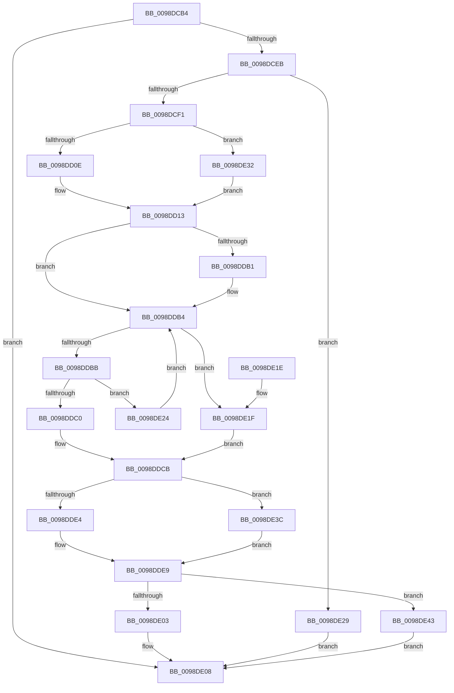

# RtlInternEntryDereference

- RVA: `0x0098DCB4`–`0x0098DE4A` (길이 `406` bytes)
- VA: `0x000000014098DCB4`
- 실행 섹션: `PAGE`
- PDB 이름 있음: `예`; PDB Function 태그: `아니요`
- unwind 정보 RVA: `0x0009889C`
- 디코드: `109`개 명령, `406/406` bytes 표시
- 미해석 바이트: `0` (있으면 어셈블리에 `.byte`로 보존)

> 이 문서는 커널 이미지의 기계어와 PDB 기호를 분석해 생성했습니다. 4번과 5번은 함수 원형과 자료형을 바이너리 사용 방식에서 추정한 C 해석이며 원본 소스 복구 결과는 아닙니다.

## 1. Dependencies

- 직접 호출 지점: **6**; 고유 호출 대상: **4**
- 직접 호출자로 확인된 함수: **7**
- RIP 상대 이미지 참조: **3**

### Outgoing calls
- `0x0098DD0E` → [PopEtInternerLock](PopEtInternerLock_function_0098DEC0.md) (function, `0x0098DEC0`)
- `0x0098DDE4` → [PopEtInternerUnlock](PopEtInternerUnlock_function_0098DE80.md) (function, `0x0098DE80`)
- `0x0098DE03` → [PopEtInternerFree](PopEtInternerFree_function_0098DEA0.md) (function, `0x0098DEA0`)
- `0x0098DE32` → [guard_dispatch_icall](../../text/6B/guard_dispatch_icall_function_006BAAD0.md) (function, `0x006BAAD0`)
- `0x0098DE3C` → [guard_dispatch_icall](../../text/6B/guard_dispatch_icall_function_006BAAD0.md) (function, `0x006BAAD0`)
- `0x0098DE43` → [guard_dispatch_icall](../../text/6B/guard_dispatch_icall_function_006BAAD0.md) (function, `0x006BAAD0`)

### Direct callers
- [PopEtEnergyContextCleanup](PopEtEnergyContextCleanup_function_0098C9B4.md) at `0x0098C9ED`
- [PopEtEnergyContextSetState](PopEtEnergyContextSetState_function_0098CF94.md) at `0x0098D036`
- [PopEtAggregateKeyCleanup](PopEtAggregateKeyCleanup_function_0098D304.md) at `0x0098D332`
- [PopEtAppIdDereference](PopEtAppIdDereference_function_0098D34C.md) at `0x0098D368`
- [PopEtStringSet](PopEtStringSet_function_0098D3E4.md) at `0x0098D407`
- [PopEtProcessSnapshotUpdateFromSnapshotContext](PopEtProcessSnapshotUpdateFromSnapshotContext_function_0098DB9C.md) at `0x0098DBE5`
- [PopEtProcessSnapshotCreate](PopEtProcessSnapshotCreate_function_0098E4C8.md) at `0x0098E54A`

### Static image references
- `0x0098DCF7` → RVA `0x0098DEC0` (`PopEtInternerLock`; read)
- `0x0098DDCF` → RVA `0x0098DE80` (`PopEtInternerUnlock`; read)
- `0x0098DDED` → RVA `0x0098DEA0` (`PopEtInternerFree`; read)

## 2. Other-region calls and transfers

- 다른 실행 섹션으로 향하는 call: **3**
  - `0x0098DE32` → [guard_dispatch_icall](../../text/6B/guard_dispatch_icall_function_006BAAD0.md) (`PAGE` → `.text`)
  - `0x0098DE3C` → [guard_dispatch_icall](../../text/6B/guard_dispatch_icall_function_006BAAD0.md) (`PAGE` → `.text`)
  - `0x0098DE43` → [guard_dispatch_icall](../../text/6B/guard_dispatch_icall_function_006BAAD0.md) (`PAGE` → `.text`)
- 별도 외부 분기/꼬리 이동을 확인하지 못했습니다.

## 3. Assembly (complete function range)

```asm
0098DCB4  48 89 5C 24 08                  mov qword ptr [rsp + 8], rbx
0098DCB9  48 89 74 24 18                  mov qword ptr [rsp + 0x18], rsi
0098DCBE  48 89 7C 24 20                  mov qword ptr [rsp + 0x20], rdi
0098DCC3  41 56                           push r14
0098DCC5  48 83 EC 20                     sub rsp, 0x20
0098DCC9  48 83 CE FF                     or rsi, 0xffffffffffffffff
0098DCCD  48 8B FA                        mov rdi, rdx
0098DCD0  48 8B C6                        mov rax, rsi
0098DCD3  48 8B D9                        mov rbx, rcx
0098DCD6  F0 48 0F C1 42 10               lock xadd qword ptr [rdx + 0x10], rax
0098DCDC  48 03 C6                        add rax, rsi
0098DCDF  45 33 F6                        xor r14d, r14d
0098DCE2  48 85 C0                        test rax, rax
0098DCE5  0F 8F 1D 01 00 00               jg 0x14098de08
0098DCEB  0F 85 38 01 00 00               jne 0x14098de29
0098DCF1  48 8B 41 10                     mov rax, qword ptr [rcx + 0x10]
0098DCF5  33 D2                           xor edx, edx
0098DCF7  48 8D 0D C2 01 00 00            lea rcx, [rip + 0x1c2]
0098DCFE  48 8B 40 10                     mov rax, qword ptr [rax + 0x10]
0098DD02  48 3B C1                        cmp rax, rcx
0098DD05  48 8B CB                        mov rcx, rbx
0098DD08  0F 85 24 01 00 00               jne 0x14098de32
0098DD0E  E8 AD 01 00 00                  call 0x14098dec0
0098DD13  44 8B 4B 04                     mov r9d, dword ptr [rbx + 4]
0098DD17  41 8B C9                        mov ecx, r9d
0098DD1A  83 E1 1F                        and ecx, 0x1f
0098DD1D  41 C1 E9 05                     shr r9d, 5
0098DD21  48 D3 E6                        shl rsi, cl
0098DD24  48 23 77 08                     and rsi, qword ptr [rdi + 8]
0098DD28  48 89 74 24 38                  mov qword ptr [rsp + 0x38], rsi
0098DD2D  40 0F B6 C6                     movzx eax, sil
0098DD31  48 05 CB 5D B1 00               add rax, 0xb15dcb
0098DD37  48 6B C8 25                     imul rcx, rax, 0x25
0098DD3B  0F B6 44 24 39                  movzx eax, byte ptr [rsp + 0x39]
0098DD40  48 03 C8                        add rcx, rax
0098DD43  0F B6 44 24 3A                  movzx eax, byte ptr [rsp + 0x3a]
0098DD48  48 6B D1 25                     imul rdx, rcx, 0x25
0098DD4C  48 03 D0                        add rdx, rax
0098DD4F  0F B6 44 24 3B                  movzx eax, byte ptr [rsp + 0x3b]
0098DD54  48 6B CA 25                     imul rcx, rdx, 0x25
0098DD58  48 03 C8                        add rcx, rax
0098DD5B  0F B6 44 24 3C                  movzx eax, byte ptr [rsp + 0x3c]
0098DD60  48 6B D1 25                     imul rdx, rcx, 0x25
0098DD64  48 03 D0                        add rdx, rax
0098DD67  0F B6 44 24 3D                  movzx eax, byte ptr [rsp + 0x3d]
0098DD6C  48 6B CA 25                     imul rcx, rdx, 0x25
0098DD70  48 03 C8                        add rcx, rax
0098DD73  0F B6 44 24 3E                  movzx eax, byte ptr [rsp + 0x3e]
0098DD78  48 6B D1 25                     imul rdx, rcx, 0x25
0098DD7C  41 8D 49 FF                     lea ecx, [r9 - 1]
0098DD80  48 03 D0                        add rdx, rax
0098DD83  0F B6 44 24 3F                  movzx eax, byte ptr [rsp + 0x3f]
0098DD88  4C 6B C2 25                     imul r8, rdx, 0x25
0098DD8C  49 03 C0                        add rax, r8
0098DD8F  8B C0                           mov eax, eax
0098DD91  48 23 C8                        and rcx, rax
0098DD94  48 8B 43 08                     mov rax, qword ptr [rbx + 8]
0098DD98  48 8D 14 C8                     lea rdx, [rax + rcx*8]
0098DD9C  48 8B 07                        mov rax, qword ptr [rdi]
0098DD9F  48 B9 02 00 00 00 00 00 00 80   movabs rcx, 0x8000000000000002
0098DDA9  48 23 C1                        and rax, rcx
0098DDAC  48 3B C1                        cmp rax, rcx
0098DDAF  75 03                           jne 0x14098ddb4
0098DDB1  49 8B 06                        mov rax, qword ptr [r14]
0098DDB4  48 8B 02                        mov rax, qword ptr [rdx]
0098DDB7  A8 01                           test al, 1
0098DDB9  75 64                           jne 0x14098de1f
0098DDBB  48 3B C7                        cmp rax, rdi
0098DDBE  75 64                           jne 0x14098de24
0098DDC0  48 8B 07                        mov rax, qword ptr [rdi]
0098DDC3  48 89 02                        mov qword ptr [rdx], rax
0098DDC6  FF 0B                           dec dword ptr [rbx]
0098DDC8  48 09 0F                        or qword ptr [rdi], rcx
0098DDCB  48 8B 43 10                     mov rax, qword ptr [rbx + 0x10]
0098DDCF  48 8D 0D AA 00 00 00            lea rcx, [rip + 0xaa]
0098DDD6  33 D2                           xor edx, edx
0098DDD8  48 8B 40 18                     mov rax, qword ptr [rax + 0x18]
0098DDDC  48 3B C1                        cmp rax, rcx
0098DDDF  48 8B CB                        mov rcx, rbx
0098DDE2  75 58                           jne 0x14098de3c
0098DDE4  E8 97 00 00 00                  call 0x14098de80
0098DDE9  48 8B 43 10                     mov rax, qword ptr [rbx + 0x10]
0098DDED  48 8D 0D AC 00 00 00            lea rcx, [rip + 0xac]
0098DDF4  48 8B D7                        mov rdx, rdi
0098DDF7  48 8B 40 08                     mov rax, qword ptr [rax + 8]
0098DDFB  48 3B C1                        cmp rax, rcx
0098DDFE  48 8B CB                        mov rcx, rbx
0098DE01  75 40                           jne 0x14098de43
0098DE03  E8 98 00 00 00                  call 0x14098dea0
0098DE08  48 8B 5C 24 30                  mov rbx, qword ptr [rsp + 0x30]
0098DE0D  48 8B 74 24 40                  mov rsi, qword ptr [rsp + 0x40]
0098DE12  48 8B 7C 24 48                  mov rdi, qword ptr [rsp + 0x48]
0098DE17  48 83 C4 20                     add rsp, 0x20
0098DE1B  41 5E                           pop r14
0098DE1D  C3                              ret
0098DE1E  CC                              int3
0098DE1F  49 8B 06                        mov rax, qword ptr [r14]
0098DE22  EB A7                           jmp 0x14098ddcb
0098DE24  48 8B D0                        mov rdx, rax
0098DE27  EB 8B                           jmp 0x14098ddb4
0098DE29  B9 0E 00 00 00                  mov ecx, 0xe
0098DE2E  CD 29                           int 0x29
0098DE30  EB D6                           jmp 0x14098de08
0098DE32  E8 99 CC D2 FF                  call 0x1406baad0
0098DE37  E9 D7 FE FF FF                  jmp 0x14098dd13
0098DE3C  E8 8F CC D2 FF                  call 0x1406baad0
0098DE41  EB A6                           jmp 0x14098dde9
0098DE43  E8 88 CC D2 FF                  call 0x1406baad0
0098DE48  EB BE                           jmp 0x14098de08
```

## 4. C-style interpretation (structured pseudocode)

```c
__int64 __fastcall RtlInternEntryDereference(__int64 a1, __int64 a2)
{
    __int64 result;
    __int64 v_r14;
    __int64 v_rsi;
    __int64 v_rsp;
    unsigned __int64 v_stack_p10;
    unsigned __int8 v_stack_p11;
    unsigned __int8 v_stack_p12;
    unsigned __int8 v_stack_p13;
    unsigned __int8 v_stack_p14;
    unsigned __int8 v_stack_p15;
    unsigned __int8 v_stack_p16;
    unsigned __int8 v_stack_p17;
    unsigned __int64 v_stack_p18;
    unsigned __int64 v_stack_p20;
    unsigned __int64 v_stack_p8;

    v_stack_p8 = v_rbx;
    v_stack_p18 = v_rsi;
    v_stack_p20 = v_rdi;
    v_rsp = (v_rsp) - (32);
    v_rsi = (v_rsi) | (-1);
    result = (v_rsi) + (v_rsi);
    v_r14 = 0;
    if (condition_is_greater) goto loc_0098DE08;
    if (result != 0) goto loc_0098DE29;
    a2 = 0;
    if ((*(unsigned __int64 *)(*(unsigned __int64 *)(a1 + 16) + 16)) != (v_rip + 450)) goto loc_0098DE32;
    result = PopEtInternerLock(a1, a2, a3, a4);
loc_0098DD13:
    a1 = (unsigned int)(((unsigned int)((unsigned int)((unsigned int)(*(unsigned int *)(a1 + 4))))) & (31));
    a4 = (unsigned int)(((unsigned int)(*(unsigned int *)(a1 + 4))) >> (5));
    v_rsi = (v_rsi) << ((unsigned __int8)(a1));
    v_rsi = (v_rsi) & (*(unsigned __int64 *)(a2 + 8));
    v_stack_p10 = v_rsi;
    result = ((unsigned __int8)(v_rsi)) + (0xB15DCBULL);
    a1 = (a1) * (result);
    a1 = (a1) + (v_stack_p11);
    a2 = (a2) * (a1);
    a2 = (a2) + (v_stack_p12);
    a1 = (a1) * (a2);
    a1 = (a1) + (v_stack_p13);
    a2 = (a2) * (a1);
    a2 = (a2) + (v_stack_p14);
    a1 = (a1) * (a2);
    a1 = (a1) + (v_stack_p15);
    a2 = (a2) * (a1);
    a2 = (a2) + (v_stack_p16);
    a3 = (a3) * (a2);
    result = (v_stack_p17) + (a3);
    a1 = (a4 - 1) & ((unsigned int)((unsigned int)(result)));
    result = (*(unsigned __int64 *)(a2)) & (a1);
    if (result == a1) {
        result = *(unsigned __int64 *)(v_r14);
    }
    if ((((unsigned __int8)(*(unsigned __int64 *)(*(unsigned __int64 *)(a1 + 8) + a1 * 8))) & (1)) != 0) goto loc_0098DE1F;
    if ((*(unsigned __int64 *)(*(unsigned __int64 *)(a1 + 8) + a1 * 8)) != a2) goto loc_0098DE24;
    *(unsigned __int64 *)(*(unsigned __int64 *)(a1 + 8) + a1 * 8) = *(unsigned __int64 *)(a2);
loc_0098DDCB:
    a2 = 0;
    if ((*(unsigned __int64 *)(*(unsigned __int64 *)(a1 + 16) + 24)) != (v_rip + 170)) goto loc_0098DE3C;
    result = PopEtInternerUnlock(a1, a2, a3, a4);
loc_0098DDE9:
    if ((*(unsigned __int64 *)(*(unsigned __int64 *)(a1 + 16) + 8)) != (v_rip + 172)) goto loc_0098DE43;
    result = PopEtInternerFree(a1, 0, a3, a4);
loc_0098DE08:
    v_rsp = (v_rsp) + (32);
    return result;
loc_0098DE1F:
    goto loc_0098DDCB;
loc_0098DE24:
    goto loc_0098DDB4;
loc_0098DE29:
    goto loc_0098DE08;
loc_0098DE32:
    result = guard_dispatch_icall(14, *(unsigned __int64 *)(v_r14), a3, a4);
    goto loc_0098DD13;
loc_0098DE3C:
    result = guard_dispatch_icall(14, *(unsigned __int64 *)(v_r14), a3, a4);
    goto loc_0098DDE9;
loc_0098DE43:
    result = guard_dispatch_icall(14, *(unsigned __int64 *)(v_r14), a3, a4);
    goto loc_0098DE08;
}
```

## 5. (Beta) C Style

```c
int64_t RtlInternEntryDereference(void *Arg1, void *Arg2)
{
    uint8_t *arg1 = (uint8_t *)Arg1;
    uint8_t *arg2 = (uint8_t *)Arg2;

    int64_t result;
    int64_t local_r14;
    int64_t local_rsi;
    int64_t local_rsp;
    uint64_t v_stack_p10;
    uint8_t v_stack_p11;
    uint8_t v_stack_p12;
    uint8_t v_stack_p13;
    uint8_t v_stack_p14;
    uint8_t v_stack_p15;
    uint8_t v_stack_p16;
    uint8_t v_stack_p17;
    uint64_t v_stack_p18;
    uint64_t v_stack_p20;
    uint64_t v_stack_p8;

    v_stack_p8 = local_rbx;
    v_stack_p18 = local_rsi;
    v_stack_p20 = local_rdi;
    local_rsp = (local_rsp) - (32);
    local_rsi = (local_rsi) | (-1);
    result = (local_rsi) + (local_rsi);
    local_r14 = 0;
    if (condition_is_greater) goto loc_0098DE08;
    if (result != 0) goto loc_0098DE29;
    Arg2 = 0;
    if ((*(uint64_t *)(*(uint64_t *)(arg1 + 0x10) + 0x10)) != (v_rip + 450)) goto loc_0098DE32;
    result = PopEtInternerLock(Arg1, Arg2, a3, a4);
loc_0098DD13:
    Arg1 = (uint32_t)(((uint32_t)((uint32_t)((uint32_t)(*(uint32_t *)(arg1 + 0x4))))) & (31));
    a4 = (uint32_t)(((uint32_t)(*(uint32_t *)(arg1 + 0x4))) >> (5));
    local_rsi = (local_rsi) << ((uint8_t)(Arg1));
    local_rsi = (local_rsi) & (*(uint64_t *)(arg2 + 0x8));
    v_stack_p10 = local_rsi;
    result = ((uint8_t)(local_rsi)) + (0xB15DCBULL);
    Arg1 = (Arg1) * (result);
    Arg1 = (Arg1) + (v_stack_p11);
    Arg2 = (Arg2) * (Arg1);
    Arg2 = (Arg2) + (v_stack_p12);
    Arg1 = (Arg1) * (Arg2);
    Arg1 = (Arg1) + (v_stack_p13);
    Arg2 = (Arg2) * (Arg1);
    Arg2 = (Arg2) + (v_stack_p14);
    Arg1 = (Arg1) * (Arg2);
    Arg1 = (Arg1) + (v_stack_p15);
    Arg2 = (Arg2) * (Arg1);
    Arg2 = (Arg2) + (v_stack_p16);
    a3 = (a3) * (Arg2);
    result = (v_stack_p17) + (a3);
    Arg1 = (a4 - 1) & ((uint32_t)((uint32_t)(result)));
    result = (*(uint64_t *)(arg2)) & (Arg1);
    if (result == Arg1) {
        result = *(uint64_t *)(local_r14);
    }
    if ((((uint8_t)(*(uint64_t *)(*(uint64_t *)(arg1 + 0x8) + arg1 * 8))) & (1)) != 0) goto loc_0098DE1F;
    if ((*(uint64_t *)(*(uint64_t *)(arg1 + 0x8) + arg1 * 8)) != Arg2) goto loc_0098DE24;
    *(uint64_t *)(*(uint64_t *)(arg1 + 0x8) + arg1 * 8) = *(uint64_t *)(arg2);
loc_0098DDCB:
    Arg2 = 0;
    if ((*(uint64_t *)(*(uint64_t *)(arg1 + 0x10) + 0x18)) != (v_rip + 170)) goto loc_0098DE3C;
    result = PopEtInternerUnlock(Arg1, Arg2, a3, a4);
loc_0098DDE9:
    if ((*(uint64_t *)(*(uint64_t *)(arg1 + 0x10) + 0x8)) != (v_rip + 172)) goto loc_0098DE43;
    result = PopEtInternerFree(Arg1, 0, a3, a4);
loc_0098DE08:
    local_rsp = (local_rsp) + (32);
    return result;
loc_0098DE1F:
    goto loc_0098DDCB;
loc_0098DE24:
    goto loc_0098DDB4;
loc_0098DE29:
    goto loc_0098DE08;
loc_0098DE32:
    result = guard_dispatch_icall(14, *(uint64_t *)(local_r14), a3, a4);
    goto loc_0098DD13;
loc_0098DE3C:
    result = guard_dispatch_icall(14, *(uint64_t *)(local_r14), a3, a4);
    goto loc_0098DDE9;
loc_0098DE43:
    result = guard_dispatch_icall(14, *(uint64_t *)(local_r14), a3, a4);
    goto loc_0098DE08;
}
```

### 관측된 메모리 오프셋

구조체 형식이 확인되지 않은 접근은 인자 기준의 오프셋으로만 기록했습니다.

| 기준 인자 | 오프셋 표현 | 폭 (bit) | 접근 |
|---|---:|---:|---|
| `Arg1` | `+ 0x0` | `32` | `R/W` |
| `Arg1` | `+ 0x4` | `32` | `R` |
| `Arg1` | `+ 0x8` | `64` | `R` |
| `Arg1` | `+ 0x10` | `64` | `R` |
| `Arg2` | `+ 0x0` | `64` | `R` |
| `Arg2` | `+ 0x0` | `64` | `R/W` |
| `Arg2` | `+ 0x8` | `64` | `R` |
| `Arg2` | `+ 0x10` | `64` | `R/W` |

## 6. Execution-region graph

[열기: 2D/3D 그래프와 함수 탐색 컨트롤 패널](../../../control-panel.html?section=page&rva=0x0098DCB4&view=graph)

- 2D 그래프는 위에서 아래로 흐르고, 3D 그래프는 빈 공간을 드래그해 회전합니다. Shift+드래그는 이동, 휠은 확대·축소, 함수 노드 선택은 대상 보고서 이동입니다.

### Static fallback


