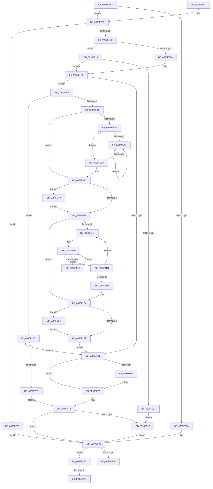

# RtlInternTableIntern

- RVA: `0x0098EEB4`–`0x0098F285` (길이 `977` bytes)
- VA: `0x000000014098EEB4`
- 실행 섹션: `PAGE`
- PDB 이름 있음: `예`; PDB Function 태그: `예`
- unwind 정보 RVA: `0x000989EC`
- 디코드: `276`개 명령, `977/977` bytes 표시
- 미해석 바이트: `0` (있으면 어셈블리에 `.byte`로 보존)

> 이 문서는 커널 이미지의 기계어와 PDB 기호를 분석해 생성했습니다. 4번과 5번은 함수 원형과 자료형을 바이너리 사용 방식에서 추정한 C 해석이며 원본 소스 복구 결과는 아닙니다.

## 1. Dependencies

- 직접 호출 지점: **14**; 고유 호출 대상: **6**
- 직접 호출자로 확인된 함수: **2**
- RIP 상대 이미지 참조: **0**

### Outgoing calls
- `0x0098EEE9` → [RtlpInternEntryHash](RtlpInternEntryHash_function_0098F3D4.md) (function, `0x0098F3D4`)
- `0x0098EF01` → [guard_dispatch_icall](../../text/6B/guard_dispatch_icall_function_006BAAD0.md) (function, `0x006BAAD0`)
- `0x0098EF17` → [RtlpInternEntryFind](RtlpInternEntryFind_function_0098F28C.md) (function, `0x0098F28C`)
- `0x0098EF30` → [guard_dispatch_icall](../../text/6B/guard_dispatch_icall_function_006BAAD0.md) (function, `0x006BAAD0`)
- `0x0098EF69` → [guard_dispatch_icall](../../text/6B/guard_dispatch_icall_function_006BAAD0.md) (function, `0x006BAAD0`)
- `0x0098EF7A` → [RtlpInternEntryCreate](RtlpInternEntryCreate_function_0098E8CC.md) (function, `0x0098E8CC`)
- `0x0098EF97` → [guard_dispatch_icall](../../text/6B/guard_dispatch_icall_function_006BAAD0.md) (function, `0x006BAAD0`)
- `0x0098F06D` → [guard_dispatch_icall](../../text/6B/guard_dispatch_icall_function_006BAAD0.md) (function, `0x006BAAD0`)
- `0x0098F085` → [guard_dispatch_icall](../../text/6B/guard_dispatch_icall_function_006BAAD0.md) (function, `0x006BAAD0`)
- `0x0098F0A8` → [guard_dispatch_icall](../../text/6B/guard_dispatch_icall_function_006BAAD0.md) (function, `0x006BAAD0`)
- `0x0098F0C5` → [RtlpInternHashBucketsAllocate](../79/RtlpInternHashBucketsAllocate_function_00795024.md) (function, `0x00795024`)
- `0x0098F21F` → [RtlpInternEntryFind](RtlpInternEntryFind_function_0098F28C.md) (function, `0x0098F28C`)
- `0x0098F23F` → [guard_dispatch_icall](../../text/6B/guard_dispatch_icall_function_006BAAD0.md) (function, `0x006BAAD0`)
- `0x0098F257` → [RtlpInternHashBucketsFree](../79/RtlpInternHashBucketsFree_function_0079504C.md) (function, `0x0079504C`)

### Direct callers
- [PopEtStringIntern](PopEtStringIntern_function_0098E7D0.md) at `0x0098E828`
- [PopEtAppIdIntern](PopEtAppIdIntern_function_0098ED74.md) at `0x0098EE70`

### Static image references
- 디코드된 RIP-relative 메모리 참조가 없습니다.

## 2. Other-region calls and transfers

- 다른 실행 섹션으로 향하는 call: **8**
  - `0x0098EF01` → [guard_dispatch_icall](../../text/6B/guard_dispatch_icall_function_006BAAD0.md) (`PAGE` → `.text`)
  - `0x0098EF30` → [guard_dispatch_icall](../../text/6B/guard_dispatch_icall_function_006BAAD0.md) (`PAGE` → `.text`)
  - `0x0098EF69` → [guard_dispatch_icall](../../text/6B/guard_dispatch_icall_function_006BAAD0.md) (`PAGE` → `.text`)
  - `0x0098EF97` → [guard_dispatch_icall](../../text/6B/guard_dispatch_icall_function_006BAAD0.md) (`PAGE` → `.text`)
  - `0x0098F06D` → [guard_dispatch_icall](../../text/6B/guard_dispatch_icall_function_006BAAD0.md) (`PAGE` → `.text`)
  - `0x0098F085` → [guard_dispatch_icall](../../text/6B/guard_dispatch_icall_function_006BAAD0.md) (`PAGE` → `.text`)
  - `0x0098F0A8` → [guard_dispatch_icall](../../text/6B/guard_dispatch_icall_function_006BAAD0.md) (`PAGE` → `.text`)
  - `0x0098F23F` → [guard_dispatch_icall](../../text/6B/guard_dispatch_icall_function_006BAAD0.md) (`PAGE` → `.text`)
- call이 아닌 외부 분기/꼬리 이동: **2**
  - `0x0098F277` → [sub_00B2B9AC + 0x1A](../B2/Unknown_function_00B2B9AC.md) (`tail-transfer`)
  - `0x0098F280` → [sub_00B2B9AC](../B2/Unknown_function_00B2B9AC.md) (`tail-transfer`)

## 3. Assembly (complete function range)

```asm
0098EEB4  48 8B C4                        mov rax, rsp
0098EEB7  48 89 58 10                     mov qword ptr [rax + 0x10], rbx
0098EEBB  48 89 68 18                     mov qword ptr [rax + 0x18], rbp
0098EEBF  48 89 70 20                     mov qword ptr [rax + 0x20], rsi
0098EEC3  57                              push rdi
0098EEC4  41 54                           push r12
0098EEC6  41 55                           push r13
0098EEC8  41 56                           push r14
0098EECA  41 57                           push r15
0098EECC  48 83 EC 20                     sub rsp, 0x20
0098EED0  48 83 60 08 00                  and qword ptr [rax + 8], 0
0098EED5  48 8D 7A 18                     lea rdi, [rdx + 0x18]
0098EED9  83 27 00                        and dword ptr [rdi], 0
0098EEDC  48 8B EA                        mov rbp, rdx
0098EEDF  48 8B F1                        mov rsi, rcx
0098EEE2  48 8D 50 08                     lea rdx, [rax + 8]
0098EEE6  48 8B CD                        mov rcx, rbp
0098EEE9  E8 E6 04 00 00                  call 0x14098f3d4
0098EEEE  4C 8B E0                        mov r12, rax
0098EEF1  4C 8D 76 10                     lea r14, [rsi + 0x10]
0098EEF5  49 8B 0E                        mov rcx, qword ptr [r14]
0098EEF8  B2 01                           mov dl, 1
0098EEFA  48 8B 41 10                     mov rax, qword ptr [rcx + 0x10]
0098EEFE  48 8B CE                        mov rcx, rsi
0098EF01  E8 CA BB D2 FF                  call 0x1406baad0
0098EF06  4C 8B 6C 24 50                  mov r13, qword ptr [rsp + 0x50]
0098EF0B  4D 8B C4                        mov r8, r12
0098EF0E  4D 8B CD                        mov r9, r13
0098EF11  48 8B D5                        mov rdx, rbp
0098EF14  48 8B CE                        mov rcx, rsi
0098EF17  E8 70 03 00 00                  call 0x14098f28c
0098EF1C  48 8B D8                        mov rbx, rax
0098EF1F  B2 01                           mov dl, 1
0098EF21  49 8B 06                        mov rax, qword ptr [r14]
0098EF24  48 8B CE                        mov rcx, rsi
0098EF27  48 8B 40 18                     mov rax, qword ptr [rax + 0x18]
0098EF2B  48 85 DB                        test rbx, rbx
0098EF2E  74 35                           je 0x14098ef65
0098EF30  E8 9B BB D2 FF                  call 0x1406baad0
0098EF35  45 33 E4                        xor r12d, r12d
0098EF38  8B 07                           mov eax, dword ptr [rdi]
0098EF3A  24 03                           and al, 3
0098EF3C  3C 01                           cmp al, 1
0098EF3E  0F 84 2C 03 00 00               je 0x14098f270
0098EF44  48 8B 6C 24 60                  mov rbp, qword ptr [rsp + 0x60]
0098EF49  48 8B C3                        mov rax, rbx
0098EF4C  48 8B 5C 24 58                  mov rbx, qword ptr [rsp + 0x58]
0098EF51  48 8B 74 24 68                  mov rsi, qword ptr [rsp + 0x68]
0098EF56  48 83 C4 20                     add rsp, 0x20
0098EF5A  41 5F                           pop r15
0098EF5C  41 5E                           pop r14
0098EF5E  41 5D                           pop r13
0098EF60  41 5C                           pop r12
0098EF62  5F                              pop rdi
0098EF63  C3                              ret
0098EF64  CC                              int3
0098EF65  48 8B 5E 18                     mov rbx, qword ptr [rsi + 0x18]
0098EF69  E8 62 BB D2 FF                  call 0x1406baad0
0098EF6E  4D 8B CD                        mov r9, r13
0098EF71  4D 8B C4                        mov r8, r12
0098EF74  48 8B D5                        mov rdx, rbp
0098EF77  48 8B CE                        mov rcx, rsi
0098EF7A  E8 4D F9 FF FF                  call 0x14098e8cc
0098EF7F  4C 8B F8                        mov r15, rax
0098EF82  48 85 C0                        test rax, rax
0098EF85  0F 84 7D 02 00 00               je 0x14098f208
0098EF8B  49 8B 06                        mov rax, qword ptr [r14]
0098EF8E  33 D2                           xor edx, edx
0098EF90  48 8B CE                        mov rcx, rsi
0098EF93  48 8B 40 10                     mov rax, qword ptr [rax + 0x10]
0098EF97  E8 34 BB D2 FF                  call 0x1406baad0
0098EF9C  48 3B 5E 18                     cmp rbx, qword ptr [rsi + 0x18]
0098EFA0  0F 85 6D 02 00 00               jne 0x14098f213
0098EFA6  45 33 E4                        xor r12d, r12d
0098EFA9  4C 8D 76 04                     lea r14, [rsi + 4]
0098EFAD  49 83 CD FF                     or r13, 0xffffffffffffffff
0098EFB1  41 8B 1E                        mov ebx, dword ptr [r14]
0098EFB4  C1 EB 05                        shr ebx, 5
0098EFB7  03 DB                           add ebx, ebx
0098EFB9  39 1E                           cmp dword ptr [rsi], ebx
0098EFBB  0F 83 F1 00 00 00               jae 0x14098f0b2
0098EFC1  41 8B 0E                        mov ecx, dword ptr [r14]
0098EFC4  8B F9                           mov edi, ecx
0098EFC6  83 E1 1F                        and ecx, 0x1f
0098EFC9  C1 EF 05                        shr edi, 5
0098EFCC  49 D3 E5                        shl r13, cl
0098EFCF  4D 23 6F 08                     and r13, qword ptr [r15 + 8]
0098EFD3  4C 89 6C 24 50                  mov qword ptr [rsp + 0x50], r13
0098EFD8  41 0F B6 C5                     movzx eax, r13b
0098EFDC  48 05 CB 5D B1 00               add rax, 0xb15dcb
0098EFE2  48 6B C8 25                     imul rcx, rax, 0x25
0098EFE6  0F B6 44 24 51                  movzx eax, byte ptr [rsp + 0x51]
0098EFEB  48 03 C8                        add rcx, rax
0098EFEE  0F B6 44 24 52                  movzx eax, byte ptr [rsp + 0x52]
0098EFF3  48 6B D1 25                     imul rdx, rcx, 0x25
0098EFF7  48 03 D0                        add rdx, rax
0098EFFA  0F B6 44 24 53                  movzx eax, byte ptr [rsp + 0x53]
0098EFFF  48 6B CA 25                     imul rcx, rdx, 0x25
0098F003  48 03 C8                        add rcx, rax
0098F006  0F B6 44 24 54                  movzx eax, byte ptr [rsp + 0x54]
0098F00B  48 6B D1 25                     imul rdx, rcx, 0x25
0098F00F  48 03 D0                        add rdx, rax
0098F012  0F B6 44 24 55                  movzx eax, byte ptr [rsp + 0x55]
0098F017  48 6B CA 25                     imul rcx, rdx, 0x25
0098F01B  48 03 C8                        add rcx, rax
0098F01E  0F B6 44 24 56                  movzx eax, byte ptr [rsp + 0x56]
0098F023  48 6B D1 25                     imul rdx, rcx, 0x25
0098F027  48 03 D0                        add rdx, rax
0098F02A  0F B6 44 24 57                  movzx eax, byte ptr [rsp + 0x57]
0098F02F  48 6B CA 25                     imul rcx, rdx, 0x25
0098F033  8D 57 FF                        lea edx, [rdi - 1]
0098F036  48 03 C1                        add rax, rcx
0098F039  48 8B 4E 08                     mov rcx, qword ptr [rsi + 8]
0098F03D  8B C0                           mov eax, eax
0098F03F  48 23 D0                        and rdx, rax
0098F042  48 8B 04 D1                     mov rax, qword ptr [rcx + rdx*8]
0098F046  49 89 07                        mov qword ptr [r15], rax
0098F049  4C 89 3C D1                     mov qword ptr [rcx + rdx*8], r15
0098F04D  FF 06                           inc dword ptr [rsi]
0098F04F  48 FF 46 18                     inc qword ptr [rsi + 0x18]
0098F053  83 4D 18 02                     or dword ptr [rbp + 0x18], 2
0098F057  48 8B 46 10                     mov rax, qword ptr [rsi + 0x10]
0098F05B  48 8B 40 20                     mov rax, qword ptr [rax + 0x20]
0098F05F  48 85 C0                        test rax, rax
0098F062  74 0E                           je 0x14098f072
0098F064  4C 8B C5                        mov r8, rbp
0098F067  49 8B D7                        mov rdx, r15
0098F06A  48 8B CE                        mov rcx, rsi
0098F06D  E8 5E BA D2 FF                  call 0x1406baad0
0098F072  49 8B DF                        mov rbx, r15
0098F075  4D 8B FC                        mov r15, r12
0098F078  48 8B 46 10                     mov rax, qword ptr [rsi + 0x10]
0098F07C  33 D2                           xor edx, edx
0098F07E  48 8B CE                        mov rcx, rsi
0098F081  48 8B 40 18                     mov rax, qword ptr [rax + 0x18]
0098F085  E8 46 BA D2 FF                  call 0x1406baad0
0098F08A  4C 8D 76 10                     lea r14, [rsi + 0x10]
0098F08E  48 8D 7D 18                     lea rdi, [rbp + 0x18]
0098F092  4D 85 FF                        test r15, r15
0098F095  0F 84 9D FE FF FF               je 0x14098ef38
0098F09B  49 8B 06                        mov rax, qword ptr [r14]
0098F09E  49 8B D7                        mov rdx, r15
0098F0A1  48 8B CE                        mov rcx, rsi
0098F0A4  48 8B 40 08                     mov rax, qword ptr [rax + 8]
0098F0A8  E8 23 BA D2 FF                  call 0x1406baad0
0098F0AD  E9 86 FE FF FF                  jmp 0x14098ef38
0098F0B2  B8 04 00 00 00                  mov eax, 4
0098F0B7  48 8B D6                        mov rdx, rsi
0098F0BA  3B D8                           cmp ebx, eax
0098F0BC  0F 42 D8                        cmovb ebx, eax
0098F0BF  8B CB                           mov ecx, ebx
0098F0C1  48 C1 E1 03                     shl rcx, 3
0098F0C5  E8 5A 5F E0 FF                  call 0x140795024
0098F0CA  4C 8B C0                        mov r8, rax
0098F0CD  48 85 C0                        test rax, rax
0098F0D0  0F 84 88 01 00 00               je 0x14098f25e
0098F0D6  8D 4B FF                        lea ecx, [rbx - 1]
0098F0D9  85 CB                           test ebx, ecx
0098F0DB  74 14                           je 0x14098f0f1
0098F0DD  83 C9 FF                        or ecx, 0xffffffff
0098F0E0  85 DB                           test ebx, ebx
0098F0E2  74 06                           je 0x14098f0ea
0098F0E4  FF C1                           inc ecx
0098F0E6  D1 EB                           shr ebx, 1
0098F0E8  75 FA                           jne 0x14098f0e4
0098F0EA  BB 01 00 00 00                  mov ebx, 1
0098F0EF  D3 E3                           shl ebx, cl
0098F0F1  B8 00 00 00 04                  mov eax, 0x4000000
0098F0F6  3B D8                           cmp ebx, eax
0098F0F8  0F 47 D8                        cmova ebx, eax
0098F0FB  48 8B C6                        mov rax, rsi
0098F0FE  48 83 C8 01                     or rax, 1
0098F102  8B CB                           mov ecx, ebx
0098F104  49 8D 14 D8                     lea rdx, [r8 + rbx*8]
0098F108  4C 3B C2                        cmp r8, rdx
0098F10B  49 0F 47 CC                     cmova rcx, r12
0098F10F  48 85 C9                        test rcx, rcx
0098F112  0F 85 31 01 00 00               jne 0x14098f249
0098F118  41 8B 06                        mov eax, dword ptr [r14]
0098F11B  4D 8B D5                        mov r10, r13
0098F11E  8B C8                           mov ecx, eax
0098F120  41 8B FC                        mov edi, r12d
0098F123  83 E1 1F                        and ecx, 0x1f
0098F126  49 D3 E2                        shl r10, cl
0098F129  A9 E0 FF FF FF                  test eax, 0xffffffe0
0098F12E  0F 86 B0 00 00 00               jbe 0x14098f1e4
0098F134  4C 8B 66 08                     mov r12, qword ptr [rsi + 8]
0098F138  44 8B DF                        mov r11d, edi
0098F13B  4F 8B 0C DC                     mov r9, qword ptr [r12 + r11*8]
0098F13F  41 F6 C1 01                     test r9b, 1
0098F143  0F 85 88 00 00 00               jne 0x14098f1d1
0098F149  49 8B 01                        mov rax, qword ptr [r9]
0098F14C  4B 89 04 DC                     mov qword ptr [r12 + r11*8], rax
0098F150  49 8B 41 08                     mov rax, qword ptr [r9 + 8]
0098F154  49 23 C2                        and rax, r10
0098F157  48 89 44 24 50                  mov qword ptr [rsp + 0x50], rax
0098F15C  0F B6 C0                        movzx eax, al
0098F15F  48 05 CB 5D B1 00               add rax, 0xb15dcb
0098F165  48 6B C8 25                     imul rcx, rax, 0x25
0098F169  0F B6 44 24 51                  movzx eax, byte ptr [rsp + 0x51]
0098F16E  48 03 C8                        add rcx, rax
0098F171  0F B6 44 24 52                  movzx eax, byte ptr [rsp + 0x52]
0098F176  48 6B D1 25                     imul rdx, rcx, 0x25
0098F17A  48 03 D0                        add rdx, rax
0098F17D  0F B6 44 24 53                  movzx eax, byte ptr [rsp + 0x53]
0098F182  48 6B CA 25                     imul rcx, rdx, 0x25
0098F186  48 03 C8                        add rcx, rax
0098F189  0F B6 44 24 54                  movzx eax, byte ptr [rsp + 0x54]
0098F18E  48 6B D1 25                     imul rdx, rcx, 0x25
0098F192  48 03 D0                        add rdx, rax
0098F195  0F B6 44 24 55                  movzx eax, byte ptr [rsp + 0x55]
0098F19A  48 6B CA 25                     imul rcx, rdx, 0x25
0098F19E  48 03 C8                        add rcx, rax
0098F1A1  0F B6 44 24 56                  movzx eax, byte ptr [rsp + 0x56]
0098F1A6  48 6B D1 25                     imul rdx, rcx, 0x25
0098F1AA  48 03 D0                        add rdx, rax
0098F1AD  0F B6 44 24 57                  movzx eax, byte ptr [rsp + 0x57]
0098F1B2  48 6B CA 25                     imul rcx, rdx, 0x25
0098F1B6  8D 53 FF                        lea edx, [rbx - 1]
0098F1B9  48 03 C1                        add rax, rcx
0098F1BC  8B C0                           mov eax, eax
0098F1BE  48 23 D0                        and rdx, rax
0098F1C1  49 8B 04 D0                     mov rax, qword ptr [r8 + rdx*8]
0098F1C5  49 89 01                        mov qword ptr [r9], rax
0098F1C8  4D 89 0C D0                     mov qword ptr [r8 + rdx*8], r9
0098F1CC  E9 6A FF FF FF                  jmp 0x14098f13b
0098F1D1  41 8B 06                        mov eax, dword ptr [r14]
0098F1D4  FF C7                           inc edi
0098F1D6  C1 E8 05                        shr eax, 5
0098F1D9  3B F8                           cmp edi, eax
0098F1DB  0F 82 53 FF FF FF               jb 0x14098f134
0098F1E1  45 33 E4                        xor r12d, r12d
0098F1E4  8B 46 04                        mov eax, dword ptr [rsi + 4]
0098F1E7  48 8B 4E 08                     mov rcx, qword ptr [rsi + 8]
0098F1EB  83 E0 1F                        and eax, 0x1f
0098F1EE  C1 E3 05                        shl ebx, 5
0098F1F1  0B C3                           or eax, ebx
0098F1F3  4C 89 46 08                     mov qword ptr [rsi + 8], r8
0098F1F7  89 46 04                        mov dword ptr [rsi + 4], eax
0098F1FA  48 85 C9                        test rcx, rcx
0098F1FD  75 55                           jne 0x14098f254
0098F1FF  4C 8D 76 04                     lea r14, [rsi + 4]
0098F203  E9 B9 FD FF FF                  jmp 0x14098efc1
0098F208  45 33 E4                        xor r12d, r12d
0098F20B  41 8B DC                        mov ebx, r12d
0098F20E  E9 25 FD FF FF                  jmp 0x14098ef38
0098F213  4D 8B CD                        mov r9, r13
0098F216  4D 8B C4                        mov r8, r12
0098F219  48 8B D5                        mov rdx, rbp
0098F21C  48 8B CE                        mov rcx, rsi
0098F21F  E8 68 00 00 00                  call 0x14098f28c
0098F224  45 33 E4                        xor r12d, r12d
0098F227  48 8B D8                        mov rbx, rax
0098F22A  48 85 C0                        test rax, rax
0098F22D  0F 84 76 FD FF FF               je 0x14098efa9
0098F233  49 8B 06                        mov rax, qword ptr [r14]
0098F236  33 D2                           xor edx, edx
0098F238  48 8B CE                        mov rcx, rsi
0098F23B  48 8B 40 18                     mov rax, qword ptr [rax + 0x18]
0098F23F  E8 8C B8 D2 FF                  call 0x1406baad0
0098F244  E9 52 FE FF FF                  jmp 0x14098f09b
0098F249  49 8B F8                        mov rdi, r8
0098F24C  F3 48 AB                        rep stosq qword ptr [rdi], rax
0098F24F  E9 C4 FE FF FF                  jmp 0x14098f118
0098F254  48 8B D6                        mov rdx, rsi
0098F257  E8 F0 5D E0 FF                  call 0x14079504c
0098F25C  EB A1                           jmp 0x14098f1ff
0098F25E  41 83 3E 20                     cmp dword ptr [r14], 0x20
0098F262  0F 83 59 FD FF FF               jae 0x14098efc1
0098F268  49 8B DC                        mov rbx, r12
0098F26B  E9 08 FE FF FF                  jmp 0x14098f078
0098F270  49 8B D4                        mov rdx, r12
0098F273  4C 39 65 10                     cmp qword ptr [rbp + 0x10], r12
0098F277  0F 86 49 C7 19 00               jbe 0x140b2b9c6
0098F27D  49 8B C4                        mov rax, r12
0098F280  E9 27 C7 19 00                  jmp 0x140b2b9ac
```

## 4. C-style interpretation (structured pseudocode)

```c
__int64 __fastcall RtlInternTableIntern(__int64 a1, __int64 a2)
{
    __int64 result;
    __int64 v_r10;
    __int64 v_r12;
    __int64 v_r13;
    __int64 v_rbx;
    __int64 v_rdi;
    __int64 v_rsp;
    unsigned __int64 v_stack_p10;
    unsigned __int64 v_stack_p18;
    unsigned __int64 v_stack_p20;
    unsigned __int64 v_stack_p50;
    unsigned __int8 v_stack_p51;
    unsigned __int8 v_stack_p52;
    unsigned __int8 v_stack_p53;
    unsigned __int8 v_stack_p54;
    unsigned __int8 v_stack_p55;
    unsigned __int8 v_stack_p56;
    unsigned __int8 v_stack_p57;
    unsigned __int64 v_stack_p8;

    *(unsigned __int64 *)(v_rsp + 16) = v_rbx;
    *(unsigned __int64 *)(v_rsp + 24) = v_rbp;
    *(unsigned __int64 *)(v_rsp + 32) = v_rsi;
    v_rsp = (v_rsp) - (32);
    result = RtlpInternEntryHash(a2, v_rsp + 8, a3, a4);
    result = guard_dispatch_icall(a1, 1, a3, a4);
    result = RtlpInternEntryFind(a1, a2, result, v_stack_p8);
    if (result == 0) goto loc_0098EF65;
    result = guard_dispatch_icall(a1, 1, result, v_stack_p8);
    v_r12 = 0;
loc_0098EF38:
    result = (unsigned __int8)(((unsigned int)(*(unsigned int *)(a2 + 24))) & (3));
    if (((unsigned __int8)(result)) == 1) goto loc_0098F270;
    v_rsp = (v_rsp) + (32);
    return result;
loc_0098EF65:
    result = guard_dispatch_icall(a1, 1, result, v_stack_p8);
    result = RtlpInternEntryCreate(v_stack_p20, v_stack_p18, 0, v_stack_p8);
    if (result == 0) goto loc_0098F208;
    a2 = 0;
    result = guard_dispatch_icall(v_stack_p20, a2, 0, v_stack_p8);
    if ((*(unsigned __int64 *)(v_stack_p20 + 24)) != (*(unsigned __int64 *)(v_stack_p20 + 24))) goto loc_0098F213;
    v_r12 = 0;
loc_0098EFA9:
    v_r13 = (v_stack_p8) | (-1);
    v_rbx = (unsigned int)(((unsigned int)(*(unsigned int *)(v_stack_p20 + 4))) >> (5));
    v_rbx = (unsigned int)((v_rbx) + ((unsigned int)(v_rbx)));
    if ((*(unsigned int *)(v_stack_p20)) >= ((unsigned int)(v_rbx))) goto loc_0098F0B2;
loc_0098EFC1:
    a1 = (unsigned int)(((unsigned int)(*(unsigned int *)(v_stack_p20 + 4))) & (31));
    v_rdi = (unsigned int)(((unsigned int)((unsigned int)((unsigned int)(*(unsigned int *)(v_stack_p20 + 4))))) >> (5));
    v_r13 = (v_r13) << ((unsigned __int8)(a1));
    v_r13 = (v_r13) & (*(unsigned __int64 *)(result + 8));
    v_stack_p50 = v_r13;
    result = ((unsigned __int8)(v_r13)) + (0xB15DCBULL);
    a1 = (a1) * (result);
    a1 = (a1) + (v_stack_p51);
    a2 = (a2) * (a1);
    a2 = (a2) + (v_stack_p52);
    a1 = (a1) * (a2);
    a1 = (a1) + (v_stack_p53);
    a2 = (a2) * (a1);
    a2 = (a2) + (v_stack_p54);
    a1 = (a1) * (a2);
    a1 = (a1) + (v_stack_p55);
    a2 = (a2) * (a1);
    a2 = (a2) + (v_stack_p56);
    a1 = (a1) * (a2);
    result = (v_stack_p57) + (a1);
    a2 = (v_rdi - 1) & ((unsigned int)((unsigned int)(result)));
    *(unsigned __int64 *)(result) = *(unsigned __int64 *)(*(unsigned __int64 *)(v_stack_p20 + 8) + a2 * 8);
    *(unsigned __int64 *)(*(unsigned __int64 *)(v_stack_p20 + 8) + a2 * 8) = result;
    result = *(unsigned __int64 *)(*(unsigned __int64 *)(v_stack_p20 + 16) + 32);
    if (*(unsigned __int64 *)(*(unsigned __int64 *)(v_stack_p20 + 16) + 32) != 0) {
        a3 = v_stack_p18;
        a2 = result;
        a1 = v_stack_p20;
        result = guard_dispatch_icall(a1, a2, a3, v_stack_p8);
    }
loc_0098F078:
    a2 = 0;
    result = guard_dispatch_icall(v_stack_p20, a2, a3, v_stack_p8);
    if (0 == 0) goto loc_0098EF38;
loc_0098F09B:
    result = guard_dispatch_icall(v_stack_p20, 0, a3, v_stack_p8);
    goto loc_0098EF38;
loc_0098F0B2:
    v_rbx = result;
    if (((unsigned int)(result)) < 4) { v_rbx = 4; }
    a1 = ((unsigned int)((unsigned int)(v_rbx))) << (3);
    result = RtlpInternHashBucketsAllocate(a1, v_stack_p20, a3, v_stack_p8);
    if (result == 0) goto loc_0098F25E;
    if ((((unsigned int)(v_rbx)) & ((unsigned int)(v_rbx - 1))) == 0) goto loc_0098F0F1;
    a1 = (unsigned int)((v_rbx - 1) | (0xFFFFFFFFULL));
    if ((unsigned int)(v_rbx) == 0) goto loc_0098F0EA;
loc_0098F0E4:
    a1 = (unsigned int)((a1) + 1);
    v_rbx = (unsigned int)((v_rbx) >> (1));
    if (condition_is_not_equal) goto loc_0098F0E4;
loc_0098F0EA:
    v_rbx = (unsigned int)((1) << ((unsigned __int8)(a1)));
loc_0098F0F1:
    if (((unsigned int)(v_rbx)) > ((unsigned int)((unsigned int)(0x4000000ULL)))) { v_rbx = (unsigned int)((unsigned int)(0x4000000ULL)); }
    result = (v_stack_p20) | (1);
    a1 = (unsigned int)((unsigned int)(v_rbx));
    if (result > (result + v_rbx * 8)) { a1 = 0; }
    if (a1 != 0) goto loc_0098F249;
loc_0098F118:
    a1 = (unsigned int)(((unsigned int)((unsigned int)((unsigned int)(*(unsigned int *)(v_stack_p20 + 16))))) & (31));
    v_r10 = (v_r13) << ((unsigned __int8)(a1));
    if (condition_is_below_or_equal) goto loc_0098F1E4;
loc_0098F134:
loc_0098F13B:
    if ((((unsigned __int8)(*(unsigned __int64 *)(*(unsigned __int64 *)(v_stack_p20 + 8) + 0 * 8))) & (1)) != 0) goto loc_0098F1D1;
    *(unsigned __int64 *)(*(unsigned __int64 *)(v_stack_p20 + 8) + 0 * 8) = *(unsigned __int64 *)(*(unsigned __int64 *)(*(unsigned __int64 *)(v_stack_p20 + 8) + 0 * 8));
    result = (*(unsigned __int64 *)(*(unsigned __int64 *)(*(unsigned __int64 *)(v_stack_p20 + 8) + 0 * 8) + 8)) & (v_r10);
    v_stack_p50 = result;
    result = ((unsigned __int8)(result)) + (0xB15DCBULL);
    a1 = (a1) * (result);
    a1 = (a1) + (v_stack_p51);
    a2 = (result + v_rbx * 8) * (a1);
    a2 = (a2) + (v_stack_p52);
    a1 = (a1) * (a2);
    a1 = (a1) + (v_stack_p53);
    a2 = (a2) * (a1);
    a2 = (a2) + (v_stack_p54);
    a1 = (a1) * (a2);
    a1 = (a1) + (v_stack_p55);
    a2 = (a2) * (a1);
    a2 = (a2) + (v_stack_p56);
    a1 = (a1) * (a2);
    result = (v_stack_p57) + (a1);
    a2 = (v_rbx - 1) & ((unsigned int)((unsigned int)(result)));
    *(unsigned __int64 *)(*(unsigned __int64 *)(*(unsigned __int64 *)(v_stack_p20 + 8) + 0 * 8)) = *(unsigned __int64 *)(result + a2 * 8);
    *(unsigned __int64 *)(result + a2 * 8) = *(unsigned __int64 *)(*(unsigned __int64 *)(v_stack_p20 + 8) + 0 * 8);
    goto loc_0098F13B;
loc_0098F1D1:
    v_rdi = (unsigned int)((0) + 1);
    result = (unsigned int)(((unsigned int)(*(unsigned int *)(v_stack_p20 + 16))) >> (5));
    if (((unsigned int)(v_rdi)) < ((unsigned int)(result))) goto loc_0098F134;
    v_r12 = 0;
loc_0098F1E4:
    result = (unsigned int)(((unsigned int)(*(unsigned int *)(v_stack_p20 + 4))) & (31));
    v_rbx = (unsigned int)((v_rbx) << (5));
    result = (unsigned int)((result) | ((unsigned int)(v_rbx)));
    *(unsigned __int64 *)(v_stack_p20 + 8) = result;
    *(unsigned int *)(v_stack_p20 + 4) = (unsigned int)(result);
    if (*(unsigned __int64 *)(v_stack_p20 + 8) != 0) goto loc_0098F254;
loc_0098F1FF:
    goto loc_0098EFC1;
loc_0098F208:
    v_r12 = 0;
    goto loc_0098EF38;
loc_0098F213:
    result = RtlpInternEntryFind(v_stack_p20, v_stack_p18, 0, v_r13);
    v_r12 = 0;
    if (result == 0) goto loc_0098EFA9;
    a2 = 0;
    result = guard_dispatch_icall(v_stack_p20, a2, 0, v_r13);
    goto loc_0098F09B;
loc_0098F249:
    goto loc_0098F118;
loc_0098F254:
    result = RtlpInternHashBucketsFree(v_stack_p20, v_stack_p20, 0, v_r13);
    goto loc_0098F1FF;
loc_0098F25E:
    if ((*(unsigned int *)(v_stack_p20 + 4)) >= 32) goto loc_0098EFC1;
    goto loc_0098F078;
loc_0098F270:
}
```

## 5. (Beta) C Style

```c
int64_t RtlInternTableIntern(void *Arg1, void *Arg2)
{
    uint8_t *arg1 = (uint8_t *)Arg1;
    uint8_t *arg2 = (uint8_t *)Arg2;

    int64_t result;
    int64_t local_r10;
    int64_t local_r12;
    int64_t local_r13;
    int64_t local_rbx;
    int64_t local_rdi;
    int64_t local_rsp;
    uint64_t v_stack_p10;
    uint64_t v_stack_p18;
    uint64_t v_stack_p20;
    uint64_t v_stack_p50;
    uint8_t v_stack_p51;
    uint8_t v_stack_p52;
    uint8_t v_stack_p53;
    uint8_t v_stack_p54;
    uint8_t v_stack_p55;
    uint8_t v_stack_p56;
    uint8_t v_stack_p57;
    uint64_t v_stack_p8;

    *(uint64_t *)(local_rsp + 0x10) = local_rbx;
    *(uint64_t *)(local_rsp + 0x18) = local_rbp;
    *(uint64_t *)(local_rsp + 0x20) = local_rsi;
    local_rsp = (local_rsp) - (32);
    result = RtlpInternEntryHash(Arg2, local_rsp + 8, a3, a4);
    result = guard_dispatch_icall(Arg1, 1, a3, a4);
    result = RtlpInternEntryFind(Arg1, Arg2, result, v_stack_p8);
    if (result == 0) goto loc_0098EF65;
    result = guard_dispatch_icall(Arg1, 1, result, v_stack_p8);
    local_r12 = 0;
loc_0098EF38:
    result = (uint8_t)(((uint32_t)(*(uint32_t *)(arg2 + 0x18))) & (3));
    if (((uint8_t)(result)) == 1) goto loc_0098F270;
    local_rsp = (local_rsp) + (32);
    return result;
loc_0098EF65:
    result = guard_dispatch_icall(Arg1, 1, result, v_stack_p8);
    result = RtlpInternEntryCreate(v_stack_p20, v_stack_p18, 0, v_stack_p8);
    if (result == 0) goto loc_0098F208;
    Arg2 = 0;
    result = guard_dispatch_icall(v_stack_p20, Arg2, 0, v_stack_p8);
    if ((*(uint64_t *)(v_stack_p20 + 0x18)) != (*(uint64_t *)(v_stack_p20 + 0x18))) goto loc_0098F213;
    local_r12 = 0;
loc_0098EFA9:
    local_r13 = (v_stack_p8) | (-1);
    local_rbx = (uint32_t)(((uint32_t)(*(uint32_t *)(v_stack_p20 + 0x4))) >> (5));
    local_rbx = (uint32_t)((local_rbx) + ((uint32_t)(local_rbx)));
    if ((*(uint32_t *)(v_stack_p20)) >= ((uint32_t)(local_rbx))) goto loc_0098F0B2;
loc_0098EFC1:
    Arg1 = (uint32_t)(((uint32_t)(*(uint32_t *)(v_stack_p20 + 0x4))) & (31));
    local_rdi = (uint32_t)(((uint32_t)((uint32_t)((uint32_t)(*(uint32_t *)(v_stack_p20 + 0x4))))) >> (5));
    local_r13 = (local_r13) << ((uint8_t)(Arg1));
    local_r13 = (local_r13) & (*(uint64_t *)(result + 0x8));
    v_stack_p50 = local_r13;
    result = ((uint8_t)(local_r13)) + (0xB15DCBULL);
    Arg1 = (Arg1) * (result);
    Arg1 = (Arg1) + (v_stack_p51);
    Arg2 = (Arg2) * (Arg1);
    Arg2 = (Arg2) + (v_stack_p52);
    Arg1 = (Arg1) * (Arg2);
    Arg1 = (Arg1) + (v_stack_p53);
    Arg2 = (Arg2) * (Arg1);
    Arg2 = (Arg2) + (v_stack_p54);
    Arg1 = (Arg1) * (Arg2);
    Arg1 = (Arg1) + (v_stack_p55);
    Arg2 = (Arg2) * (Arg1);
    Arg2 = (Arg2) + (v_stack_p56);
    Arg1 = (Arg1) * (Arg2);
    result = (v_stack_p57) + (Arg1);
    Arg2 = (local_rdi - 1) & ((uint32_t)((uint32_t)(result)));
    *(uint64_t *)(result) = *(uint64_t *)(*(uint64_t *)(v_stack_p20 + 0x8) + arg2 * 8);
    *(uint64_t *)(*(uint64_t *)(v_stack_p20 + 0x8) + arg2 * 8) = result;
    result = *(uint64_t *)(*(uint64_t *)(v_stack_p20 + 0x10) + 0x20);
    if (*(uint64_t *)(*(uint64_t *)(v_stack_p20 + 0x10) + 0x20) != 0) {
        a3 = v_stack_p18;
        Arg2 = result;
        Arg1 = v_stack_p20;
        result = guard_dispatch_icall(Arg1, Arg2, a3, v_stack_p8);
    }
loc_0098F078:
    Arg2 = 0;
    result = guard_dispatch_icall(v_stack_p20, Arg2, a3, v_stack_p8);
    if (0 == 0) goto loc_0098EF38;
loc_0098F09B:
    result = guard_dispatch_icall(v_stack_p20, 0, a3, v_stack_p8);
    goto loc_0098EF38;
loc_0098F0B2:
    local_rbx = result;
    if (((uint32_t)(result)) < 4) { local_rbx = 4; }
    Arg1 = ((uint32_t)((uint32_t)(local_rbx))) << (3);
    result = RtlpInternHashBucketsAllocate(Arg1, v_stack_p20, a3, v_stack_p8);
    if (result == 0) goto loc_0098F25E;
    if ((((uint32_t)(local_rbx)) & ((uint32_t)(local_rbx - 1))) == 0) goto loc_0098F0F1;
    Arg1 = (uint32_t)((local_rbx - 1) | (0xFFFFFFFFULL));
    if ((uint32_t)(local_rbx) == 0) goto loc_0098F0EA;
loc_0098F0E4:
    Arg1 = (uint32_t)((Arg1) + 1);
    local_rbx = (uint32_t)((local_rbx) >> (1));
    if (condition_is_not_equal) goto loc_0098F0E4;
loc_0098F0EA:
    local_rbx = (uint32_t)((1) << ((uint8_t)(Arg1)));
loc_0098F0F1:
    if (((uint32_t)(local_rbx)) > ((uint32_t)((uint32_t)(0x4000000ULL)))) { local_rbx = (uint32_t)((uint32_t)(0x4000000ULL)); }
    result = (v_stack_p20) | (1);
    Arg1 = (uint32_t)((uint32_t)(local_rbx));
    if (result > (result + local_rbx * 8)) { Arg1 = 0; }
    if (Arg1 != NULL) goto loc_0098F249;
loc_0098F118:
    Arg1 = (uint32_t)(((uint32_t)((uint32_t)((uint32_t)(*(uint32_t *)(v_stack_p20 + 0x10))))) & (31));
    local_r10 = (local_r13) << ((uint8_t)(Arg1));
    if (condition_is_below_or_equal) goto loc_0098F1E4;
loc_0098F134:
loc_0098F13B:
    if ((((uint8_t)(*(uint64_t *)(*(uint64_t *)(v_stack_p20 + 0x8) + 0x0 * 8))) & (1)) != 0) goto loc_0098F1D1;
    *(uint64_t *)(*(uint64_t *)(v_stack_p20 + 0x8) + 0x0 * 8) = *(uint64_t *)(*(uint64_t *)(*(uint64_t *)(v_stack_p20 + 0x8) + 0x0 * 8));
    result = (*(uint64_t *)(*(uint64_t *)(*(uint64_t *)(v_stack_p20 + 0x8) + 0x0 * 8) + 0x8)) & (local_r10);
    v_stack_p50 = result;
    result = ((uint8_t)(result)) + (0xB15DCBULL);
    Arg1 = (Arg1) * (result);
    Arg1 = (Arg1) + (v_stack_p51);
    Arg2 = (result + local_rbx * 8) * (Arg1);
    Arg2 = (Arg2) + (v_stack_p52);
    Arg1 = (Arg1) * (Arg2);
    Arg1 = (Arg1) + (v_stack_p53);
    Arg2 = (Arg2) * (Arg1);
    Arg2 = (Arg2) + (v_stack_p54);
    Arg1 = (Arg1) * (Arg2);
    Arg1 = (Arg1) + (v_stack_p55);
    Arg2 = (Arg2) * (Arg1);
    Arg2 = (Arg2) + (v_stack_p56);
    Arg1 = (Arg1) * (Arg2);
    result = (v_stack_p57) + (Arg1);
    Arg2 = (local_rbx - 1) & ((uint32_t)((uint32_t)(result)));
    *(uint64_t *)(*(uint64_t *)(*(uint64_t *)(v_stack_p20 + 0x8) + 0x0 * 8)) = *(uint64_t *)(result + arg2 * 8);
    *(uint64_t *)(result + arg2 * 8) = *(uint64_t *)(*(uint64_t *)(v_stack_p20 + 0x8) + 0x0 * 8);
    goto loc_0098F13B;
loc_0098F1D1:
    local_rdi = (uint32_t)((0) + 1);
    result = (uint32_t)(((uint32_t)(*(uint32_t *)(v_stack_p20 + 0x10))) >> (5));
    if (((uint32_t)(local_rdi)) < ((uint32_t)(result))) goto loc_0098F134;
    local_r12 = 0;
loc_0098F1E4:
    result = (uint32_t)(((uint32_t)(*(uint32_t *)(v_stack_p20 + 0x4))) & (31));
    local_rbx = (uint32_t)((local_rbx) << (5));
    result = (uint32_t)((result) | ((uint32_t)(local_rbx)));
    *(uint64_t *)(v_stack_p20 + 0x8) = result;
    *(uint32_t *)(v_stack_p20 + 0x4) = (uint32_t)(result);
    if (*(uint64_t *)(v_stack_p20 + 0x8) != 0) goto loc_0098F254;
loc_0098F1FF:
    goto loc_0098EFC1;
loc_0098F208:
    local_r12 = 0;
    goto loc_0098EF38;
loc_0098F213:
    result = RtlpInternEntryFind(v_stack_p20, v_stack_p18, 0, local_r13);
    local_r12 = 0;
    if (result == 0) goto loc_0098EFA9;
    Arg2 = 0;
    result = guard_dispatch_icall(v_stack_p20, Arg2, 0, local_r13);
    goto loc_0098F09B;
loc_0098F249:
    goto loc_0098F118;
loc_0098F254:
    result = RtlpInternHashBucketsFree(v_stack_p20, v_stack_p20, 0, local_r13);
    goto loc_0098F1FF;
loc_0098F25E:
    if ((*(uint32_t *)(v_stack_p20 + 0x4)) >= 32) goto loc_0098EFC1;
    goto loc_0098F078;
loc_0098F270:
}
```

### 관측된 메모리 오프셋

구조체 형식이 확인되지 않은 접근은 인자 기준의 오프셋으로만 기록했습니다.

| 기준 인자 | 오프셋 표현 | 폭 (bit) | 접근 |
|---|---:|---:|---|
| `Arg1` | `+ 0x0` | `32` | `R` |
| `Arg1` | `+ 0x0` | `32` | `R/W` |
| `Arg1` | `+ 0x0` | `64` | `R` |
| `Arg1` | `+ 0x4` | `32` | `R` |
| `Arg1` | `+ 0x4` | `32` | `W` |
| `Arg1` | `+ 0x4` | `64` | `R` |
| `Arg1` | `+ 0x8` | `64` | `R` |
| `Arg1` | `+ 0x8` | `64` | `W` |
| `Arg1` | `+ 0x10` | `64` | `R` |
| `Arg1` | `+ 0x18` | `64` | `R` |
| `Arg1` | `+ 0x18` | `64` | `R/W` |
| `Arg2` | `+ 0x0` | `32` | `R` |
| `Arg2` | `+ 0x0` | `32` | `R/W` |
| `Arg2` | `+ 0x10` | `64` | `R` |
| `Arg2` | `+ 0x18` | `32` | `R/W` |
| `Arg2` | `+ 0x18` | `64` | `R` |

## 6. Execution-region graph

[열기: 2D/3D 그래프와 함수 탐색 컨트롤 패널](../../../control-panel.html?section=page&rva=0x0098EEB4&view=graph)

- 2D 그래프는 위에서 아래로 흐르고, 3D 그래프는 빈 공간을 드래그해 회전합니다. Shift+드래그는 이동, 휠은 확대·축소, 함수 노드 선택은 대상 보고서 이동입니다.

### Static fallback


