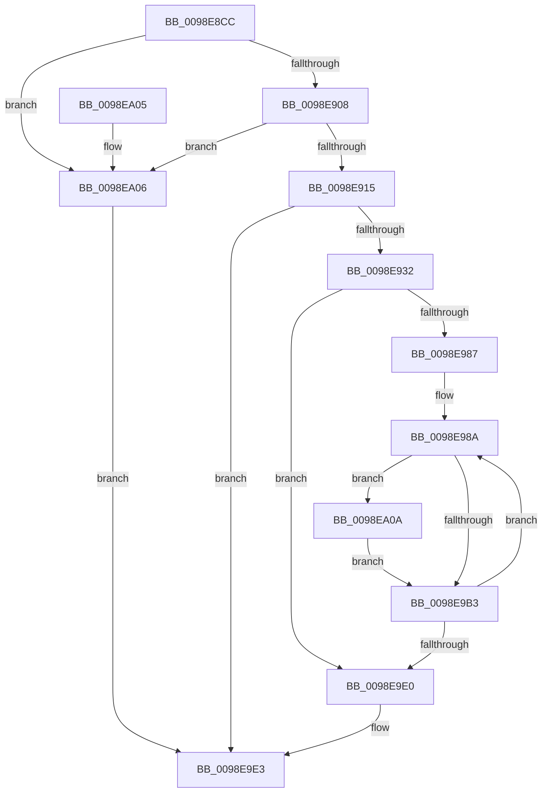

# RtlpInternEntryCreate

- RVA: `0x0098E8CC`–`0x0098EA1D` (길이 `337` bytes)
- VA: `0x000000014098E8CC`
- 실행 섹션: `PAGE`
- PDB 이름 있음: `예`; PDB Function 태그: `아니요`
- unwind 정보 RVA: `0x000909DC`
- 디코드: `91`개 명령, `337/337` bytes 표시
- 미해석 바이트: `0` (있으면 어셈블리에 `.byte`로 보존)

> 이 문서는 커널 이미지의 기계어와 PDB 기호를 분석해 생성했습니다. 4번과 5번은 함수 원형과 자료형을 바이너리 사용 방식에서 추정한 C 해석이며 원본 소스 복구 결과는 아닙니다.

## 1. Dependencies

- 직접 호출 지점: **4**; 고유 호출 대상: **3**
- 직접 호출자로 확인된 함수: **1**
- RIP 상대 이미지 참조: **0**

### Outgoing calls
- `0x0098E91F` → [guard_dispatch_icall](../../text/6B/guard_dispatch_icall_function_006BAAD0.md) (function, `0x006BAAD0`)
- `0x0098E93B` → [memset](../../text/6C/memset_function_006C6C40.md) (function, `0x006C6C40`)
- `0x0098E9C3` → [memcpy](../../text/6C/memcpy_function_006C6840.md) (function, `0x006C6840`)
- `0x0098EA16` → [memset](../../text/6C/memset_function_006C6C40.md) (function, `0x006C6C40`)

### Direct callers
- [RtlInternTableIntern](RtlInternTableIntern_function_0098EEB4.md) at `0x0098EF7A`

### Static image references
- 디코드된 RIP-relative 메모리 참조가 없습니다.

## 2. Other-region calls and transfers

- 다른 실행 섹션으로 향하는 call: **4**
  - `0x0098E91F` → [guard_dispatch_icall](../../text/6B/guard_dispatch_icall_function_006BAAD0.md) (`PAGE` → `.text`)
  - `0x0098E93B` → [memset](../../text/6C/memset_function_006C6C40.md) (`PAGE` → `.text`)
  - `0x0098E9C3` → [memcpy](../../text/6C/memcpy_function_006C6840.md) (`PAGE` → `.text`)
  - `0x0098EA16` → [memset](../../text/6C/memset_function_006C6C40.md) (`PAGE` → `.text`)
- 별도 외부 분기/꼬리 이동을 확인하지 못했습니다.

## 3. Assembly (complete function range)

```asm
0098E8CC  48 8B C4                        mov rax, rsp
0098E8CF  48 89 58 08                     mov qword ptr [rax + 8], rbx
0098E8D3  48 89 68 10                     mov qword ptr [rax + 0x10], rbp
0098E8D7  48 89 70 18                     mov qword ptr [rax + 0x18], rsi
0098E8DB  48 89 78 20                     mov qword ptr [rax + 0x20], rdi
0098E8DF  41 54                           push r12
0098E8E1  41 56                           push r14
0098E8E3  41 57                           push r15
0098E8E5  48 83 EC 20                     sub rsp, 0x20
0098E8E9  48 8B 02                        mov rax, qword ptr [rdx]
0098E8EC  49 8B D9                        mov rbx, r9
0098E8EF  48 2B D8                        sub rbx, rax
0098E8F2  49 8B F0                        mov rsi, r8
0098E8F5  48 83 C0 E0                     add rax, -0x20
0098E8F9  4C 8B E2                        mov r12, rdx
0098E8FC  48 3D E0 FF 00 00               cmp rax, 0xffe0
0098E902  0F 87 FE 00 00 00               ja 0x14098ea06
0098E908  48 81 FB 00 00 00 40            cmp rbx, 0x40000000
0098E90F  0F 87 F1 00 00 00               ja 0x14098ea06
0098E915  48 8B 41 10                     mov rax, qword ptr [rcx + 0x10]
0098E919  49 8B D1                        mov rdx, r9
0098E91C  48 8B 00                        mov rax, qword ptr [rax]
0098E91F  E8 AC C1 D2 FF                  call 0x1406baad0
0098E924  33 FF                           xor edi, edi
0098E926  48 8B E8                        mov rbp, rax
0098E929  48 85 C0                        test rax, rax
0098E92C  0F 84 B1 00 00 00               je 0x14098e9e3
0098E932  4D 8B 04 24                     mov r8, qword ptr [r12]
0098E936  33 D2                           xor edx, edx
0098E938  48 8B C8                        mov rcx, rax
0098E93B  E8 00 83 D3 FF                  call 0x1406c6c40
0098E940  41 0F B7 04 24                  movzx eax, word ptr [r12]
0098E945  48 B9 FF FF 00 00 00 C0 FF FF   movabs rcx, 0xffffc0000000ffff
0098E94F  66 89 45 18                     mov word ptr [rbp + 0x18], ax
0098E953  48 C1 E3 10                     shl rbx, 0x10
0098E957  48 89 75 08                     mov qword ptr [rbp + 8], rsi
0098E95B  48 8B C3                        mov rax, rbx
0098E95E  48 33 45 18                     xor rax, qword ptr [rbp + 0x18]
0098E962  48 23 C1                        and rax, rcx
0098E965  48 C7 45 10 01 00 00 00         mov qword ptr [rbp + 0x10], 1
0098E96D  48 33 C3                        xor rax, rbx
0098E970  48 89 45 18                     mov qword ptr [rbp + 0x18], rax
0098E974  41 83 4C 24 18 01               or dword ptr [r12 + 0x18], 1
0098E97A  8B 45 18                        mov eax, dword ptr [rbp + 0x18]
0098E97D  0F B7 F0                        movzx esi, ax
0098E980  49 39 7C 24 10                  cmp qword ptr [r12 + 0x10], rdi
0098E985  76 59                           jbe 0x14098e9e0
0098E987  44 8B F7                        mov r14d, edi
0098E98A  4D 8B 7C 24 08                  mov r15, qword ptr [r12 + 8]
0098E98F  48 8D 4E FF                     lea rcx, [rsi - 1]
0098E993  4C 8B CE                        mov r9, rsi
0098E996  48 FF CE                        dec rsi
0098E999  4B 8B 54 3E 18                  mov rdx, qword ptr [r14 + r15 + 0x18]
0098E99E  48 03 CA                        add rcx, rdx
0098E9A1  48 8D 42 FF                     lea rax, [rdx - 1]
0098E9A5  48 23 C8                        and rcx, rax
0098E9A8  48 2B D1                        sub rdx, rcx
0098E9AB  48 03 F2                        add rsi, rdx
0098E9AE  49 3B F1                        cmp rsi, r9
0098E9B1  75 57                           jne 0x14098ea0a
0098E9B3  4F 8B 44 3E 10                  mov r8, qword ptr [r14 + r15 + 0x10]
0098E9B8  48 8D 1C 2E                     lea rbx, [rsi + rbp]
0098E9BC  4B 8B 14 3E                     mov rdx, qword ptr [r14 + r15]
0098E9C0  48 8B CB                        mov rcx, rbx
0098E9C3  E8 78 7E D3 FF                  call 0x1406c6840
0098E9C8  4B 03 74 3E 10                  add rsi, qword ptr [r14 + r15 + 0x10]
0098E9CD  48 FF C7                        inc rdi
0098E9D0  4B 89 5C 3E 08                  mov qword ptr [r14 + r15 + 8], rbx
0098E9D5  49 83 C6 20                     add r14, 0x20
0098E9D9  49 3B 7C 24 10                  cmp rdi, qword ptr [r12 + 0x10]
0098E9DE  72 AA                           jb 0x14098e98a
0098E9E0  48 8B FD                        mov rdi, rbp
0098E9E3  48 8B 5C 24 40                  mov rbx, qword ptr [rsp + 0x40]
0098E9E8  48 8B C7                        mov rax, rdi
0098E9EB  48 8B 7C 24 58                  mov rdi, qword ptr [rsp + 0x58]
0098E9F0  48 8B 6C 24 48                  mov rbp, qword ptr [rsp + 0x48]
0098E9F5  48 8B 74 24 50                  mov rsi, qword ptr [rsp + 0x50]
0098E9FA  48 83 C4 20                     add rsp, 0x20
0098E9FE  41 5F                           pop r15
0098EA00  41 5E                           pop r14
0098EA02  41 5C                           pop r12
0098EA04  C3                              ret
0098EA05  CC                              int3
0098EA06  33 FF                           xor edi, edi
0098EA08  EB D9                           jmp 0x14098e9e3
0098EA0A  4C 8B C6                        mov r8, rsi
0098EA0D  49 8D 0C 29                     lea rcx, [r9 + rbp]
0098EA11  4D 2B C1                        sub r8, r9
0098EA14  33 D2                           xor edx, edx
0098EA16  E8 25 82 D3 FF                  call 0x1406c6c40
0098EA1B  EB 96                           jmp 0x14098e9b3
```

## 4. C-style interpretation (structured pseudocode)

```c
__int64 __fastcall RtlpInternEntryCreate(__int64 a1, __int64 a2, __int64 a3, __int64 a4)
{
    __int64 result;
    __int64 v_r14;
    __int64 v_rbx;
    __int64 v_rdi;
    __int64 v_rsi;
    __int64 v_rsp;
    unsigned __int64 v_stack_p10;
    unsigned __int64 v_stack_p18;
    unsigned __int64 v_stack_p20;
    unsigned __int64 v_stack_p8;

    *(unsigned __int64 *)(v_rsp + 8) = v_rbx;
    *(unsigned __int64 *)(v_rsp + 16) = v_rbp;
    *(unsigned __int64 *)(v_rsp + 24) = v_rsi;
    *(unsigned __int64 *)(v_rsp + 32) = v_rdi;
    v_rsp = (v_rsp) - (32);
    v_rbx = (a4) - (*(unsigned __int64 *)(a2));
    result = (*(unsigned __int64 *)(a2)) + (-32);
    if (result > 0xFFE0ULL) goto loc_0098EA06;
    if (v_rbx > 0x40000000ULL) goto loc_0098EA06;
    result = guard_dispatch_icall(a1, a4, a3, a4);
    v_rdi = 0;
    if (result == 0) goto loc_0098E9E3;
    a2 = 0;
    result = memset(result, a2, *(unsigned __int64 *)(a2), a4);
    *(unsigned __int16 *)(result + 24) = (unsigned __int16)(*(unsigned __int16 *)(a2));
    v_rbx = (v_rbx) << (16);
    *(unsigned __int64 *)(result + 8) = a3;
    result = (v_rbx) ^ (*(unsigned __int64 *)(result + 24));
    result = (result) & (result);
    *(unsigned __int64 *)(result + 16) = 1;
    result = (result) ^ (v_rbx);
    *(unsigned __int64 *)(result + 24) = result;
    if ((*(unsigned __int64 *)(a2 + 16)) <= 0) goto loc_0098E9E0;
loc_0098E98A:
    v_rsi = ((unsigned __int16)((unsigned int)(*(unsigned int *)(result + 24)))) - 1;
    a1 = ((unsigned __int16)((unsigned int)(*(unsigned int *)(result + 24))) - 1) + (*(unsigned __int64 *)(0 + *(unsigned __int64 *)(a2 + 8) * 1 + 24));
    a1 = (a1) & (*(unsigned __int64 *)(0 + *(unsigned __int64 *)(a2 + 8) * 1 + 24) - 1);
    a2 = (*(unsigned __int64 *)(0 + *(unsigned __int64 *)(a2 + 8) * 1 + 24)) - (a1);
    v_rsi = (v_rsi) + (a2);
    if (v_rsi != ((unsigned __int16)((unsigned int)(*(unsigned int *)(result + 24))))) goto loc_0098EA0A;
loc_0098E9B3:
    result = memcpy(v_rsi + result * 1, *(unsigned __int64 *)(0 + *(unsigned __int64 *)(a2 + 8) * 1), *(unsigned __int64 *)(0 + *(unsigned __int64 *)(a2 + 8) * 1 + 16), (unsigned __int16)((unsigned int)(*(unsigned int *)(result + 24))));
    v_rsi = (v_rsi) + (*(unsigned __int64 *)(0 + *(unsigned __int64 *)(a2 + 8) * 1 + 16));
    v_rdi = (v_rdi) + 1;
    *(unsigned __int64 *)(0 + *(unsigned __int64 *)(a2 + 8) * 1 + 8) = v_rsi + result * 1;
    v_r14 = (0) + (32);
    if (v_rdi < (*(unsigned __int64 *)(a2 + 16))) goto loc_0098E98A;
loc_0098E9E0:
loc_0098E9E3:
    v_rsp = (v_rsp) + (32);
    return result;
loc_0098EA06:
    v_rdi = 0;
    goto loc_0098E9E3;
loc_0098EA0A:
    a3 = (v_stack_p18) - ((unsigned __int16)((unsigned int)(*(unsigned int *)(result + 24))));
    a2 = 0;
    result = memset((unsigned __int16)((unsigned int)(*(unsigned int *)(result + 24))) + v_stack_p10 * 1, a2, a3, (unsigned __int16)((unsigned int)(*(unsigned int *)(result + 24))));
    goto loc_0098E9B3;
}
```

## 5. (Beta) C Style

```c
int64_t RtlpInternEntryCreate(void *Arg1, void *Arg2, int64_t Arg3, int64_t Arg4)
{
    uint8_t *arg1 = (uint8_t *)Arg1;
    uint8_t *arg2 = (uint8_t *)Arg2;

    int64_t result;
    int64_t local_r14;
    int64_t local_rbx;
    int64_t local_rdi;
    int64_t local_rsi;
    int64_t local_rsp;
    uint64_t v_stack_p10;
    uint64_t v_stack_p18;
    uint64_t v_stack_p20;
    uint64_t v_stack_p8;

    *(uint64_t *)(local_rsp + 0x8) = local_rbx;
    *(uint64_t *)(local_rsp + 0x10) = local_rbp;
    *(uint64_t *)(local_rsp + 0x18) = local_rsi;
    *(uint64_t *)(local_rsp + 0x20) = local_rdi;
    local_rsp = (local_rsp) - (32);
    local_rbx = (Arg4) - (*(uint64_t *)(arg2));
    result = (*(uint64_t *)(arg2)) + (-32);
    if (result > 0xFFE0ULL) goto loc_0098EA06;
    if (local_rbx > 0x40000000ULL) goto loc_0098EA06;
    result = guard_dispatch_icall(Arg1, Arg4, Arg3, Arg4);
    local_rdi = 0;
    if (result == 0) goto loc_0098E9E3;
    Arg2 = 0;
    result = memset(result, Arg2, *(uint64_t *)(arg2), Arg4);
    *(uint16_t *)(result + 0x18) = (uint16_t)(*(uint16_t *)(arg2));
    local_rbx = (local_rbx) << (16);
    *(uint64_t *)(result + 0x8) = Arg3;
    result = (local_rbx) ^ (*(uint64_t *)(result + 0x18));
    result = (result) & (result);
    *(uint64_t *)(result + 0x10) = 1;
    result = (result) ^ (local_rbx);
    *(uint64_t *)(result + 0x18) = result;
    if ((*(uint64_t *)(arg2 + 0x10)) <= 0) goto loc_0098E9E0;
loc_0098E98A:
    local_rsi = ((uint16_t)((uint32_t)(*(uint32_t *)(result + 0x18)))) - 1;
    Arg1 = ((uint16_t)((uint32_t)(*(uint32_t *)(result + 0x18))) - 1) + (*(uint64_t *)(0 + *(uint64_t *)(arg2 + 0x8) * 1 + 0x18));
    Arg1 = (Arg1) & (*(uint64_t *)(0 + *(uint64_t *)(arg2 + 0x8) * 1 + 0x18) - 1);
    Arg2 = (*(uint64_t *)(0 + *(uint64_t *)(arg2 + 0x8) * 1 + 0x18)) - (Arg1);
    local_rsi = (local_rsi) + (Arg2);
    if (local_rsi != ((uint16_t)((uint32_t)(*(uint32_t *)(result + 0x18))))) goto loc_0098EA0A;
loc_0098E9B3:
    result = memcpy(local_rsi + result * 1, *(uint64_t *)(0 + *(uint64_t *)(arg2 + 0x8) * 1), *(uint64_t *)(0 + *(uint64_t *)(arg2 + 0x8) * 1 + 0x10), (uint16_t)((uint32_t)(*(uint32_t *)(result + 0x18))));
    local_rsi = (local_rsi) + (*(uint64_t *)(0 + *(uint64_t *)(arg2 + 0x8) * 1 + 0x10));
    local_rdi = (local_rdi) + 1;
    *(uint64_t *)(0 + *(uint64_t *)(arg2 + 0x8) * 1 + 0x8) = local_rsi + result * 1;
    local_r14 = (0) + (32);
    if (local_rdi < (*(uint64_t *)(arg2 + 0x10))) goto loc_0098E98A;
loc_0098E9E0:
loc_0098E9E3:
    local_rsp = (local_rsp) + (32);
    return result;
loc_0098EA06:
    local_rdi = 0;
    goto loc_0098E9E3;
loc_0098EA0A:
    Arg3 = (v_stack_p18) - ((uint16_t)((uint32_t)(*(uint32_t *)(result + 0x18))));
    Arg2 = 0;
    result = memset((uint16_t)((uint32_t)(*(uint32_t *)(result + 0x18))) + v_stack_p10 * 1, Arg2, Arg3, (uint16_t)((uint32_t)(*(uint32_t *)(result + 0x18))));
    goto loc_0098E9B3;
}
```

### 관측된 메모리 오프셋

구조체 형식이 확인되지 않은 접근은 인자 기준의 오프셋으로만 기록했습니다.

| 기준 인자 | 오프셋 표현 | 폭 (bit) | 접근 |
|---|---:|---:|---|
| `Arg1` | `+ 0x10` | `64` | `R` |
| `Arg2` | `+ 0x0` | `16` | `R` |
| `Arg2` | `+ 0x0` | `64` | `R` |
| `Arg2` | `+ 0x8` | `64` | `R` |
| `Arg2` | `+ 0x10` | `64` | `R` |
| `Arg2` | `+ 0x18` | `32` | `R/W` |

## 6. Execution-region graph

[열기: 2D/3D 그래프와 함수 탐색 컨트롤 패널](../../../control-panel.html?section=page&rva=0x0098E8CC&view=graph)

- 2D 그래프는 위에서 아래로 흐르고, 3D 그래프는 빈 공간을 드래그해 회전합니다. Shift+드래그는 이동, 휠은 확대·축소, 함수 노드 선택은 대상 보고서 이동입니다.

### Static fallback


