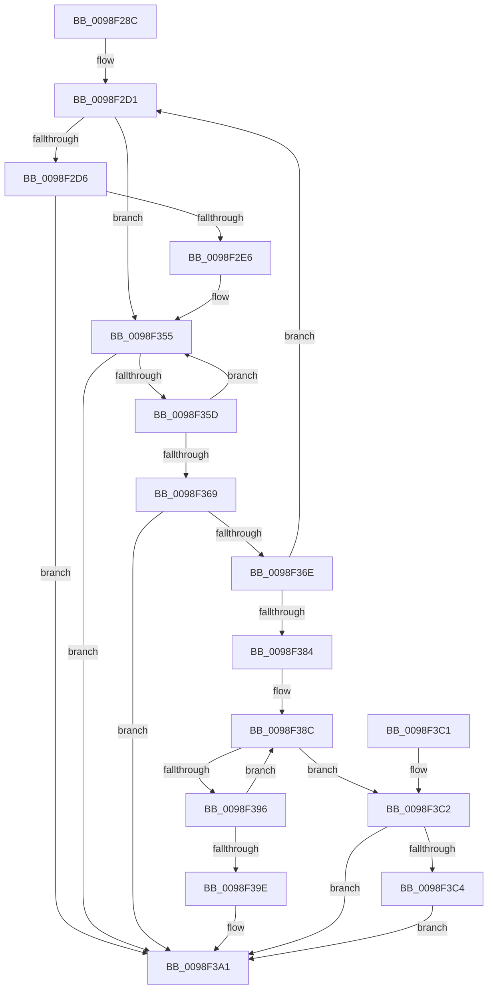

# RtlpInternEntryFind

- RVA: `0x0098F28C`–`0x0098F3CD` (길이 `321` bytes)
- VA: `0x000000014098F28C`
- 실행 섹션: `PAGE`
- PDB 이름 있음: `예`; PDB Function 태그: `아니요`
- unwind 정보 RVA: `0x00098A1C`
- 디코드: `95`개 명령, `321/321` bytes 표시
- 미해석 바이트: `0` (있으면 어셈블리에 `.byte`로 보존)

> 이 문서는 커널 이미지의 기계어와 PDB 기호를 분석해 생성했습니다. 4번과 5번은 함수 원형과 자료형을 바이너리 사용 방식에서 추정한 C 해석이며 원본 소스 복구 결과는 아닙니다.

## 1. Dependencies

- 직접 호출 지점: **1**; 고유 호출 대상: **1**
- 직접 호출자로 확인된 함수: **1**
- RIP 상대 이미지 참조: **0**

### Outgoing calls
- `0x0098F377` → [RtlpInternEntryMatch](RtlpInternEntryMatch_function_0098EA24.md) (function, `0x0098EA24`)

### Direct callers
- [RtlInternTableIntern](RtlInternTableIntern_function_0098EEB4.md) at `0x0098EF17`
- [RtlInternTableIntern](RtlInternTableIntern_function_0098EEB4.md) at `0x0098F21F`

### Static image references
- 디코드된 RIP-relative 메모리 참조가 없습니다.

## 2. Other-region calls and transfers

- 다른 실행 섹션으로 향하는 call: **0**
- 별도 외부 분기/꼬리 이동을 확인하지 못했습니다.

## 3. Assembly (complete function range)

```asm
0098F28C  48 89 5C 24 10                  mov qword ptr [rsp + 0x10], rbx
0098F291  48 89 6C 24 18                  mov qword ptr [rsp + 0x18], rbp
0098F296  48 89 74 24 20                  mov qword ptr [rsp + 0x20], rsi
0098F29B  57                              push rdi
0098F29C  41 54                           push r12
0098F29E  41 55                           push r13
0098F2A0  41 56                           push r14
0098F2A2  41 57                           push r15
0098F2A4  48 83 EC 20                     sub rsp, 0x20
0098F2A8  44 8B 71 04                     mov r14d, dword ptr [rcx + 4]
0098F2AC  4C 8B F9                        mov r15, rcx
0098F2AF  48 83 CD FF                     or rbp, 0xffffffffffffffff
0098F2B3  33 FF                           xor edi, edi
0098F2B5  41 8B CE                        mov ecx, r14d
0098F2B8  4D 8B E1                        mov r12, r9
0098F2BB  83 E1 1F                        and ecx, 0x1f
0098F2BE  4C 8B EA                        mov r13, rdx
0098F2C1  48 D3 E5                        shl rbp, cl
0098F2C4  8B DF                           mov ebx, edi
0098F2C6  48 8B F5                        mov rsi, rbp
0098F2C9  49 23 F0                        and rsi, r8
0098F2CC  48 89 74 24 50                  mov qword ptr [rsp + 0x50], rsi
0098F2D1  48 85 DB                        test rbx, rbx
0098F2D4  75 7F                           jne 0x14098f355
0098F2D6  45 8B CE                        mov r9d, r14d
0098F2D9  41 C1 E9 05                     shr r9d, 5
0098F2DD  45 85 C9                        test r9d, r9d
0098F2E0  0F 84 BB 00 00 00               je 0x14098f3a1
0098F2E6  40 0F B6 C6                     movzx eax, sil
0098F2EA  48 05 CB 5D B1 00               add rax, 0xb15dcb
0098F2F0  48 6B C8 25                     imul rcx, rax, 0x25
0098F2F4  0F B6 44 24 51                  movzx eax, byte ptr [rsp + 0x51]
0098F2F9  48 03 C8                        add rcx, rax
0098F2FC  0F B6 44 24 52                  movzx eax, byte ptr [rsp + 0x52]
0098F301  48 6B D1 25                     imul rdx, rcx, 0x25
0098F305  48 03 D0                        add rdx, rax
0098F308  0F B6 44 24 53                  movzx eax, byte ptr [rsp + 0x53]
0098F30D  48 6B CA 25                     imul rcx, rdx, 0x25
0098F311  48 03 C8                        add rcx, rax
0098F314  0F B6 44 24 54                  movzx eax, byte ptr [rsp + 0x54]
0098F319  48 6B D1 25                     imul rdx, rcx, 0x25
0098F31D  48 03 D0                        add rdx, rax
0098F320  0F B6 44 24 55                  movzx eax, byte ptr [rsp + 0x55]
0098F325  48 6B CA 25                     imul rcx, rdx, 0x25
0098F329  48 03 C8                        add rcx, rax
0098F32C  0F B6 44 24 56                  movzx eax, byte ptr [rsp + 0x56]
0098F331  48 6B D1 25                     imul rdx, rcx, 0x25
0098F335  41 8D 49 FF                     lea ecx, [r9 - 1]
0098F339  48 03 D0                        add rdx, rax
0098F33C  0F B6 44 24 57                  movzx eax, byte ptr [rsp + 0x57]
0098F341  4C 6B C2 25                     imul r8, rdx, 0x25
0098F345  49 03 C0                        add rax, r8
0098F348  8B C0                           mov eax, eax
0098F34A  48 23 C8                        and rcx, rax
0098F34D  49 8B 47 08                     mov rax, qword ptr [r15 + 8]
0098F351  48 8D 1C C8                     lea rbx, [rax + rcx*8]
0098F355  48 8B 1B                        mov rbx, qword ptr [rbx]
0098F358  F6 C3 01                        test bl, 1
0098F35B  75 44                           jne 0x14098f3a1
0098F35D  48 8B 43 08                     mov rax, qword ptr [rbx + 8]
0098F361  48 23 C5                        and rax, rbp
0098F364  48 3B F0                        cmp rsi, rax
0098F367  75 EC                           jne 0x14098f355
0098F369  48 85 DB                        test rbx, rbx
0098F36C  74 33                           je 0x14098f3a1
0098F36E  4D 8B C4                        mov r8, r12
0098F371  49 8B D5                        mov rdx, r13
0098F374  48 8B CB                        mov rcx, rbx
0098F377  E8 A8 F6 FF FF                  call 0x14098ea24
0098F37C  84 C0                           test al, al
0098F37E  0F 84 4D FF FF FF               je 0x14098f2d1
0098F384  0F 0D 4B 10                     prefetchw byte ptr [rbx + 0x10]
0098F388  48 8B 43 10                     mov rax, qword ptr [rbx + 0x10]
0098F38C  48 8D 48 01                     lea rcx, [rax + 1]
0098F390  48 83 F9 01                     cmp rcx, 1
0098F394  76 2C                           jbe 0x14098f3c2
0098F396  F0 48 0F B1 4B 10               lock cmpxchg qword ptr [rbx + 0x10], rcx
0098F39C  75 EE                           jne 0x14098f38c
0098F39E  48 8B FB                        mov rdi, rbx
0098F3A1  48 8B 5C 24 58                  mov rbx, qword ptr [rsp + 0x58]
0098F3A6  48 8B C7                        mov rax, rdi
0098F3A9  48 8B 6C 24 60                  mov rbp, qword ptr [rsp + 0x60]
0098F3AE  48 8B 74 24 68                  mov rsi, qword ptr [rsp + 0x68]
0098F3B3  48 83 C4 20                     add rsp, 0x20
0098F3B7  41 5F                           pop r15
0098F3B9  41 5E                           pop r14
0098F3BB  41 5D                           pop r13
0098F3BD  41 5C                           pop r12
0098F3BF  5F                              pop rdi
0098F3C0  C3                              ret
0098F3C1  CC                              int3
0098F3C2  74 DD                           je 0x14098f3a1
0098F3C4  B9 0E 00 00 00                  mov ecx, 0xe
0098F3C9  CD 29                           int 0x29
0098F3CB  EB D4                           jmp 0x14098f3a1
```

## 4. C-style interpretation (structured pseudocode)

```c
__int64 __fastcall RtlpInternEntryFind(__int64 a1, __int64 a2, __int64 a3, __int64 a4)
{
    __int64 result;
    __int64 v_rbp;
    __int64 v_rdi;
    __int64 v_rsi;
    __int64 v_rsp;
    unsigned __int64 v_stack_p10;
    unsigned __int64 v_stack_p18;
    unsigned __int64 v_stack_p20;
    unsigned __int64 v_stack_p8;
    unsigned __int8 v_stack_p9;
    unsigned __int8 v_stack_pA;
    unsigned __int8 v_stack_pB;
    unsigned __int8 v_stack_pC;
    unsigned __int8 v_stack_pD;
    unsigned __int8 v_stack_pE;
    unsigned __int8 v_stack_pF;

    v_stack_p10 = v_rbx;
    v_stack_p18 = v_rbp;
    v_stack_p20 = v_rsi;
    v_rsp = (v_rsp) - (32);
    v_rbp = (v_rbp) | (-1);
    v_rdi = 0;
    a1 = (unsigned int)(((unsigned int)((unsigned int)((unsigned int)(*(unsigned int *)(a1 + 4))))) & (31));
    v_rbp = (v_rbp) << ((unsigned __int8)(a1));
    v_rsi = (v_rbp) & (a3);
    v_stack_p8 = v_rsi;
loc_0098F2D1:
    if (0 != 0) goto loc_0098F355;
    a4 = (unsigned int)(((unsigned int)((unsigned int)((unsigned int)(*(unsigned int *)(a1 + 4))))) >> (5));
    if ((unsigned int)(a4) == 0) goto loc_0098F3A1;
    result = ((unsigned __int8)(v_rsi)) + (0xB15DCBULL);
    a1 = (a1) * (result);
    a1 = (a1) + (v_stack_p9);
    a2 = (a2) * (a1);
    a2 = (a2) + (v_stack_pA);
    a1 = (a1) * (a2);
    a1 = (a1) + (v_stack_pB);
    a2 = (a2) * (a1);
    a2 = (a2) + (v_stack_pC);
    a1 = (a1) * (a2);
    a1 = (a1) + (v_stack_pD);
    a2 = (a2) * (a1);
    a2 = (a2) + (v_stack_pE);
    a3 = (a3) * (a2);
    result = (v_stack_pF) + (a3);
    a1 = (a4 - 1) & ((unsigned int)((unsigned int)(result)));
loc_0098F355:
    if ((((unsigned __int8)(*(unsigned __int64 *)(*(unsigned __int64 *)(a1 + 8) + a1 * 8))) & (1)) != 0) goto loc_0098F3A1;
    result = (*(unsigned __int64 *)(*(unsigned __int64 *)(*(unsigned __int64 *)(a1 + 8) + a1 * 8) + 8)) & (v_rbp);
    if (v_rsi != result) goto loc_0098F355;
    if (*(unsigned __int64 *)(*(unsigned __int64 *)(a1 + 8) + a1 * 8) == 0) goto loc_0098F3A1;
    result = RtlpInternEntryMatch(*(unsigned __int64 *)(*(unsigned __int64 *)(a1 + 8) + a1 * 8), a2, a4, a4);
    if ((unsigned __int8)(result) == 0) goto loc_0098F2D1;
loc_0098F38C:
    if ((*(unsigned __int64 *)(*(unsigned __int64 *)(*(unsigned __int64 *)(a1 + 8) + a1 * 8) + 16) + 1) <= 1) goto loc_0098F3C2;
    if ((*(unsigned __int64 *)(*(unsigned __int64 *)(*(unsigned __int64 *)(a1 + 8) + a1 * 8) + 16) + 1) != 1) goto loc_0098F38C;
loc_0098F3A1:
    v_rsp = (v_rsp) + (32);
    return *(unsigned __int64 *)(*(unsigned __int64 *)(a1 + 8) + a1 * 8);
loc_0098F3C2:
    if (condition_is_equal) goto loc_0098F3A1;
    goto loc_0098F3A1;
}
```

## 5. (Beta) C Style

```c
int64_t RtlpInternEntryFind(void *Arg1, int64_t Arg2, int64_t Arg3, int64_t Arg4)
{
    uint8_t *arg1 = (uint8_t *)Arg1;

    int64_t result;
    int64_t local_rbp;
    int64_t local_rdi;
    int64_t local_rsi;
    int64_t local_rsp;
    uint64_t v_stack_p10;
    uint64_t v_stack_p18;
    uint64_t v_stack_p20;
    uint64_t v_stack_p8;
    uint8_t v_stack_p9;
    uint8_t v_stack_pA;
    uint8_t v_stack_pB;
    uint8_t v_stack_pC;
    uint8_t v_stack_pD;
    uint8_t v_stack_pE;
    uint8_t v_stack_pF;

    v_stack_p10 = local_rbx;
    v_stack_p18 = local_rbp;
    v_stack_p20 = local_rsi;
    local_rsp = (local_rsp) - (32);
    local_rbp = (local_rbp) | (-1);
    local_rdi = 0;
    Arg1 = (uint32_t)(((uint32_t)((uint32_t)((uint32_t)(*(uint32_t *)(arg1 + 0x4))))) & (31));
    local_rbp = (local_rbp) << ((uint8_t)(Arg1));
    local_rsi = (local_rbp) & (Arg3);
    v_stack_p8 = local_rsi;
loc_0098F2D1:
    if (0 != 0) goto loc_0098F355;
    Arg4 = (uint32_t)(((uint32_t)((uint32_t)((uint32_t)(*(uint32_t *)(arg1 + 0x4))))) >> (5));
    if ((uint32_t)(Arg4) == 0) goto loc_0098F3A1;
    result = ((uint8_t)(local_rsi)) + (0xB15DCBULL);
    Arg1 = (Arg1) * (result);
    Arg1 = (Arg1) + (v_stack_p9);
    Arg2 = (Arg2) * (Arg1);
    Arg2 = (Arg2) + (v_stack_pA);
    Arg1 = (Arg1) * (Arg2);
    Arg1 = (Arg1) + (v_stack_pB);
    Arg2 = (Arg2) * (Arg1);
    Arg2 = (Arg2) + (v_stack_pC);
    Arg1 = (Arg1) * (Arg2);
    Arg1 = (Arg1) + (v_stack_pD);
    Arg2 = (Arg2) * (Arg1);
    Arg2 = (Arg2) + (v_stack_pE);
    Arg3 = (Arg3) * (Arg2);
    result = (v_stack_pF) + (Arg3);
    Arg1 = (Arg4 - 1) & ((uint32_t)((uint32_t)(result)));
loc_0098F355:
    if ((((uint8_t)(*(uint64_t *)(*(uint64_t *)(arg1 + 0x8) + arg1 * 8))) & (1)) != 0) goto loc_0098F3A1;
    result = (*(uint64_t *)(*(uint64_t *)(*(uint64_t *)(arg1 + 0x8) + arg1 * 8) + 0x8)) & (local_rbp);
    if (local_rsi != result) goto loc_0098F355;
    if (*(uint64_t *)(*(uint64_t *)(arg1 + 0x8) + arg1 * 8) == 0) goto loc_0098F3A1;
    result = RtlpInternEntryMatch(*(uint64_t *)(*(uint64_t *)(arg1 + 0x8) + arg1 * 8), Arg2, Arg4, Arg4);
    if ((uint8_t)(result) == 0) goto loc_0098F2D1;
loc_0098F38C:
    if ((*(uint64_t *)(*(uint64_t *)(*(uint64_t *)(arg1 + 0x8) + arg1 * 8) + 0x10) + 1) <= 1) goto loc_0098F3C2;
    if ((*(uint64_t *)(*(uint64_t *)(*(uint64_t *)(arg1 + 0x8) + arg1 * 8) + 0x10) + 1) != 1) goto loc_0098F38C;
loc_0098F3A1:
    local_rsp = (local_rsp) + (32);
    return *(uint64_t *)(*(uint64_t *)(arg1 + 0x8) + arg1 * 8);
loc_0098F3C2:
    if (condition_is_equal) goto loc_0098F3A1;
    goto loc_0098F3A1;
}
```

### 관측된 메모리 오프셋

구조체 형식이 확인되지 않은 접근은 인자 기준의 오프셋으로만 기록했습니다.

| 기준 인자 | 오프셋 표현 | 폭 (bit) | 접근 |
|---|---:|---:|---|
| `Arg1` | `+ 0x4` | `32` | `R` |
| `Arg1` | `+ 0x8` | `64` | `R` |

## 6. Execution-region graph

[열기: 2D/3D 그래프와 함수 탐색 컨트롤 패널](../../../control-panel.html?section=page&rva=0x0098F28C&view=graph)

- 2D 그래프는 위에서 아래로 흐르고, 3D 그래프는 빈 공간을 드래그해 회전합니다. Shift+드래그는 이동, 휠은 확대·축소, 함수 노드 선택은 대상 보고서 이동입니다.

### Static fallback


