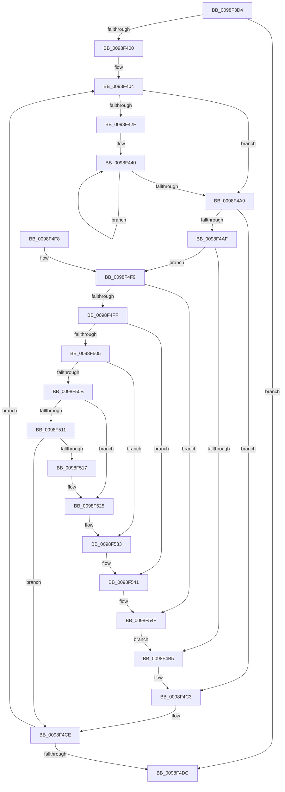

# RtlpInternEntryHash

- RVA: `0x0098F3D4`–`0x0098F562` (길이 `398` bytes)
- VA: `0x000000014098F3D4`
- 실행 섹션: `PAGE`
- PDB 이름 있음: `예`; PDB Function 태그: `아니요`
- unwind 정보 RVA: `0x00098A3C`
- 디코드: `110`개 명령, `398/398` bytes 표시
- 미해석 바이트: `0` (있으면 어셈블리에 `.byte`로 보존)

> 이 문서는 커널 이미지의 기계어와 PDB 기호를 분석해 생성했습니다. 4번과 5번은 함수 원형과 자료형을 바이너리 사용 방식에서 추정한 C 해석이며 원본 소스 복구 결과는 아닙니다.

## 1. Dependencies

- 직접 호출 지점: **0**; 고유 호출 대상: **0**
- 직접 호출자로 확인된 함수: **1**
- RIP 상대 이미지 참조: **0**

### Outgoing calls
- 직접 디코드된 call 명령이 없습니다.

### Direct callers
- [RtlInternTableIntern](RtlInternTableIntern_function_0098EEB4.md) at `0x0098EEE9`

### Static image references
- 디코드된 RIP-relative 메모리 참조가 없습니다.

## 2. Other-region calls and transfers

- 다른 실행 섹션으로 향하는 call: **0**
- 별도 외부 분기/꼬리 이동을 확인하지 못했습니다.

## 3. Assembly (complete function range)

```asm
0098F3D4  48 8B C4                        mov rax, rsp
0098F3D7  48 89 58 08                     mov qword ptr [rax + 8], rbx
0098F3DB  48 89 70 10                     mov qword ptr [rax + 0x10], rsi
0098F3DF  48 89 78 18                     mov qword ptr [rax + 0x18], rdi
0098F3E3  4C 89 70 20                     mov qword ptr [rax + 0x20], r14
0098F3E7  48 8B 71 10                     mov rsi, qword ptr [rcx + 0x10]
0098F3EB  4C 8B F2                        mov r14, rdx
0098F3EE  4C 8B 19                        mov r11, qword ptr [rcx]
0098F3F1  41 B8 2F CB 04 00               mov r8d, 0x4cb2f
0098F3F7  48 85 F6                        test rsi, rsi
0098F3FA  0F 84 DC 00 00 00               je 0x14098f4dc
0098F400  48 8B 59 08                     mov rbx, qword ptr [rcx + 8]
0098F404  48 8B 53 18                     mov rdx, qword ptr [rbx + 0x18]
0098F408  49 8D 4B FF                     lea rcx, [r11 - 1]
0098F40C  4C 8B 53 10                     mov r10, qword ptr [rbx + 0x10]
0098F410  48 03 CA                        add rcx, rdx
0098F413  4C 8B 0B                        mov r9, qword ptr [rbx]
0098F416  49 FF CB                        dec r11
0098F419  48 8D 42 FF                     lea rax, [rdx - 1]
0098F41D  48 23 C8                        and rcx, rax
0098F420  48 2B D1                        sub rdx, rcx
0098F423  49 03 D2                        add rdx, r10
0098F426  4C 03 DA                        add r11, rdx
0098F429  49 83 FA 08                     cmp r10, 8
0098F42D  7C 7A                           jl 0x14098f4a9
0098F42F  49 8B FA                        mov rdi, r10
0098F432  48 C1 EF 03                     shr rdi, 3
0098F436  48 8B C7                        mov rax, rdi
0098F439  48 F7 D8                        neg rax
0098F43C  4D 8D 14 C2                     lea r10, [r10 + rax*8]
0098F440  41 0F B6 01                     movzx eax, byte ptr [r9]
0098F444  49 6B C8 25                     imul rcx, r8, 0x25
0098F448  48 03 C8                        add rcx, rax
0098F44B  41 0F B6 41 01                  movzx eax, byte ptr [r9 + 1]
0098F450  48 6B D1 25                     imul rdx, rcx, 0x25
0098F454  48 03 D0                        add rdx, rax
0098F457  41 0F B6 41 02                  movzx eax, byte ptr [r9 + 2]
0098F45C  48 6B CA 25                     imul rcx, rdx, 0x25
0098F460  48 03 C8                        add rcx, rax
0098F463  41 0F B6 41 03                  movzx eax, byte ptr [r9 + 3]
0098F468  48 6B D1 25                     imul rdx, rcx, 0x25
0098F46C  48 03 D0                        add rdx, rax
0098F46F  41 0F B6 41 04                  movzx eax, byte ptr [r9 + 4]
0098F474  48 6B CA 25                     imul rcx, rdx, 0x25
0098F478  48 03 C8                        add rcx, rax
0098F47B  41 0F B6 41 05                  movzx eax, byte ptr [r9 + 5]
0098F480  48 6B D1 25                     imul rdx, rcx, 0x25
0098F484  48 03 D0                        add rdx, rax
0098F487  41 0F B6 41 06                  movzx eax, byte ptr [r9 + 6]
0098F48C  48 6B CA 25                     imul rcx, rdx, 0x25
0098F490  48 03 C8                        add rcx, rax
0098F493  41 0F B6 41 07                  movzx eax, byte ptr [r9 + 7]
0098F498  4C 6B C1 25                     imul r8, rcx, 0x25
0098F49C  49 83 C1 08                     add r9, 8
0098F4A0  4C 03 C0                        add r8, rax
0098F4A3  48 83 EF 01                     sub rdi, 1
0098F4A7  75 97                           jne 0x14098f440
0098F4A9  49 83 EA 01                     sub r10, 1
0098F4AD  74 14                           je 0x14098f4c3
0098F4AF  49 83 EA 01                     sub r10, 1
0098F4B3  75 44                           jne 0x14098f4f9
0098F4B5  41 0F B6 01                     movzx eax, byte ptr [r9]
0098F4B9  4D 6B C0 25                     imul r8, r8, 0x25
0098F4BD  4C 03 C0                        add r8, rax
0098F4C0  49 FF C1                        inc r9
0098F4C3  41 0F B6 01                     movzx eax, byte ptr [r9]
0098F4C7  4D 6B C0 25                     imul r8, r8, 0x25
0098F4CB  4C 03 C0                        add r8, rax
0098F4CE  48 83 C3 20                     add rbx, 0x20
0098F4D2  48 83 EE 01                     sub rsi, 1
0098F4D6  0F 85 28 FF FF FF               jne 0x14098f404
0098F4DC  48 8B 5C 24 08                  mov rbx, qword ptr [rsp + 8]
0098F4E1  4B 8D 04 03                     lea rax, [r11 + r8]
0098F4E5  48 8B 74 24 10                  mov rsi, qword ptr [rsp + 0x10]
0098F4EA  48 8B 7C 24 18                  mov rdi, qword ptr [rsp + 0x18]
0098F4EF  4D 89 1E                        mov qword ptr [r14], r11
0098F4F2  4C 8B 74 24 20                  mov r14, qword ptr [rsp + 0x20]
0098F4F7  C3                              ret
0098F4F8  CC                              int3
0098F4F9  49 83 EA 01                     sub r10, 1
0098F4FD  74 50                           je 0x14098f54f
0098F4FF  49 83 EA 01                     sub r10, 1
0098F503  74 3C                           je 0x14098f541
0098F505  49 83 EA 01                     sub r10, 1
0098F509  74 28                           je 0x14098f533
0098F50B  49 83 EA 01                     sub r10, 1
0098F50F  74 14                           je 0x14098f525
0098F511  49 83 FA 01                     cmp r10, 1
0098F515  75 B7                           jne 0x14098f4ce
0098F517  41 0F B6 01                     movzx eax, byte ptr [r9]
0098F51B  4D 6B C0 25                     imul r8, r8, 0x25
0098F51F  4C 03 C0                        add r8, rax
0098F522  49 FF C1                        inc r9
0098F525  41 0F B6 01                     movzx eax, byte ptr [r9]
0098F529  4D 6B C0 25                     imul r8, r8, 0x25
0098F52D  4C 03 C0                        add r8, rax
0098F530  49 FF C1                        inc r9
0098F533  41 0F B6 01                     movzx eax, byte ptr [r9]
0098F537  4D 6B C0 25                     imul r8, r8, 0x25
0098F53B  4C 03 C0                        add r8, rax
0098F53E  49 FF C1                        inc r9
0098F541  41 0F B6 01                     movzx eax, byte ptr [r9]
0098F545  4D 6B C0 25                     imul r8, r8, 0x25
0098F549  4C 03 C0                        add r8, rax
0098F54C  49 FF C1                        inc r9
0098F54F  41 0F B6 01                     movzx eax, byte ptr [r9]
0098F553  4D 6B C0 25                     imul r8, r8, 0x25
0098F557  4C 03 C0                        add r8, rax
0098F55A  49 FF C1                        inc r9
0098F55D  E9 53 FF FF FF                  jmp 0x14098f4b5
```

## 4. C-style interpretation (structured pseudocode)

```c
__int64 __fastcall RtlpInternEntryHash(__int64 a1, __int64 a2)
{
    __int64 result;
    __int64 v_r10;
    __int64 v_r11;
    __int64 v_rbx;
    __int64 v_rdi;
    __int64 v_rsi;
    unsigned __int64 v_stack_p10;
    unsigned __int64 v_stack_p18;
    unsigned __int64 v_stack_p20;
    unsigned __int64 v_stack_p8;

    *(unsigned __int64 *)(v_rsp + 8) = v_rbx;
    *(unsigned __int64 *)(v_rsp + 16) = v_rsi;
    *(unsigned __int64 *)(v_rsp + 24) = v_rdi;
    *(unsigned __int64 *)(v_rsp + 32) = v_r14;
    if (*(unsigned __int64 *)(a1 + 16) == 0) goto loc_0098F4DC;
loc_0098F404:
    a1 = (*(unsigned __int64 *)(a1) - 1) + (*(unsigned __int64 *)(*(unsigned __int64 *)(a1 + 8) + 24));
    v_r11 = (*(unsigned __int64 *)(a1)) - 1;
    a1 = (a1) & (*(unsigned __int64 *)(*(unsigned __int64 *)(a1 + 8) + 24) - 1);
    a2 = (*(unsigned __int64 *)(*(unsigned __int64 *)(a1 + 8) + 24)) - (a1);
    a2 = (a2) + (*(unsigned __int64 *)(*(unsigned __int64 *)(a1 + 8) + 16));
    v_r11 = (v_r11) + (a2);
    if ((*(unsigned __int64 *)(*(unsigned __int64 *)(a1 + 8) + 16)) < 8) goto loc_0098F4A9;
    v_rdi = (*(unsigned __int64 *)(*(unsigned __int64 *)(a1 + 8) + 16)) >> (3);
    result = -(v_rdi);
loc_0098F440:
    a1 = (a1) * ((unsigned int)(0x4CB2FULL));
    a1 = (a1) + (*(unsigned __int8 *)(*(unsigned __int64 *)(*(unsigned __int64 *)(a1 + 8))));
    a2 = (a2) * (a1);
    a2 = (a2) + (*(unsigned __int8 *)(*(unsigned __int64 *)(*(unsigned __int64 *)(a1 + 8)) + 1));
    a1 = (a1) * (a2);
    a1 = (a1) + (*(unsigned __int8 *)(*(unsigned __int64 *)(*(unsigned __int64 *)(a1 + 8)) + 2));
    a2 = (a2) * (a1);
    a2 = (a2) + (*(unsigned __int8 *)(*(unsigned __int64 *)(*(unsigned __int64 *)(a1 + 8)) + 3));
    a1 = (a1) * (a2);
    a1 = (a1) + (*(unsigned __int8 *)(*(unsigned __int64 *)(*(unsigned __int64 *)(a1 + 8)) + 4));
    a2 = (a2) * (a1);
    a2 = (a2) + (*(unsigned __int8 *)(*(unsigned __int64 *)(*(unsigned __int64 *)(a1 + 8)) + 5));
    a1 = (a1) * (a2);
    a1 = (a1) + (*(unsigned __int8 *)(*(unsigned __int64 *)(*(unsigned __int64 *)(a1 + 8)) + 6));
    a3 = ((unsigned int)(0x4CB2FULL)) * (a1);
    a4 = (*(unsigned __int64 *)(*(unsigned __int64 *)(a1 + 8))) + (8);
    a3 = (a3) + (*(unsigned __int8 *)(*(unsigned __int64 *)(*(unsigned __int64 *)(a1 + 8)) + 7));
    v_rdi = (v_rdi) - (1);
    if (condition_is_not_equal) goto loc_0098F440;
loc_0098F4A9:
    v_r10 = (*(unsigned __int64 *)(*(unsigned __int64 *)(a1 + 8) + 16) + result * 8) - (1);
    if (condition_is_equal) goto loc_0098F4C3;
    v_r10 = (v_r10) - (1);
    if (condition_is_not_equal) goto loc_0098F4F9;
loc_0098F4B5:
    a3 = (a3) * (a3);
    a3 = (a3) + (*(unsigned __int8 *)(a4));
    a4 = (a4) + 1;
loc_0098F4C3:
    a3 = (a3) * (a3);
    a3 = (a3) + (*(unsigned __int8 *)(a4));
loc_0098F4CE:
    v_rbx = (*(unsigned __int64 *)(a1 + 8)) + (32);
    v_rsi = (*(unsigned __int64 *)(a1 + 16)) - (1);
    if (condition_is_not_equal) goto loc_0098F404;
loc_0098F4DC:
    *(unsigned __int64 *)(a2) = v_r11;
    return v_r11 + a3 * 1;
loc_0098F4F9:
    v_r10 = (v_r10) - (1);
    if (condition_is_equal) goto loc_0098F54F;
    v_r10 = (v_r10) - (1);
    if (condition_is_equal) goto loc_0098F541;
    v_r10 = (v_r10) - (1);
    if (condition_is_equal) goto loc_0098F533;
    v_r10 = (v_r10) - (1);
    if (condition_is_equal) goto loc_0098F525;
    if (v_r10 != 1) goto loc_0098F4CE;
    a3 = (a3) * (a3);
    a3 = (a3) + (*(unsigned __int8 *)(a4));
    a4 = (a4) + 1;
loc_0098F525:
    a3 = (a3) * (a3);
    a3 = (a3) + (*(unsigned __int8 *)(a4));
    a4 = (a4) + 1;
loc_0098F533:
    a3 = (a3) * (a3);
    a3 = (a3) + (*(unsigned __int8 *)(a4));
    a4 = (a4) + 1;
loc_0098F541:
    a3 = (a3) * (a3);
    a3 = (a3) + (*(unsigned __int8 *)(a4));
    a4 = (a4) + 1;
loc_0098F54F:
    a3 = (a3) * (a3);
    a3 = (a3) + (*(unsigned __int8 *)(a4));
    a4 = (a4) + 1;
    goto loc_0098F4B5;
}
```

## 5. (Beta) C Style

```c
int64_t RtlpInternEntryHash(void *Arg1, void *Arg2)
{
    uint8_t *arg1 = (uint8_t *)Arg1;
    uint8_t *arg2 = (uint8_t *)Arg2;

    int64_t result;
    int64_t local_r10;
    int64_t local_r11;
    int64_t local_rbx;
    int64_t local_rdi;
    int64_t local_rsi;
    uint64_t v_stack_p10;
    uint64_t v_stack_p18;
    uint64_t v_stack_p20;
    uint64_t v_stack_p8;

    *(uint64_t *)(local_rsp + 0x8) = local_rbx;
    *(uint64_t *)(local_rsp + 0x10) = local_rsi;
    *(uint64_t *)(local_rsp + 0x18) = local_rdi;
    *(uint64_t *)(local_rsp + 0x20) = local_r14;
    if (*(uint64_t *)(arg1 + 0x10) == 0) goto loc_0098F4DC;
loc_0098F404:
    Arg1 = (*(uint64_t *)(arg1) - 1) + (*(uint64_t *)(*(uint64_t *)(arg1 + 0x8) + 0x18));
    local_r11 = (*(uint64_t *)(arg1)) - 1;
    Arg1 = (Arg1) & (*(uint64_t *)(*(uint64_t *)(arg1 + 0x8) + 0x18) - 1);
    Arg2 = (*(uint64_t *)(*(uint64_t *)(arg1 + 0x8) + 0x18)) - (Arg1);
    Arg2 = (Arg2) + (*(uint64_t *)(*(uint64_t *)(arg1 + 0x8) + 0x10));
    local_r11 = (local_r11) + (Arg2);
    if ((*(uint64_t *)(*(uint64_t *)(arg1 + 0x8) + 0x10)) < 8) goto loc_0098F4A9;
    local_rdi = (*(uint64_t *)(*(uint64_t *)(arg1 + 0x8) + 0x10)) >> (3);
    result = -(local_rdi);
loc_0098F440:
    Arg1 = (Arg1) * ((uint32_t)(0x4CB2FULL));
    Arg1 = (Arg1) + (*(uint8_t *)(*(uint64_t *)(*(uint64_t *)(arg1 + 0x8))));
    Arg2 = (Arg2) * (Arg1);
    Arg2 = (Arg2) + (*(uint8_t *)(*(uint64_t *)(*(uint64_t *)(arg1 + 0x8)) + 0x1));
    Arg1 = (Arg1) * (Arg2);
    Arg1 = (Arg1) + (*(uint8_t *)(*(uint64_t *)(*(uint64_t *)(arg1 + 0x8)) + 0x2));
    Arg2 = (Arg2) * (Arg1);
    Arg2 = (Arg2) + (*(uint8_t *)(*(uint64_t *)(*(uint64_t *)(arg1 + 0x8)) + 0x3));
    Arg1 = (Arg1) * (Arg2);
    Arg1 = (Arg1) + (*(uint8_t *)(*(uint64_t *)(*(uint64_t *)(arg1 + 0x8)) + 0x4));
    Arg2 = (Arg2) * (Arg1);
    Arg2 = (Arg2) + (*(uint8_t *)(*(uint64_t *)(*(uint64_t *)(arg1 + 0x8)) + 0x5));
    Arg1 = (Arg1) * (Arg2);
    Arg1 = (Arg1) + (*(uint8_t *)(*(uint64_t *)(*(uint64_t *)(arg1 + 0x8)) + 0x6));
    a3 = ((uint32_t)(0x4CB2FULL)) * (Arg1);
    a4 = (*(uint64_t *)(*(uint64_t *)(arg1 + 0x8))) + (8);
    a3 = (a3) + (*(uint8_t *)(*(uint64_t *)(*(uint64_t *)(arg1 + 0x8)) + 0x7));
    local_rdi = (local_rdi) - (1);
    if (condition_is_not_equal) goto loc_0098F440;
loc_0098F4A9:
    local_r10 = (*(uint64_t *)(*(uint64_t *)(arg1 + 0x8) + 0x10) + result * 8) - (1);
    if (condition_is_equal) goto loc_0098F4C3;
    local_r10 = (local_r10) - (1);
    if (condition_is_not_equal) goto loc_0098F4F9;
loc_0098F4B5:
    a3 = (a3) * (a3);
    a3 = (a3) + (*(uint8_t *)(a4));
    a4 = (a4) + 1;
loc_0098F4C3:
    a3 = (a3) * (a3);
    a3 = (a3) + (*(uint8_t *)(a4));
loc_0098F4CE:
    local_rbx = (*(uint64_t *)(arg1 + 0x8)) + (32);
    local_rsi = (*(uint64_t *)(arg1 + 0x10)) - (1);
    if (condition_is_not_equal) goto loc_0098F404;
loc_0098F4DC:
    *(uint64_t *)(arg2) = local_r11;
    return local_r11 + a3 * 1;
loc_0098F4F9:
    local_r10 = (local_r10) - (1);
    if (condition_is_equal) goto loc_0098F54F;
    local_r10 = (local_r10) - (1);
    if (condition_is_equal) goto loc_0098F541;
    local_r10 = (local_r10) - (1);
    if (condition_is_equal) goto loc_0098F533;
    local_r10 = (local_r10) - (1);
    if (condition_is_equal) goto loc_0098F525;
    if (local_r10 != 1) goto loc_0098F4CE;
    a3 = (a3) * (a3);
    a3 = (a3) + (*(uint8_t *)(a4));
    a4 = (a4) + 1;
loc_0098F525:
    a3 = (a3) * (a3);
    a3 = (a3) + (*(uint8_t *)(a4));
    a4 = (a4) + 1;
loc_0098F533:
    a3 = (a3) * (a3);
    a3 = (a3) + (*(uint8_t *)(a4));
    a4 = (a4) + 1;
loc_0098F541:
    a3 = (a3) * (a3);
    a3 = (a3) + (*(uint8_t *)(a4));
    a4 = (a4) + 1;
loc_0098F54F:
    a3 = (a3) * (a3);
    a3 = (a3) + (*(uint8_t *)(a4));
    a4 = (a4) + 1;
    goto loc_0098F4B5;
}
```

### 관측된 메모리 오프셋

구조체 형식이 확인되지 않은 접근은 인자 기준의 오프셋으로만 기록했습니다.

| 기준 인자 | 오프셋 표현 | 폭 (bit) | 접근 |
|---|---:|---:|---|
| `Arg1` | `+ 0x0` | `64` | `R` |
| `Arg1` | `+ 0x8` | `64` | `R` |
| `Arg1` | `+ 0x10` | `64` | `R` |
| `Arg2` | `+ 0x0` | `64` | `W` |

## 6. Execution-region graph

[열기: 2D/3D 그래프와 함수 탐색 컨트롤 패널](../../../control-panel.html?section=page&rva=0x0098F3D4&view=graph)

- 2D 그래프는 위에서 아래로 흐르고, 3D 그래프는 빈 공간을 드래그해 회전합니다. Shift+드래그는 이동, 휠은 확대·축소, 함수 노드 선택은 대상 보고서 이동입니다.

### Static fallback


